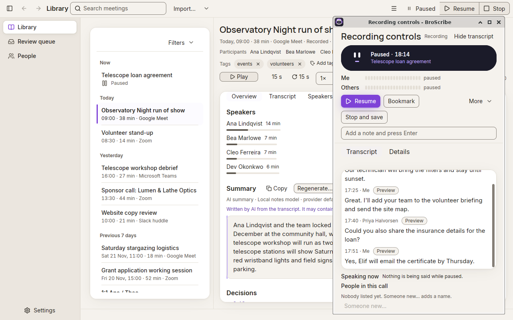
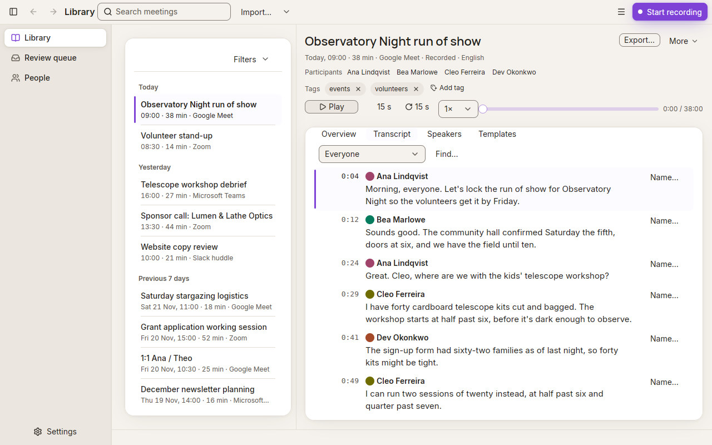

# BroScribe

**Your meetings, recorded, transcribed and searchable — on your own computer.**

BroScribe notices when a call starts and records it, or asks you first. Follow a
live transcript while people talk. After the call, you get a transcript
organized by speaker, and BroScribe can recognize voices you've named in earlier
meetings. Turn on an AI provider and ask for a summary, decisions and action
items. Search everything from the app, the command line or your AI assistant.
Transcription runs on your computer, and BroScribe never uploads your audio.

> **Status: early releases.** Download the
> [latest release](https://github.com/BroToolbox/BroScribe/releases/latest) for
> macOS, Windows or Linux; the [changelog](CHANGELOG.md) lists what each one
> brought. macOS is the most complete platform; Windows and Linux packages are
> published but not yet verified on real desktops. You can also
> [build it from source](#build-from-source).


## How it works

### 1. A call starts — BroScribe notices

Join a call in Teams, Zoom, Google Meet, Slack, Discord or Webex and BroScribe
sees it from the app using your microphone. Depending on what you choose for each
app, it starts recording right away, asks you first, or stays out of the way. By
default Teams, Zoom and Webex record automatically and Discord asks first; Meet
and Slack also ask unless BroScribe can read window titles (on macOS, the optional
Screen Recording permission; on Linux, X11 only). You can also start a recording yourself — for an
in-person meeting, for example — from the app, the menu bar or tray icon, or the
command line.

For an online call, BroScribe records two separate tracks: **you** (your
microphone) and **everyone else** (the computer's sound). If you use speakers
instead of headphones, it reduces their echo on your track before transcribing.

### 2. Follow along live



The recording controls show a provisional transcript a short delay behind the
conversation, and can suggest names for voices BroScribe already knows. Bookmark
a moment, type a note, pause and resume, change the title or tags, or switch the
language mid-meeting. On Windows and macOS 14 you can hide the controls from
screen sharing (not available on macOS 15 or later, or on Linux), and an optional
reminder helps you tell people they are being recorded.

### 3. The call ends — BroScribe saves and transcribes it



When BroScribe detects that a call has ended, you have 10 seconds to choose
**Keep recording** before it saves. By default, a recording you start yourself
continues until you stop it. BroScribe then transcribes the recording on your computer with local speech
models and works out who said what. In your first meetings speakers appear as
*Speaker 1*, *Speaker 2*: name a voice once and BroScribe suggests that person in
later meetings (or names them automatically once matching is calibrated), and
anything it is unsure about goes to a review queue where you can confirm or
correct it. Record your own voice during setup and BroScribe can recognize your
lines on your microphone track and show them under your name.

### 4. Summaries, decisions and search

Turn on an AI provider and ask for a summary of any meeting, with topics,
decisions and action items with owners and status (single imported files can be
summarized automatically). Tell it what summaries should focus on, or run
templates such as meeting notes, a follow-up e-mail or a BANT qualification.
It works with AI command-line tools you already have (such as Claude Code or
Codex) or any OpenAI-compatible server, including one running locally such as
Ollama or LM Studio. This is off until you turn it on.

Then find anything: search every transcript by words, speaker or tag, browse
people with their meetings and talking time, and export a meeting as Markdown,
text or JSON.

## Highlights

- **Private by design.** Recordings, transcripts and voice profiles are ordinary
  files on your computer. Transcription and speaker recognition run
  locally, and BroScribe never uploads your audio.
- **Learns the people you meet.** A people gallery with every person's meetings,
  talking time and voice samples. Group duplicate speakers, correct a line, forget
  a voice.
- **Knows your calendar.** Connect the calendars on your Mac to match
  recordings with event titles and attendees; BroScribe only reads the calendars
  you pick. Microsoft 365 and Google can also be connected with an OAuth
  application you register yourself; those sign-ins are not yet validated against
  real accounts.
- **Imports what you already have.** Drop in audio or video files, a whole folder,
  or a manifest with one track per participant.
- **Works with your AI tools.** A full command-line interface and an optional
  MCP server (off until you enable it) let assistants such as Claude Code or
  Codex search, read and update your meetings and control recording.
- **A native desktop app.** Built in Rust with GPUI for macOS, Windows and
  Linux, with light and dark themes, adjustable text size, support for the
  system's increased-contrast setting, labels for screen readers, a menu bar or
  tray icon and notifications.


*Screenshots: current development build on Linux (XFCE/X11) with invented data,
updated by CI when the interface changes on `main`.*

## Privacy

- Recordings, transcripts and voice profiles live in a library folder you choose
  (default `~/BroScribe`) and in BroScribe's own data and cache folders. Protect
  them with your system's disk encryption.
- You choose how long to keep audio: forever, deleted after a number of days, or
  deleted as soon as the transcript is done. Transcripts and notes stay.
- AI providers are **off by default** and need your consent one by one. An
  enabled summary provider receives transcript text, notes, bookmarks and your
  instructions. Once you enable a summary provider, single imported files are
  summarized automatically unless you turn that off in Settings; recorded
  meetings are summarized when you ask. An enabled search provider receives
  transcript excerpts and your search queries. Neither receives audio or voice
  data.
- MCP access is **off by default**. Once you enable it, connected AI tools can
  read and change your meetings, and depending on how a tool is set up, it may
  send meeting content to its provider. `broscribe agents install` is separate:
  it gives your AI command-line tools a BroScribe skill, so they can run the
  `broscribe` command on your meetings even while MCP is off.
- Calendar connections are optional and read only the calendars you select.
- Model downloads and update checks contact their hosts. BroScribe checks
  GitHub for signed updates by default (you can turn this off in Settings) and
  installs one only after you confirm.

The [security policy](SECURITY.md) describes the security model and how to
report a vulnerability.

## Platforms

| System | Status |
| --- | --- |
| macOS 14.2 or later, Apple silicon | Main supported build; signed and notarized disk image |
| Windows 11, x64 | ZIP, not yet Authenticode-signed; not yet verified on a real desktop |
| Linux x64 and arm64, glibc 2.39 or later | per-user tar.gz; not yet verified on a real desktop (reference: Ubuntu 24.04 with GNOME and PipeWire) |

Intel Macs are not supported. The [verification page](docs/acceptance.md)
shows what has been tested on each system so far.

## Install

Download the
[latest release](https://github.com/BroToolbox/BroScribe/releases/latest). On macOS,
open the disk image and drag BroScribe to Applications. On Linux, unpack the
tar.gz and run its per-user installer. On Windows, extract the ZIP into
`%LOCALAPPDATA%\Programs`; it is not yet Authenticode-signed, so SmartScreen
may warn. Later versions arrive through the in-app updater. The
[installation guide](docs/install.md) explains installing, upgrading and
removing BroScribe on each system.

### Build from source

You need Rust (through rustup; the repository pins the version), CMake and the
native prerequisites for your system. The
[installation guide](docs/install.md) has the prerequisites and build steps for
each platform, and [CONTRIBUTING.md](CONTRIBUTING.md) explains how to run the
tests. On first launch, a setup assistant walks you through recording permissions,
downloading the local speech models and recording your voice.

## Command line and AI tools

```sh
broscribe import ~/Recordings/planning.m4a   # add a recording
broscribe meetings                           # your most recent meetings
broscribe search "budget" --person "Iris"    # who said what, and when
broscribe mcp enable                         # let your AI tools use BroScribe
```

`broscribe --help` lists every command; add `--json` for machine-readable output.
On macOS, run
`/Applications/BroScribe.app/Contents/MacOS/broscribe agents install` once; it
links `broscribe` into `~/.local/bin` and adds the BroScribe skill for the AI
command-line tools it finds. The Linux installer creates the same link. On Windows, call `broscribe.exe` by its full path. The
[installation guide](docs/install.md#command-line-and-mcp) covers CLI and MCP
setup.

## Updates and uninstall

BroScribe downloads and installs signed updates only after you confirm, and keeps
the previous version so you can roll back until you confirm the new one works.
To remove it, run `broscribe uninstall --dry-run` to
preview the plan and `broscribe uninstall --yes` to apply it, or use
**Settings → Privacy → Uninstall BroScribe…**. It keeps your library and data
unless you choose to remove them.

Keep unrelated files outside the BroScribe installation folder: updates and
uninstall refuse to replace or remove a folder that holds anything unexpected.
The [installation guide](docs/install.md) explains where to put FFmpeg on
Windows.

## Documentation

| Document | What it covers |
| --- | --- |
| [Installation guide](docs/install.md) | Install, build, upgrade, remove, data locations, CLI and MCP |
| [Verification page](docs/acceptance.md) | What has been tested on each platform |
| [Design](docs/design.md) | Architecture and design decisions |
| [Security policy](SECURITY.md) | Security model, data flows and vulnerability reporting |
| [Changelog](CHANGELOG.md) | User-facing changes |
| [Release checklist](docs/release.md) | How releases are built and verified (maintainers) |

## Contributing

Issues and pull requests are welcome. Read [CONTRIBUTING.md](CONTRIBUTING.md)
first: it covers building, testing and the review process. Use invented names
and synthetic audio in issues and tests.

## License

BroScribe is licensed under the [Apache License 2.0](LICENSE). See
[NOTICE](NOTICE) for third-party notices.
