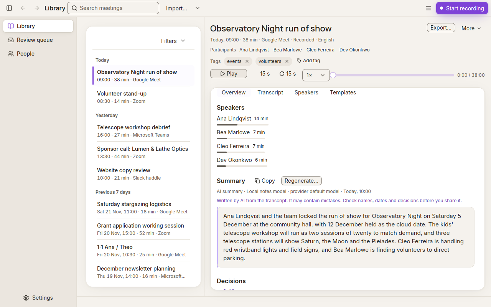
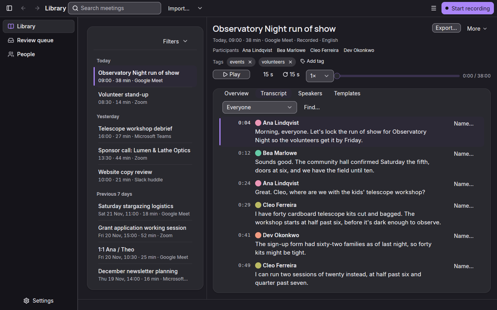

# BroScribe

BroScribe records your meetings and transcribes them on your computer. It helps
you see who said what, summarize the meeting and search past conversations — in
the desktop app, from the command line or through an AI assistant you connect.

> **Status: in development.** The first release is being prepared and there are
> no downloads yet. macOS is the most complete platform; Windows and Linux are
> implemented but not yet verified on real desktops. You can
> [build it from source](#build-from-source).

## Screenshots







*Current development build on Linux (XFCE/X11) with invented data.*

## What it does

- **Records meetings**, by hand or when it notices a call in Teams, Zoom, Meet,
  Slack, Discord or Webex, with a live side panel. By default, Teams, Zoom and
  Webex calls are recorded automatically and Discord asks first; Meet and Slack
  also ask unless BroScribe can read window titles (on macOS, the optional
  Screen Recording permission). You can set each app to ask, automatic or off.
  It also **imports** audio and video files.
- **Transcribes on your machine** with local speech models. BroScribe never
  uploads your audio.
- **Helps identify speakers.** Name a voice once and BroScribe suggests that
  person in later meetings (or names them automatically once matching is
  calibrated). Matches it is unsure about go to a review queue, and you can
  always correct them.
- **Creates optional summaries** with topics, decisions and action items, using
  an AI command-line tool you already have (such as Claude Code or Codex) or an
  OpenAI-compatible server, including one you run locally such as Ollama or
  LM Studio. This is off until you turn it on.
- **Searches your transcripts** across meetings by word, speaker or tag.
- **Works with your AI tools.** A CLI and an optional MCP server let assistants
  such as Claude Code or Codex search, read and update your meetings.

## Privacy

- Recordings, transcripts and voice profiles are ordinary files on your
  computer: in a library folder you choose (default `~/BroScribe`) and
  BroScribe's own data and cache folders. Protect them with your system's disk encryption.
- Transcription and speaker recognition run locally.
- AI providers are **off by default** and need your consent one by one. An
  enabled summary provider receives transcript text, notes, bookmarks and your
  instructions. Once you enable a summary provider, single imported files are
  summarized automatically unless you turn that off in Settings; recorded
  meetings are summarized when you ask. An enabled search provider receives
  transcript excerpts and your search queries. Neither receives audio or voice
  data.
- MCP access is **off by default**. Once you enable it, connected AI tools can
  read and change your meetings, and depending on how a tool is set up, it may
  send meeting content to its provider. `broscribe agents install` is separate:
  it gives your AI command-line tools a BroScribe skill, so they can run the
  `broscribe` command on your meetings even while MCP is off.
- Calendar connections are optional and read only the calendars you select.
- Model downloads and update checks contact their hosts. BroScribe checks
  GitHub for signed updates by default (you can turn this off in Settings) and
  installs one only after you confirm.

The [security policy](SECURITY.md) describes the security model and how to
report a vulnerability.

## Platforms

| System | Status |
| --- | --- |
| macOS 14.2 or later, Apple silicon | Main supported build; first release in preparation |
| Windows 11, x64 | Implemented; not yet verified on a real desktop |
| Linux x64 and arm64, glibc 2.39 or later | Implemented; not yet verified on a real desktop (reference: Ubuntu 24.04 with GNOME and PipeWire) |

Intel Macs are not supported. The [verification page](docs/acceptance.md)
shows what has been tested on each system so far.

## Install

There are no downloads yet. When the first release is published, it will be on
the [Releases page](https://github.com/BroToolbox/BroScribe/releases); on macOS,
open the disk image and drag BroScribe to Applications. The
[installation guide](docs/install.md) explains installing, upgrading and
removing BroScribe on each system.

### Build from source

You need Rust (through rustup; the repository pins the version), CMake and the
native prerequisites for your system. The
[installation guide](docs/install.md) has the prerequisites and build steps for
each platform, and [CONTRIBUTING.md](CONTRIBUTING.md) explains how to run the
tests.

## Command line and AI tools

```sh
broscribe import ~/Recordings/planning.m4a   # add a recording
broscribe meetings                           # your most recent meetings
broscribe search "budget" --person "Iris"    # who said what, and when
broscribe mcp enable                         # let your AI tools use BroScribe
```

`broscribe --help` lists every command. On macOS, run
`/Applications/BroScribe.app/Contents/MacOS/broscribe agents install` once; it
links `broscribe` into `~/.local/bin`. The Linux installer creates the same
link. On Windows, call `broscribe.exe` by its full path. The
[installation guide](docs/install.md#command-line-and-mcp) covers CLI and MCP
setup.

## Updates and uninstall

BroScribe downloads and installs updates only after you confirm. To remove it,
run `broscribe uninstall --dry-run` to preview the plan and `broscribe uninstall --yes`
to apply it, or use **Settings → Privacy → Uninstall BroScribe…**. It keeps
your library and data unless you choose to remove them.

Keep unrelated files outside the BroScribe installation folder: updates and
uninstall refuse to replace or remove a folder that holds anything unexpected.
The [installation guide](docs/install.md) explains where to put FFmpeg on
Windows.

## Documentation

| Document | What it covers |
| --- | --- |
| [Installation guide](docs/install.md) | Install, build, upgrade, remove, data locations, CLI and MCP |
| [Verification page](docs/acceptance.md) | What has been tested on each platform |
| [Design](docs/design.md) | Architecture and design decisions |
| [Security policy](SECURITY.md) | Security model, data flows and vulnerability reporting |
| [Changelog](CHANGELOG.md) | User-facing changes |
| [Release checklist](docs/release.md) | How releases are built and verified (maintainers) |

## Contributing

Issues and pull requests are welcome. Read [CONTRIBUTING.md](CONTRIBUTING.md)
first: it covers building, testing and the review process. Use invented names
and synthetic audio in issues and tests.

## License

BroScribe is licensed under the [Apache License 2.0](LICENSE). See
[NOTICE](NOTICE) for third-party notices.
