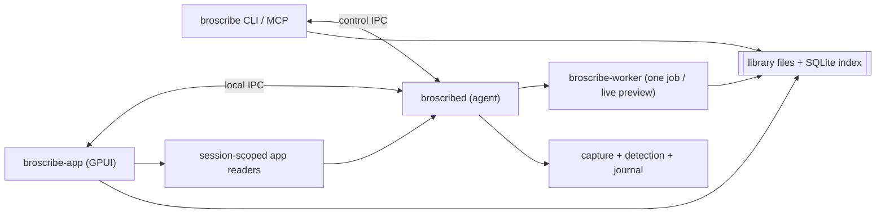
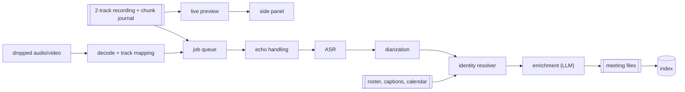

# BroScribe design

Status: draft v6 (2026-11-17). Licence: Apache-2.0.

BroScribe is a local-first meeting memory.
- It detects meetings and records them automatically, with a live side panel.
- It accepts any audio or video file you drop in.
- After each meeting it produces an accurate transcript where every line carries a real name, without assigning speakers by hand every time.
- A CLI and an MCP server let agents search meetings by subject, keywords, participants and tags.

The whole application is Rust with a GPUI interface. macOS on Apple silicon is the supported build; Windows and Linux platform implementations are present, with build and runtime acceptance still *verify* (§13–§14). What has been proven, item by item, is recorded in [acceptance.md](acceptance.md); installation, upgrade and removal are in [install.md](install.md).

## 1. Problem

Existing meeting recorders tend to fail in the same places:

- **Anonymous speakers.** Transcripts show "Speaker 1 … Speaker N". Naming only works when the meeting is linked to a calendar event, and only against that event's invitees. Calendar links often fail (unsupported calendar, Teams/Outlook meetings, ad-hoc calls), so users rename speakers in every meeting.
- **Over-segmentation.** One person is split into several speakers.
- **Mixed audio.** Microphone and system audio are summed before recognition, so the app loses the one thing it knows for sure: which side of the call a voice came from.
- **Closed data.** Transcripts are hard to reach from other tools and agents.

## 2. Principles

1. **Two tracks, never mixed before analysis.** The system track holds remote people. The mic track holds the user, plus speaker echo or people in the room.
2. **The transcript of record is produced after the meeting**, over the whole recording. The live view is a preview.
3. **Naming is a learning loop.** Match open-set against everyone the user has ever named; calendar and meeting app are hints. Corrections improve future meetings and can fix past ones.
4. **Files are the truth.** Markdown, JSON and audio on disk; SQLite is a rebuildable index.
5. **Nothing hard-coded.** Models and providers come from a registry and config, chosen by benchmarks on the user's own meetings.
6. **Agent-first.** Everything the UI can do, the CLI and MCP can do.
7. **Recording never depends on the UI or ML.** Capture survives a crash in either.
8. **Portable core, native edges.** Domain, pipeline, storage and UI are shared code. Operating-system access sits behind traits (§3).

## 3. Cross-platform architecture

### 3.1 Processes



- **`broscribed`** owns capture, detection, session journals, queue scheduling, integration maintenance and retention. On macOS it runs inside `BroScribe.app/Contents/Library/LoginItems/BroScribe Agent.app`, registered with `SMAppService.agent` using `BundleProgram`. The helper has its own permission descriptions, the same signing identity and hardened runtime as the app, and the audio-input and calendars entitlements; the app declares the same ones because macOS attributes the helper's permission requests to it (§10.0). Development LaunchAgent installation also targets this helper, never a bare binary. Recording survives closing or crashing the UI.
  - **Windows agent lifecycle.** The agent's pipe is keyed by the user's SID and the data folder, not by Windows session. An agent that outlived the SSH (network-logon, non-interactive) session that started it would keep serving that data folder for the later desktop session without tray or notifications, and possibly without Credential Manager or the microphone (*verify*). So it dies with the session that launched it, as on macOS (launchd GUI domain) and Linux (systemd user unit), and detached startup is unchanged: the desktop agent starts at logon from the per-user Run key or from the app, and `broscribe daemon start` from SSH or CI runs it only for that session's lifetime.
- **`broscribe-worker`** runs exactly one leased queue job and exits; the agent starts a separate process for each job. Interrupted jobs are reclaimed and retried with backoff. Failures and takeovers of a crashed holder's lease count attempts; plain claims don't (manifest batches claim each job once per phase). Taking over a stale or dead lease of a running job counts the crashed run; when that is its third attempt the job is marked `failed` ("worker crashed") instead of running again, so a job runs at most three times. Automatic retries (worker resume, recovery) keep the count; re-enqueueing the same kind and key (an explicit user retry or a new direct import) resets a failed job to `queued` with zero attempts and the new input. Live inference is a separate `broscribe-worker live <session-id>` process, never ML in the daemon. The idle daemon holds no models.
- **`broscribe-app`** owns GPUI's sole UI loop, menu-bar item, side panel, library, settings, Accessibility observations and notifications. Readers stream session evidence to the agent over IPC. One app instance runs per data directory (`<data_dir>/run/app.lock`): a second launch in accessory mode exits; a normal launch asks the running instance to show its window through the app's own single-instance channel. Windows taskbar launches use that channel for their chosen command. A failed handoff reports the running app. When the agent starts and `[app] open_at_login` is on (absent = on), it starts the app in accessory mode: the menu-bar item without a window. The agent itself is the login item, so an agent restart (update, crash recovery) also shows the menu-bar item again if the user had quit the app. Observed on the signed build (2026-11-15): opening `BroScribe.app` through LaunchServices (`open`) while the agent-started menu-bar instance ran showed the window in that same process, leaving one process; whether LaunchServices reactivated it or a second launch handed off via `app.show` was not distinguished. A Dock or Finder double-click — *verify*.
- **Offline maintenance (combined workspace/native acceptance *verify*).** `maintenance status|enable|disable --json` controls a non-expiring request at `<data_dir>/maintenance.request`, independently of config validity. Every new profile actor takes shared admission on the never-unlinked `maintenance.lock` before protected effects; offline mode changes require exclusive admission, no responding/ambiguous legacy endpoint and no pending replacement, install record, handoff or durable admission. Idle MCP servers and open clients must stop too. No force, implicit interruption or automatic resume: disable changes only the request, then a later explicit launch resumes normal operation.
  - A maintenance agent is a genuine control responder, chosen before config/library/native adapters, capture, models, recovery, retention, readers, integration refresh and accessory launch. It answers only `ping` and `daemon.stop`; all other calls, including status/subscription/install admission, return typed `maintenance`. Unscanned inventory is unassessed, never empty/idle/healthy. The GUI mounts only an informational control screen, not normal library/setup/settings views, and never starts the agent in this mode. CLI/MCP permit only proven local non-repairing reads; existing index-backed reads are denied because `Index::open_readonly` can migrate schemas.
  - Admission survives blocking runtime teardown, background library clones and independently executing workers/runners. Explicit data-directory overrides are made absolute and propagated per child with their override origin; the native-default cache stays native. Marker writes use mode 0600 and existing file/directory sync policy; post-change sync failure reports that the request may already have changed, without rollback. Power-loss directory durability on Windows/unsupported filesystems remains unclaimed. Legacy binaries, external writers and another data directory sharing the library are not fenced; a first quiet legacy installation still needs an explicitly authorized offline migration, not updater eligibility.
- **IPC** is versioned newline-delimited JSON with client-chosen request IDs, responses and bounded event subscriptions. An uncertain mutating response is reconciled through `request.status` using the same ID; it never triggers blind local fallback. Slow subscribers receive a `lagged` marker rather than blocking capture, and the agent then resends the subscription snapshot at once. No TCP, except OAuth loopback sign-in. The protocol is **version 8**: version 2 (2026-11-17) made every command on a recording name its session (below); version 3 replaced the boolean and free-text state with the typed states, admission calls and retry below; version 4 added the terminal `model_missing` worker problem and `RecordingState.reader_health`; version 5 added typed reader start refusals, the reader identity-registry cap and the Google account/selection generation pair; version 6 gives live and preview events their originating session; version 7 requires typed ping mode/readiness and reserves normal inventory for normal agents; version 8 adds `daemon.stop_if_idle` (an idle check and shutdown in one admission shared with recording and job starts), `daemon.stop_acquire` (a connection-bound hold that fences capture and worker starts on a relaunched agent while queued jobs stay on disk, so `broscribe daemon stop` unloads the login job without waiting for an empty queue; before its first probe the CLI also takes an OS-backed per-profile startup reservation, held through the unload, so an agent that launchd relaunches in between admits no capture or job, and a relaunched agent still in startup recovery gets a bounded wait instead of a failure. `daemon stop` stops the selected profile through its own endpoint and asks the login manager for its live process (`Autostart::login_job`: launchd's PID on macOS, the systemd user unit's `MainPID` on Linux; a one-shot registration such as the Windows Run entry is `Unsupported` and stays for the next logon). After the selected agent has exited, the CLI keeps the profile's startup reservation and lets the manager settle (polling within a 15 s budget, and starting no manager query that cannot finish inside it), because a KeepAlive relaunch for this profile cannot pass the reservation and exits on its own. It then unloads the job only when the job is idle and its loaded configuration serves this profile (a job for this profile spawned at that moment is fenced by the reservation), or its live PID is the agent that answered this profile's endpoint and holds the stop admission, checked again just before the unload. An idle job, or a live job without this profile's endpoint, configured for another profile stays loaded (`login_job_unloaded: false`). A job whose profile cannot be determined, or a manager that does not settle, fails with `login_job_unverified` and says whether the selected agent was already stopped, so stopping another profile never stops the login agent recording in the default one. The final observation and the unload run under a per-user login-registration lock (taken after the profile reservation; one path per user that other accounts cannot create first: `org.broscribe.login-registration.lock` in the system per-user folder on macOS, `/run/user/<uid>/broscribe-login-registration.lock` on Linux, and `/tmp/broscribe-<uid>/login-registration.lock` only on Linux systems without `/run/user/<uid>` (no logind, so no systemd user manager either)) that every registration change also takes (install, start, autostart toggle, uninstall, SMAppService and development LaunchAgent changes, the systemd unit), so another profile cannot repoint the shared job in between; waiting more than 15 s for it returns `busy`. A job's profile is read only from a direct `broscribed` program (its `--data-dir` or launchd/systemd environment), including the bundled SMAppService job, which launchd prints only as `program identifier = Contents/…/broscribed (mode: 2)`; a wrapper or any other program counts as unknown, never as the default profile. The system folders must be real folders owned by the user and not writable by others (BroScribe never changes them; a failed check is an error, never a fall back to `/tmp`); the Linux `/tmp` folder is tightened to 0700; and the lock file is opened without following symlinks and must be a regular file owned by the user (tightened to 0600). Every `launchctl` and `systemctl` call has a 10 s deadline: a timed-out query is unknown, a timed-out change is an error that releases the lock, and the next stop checks the job again. The settle loop starts no new query when less than that deadline remains; the unload that follows has its own 10 s deadline, so another profile waiting the usual 15 s for the lock can still get `busy` and retry. On Linux, `daemon status` reports an unknown or timed-out unit state as an error instead of `Stopped`. The Linux graphical-login entry bounds its `systemctl` calls with coreutils `timeout`. On Linux a unit systemd has unloaded is read from disk (`LoadUnit`). A restarted agent that answers `busy` is pinged again: the stop keeps waiting while it is still starting, retries the hold once if it has just become ready, and otherwise returns the agent's `busy`. A missing login manager (no systemd user manager, no launchd GUI domain) counts as no job. Success also requires the profile's agent instance claim (the locked `run/broscribed.pid` on macOS and Linux, the named-pipe claim on Windows) to be free, so an agent the CLI cannot reach (for example an older build on another socket path) yields `agent_unreachable`, never `running: false`. MCP `stop_daemon` follows the same rule. On macOS the socket for a data folder is chosen from its canonical path, so aliases of one folder reach one agent, and a folder whose socket path would be too long gets its own hashed fallback socket), and `record.resolve_journal`. Journals carry `meta.library_root`: one recorded for another library (`journal_library_mismatch`) waits until that library is open again, and one written before the field existed (`journal_library_unknown`) is adopted into the open library or discarded only by `broscribe record resolve-journal <adopt|discard> --session <id>` with `--dry-run` or `--yes` (discard removes only the journal; neither is an MCP tool). Recording controls, the tray and `doctor` say which case applies. Each step changed shapes older peers cannot read. A line of any other version is refused with `unsupported_version` on both sides (the CLI reports it as `helper_outdated`), so an older installed agent never runs a command from a newer client it cannot read, or the reverse. After an upgrade the app, CLI and agent must come from the same build (install.md).
  - macOS: `<data_dir>/run/broscribed.sock`; a path of 104 bytes or longer falls back to `broscribe/broscribed-<hash>.sock` in the user's system per-user folder (`confstr(_CS_DARWIN_USER_DIR)`, `/var/folders/…/0/`), never `/tmp`.
  - Linux: `$XDG_RUNTIME_DIR/broscribe/broscribed-<hash>.sock`, falling back to `/run/user/<uid>/broscribe/` when that folder is valid and only then `/tmp/broscribe-<uid>/` (systems without logind), where `<hash>` is the first 16 hex digits of the SHA-256 of the canonical data directory, so daemons for different data directories never share an endpoint. A per-endpoint lock is taken before a stale socket is removed. Unix directories are ownership-checked and 0700, sockets 0600; macOS authenticates with `getpeereid`, Linux with `SO_PEERCRED`.
  - Windows transport: named pipes with first-instance protection, current-user DACL, and peer SID checks before sending bytes. Isolated native-debug daemon/CLI status and graceful shutdown were observed. A debug build with tests is known good with one Cargo job only; current release, parallel-build stability and real runtime acceptance remain *verify* ([acceptance.md](acceptance.md)).
  - Methods: `ping`, `status`, `request.status`, `subscribe`, `daemon.stop`, `daemon.stop_if_idle`, `daemon.stop_acquire`; `record.start|stop|pause|resume|status|lang|bookmark|note|tag|title|title_refresh|discard|auto_stop|process_now|retry|resolve_journal`, `reader_events`, `reader.attach`, `reader.refused`, `record_participant`; `queue.kick`, `queue.enqueue`; `detect.status|reload`; `audio_check`, `capture_sample`, `capture_sample_stop`, `permissions_status`, `permissions_request`; `integrations.reload|sync`, `integrations.google_calendar_authority`; `meeting.tag`, `speaker.name`, `speaker.reject`, `person.forget`, `retention.apply`; `install.acquire|confirm|release`; `notification.action`; `app.show` (publishes `show_main_window` to subscribers and returns their count).
  - **Session-fenced recording commands.** `record.stop|pause|resume|process_now {session_id}`, `record.lang {session_id, language}`, `record.bookmark {session_id, label?}`, `record.note {session_id, text}` and `record.tag {session_id, tags}` run only while `session_id` is the active recording, checked under its session mutex; any other session, or none, is `stale_session` and changes nothing. The app and menu send the session they show. The CLI's `record stop|pause|resume|lang|bookmark|note|tag|process-now` take `--session <id>` (at most once; after `--` every value is literal) and otherwise resolve the active session through `record.status` before sending. Version 1 sent these without a session and is refused.
  - **Typed recording state (protocol 3).** `PreviewState` is one of `off`, `loading {model?, elapsed_ms}`, `ready {model}`, `restarting {reason, retry_in_ms}`, `unavailable {reason}`. `LiveIdentityState` is `{status, epoch}` with status `idle`, `disabled`, `loading {elapsed_ms}`, `ready`, `behind`, `restarting {reason}` or `unavailable {reason}`; live workers emit `{"type":"loading"}` lines while their models load. `RecordingState` carries `health` (per-track health, dropped frames, disk headroom) and `reader` (`unavailable`, `starting`, `reading`, `degraded` — silent or unusable call state — or `paused`). Capture problems arrive as the `capture_warning {session_id, warning}` event (`track_down`, `track_resumed`, `disk_low`, `preview_unavailable`); low disk warns before the protective stop. Each stopped recording is tagged by `phase`: `queued {ahead}`, `running {fraction}`, `retrying {attempts, retry_in_s, error}`, `failed {error}` or `discarding`. `record.retry {session_id, request_id}` restarts only a final job that failed for good (`not_retryable` otherwise); nothing retries one automatically. The agent's state also lists unrecoverable journals (`journal_issues`, kept untouched), the index state (`checking`, `current`, `pending {skipped}`, `failed {code}`) and any install hold.
  - **Agent identity/build (protocol 7).** `ping` requires `{pid, version, protocol, build, mode, readiness}`: mode is `normal` or `maintenance`; readiness is `normal_starting`, `normal_operational` or `maintenance_control_ready`. Missing/inconsistent fields, a zero PID and incompatible versions never prove normal operation or maintenance readiness. `build` remains `{build, target}` (monotonic build number and Rust target), read once through the installation's About reader, or null when unknown; `DaemonState` remains normal-only. A version or ping alone never proves updater eligibility: normal `Status`, new PID, expected build and durable install fence are still required.
  - **Protocol 4 additions.** `WorkerProblem::ModelMissing` (`model_missing`): a live worker whose model is not installed stops for good — `unavailable`, not a restart loop — until the model is installed. `RecordingState.reader_health` (optional) carries the diagnostics the current reader incarnation sent with its latest accepted batch: why the latest observation is incomplete, failed snapshots in a row, when the next retry may happen, the manual-accessibility state, and the web documents read or skipped. It is `null` before the incarnation's first batch, after a pause and whenever a new incarnation is issued, and it is never call evidence (§9).
  - **Protocol 5 additions.** `reader.refused {session_id, app_id, pid, reader_generation, refusal}` lets a reader host report that it could not start the incarnation it was told about, as one typed, content-free stage — `untrusted` (the platform reported this host's accessibility access as not trusted), `no_rule` (no reader rule for the app), `prepare` (the rule set could not be loaded), `attach` (`reader.attach` issued no incarnation as far as the host knows; reported for the generation it was told, never a guessed one) or `observe` (the issued incarnation could not begin observing). No error text is sent or parsed. The agent keeps it only while that is the session's current, unpaused incarnation of that reader and none of its batches has arrived; a new incarnation clears it. Another session is `stale_session`, another app or process `invalid_input`, anything else `stale_reader`; it is fenced by generation like reader batches and answers `{"retained":true}`. It shows as `ReaderStatus::Refused {refusal}`: diagnostics only, never call evidence — automatic stop falls back to the microphone release, and the agent still re-announces the incarnation. `IncompleteReason::IdentityCap` marks a snapshot whose reader's bounded window/document identity registry is full (§9). `integrations.google_calendar_authority` answers exactly `{"authority": {"generation", "selection_generation"} | null}` (§10).
  - **Protocol 6 additions (seen natively with synthetic data).** `LiveTranscript {session_id, segment}`, `LiveIdentity {session_id, identity}`, `PreviewGap {session_id, track, from_s, …}` and `Preview {session_id, preview}` carry the recording that produced them. Reason: a live supervisor of a stopped recording keeps running detached and can publish after the next recording started; without an origin, the CLI's `record live --follow` stamped such an event with the new session and the panel applied it to whatever it showed, so A's late transcript, identity or preview state could appear as B's. The session is fixed where the event is produced (the live run or identity tracker that owns it), carried unchanged through the bus and the wire, and every consumer — the follow stream and the panel — drops an event of another session before applying it; the preview state is owned under the active-session lock. B's own ASR-fallback lines and its identity `idle` are never dropped, and a new capture never waits for an old worker to stop. `DaemonState.preview` is unchanged; there are no defaults or aliases that would admit an event without a session.
  - **Install admission.** `install.acquire` returns a fence, persisted and always increasing (`run/install-admission.json`, mode 0600), and is refused while a recording is capturing, paused, in its stop grace, stopped but unsaved, or while the agent is still starting. While a fence is held every capture start is refused with `update_installing`. An unconfirmed admission ends with its connection; `install.confirm {fence}` makes it survive the connection and an agent restart until `install.release {fence}`. An unreadable admission record fails closed: the fences granted before are unknown and nothing (a clock, a fresh count) can prove a new fence larger than all of them, so the agent shows a durable admission with fence 0, refuses every capture start, and refuses every `install.acquire|confirm|release` — fence 0 included — with `update_admission_damaged`. It never rewrites the record; the hold lasts until the record is restored readable and the agent restarts. Other new codes: `busy` (captures wait until startup recovery finishes), `recording_active`, `update_admission_lost`.
  - **Startup and capture start.** Startup recovery runs once off the accept loop; one corrupt journal never stops the others and is kept untouched. The index is repaired under a library write before it is reported `current`. A capture start is admitted under the session lock, opens its devices without it, and is acknowledged only after a commit check; a shutdown, the meeting ending or capture stopping meanwhile cancels it and removes the opened journal. A worker killed by a planned shutdown spends no attempt.
  - `record.auto_stop {session_id, request_id, expected_generation, enabled, app_id?}` enables, disables or links automatic stop (§9) and returns the session's `AutoStopStatus {enabled, app, generation, reader_available, pending {reason, remaining_s}, candidates}`, also published as `recording.auto_stop`. The session and the binding `generation` are checked under the session mutex: a mismatch is `stale_session` / `stale_binding` and changes nothing; enabling without a binding, `app_id` that is not a current candidate, or `app_id` with `enabled = false` is `invalid_input`. An unchanged request changes nothing; any change bumps the generation and starts from fresh evidence. `StartReader` carries the `reader_generation` every reader batch must echo.
  - `record_participant {session_id, request_id, person_ref, action}` confirms or removes attendance in the active session; `record.title {session_id, request_id, title}` and `record.discard {session_id, request_id}` act on the active session or a stopped one not saved yet. Their outer request ID must equal `request_id`, so a retry is reconciled, never run twice. Another session is `stale_session` and changes nothing. `record.tag {session_id, tags}` answers `{session_id, tags, added, removed}` with the session's current `tags`; a leading `-` removes, so the app sends a literal `-x` as `+-x`. Tag changes are applied one at a time, journal and provisional meeting together, in the order the agent accepted them, and the panel keeps the newest snapshot over a late reply.
  - Attendance confirmation is not voice confirmation: a typed name nobody has creates a name-only person (no voiceprint, no enrollment); an ID never falls back to a name, an unknown e-mail is `not_found` and an ambiguous name `invalid_input`. The handler takes the library lock first and then the session mutex, checks the exact active session before creating anything, saves a new person before the journal can name it and holds the session (Stop waits) only for that short person-file and journal write. When the journal write fails after creating the person the answer is `{"status":"partial","person_id","created":true,"attendance":false}`; the person stays.
  - `record.title` writes the session's title sidecar (§7.1) and renames its provisional meeting under the library lock; once the final meeting is published it answers `already_published {meeting_id}` (rename the meeting instead). The shown title is always re-read from that sidecar under the session mutex, so concurrent edits show the newest; `record.title_refresh {session_id}` only re-reads it (after a rename through the shared core service) and edits nothing. `record.discard` answers `discarded` (cleanup `pending` in the background) or, once saved, `already_saved {meeting_id}` (delete the meeting instead). Discard also removes what a final attempt that failed before publishing left — the folder without `meeting.json` and the samples under the meeting ID its job recorded — proven by job, ID and session start minute; files a record job never writes stay.
  - `capture_sample {session, seconds, purpose}` is the helper-owned setup capture: `seconds` 0.1–120, `purpose` `enrollment`, `try_it` or `audio_check`. It returns a 16 kHz mono WAV, mode 0600, in a fresh 0700 folder `<cache_dir>/helper-capture/sample-<random><session-sha256>/`. The bounded hash makes every valid request ID filename-safe on Windows without exposing the ID in the path; stop/reclamation compare the full ownership key. Capture is refused (`busy`) during a recording, audio check or another sample. `capture_sample_stop {session, discard}` ends it early; `discard` returns `cancelled` and writes nothing, also when the stop arrives before the capture starts, and removes that session's finished sample if the requester never consumed it. The requester deletes the folder once it has read the sample; the helper reclaims an unconsumed sample 60 seconds after writing it. No requester survives a helper restart, so startup removes every `sample-*` folder; each retention run and each new capture remove `sample-*` folders older than 180 seconds (legacy names included), never the active capture's.
  - `permissions_status` reports `microphone` and `system_audio`; `permissions_request {permission}` asks for one of them under the helper's identity and is refused while capturing. On macOS no public API reports process-tap authorization, so `system_audio` status and request use the private TCC framework (`TCCAccessPreflight` / `TCCAccessRequest` for `kTCCServiceAudioCapture`), loaded at run time. If it or a symbol is missing, the status is `not_determined` and a request only starts and stops a tap to raise the prompt, never reporting a guessed grant — *verify* on each macOS release.
  - `integrations.sync {integration?}` forces a calendar sync of one or every active account (§10.3).
  - `integrations.system_calendar` carries status/connect/configure/disconnect for the macOS system-calendar connector; `integrations.system_calendar_authority` returns only the currently active generation for worker-side revocation fencing. The signed agent owns EventKit permission, never the UI or a CLI fallback.
  - `integrations.microsoft_calendar_authority {account: AccountRef}` is read-only and returns `{"authority": AccountAuthority|null}` with that exact account's generation, selection generation and usable selected targets. macOS and Linux workers ask the private helper before consuming remote priors and after inference; absent/mismatched authority supplies no prior. Windows still reports this recording-authority boundary unsupported; partial native runtime proof does not implement or validate it, and no unverified remote-prior fallback is used.
  - `status` and the `state` event carry `pending_notifications`, the authoritative prompt list (empty after dismissal), and `recording.observed_roster`, the union of the session's reader roster snapshots merged by e-mail or folded name. Roster entries are observations, never confirmations. `recording.participants` (confirmed person IDs) and `recording.tags` restore the panel on reconnect, as do `stopped` (stopped recordings not saved yet, each with its `phase`, rebuilt from the journals after an agent restart) and `saved` (the last five recordings saved during this agent run, with their meeting IDs).
- **Library writes stay in-process** in CLI, MCP and app callers through the shared `core::ops`, library lock and SQLite WAL; M4 does not require routing every library edit through the daemon. Session/control operations use IPC. Heavy work is persisted in `<library>/.queue/`, then `kick_queue` (`queue.kick` on the wire) wakes the agent; without an agent the app starts a `broscribe queue work` child, never ML on GPUI's loop.
- **Identity reevaluation** (`learning`, design §6.4 item 7): when confirmed voice evidence changes, the writing operation records a request in the same library write, before it changes the evidence: one coalescing `reidentify` job per speaker-embedding model, keyed by the model (input: request generation `requested`, last complete `processed`, `source_meetings` to do first, `requested_source` for the latest request even after its worklist is drained, `deferred` busy meetings, the pass checkpoint and the retained report; never `meeting_id` or embeddings). `ops::name_speaker` (every surface), `ops::forget_voice` / `forget_person` (every model the forgotten person's samples or speakers used, plus models that already have a job) and a confirmation-samples commit that actually changed a person's voiceprints request it; line-only corrections and the job's own automatic names never do. A request to a `queued` or `running` job only raises the generation and adds its source: the holder sees it at its next per-meeting write (`LeaseHandle::update_in` reads the stored input under the library and queue locks), so a worker's older copy never overwrites it. A `done` or `failed` job is queued again at the back. `learning::status` reads the job without locks (`broscribe identity status`, `queue status`).
- **Locking:** shared profile-mode admission precedes endpoint/config/library/queue locks; exclusive offline mode control takes no subordinate lock. One short `Library::write` transaction (`WriteTx`) holds the single-writer library lock, never a process lifetime, model call or child wait. A busy writer returns a stable "library busy" error; WAL lets readers continue. Queue leases have their own `.queue/.lock`, PID, token and heartbeat: renewed every 5 seconds, reclaimable after 15 seconds or process death, and committed only by the current token. In the agent the inner order is library → session mutex → stopped list; Stop takes only the session mutex and never the library lock while holding it, and capture callbacks and inference acquire none of these inner locks. Deleting a meeting or discarding a recording revokes its jobs (`failed` with a revoked token, no attempts left): the holder's heartbeat, commit and release find the lease lost, and the job folder is removed once its process has ended.
- **Capture isolation:** journaling is the only durable path. Preview consumes only journaled audio through a bounded drop-oldest feed; a stuck/crashed live worker produces preview-gap/unavailable events and restarts without stalling capture. Capture/journal threads request high priority; live and job workers request utility/background priority. Ordinary final jobs wait during capture; "process now" has the provisional boundary in §7.2.

### 3.2 Platform traits

| Trait | macOS (first) | Windows | Linux |
|---|---|---|---|
| `SystemAudioCapture` | Core Audio process tap (macOS 14.2+) | WASAPI process loopback | PipeWire monitor / per-app node |
| `MicCapture` | AUHAL (or `cpal`) | WASAPI (`cpal`) | PipeWire/ALSA (`cpal`) |
| `MicUsageMonitor` (who uses the mic) | Core Audio process objects | Audio session enumeration (`IAudioSessionManager2`) | PipeWire node metadata |
| `WindowInspector` | `CGWindowList` | `EnumWindows` | X11; Wayland returns unsupported and detection continues without titles (§9) |
| `AppUiReader` (meeting-app text) | Accessibility API (AX) | UI Automation | AT-SPI over D-Bus |
| `SecretStore` (one namespace per data folder) | Keychain service `org.broscribe.BroScribe`, or `org.broscribe.BroScribe.profile-<hash>` for another data folder | Credential Manager service `org.broscribe.BroScribe` (targets `<key>.org.broscribe.BroScribe`), or `org.broscribe.BroScribe.profile-<hash>` for another data folder; a secret larger than one 2,560-byte password is split into chunk entries behind a manifest, switched atomically, all under that service | Secret Service service `BroScribe`, or `BroScribe.profile-<hash>` for another data folder |
| `BrowserLauncher` | `NSWorkspace` | `ShellExecute` | `xdg-open` |
| `Autostart` (enable, start, stop) | `SMAppService` helper / development LaunchAgent | per-user Run key for the sibling `broscribed.exe`, a normal logon process (not a service) | XDG autostart + systemd user unit |
| `Notifier` (actionable, delivery state, withdraw) | `UNUserNotificationCenter` on GPUI's loop | WinRT toast + app shortcut/AUMID | freedesktop notifications |
| `StatusItem` | `NSStatusItem` | `Shell_NotifyIcon` | StatusNotifierItem |
| `MediaDecoder` | AVFoundation (`AVAssetReader`: each selected audio track decoded on its own to mono float PCM, timeline gaps filled, cancellable; track metadata it cannot read comes from symphonia; multi-track files with gapless info go to symphonia so no track is cut short), then symphonia, then optional ffmpeg (native tests pass on a test Mac) | Media Foundation, then symphonia, then ffmpeg (`ffmpeg.exe` next to the executable first, then absolute `PATH` entries) | symphonia, then ffmpeg |
| `AudioEncoder` | AVFoundation, enabled independent AAC tracks | ffmpeg fallback | ffmpeg fallback |
| `DeviceInfo` | Core Audio device properties | endpoint / CPAL properties | CPAL device properties; unknown facts stay unknown |
| `ProcessPriority` | thread/process QoS | thread/process priority | nice / scheduler permissions |
| `ResourceUsage` | process CPU and peak RSS | process counters | procfs / getrusage |

- Each trait has a fake implementation used in tests.
- Platform crates are selected with `cfg(target_os)` in one place: `broscribe-platform-native` re-exports the implementation for the current OS. Nothing else in the workspace knows which OS it runs on.
- **Secrets per data folder.** `NativePlatform::secret_store(data_dir)` keeps the base namespace above for the native default data folder (also when `BROSCRIBE_DATA_DIR` or `--data-dir` names that same folder) and uses `<base>.profile-<hash>` for any other, `<hash>` being the first 16 hex digits of the SHA-256 of the folder's identity. A second profile therefore never reads, replaces or deletes the default profile's provider keys and integration tokens, and the data-folder-scoped generation and pending-record fencing (§10) stays within one store. The identity is the folder's canonical path (`broscribe_platform::stable_path`, also used for the daemon endpoint: symlink aliases, `..` and a not-yet-created folder resolve alike), folded for case, separators and the verbatim prefix on Windows. Only `BROSCRIBE_DATA_DIR` / `--data-dir` select a profile: moving the native default itself (`HOME`, `XDG_DATA_HOME`, `APPDATA`) keeps the base namespace. Entries an override folder stored before this change stay under the base name, unused by that profile and never deleted.
- Traits added in M1–M3: `AudioPlayer` (playback), `LibraryWatcher` (file changes for the app) and `SystemInfo` (M3) in `broscribe-platform`; `ProcessProbe` (is a lease holder's process alive) in `broscribe-core`.
- Added for the desktop shell (`broscribe-platform::shell`, §4 *Windows*): `InstanceChannel` (the desktop app's own single-instance handoff; `NativePlatform::instance_channel`, `FakeInstanceChannel`), `AppActivation` (the activation policy, applied through GPUI; `FakeActivation`) and the `StatusIconPlace` value (`NativePlatform::status_icon_place`, `FakeStatusIconPlace`). `RecordingOverlay::present_new` takes an `OverlayPlacement`.
- `MediaDecoder::decode_track(path, track_index, sink)` addresses individual audio tracks; `MediaInfo` includes per-track index, channels, rate and optional language/title. Encoding verification, multi-source import, playback and reprocessing use this mapping.
- Native traits are wired for Windows and Linux, returning explicit unsupported errors for genuine OS limitations. Compilation/fake tests are distinct from hardware, GUI, accessibility, notification and credential-store runtime proof (§13–§14). Linux and Windows use the portable CPU baseline. Metal is always on for macOS and never elsewhere. Only the macOS inference consumers — the CLI and the worker — enable `broscribe-models/metal`, through macOS-only target dependencies. `broscribe-platform-native` no longer depends on `broscribe-models`, so the agent and the app link no ML runtime (principle 7); no binary has a `metal` feature of its own, and the Linux build rejects every `metal` feature in its tree except wgpu's own: GPUI's Linux renderer (`gpui-pre-wgpu`) enables `wgpu/metal` on every target, which reaches only `wgpu` and `wgpu-core` and builds nothing on Linux, since wgpu-core's Metal dependencies (`wgpu-core-deps-apple`) are Apple-only. A `metal` feature on `wgpu-hal` would compile MSL output and fails the Linux build check.
- Linux specifics:
  - System audio is recorded only through per-application PipeWire monitors; the default-sink monitor only supplies the graph clock and is never recorded. BroScribe's own processes and the players they start directly (`ffplay`) are always left out, as are the caller's excluded processes; deeper descendants (a browser opened for sign-in) count as other apps. Forwarding playback streams (the output side of loopback, filter-chain and similar modules: `node.link-group`, `node.virtual` or `stream.is-loopback`) are left out too, since the application streams they forward are recorded already; audio that never appears as an application playback stream (JACK clients, a filter-chain's own output) is therefore not recorded. A per-app monitor whose stream ended (its target left the graph; monitors use `node.dont-reconnect`) is drained and dropped; only a failed clock monitor, or a failed monitor whose target is still present, ends the capture. Sample positions come from sample counts: the sink stream counts its own samples and moves on by its ticks when it misses a cycle. PipeWire rebases each stream's ticks to its own start, so another stream joins the timeline through its first cycle's driver time (`pw_time.now`) relative to the latest clock packet, then follows its own ticks.
  - The systemd user unit is bound to the graphical session (`PartOf=` and `WantedBy=graphical-session.target`) and carries `BROSCRIBE_DATA_DIR`, `BROSCRIBE_LIBRARY` and the `XDG_*_HOME` folders set at install. The XDG autostart entry imports `DISPLAY`, `WAYLAND_DISPLAY`, `XDG_SESSION_TYPE` and `DBUS_SESSION_BUS_ADDRESS` into the user manager before starting the unit. Installs made before this change report autostart as disabled until reinstalled (`broscribe daemon install`).
  - A microphone user that is a browser or Electron helper (`--type=…`, Firefox `-contentproc`) is attributed to its first non-helper ancestor (`responsible_pid`), the process AT-SPI finds; Windows does the same by walking to the process owning the app's windows. Chromium's rewritten process title (one space-joined `cmdline` string) is read as well as a NUL-separated argv. AT-SPI snapshots and observer connection, app scanning and registration run off GPUI's loop. Only callback registration and dispatch stay on its loop; dropping an observation removes its callback without joining setup. A failed asynchronous observer supplies no evidence; the existing 1.5-second snapshot heartbeat continues.
  - **Capture clock.** Realtime callbacks (PipeWire monitors and the CPAL microphone) only fill preallocated single-producer rings; alignment, mixing and timestamps happen on the delivery worker. Every chunk carries `host_time`, the `Instant` of its first sample taken from the audio clock (`CLOCK_MONOTONIC`, PipeWire's graph time base, for system audio; CPAL's capture instant for the microphone), never from when the worker handled it, so holdback, delivery stalls and pause boundaries never move audio on the recording timeline. A stream's first packet, or one whose ticks went backwards, is placed through its graph cycle time; later packets follow their own ticks. Audio is never shifted later to avoid frames already delivered: such audio fails the capture instead. The installed systemd unit and its environment are written only at install; start and restart never rewrite them from the caller's environment. Notification delivery and withdrawal run off GPUI's loop and report their terminal delivery state, and the StatusNotifierItem registers again when the watcher restarts. Source only: real PipeWire, D-Bus and systemd behaviour — *verify*.
- Accelerated inference differs per OS: Metal, Core ML and MLX on macOS; CUDA, DirectML or Vulkan on Windows; CUDA, Vulkan or ROCm on Linux. The model registry records which platforms each model supports (§8).

### 3.3 Workspace

| Crate | Role |
|---|---|
| `broscribe-core` | domain types, library layout, index, identity resolver, retention policy |
| `broscribe-pipeline` | job graph: decode, echo handling, ASR, diarization, identity, enrichment |
| `broscribe-models` | registry and runtime adapters (§8) |
| `broscribe-platform` | the traits above |
| `broscribe-platform-{macos,windows,linux}` | implementations |
| `broscribe-platform-native` | picks the implementation for the current OS (`cfg(target_os)`); the binaries depend on it |
| `broscribe-platform-unix` | shared Unix IPC framing, private socket directories, instance locking and client reconciliation; OS crates supply peer credentials |
| `broscribe-ipc` | OS-free versioned control, event, request-ID and recording-job schemas |
| `broscribe-capture` | raw chunk journal, recovery, common timeline, capture isolation and verified finalization |
| `broscribe-dsp` | setup rules, audio check, alignment, sonora AEC3, residue gating and echo-duplicate decisions |
| `broscribe-detect` | meeting detection rules per meeting app |
| `broscribe-readers` | meeting-app UI readers (roster, captions, active speaker) |
| `broscribe-integrations` | macOS system-calendar and advanced Microsoft 365 / Google connectors (§10) |
| `broscribe-updates` | the signed updater (checks GitHub Releases by default): release envelope verification against pinned Ed25519 keys, staging, install journal, confirm/rollback/recover, release-key signing |
| `broscribe-update-runner` | binary started only by `broscribe update install`, from a copy outside the installation it replaces, to run the handoff and exit |
| `broscribed`, `broscribe-worker` | binaries |
| `broscribe-cli` | binary `broscribe`, including `broscribe mcp` |
| `broscribe-app` | the GPUI application |

## 4. User experience (all GPUI)

- **Main window navigation.** Library and People open side by side with their details at 47.5 rem and above. Review queue fills the content area. At 62.5 rem and above the sidebar can sit beside the content. Below 62.5 rem the toolbar opens it as an overlay, and below 47.5 rem the list and detail take turns. Back returns to the list with the row still selected. The sidebar's three sections form one Tab stop with arrow-key, Home and End navigation. F6 and Shift+F6 cycle the visible areas. Section changes, links and opening a single-pane detail add a history entry. Choosing another row in a split replaces the current entry, and each history stack holds up to 50 entries. Opening a meeting by ID selects it and clears any filters that hid it, with a Status line. Divider behavior, focus paths and text scaling on macOS, Linux and Windows remain *verify*.
- **Menus and shortcuts.** macOS has BroScribe, File, Edit, View, Go, Meeting, Recording, Window and Help menus. Windows and Linux use the toolbar's **Main menu** (F10). Both use the same command definitions, and the native menu, F10 menu, tooltips and Keyboard shortcuts dialog take their accelerators from the app keymap. Space and Shift+Left/Right for meeting playback stay in the GPUI key context, which gives text fields and speaker samples priority. The corresponding macOS Meeting menu items invoke playback without AppKit key equivalents. The native View and Go items follow sidebar visibility, full screen, history and the key window. File holds Import, Search Meetings, Export Meeting and Close. A currently available update is shown in navigation menus and the status menu while idle. The update pane owns checks and installation. Native menu layouts, accelerators and focus remain *verify*.
- **Status menu.** The menu-bar item and tray share one set of groups for recording, pending Record or Ignore prompts, main-window and Review queue navigation, Settings, About, updates and Quit. The recording caption includes the meeting title or app when known. Capture controls remain in place across idle, recording and paused states. Pause becomes Resume. Menu Pause, Resume, Stop and Bookmark bind to the agent's active session. Stop and save has no accelerator. Open BroScribe and Window › BroScribe restore the current main-window route. The status item and its clicks run on GPUI's foreground loop and change only when their displayed state changes.
- **Dock menu and jump list.** The menu offers Start recording while idle or Stop and save recording during an active or paused session. Show recording controls and Review queue stay available when the agent is disconnected. Changes to the displayed recording state rebuild the menu. macOS uses GPUI's Dock menu. Its native click dispatch with no key window remains *verify*. Windows uses the same command model and publishes tasks under its taskbar identity. Each link carries a stable command word through the app's single-instance channel and preserves explicit data and library folders. Recording commands reuse the active-session checks. Native Windows taskbar registration and task activation remain *verify*.
- **Menu bar presence.** In macOS General settings, Show BroScribe in the menu bar writes `[app] show_status_item`, on by default. Turning it off drops the status item and keeps the Dock icon through regular activation policy. The Dock can reopen the main window and its Settings. Recording state remains available in the main toolbar and Recording controls. A pending Record or Ignore ask temporarily brings the status item and its prompt badge back. CLI parity is `broscribe app status-item on|off|status --json`. Native status item and Dock appearance remain *verify*.
- **Tray and login.** On Windows, the main window shows a dismissible taskbar overflow tip after setup. The assistant's final step also explains the overflow and opens Taskbar settings. On Linux, when there is no StatusNotifierWatcher, the main window shows a dismissible note and General keeps the same guidance. The first main-window close on Windows or Linux posts a local “BroScribe is still running” notification. Clicking it restores the main window. If delivery is denied, the notice waits in Recording controls. The once-only claims live under `<data_dir>/state` and survive relaunches.
- **Login launch.** The agent adds `--at-login` when it starts the accessory at login. On Linux without a tray host, that launch restores the main window without taking focus. A first run can show the assistant without focus if setup has never been deferred or finished. Notification launches use `--accessory` alone and start without a main window. Native delivery, activation and the Windows taskbar settings destination remain *verify*.
- **Startup and maintenance.** Startup failures use a stage-specific heading, cause and recovery instructions. The affected path appears locally when known. Copy details includes the location type and fixed support text, keeping paths and raw error data out of the clipboard and log. Enter or Try again requests a restart with the original launch arguments. Escape or Quit BroScribe exits with failure. The primary action comes first within the trailing group on Windows and last elsewhere. The maintenance window shows its command on a separate monospace line and copies just the command. Native restart with the instance lock, window layout and accessibility remain *verify*.
- **Recording controls.** The fixed header holds the visor, separate **Me** and **Others** meters, the recording actions and the note field. The action row follows the order Pause or Resume, Bookmark, More, Stop and save. Stop and save is primary during capture and Resume is primary while paused. More holds Rename, Process now and Discard. The conditional Needs attention area follows the header and keeps the automatic-stop action, capture and agent warnings, Record or Ignore asks, other recording failures and consent in view. It can scroll independently when several notices arrive together. In the expanded panel the controls scroll when the header needs more than half the available height, leaving room for the tabs and selected page.
  - **Transcript and Details.** The selected tab fills the remaining space. Transcript has a virtual list and Details has its own scroll area. Both have scrollbars. The virtual list uses 260 px of overdraw. Details scrolls through Title, Language, Participants, Tags, Automatic stop, Capture and Other recordings. More › Rename opens Details and focuses Meeting title. An unsaved title marks the tab and keeps the window open. Each new session selects Transcript. The usual initial frame is 420×712 at Standard and its width follows Text size up to half the display width, with a 360×440 minimum. Native size, wrapping and focus across platforms are *verify*.
  - **Compact mode.** Hide transcript sits at the top of the controls and collapses the tabs and body. The controls and Needs attention area remain available. At shorter heights the compact panel scrolls. The panel sizes to those areas up to its previous expanded height and restores that height when switching back. Show transcript restores the previously selected tab and transcript follow position. Actions that need Details can expand the panel for the current window. Closing either layout leaves recording to the agent. The choice is stored as `[panel] compact` through `Config::update`, with `broscribe app panel-compact on|off|status --json`. Native resize, focus and wrapping are *verify* on macOS, Windows and Linux.
  - **Recording state.** The tabular elapsed timer follows Recording or Paused on the visor, and the app and saved title sit below. An unknown title is displayed as Untitled meeting. In automatic-stop grace the timer shows the seconds until saving and the attention area offers Keep recording. An idle visor offers Start recording and Open library, with no tabs. When capture ends, the most recent stopped or saved recording can show its phase in the visor, including reported progress, the retry countdown, Try again, or Open meeting and live names to review. If the connection drops the visor reads Not connected and gives the last known state and time. The controls are disabled and drafts are kept until the agent reconnects. The elapsed clock runs at 1 Hz while recording and only while the window is visible.
  - **Agent recovery.** Toolbar, Recording controls and status menu use the same messages and actions. Connecting lasts until the first stream result. An uninstalled agent opens the setup assistant at Recording access, a stopped one offers Start, and waiting for Login Items approval offers the system pane. An incompatible agent offers Reinstall and shows protocol details in About and Copy details. A start that times out offers Try again and Copy details. Reinstall uses the install and start commands without stopping an existing peer. Native registration, approval and reconnection are *verify*.
  - **Language picker:** session language, default from settings. Switching mid-meeting changes the live engine and stores a time-stamped language span that the final pass honours.
  - **Live transcript** (preview, §6.1). The list has one Tab stop. Arrow keys move the selection by stable row ID, Home and End select the first and last rows, and Page Up and Page Down scroll. End and **Show latest** resume following. The list holds its scroll position when the user reads earlier rows or is naming a line. Keyboard focus stays where the user put it. The selected or hovered turn offers the applicable actions, and assistive technology can find the actions on every visible turn. Return accepts a suggestion or opens **Name…**, N opens **Name…**, and Delete or Backspace clears a name. The same actions are available in the row menu. The dock below the list names one line and freezes its revision, epoch and evidence. Escape or Cancel returns focus to the list. If the row changes or leaves the preview, the dock closes without saving and the panel explains why. A refused decision (`stale_turn`, `stale_revision`, `stale_evidence`) refreshes the rows. A `partial_outcome` says when the person exists and the line still needs a name.
  - **Transcript rows and status.** `record.live` supplies snapshots after connect, lag or a new session, then `live_turn` upserts by `turn_id` in revision order. A short badge identifies Preview, Unresolved, Voice N, Suggested or Named by you. Evidence and qualifiers appear below the badge. Each row announces its complete name and uses Me or Others for its track. Track-only lines carry a Preview badge and gaps say the recording has the omitted part. Accepted notes and bookmarks appear at the agent's timestamp. Preview and speaker-analysis problems have separate status messages. The **About live names** popover and naming dock explain the immediate line name and what happens after saving. When enough final lines agree, BroScribe names the speaker and learns from clean voice samples. The saved recording links to names that need review. Native scrollbar behavior and screen-reader navigation are *verify*.
  - **Participants.** Details lists confirmed attendance and unconfirmed call observations or names given live. A confirmed row shows the name, an attended status and a separate Remove button. Confirm… opens the person picker with the name filled in. Add participant… opens it with an empty search. An existing person is chosen by ID. To create a person, explicitly select the final “Add ‘Name’ as a new person” option. Confirming someone records attendance. It does not teach BroScribe their voice. A partial outcome explains when a person was created and attendance still needs confirmation.
  - **Tags:** the session's current tags as chips with Remove; the field adds comma-separated tags literally (sent as `+tag`, so a typed `-x` adds `-x`).
  - **Notes and bookmarks.** Enter in the Note field sends a note. The Bookmark button and Add Bookmark command mark the current position and use any text in the field as the label. With Recording controls closed, the command adds an unlabelled bookmark. Accepted actions report the agent's timestamp beside the field. A note, tag or participant search draft keeps the controls open when capture ends. The stopped view shows the drafts with Clear drafts.
  - **Feedback:** every control has its own pending / done / failed line beside it (`Status`/`Alert`), kept until the next action on that control; meters and other events never clear it, and a control waiting for the agent ignores a second submit. Drafts clear only after the agent accepted them. Each request names its session: an answer for an older session never changes the drafts, roster or tags of a newer one, and a new session clears the previous one's drafts and statuses. Agent-level failures (stream, menu commands, notification actions) stay until a later command succeeds or the agent reconnects.
  - **Discard** opens an alert dialog with the warning first, followed by what goes, what stays and the irreversible action. Audio, the live transcript, draft transcripts and samples from that recording go. People confirmed as participants stay. Cancel is focused, sends nothing, and returns to More or the stopped row. Escape and the platform's secondary-click keyboard modifier with period cancel. The dialog targets the session it was opened for and closes if it is no longer discardable. A stopped row reveals its title editor when the person chooses Rename. Saved rows show Saved, live names to review when any remain, Open meeting and a quiet **Delete meeting**. An answer `already_saved` or `already_published` links that meeting the same way.
  - Closing the panel never stops capture. Me and Others show recording, paused, retrying or no access. Accessible meter names say sound or silent during capture, with −50 dBFS as the provisional threshold (*verify*). Meter values update in the dedicated LiveMeters entity at most 10 times per second. Disk headroom sits below the meters while healthy. Abnormal capture and disk conditions appear in Needs attention. BroScribe Agent checks permissions at admission, during capture health checks and when the app asks on activation. It uses a permission status read that never prompts. Denied permissions identify the affected track and offer the applicable system settings. The other track continues. Native grant detection and the system-audio settings destination are *verify*. Preview gaps and worker unavailability stay visible. Process now publishes a provisional revision (§7.2).
  - **Automatic stop** (§9, `recording.auto_stop`): a linked call has a **Save when the call ends** switch naming the app, and a line says whether it watches the call window and microphone or only the microphone. An unlinked recording says it stops only when the user stops it. A detected recording starts linked and on; an unbound (manual or in-person) one never stops from a guessed app: each freshly detected call is offered as "Stop when the <app> call ends", an explicit link. When the agent decides the call ended, an alert says why — "<app> shows the call has ended", "<app> released the microphone and no longer matches a call" or "<app> released the microphone (the call window could not confirm the end)" — and "saving in N s" over the fixed 10-second grace, counted down from the agent's last state (display only; the agent decides), with **Keep recording**. Turning the switch off has the same effect during grace. Turning it back on uses fresh evidence. Every change is sent with the shown binding generation and session: `stale_binding` / `stale_session` change nothing and are shown beside the control; an answer for an older session never touches a newer one. Automatic stop always saves; it never discards. An agent without `auto_stop` in its state shows "Automatic stop needs a newer BroScribe Agent." and offers no control.
  - **Overlay and focus** (`RecordingOverlay` in `broscribe-platform`):
    - macOS (`NonactivatingPanel`): the panel is GPUI's `PopUp`, an `NSPanel` created with the nonactivating style, hidden and unfocused. Before it is first shown the adapter, through the window's borrowed `raw-window-handle`, lowers it to `NSFloatingWindowLevel` (above ordinary apps, never above system prompts), keeps it when BroScribe is inactive (`hidesOnDeactivate = NO`) and on every Space including full-screen ones (`CanJoinAllSpaces | FullScreenAuxiliary`), and places its complete frame (title bar included) at the right edge of the visible area (outside the Dock and menu bar) of the screen under the pointer (else the main, else the primary screen), 16 points in and vertically centred, shrunk on smaller displays (`OverlayPlacement::RightEdge`). When the controls remember a frame for a present display (§4 *Windows*), GPUI creates the panel at that frame on that display instead and the adapter leaves it there, moving it back only when it no longer fits its screen (`OverlayPlacement::AsOpened`). An automatic presentation uses `orderFrontRegardless` and preserves keyboard focus. The Window menu’s **Show Recording Controls** command and ⌥⌘R call `makeKeyWindow` while BroScribe is active. The first focus target is a time-critical action when present, otherwise Pause or Resume, Start recording, or agent recovery. The menu-bar item and notifications present without making the panel key. Escape outside a draft, picker or dialog returns to the previous BroScribe window and leaves the controls open. ⌘W returns focus as it closes the panel. The panel only moves when a display change leaves it outside its screen. The key-window behavior is *verify*. The style is never changed after creation; the screen-change observer belongs to the panel and is removed with it. No polling and no continuous frames.
    - Windows (`DecoratedTopmost`): GPUI creates a decorated Floating window hidden and unfocused. The adapter uses `SetWindowPos(HWND_TOPMOST)` with `SWP_NOACTIVATE | SWP_NOMOVE | SWP_NOSIZE` and presents with `SW_SHOWNOACTIVATE`. Clicking the window or explicitly showing Recording controls gives it focus. The main and panel taskbar buttons describe their recording or paused glyph. A stopped or disconnected state clears the glyph. The adapter reapplies it when Explorer recreates the taskbar button. Native topmost, focus and taskbar behavior are *verify*.
    - Linux (`Standard`): GPUI opens a decorated floating window without focus. Details › Capture explains that other apps can cover the controls. With no remembered frame, the adapter places the controls to the right of the main window when its default frame would overlap and at least 360 points fit. X11 can raise the existing panel without focusing it. Wayland leaves the stacking of existing windows to the compositor. Native placement and stacking are *verify*.
    - Menu Start and Stop present the controls without taking focus. Pause and Resume leave the window in place. The first close during recording or pause posts a local **Still recording** notice with the platform's way back to the controls. Closing leaves the agent and capture running.
    - **Screen sharing.** The Details › Capture switch stores `[app] hide_controls_from_screen_sharing`, off by default. `app hide-controls-from-screen-sharing on|off|status --json` reads and updates the same preference. On Windows 10 version 2004 or later the adapter uses `WDA_EXCLUDEFROMCAPTURE`. On macOS versions before 15 it uses `NSWindow.sharingType`. Linux and macOS 15 or later show the unavailable state. The macOS decision is conservative pending native tests with ScreenCaptureKit. The switch reflects whether the last request applied. On failure its status explains the current visibility. Supported captures and screenshots are *verify* on native systems.
    - The shell holds the open panel only weakly: closing the window drops the panel with its native overlay state (observer) and subscriptions.
    - Native title bar and close button stay; the panel can be dragged and cannot be minimized. Where a Linux compositor leaves decorations to the app (§4.3 *Window title bar*), BroScribe draws the panel's bar itself: the 34 px row other windows get, with the title as a named heading, which moves the window when dragged, and one Close button ("Close recording controls"). It has no minimize and no maximize, a double click does not zoom the panel and a right click opens no window menu, which would offer both. Close only removes the window; it never stops capture. The button is no tab stop, as a native title bar's is not (Close Window has its own key), so the row takes no focus when the panel opens.
    - **Overlay failure.** If the adapter cannot configure a new overlay, BroScribe closes the hidden window and opens decorated Floating controls without focus. The window and a durable **Recording controls can't stay on top** notice explain the failure. If raising an existing overlay fails, it stays where it is and shows the same warning. Recording continues in the agent.
- **Library.** The toolbar holds meeting search and Import…. The list header holds Filters and the count for filtered or text results. The Filters popover applies Person, Tag, App, Source and Date immediately. It lists people and tags from the index and shows app names from the detector registry. Removable tokens name the active filters. Date presets and custom inclusive ranges use local calendar days. Rows show title, processing or speaker-review state, date, duration, participant count and app or import source. Results without text group by period and month. Rows and headers use a variable-height virtual list and follow Reading size. One keyboard stop owns row selection. The selected row is the accessible active descendant, with position counted across meeting rows only. Paging starts near the end of the list or on Down after the last row. A first read can show six static placeholders after 300 ms. A watcher refresh retains the presented results and selected meeting. Window activation re-reads the Library if its watcher could not start.
- **Library search and recording.** Text search debounces for 250 ms and groups title, people and tag hits ahead of transcript-only hits. Each meeting appears once. A transcript hit shows the matching speaker, time and emphasized words, and opens the Transcript tab at that segment without starting playback. The child receives the query and person on stdin. Empty Library offers Start recording when the agent is available and Import recordings…. No-results copy names the query and active filters. A missing or incompatible index has its own repair action. A refresh failure leaves the current query's meetings visible. Right-click and the Windows and Linux row-menu keys open the same contextual commands. Delete uses the meeting confirmation. The Now section shows the agent's current recording or latest pending recording that stopped unexpectedly. It uses journal-backed session state and takes the place of that session's published draft while present. It has no timer. Opening it shows Recording controls. Native keyboard, screen-reader and menu checks remain *verify*.
  - **Meeting header.** The local date, time and length share a facts line with the detected app display name when available, source, audio state and meeting languages. The detected transcript language gets its own caption when known. An unavailable recording's facts distinguish No recording, Audio deleted and Recording missing. A missing recording names the expected file, offers to reveal its folder when present, and rechecks the file and its hash. More holds Rename, Copy transcript, the platform reveal command when audio is available, and Delete meeting with its confirmation. Participants wrap with effective tags and links open the selected person through navigation history. The list starts with six names or three in a narrow detail, with a control to expand it. Below 40 rem of actual detail width, Export… moves into More and the transport shows elapsed time and hides the skip buttons.
  - **Transport and processing.** Play, Pause and Cancel have a fixed-width control in the header on each tab with audio. Shift+Left and Shift+Right seek 15 seconds. Space plays or pauses the meeting in the transcript and leaves the speaker sample and focused buttons to their own controls. The clock previews the scrub target immediately. The shared player polls at 4 Hz while playing and the meeting redraws as the visible second or playing line changes. Cancel while preparing audio clears its pending start and leaves the cache job running. Errors offer a retry beside playback. Transcript and Overview show the meeting's processing phase, queue position or reported percent when available, and can queue a fresh transcription after failure when the recording is present. A load failure offers Try again and Back to Library. The native transport, responsive header, and recovery actions are *verify*.
  - **Saved transcript.** A variable-height list measures turns at the current reading size and lays out visible rows plus overdraw. The list holds one Tab stop. Arrow, Home, End and Page keys move the focused row, which stays in the focus tree when scrolled away. Each named list item carries its speaker, spoken position and words. The displayed clock uses a fixed monospace column. Click and Return play from the line. Playback follows the current line until the user scrolls or moves to read another row. Follow pauses while naming or while the find field holds focus. **Back to current line** reveals and focuses the playing line. A Library search result opens the exact segment and leaves playback idle.
  - **Find and line actions.** Find in This View opens Transcript and focuses the find field. Case- and accent-insensitive literal matches search both the spoken words and speaker names after 150 ms. Return and Shift+Return wrap through matches, and Escape clears the bar and gives focus to the current match. The row menu opens by secondary click or by Shift+F10 and Menu on Windows and Linux. **Name…** appears on hover, focus or the playing line. N and the row menu open the anchored picker as well. It offers the shared radio choices *Every line of Speaker N* and *Only this line* where the line has a speaker, and gives focus back to the line on dismissal. A refused write stays beside the picker. A corrected line keeps its separate marker and can restore its speaker's name from the popup or line menu. Edit › Copy copies the focused line. More › Copy transcript uses the plain-text export's transcript lines. Native scrolling, screen readers, find and keyboard checks are *verify*.
  - **Meeting tabs and Overview.** Overview, Transcript, Speakers and Templates use the underlined GPUI TabBar. The selected tab names its panel. The Speakers label includes the count of shown speakers who still need a name. Overview starts with Needs review and Speakers when present, followed by Summary, Decisions, Action items, Topics, and Bookmarks and notes. Sections appear when there is content. Summary is always present. The first tab on a new visit is Overview when there is a summary, review work or a bookmark or note. Otherwise it is Transcript. The app remembers the last 20 meetings’ tabs, transcript and Overview scroll, and playback positions in memory. Returning never starts playback.
  - **Notes and review.** Saved bookmarks and notes appear in recording-time order in Overview and in the virtual transcript list before the next line. They share its roving focus, and Enter or click plays from the marker when audio is available. Ticks on the transport mark those positions. Review notes appear in Needs review as notes, with a status announcement when a reload finds new ones. Names given while recording show their reason and explicit review actions. Show lines opens Transcript, reveals and focuses the first affected line. Each affected line also exposes the pending name and both review choices. Native tabs, keyboard navigation and screen-reader checks remain *verify*.
  - **Speakers.** Rows run from most to least speaking time. The count line says how many need a decision. The title holds the speaker name and naming badge. Suggestions and unnamed speakers get an attention badge. Automatic and confirmed names get neutral badges. Dismissed speakers show Restore. A caption holds speech duration, any voice score, and grouping facts such as “includes Speaker 9 · merged automatically · voice 0.93”. The list retains selection by speaker ID. Only the selected row contributes controls to Tab order and gives its first decision primary styling. Up and Down move selection. Return accepts the proposal, opens Name… or restores the dismissed row. R rejects, N opens the person picker, D dismisses from review, Space plays or stops the sample, and Left and Right step between clips. More, right-click and the Windows and Linux row-menu keys share the same fenced commands, including Merge into and Unmerge. A rejected person is named in the row's result and is no longer offered to that speaker.
  - **Voices without a transcript.** Completed unresolved speakers with neither transcript segments nor a playable sample appear in a disclosure that's closed by default. They stay out of the naming count and Overview speaker recap. A speaker with transcript segments but no playable sample gets Go to transcript, which reveals the first corresponding line, and an explanation of the audio state. Positive speech durations under a second display as `<1 s`. Native disclosure, navigation and sample playback checks remain *verify*.
  - **Voice samples.** Play and the Previous and Next controls for a speaker with multiple clips appear together from the first render, with the clip position beside them. The line being played and any pending or failed playback status appear on that speaker's row. One message explains a recording that is absent, deleted or missing. The clips (`ops::sample_clips`, shared with the review queue and `speakers samples`) come from the shown speaker's lines, including grouped members, with line corrections to another person excluded. Each clip is at most 15 s. Lines that overlap other shown speakers by more than 30% of the cut clip are excluded when cleaner clips remain. The five longest clips rank first, with earlier clips winning ties. A speaker with no transcript segments can play the saved clean time ranges used to build its voice centroid, including grouped members, when the recording is available. These clips are bounded by the recording timeline and carry empty sample text. Starting either sample or meeting playback stops the other.
  - **Possible duplicates.** The decision block appears before the rows, states what a merge changes, and names the speaker expected to be kept. Pairs between the calibrated `merge` and `auto_merge` read “Speaker 9 may be the same person as Speaker 2 · voice 0.86”. Grouping preserves the underlying speakers, transcript and voice samples (§6.4 *Speaker grouping*). Speakers tab keyboard, screen-reader and sample playback checks remain *verify*.
  - **Overview AI results.** The Summary heading gives access to Copy and Regenerate…. With no summary and a usable provider, Generate summary runs with the visible default and Options… opens the same form. Generation opens a popover or, below 30 rem of Overview width, a dialog. Its Provider and Model selects prefer the current result's usable provider and listed requested model, then the last submitted choice in the app session, then the first usable provider. The full named provider catalog is shared for the current configuration. Local and Cloud destinations are identified beside the picker. A CLI's own service or an unknown destination is described in words. The caption names transcript text, notes and instructions as inputs and says speaker names, audio and voice data stay on this computer. Consent is given in Settings.
    - The credit reads “AI summary · <provider> · <model> · <local date and time>”. A known disabled provider keeps its display name. The model is the provider's reported model, the requested model marked “(requested)”, or “provider default model”. The AI caption asks the reader to check the result before sharing. An out-of-date status sits under the credit. Copy places the timestamped Markdown export of Summary, Decisions and Action items on the clipboard. Summary uses the same selectable Markdown blocks as Templates, within a 42 rem reading measure. Decisions name their author where known. Decision and action time links open the transcript with the matching line selected and focused.
    - Speakers show talk time and share before the AI results. Action items use a Done checkbox, Action, Owner, Due and Said at columns, and a list below 40 rem. Owner and Due can be sorted in either direction. The row marks actions absent from the latest summary and those overdue in words. Action edits use meeting history. Regeneration keeps the action statuses the user set. Topics follow Action items when present. Native rendering, keyboard and screen readers are *verify*.
    - **Feedback while generating:** while the meeting's job exists the panel says "Queued · N jobs ahead" (claimable jobs before it in the scheduler's `(created_at, id)` order, `Queue::jobs_ahead`) or "Generating with <provider> · <model or provider default> · 1:23", the time counted from the job's `updated_at` (set when it is claimed or restarted, never by heartbeats). One 1 Hz timer runs only while such a job is shown; Generate is disabled and reads "Generating…", with "Long meetings can take several minutes. You can leave this meeting; you will be notified." Completion or failure posts a local notification ("Summary ready — <title>", "Summary failed — <title>: <reason>") unless that meeting's view is visible in the focused window. The jobs footer and `queue status` show labels ("Generating summary", "Running <template name>", "Refreshing search") instead of job kinds (`queue::kind_label`).
    - **Run binding.** `AppState::submit_generation` reserves a per-run token before it starts the CLI and requires the queued answer's receipt `{job_id, baseline}`, where `baseline` is the stored result's `created_at` read in the enqueue's own library write (null when none), so the app makes no separate read of the meeting before enqueueing. The watcher settles a run only against its own receipt: a completion or poll for an earlier enqueue, including one that reused the same job ID, is ignored, and a run whose job event was lost is settled from the meeting files instead of staying "Generating".
    - **Instructions:** an "Instructions" disclosure, prefilled with the saved `[enrichment] instructions` (§8.4), edits them for one run, with "Save as default". The credit line says "custom instructions" when the stored summary used some, with the text in its tooltip and a selectable popover.
  - **Templates.** Each built-in or user template has a row with its description and a named disclosure. Its header shows Not run, Queued, Generating…, Ready with the local date, or Out of date. Templates in the automatic list also say Runs automatically. A stored result starts expanded and uses the shared selectable Markdown blocks with one named node per block and names filled in through the result's own line attribution. The AI credit and check-before-sharing caption precede the result. If it is out of date, an unfilled line explains which changes can make it stale.
    - Run… and Run again… open the same Provider and Model options as Summary. Extra instructions apply to that run, survive collapsing and go to the CLI on stdin. Both instructions disclosures use a chevron, a character count that becomes a Status at 3,600 of 4,000 characters, and examples that append to the draft. The provider caption names the destination and the text sent. Consent stays in AI providers settings. The tab shows one link to those settings when no enabled, consented provider is usable. Edit templates opens Templates settings.
    - A result whose definition was deleted keeps its stored name, with a Template deleted badge and a disabled Run… that explains why. Copy and Export… stay with the result, with feedback beside their controls. Export uses the meeting export destination and mode-0600 writer. It shows the saved filename and gives the full path to assistive technology. Job feedback stays with its row, and its elapsed timer runs only while the Templates tab is visible. Native layout, screen reader, keyboard and export checks remain *verify*.
  - **Meeting edits.** More › Rename, a double-click on the title, and F2 on Windows and Linux open the title field. Return or Save writes through `title <id> --stdin`. Escape cancels and the title receives focus again. A title refusal keeps the draft. Add tag opens a prefix-matching field for library tags and accepts comma-separated entries. A tag write clears only the draft it saved. A removed chip hands focus to the next chip or Add tag. Writes are serialized and report beside the affected control through Pending, Done and Failed status lines. Other controls remain available and report a local wait instruction if they attempt a competing write. Undo and Redo replay reversible meeting edits against the value the last write left. Undo Rename restores the previous displayed title as a user title. Delete is irreversible. Speaker confirmation has its own voice-learning lifecycle. The inline Can't tell Undo lasts until the next edit, leaving the meeting, or nine minutes.
  - **Delete meeting.** The shared alert dialog focuses Cancel and runs `delete <id> --dry-run`. It lists What goes, What changes and What stays. A moved original gets an only-copy warning. Check again repeats the dry run after a library, job or import refusal. A recording still in progress links to Recording controls and Discard. Only **Delete meeting** issues `delete <id> --yes`. The Library reports the deletion and any pending file cleanup, and gives focus to the next available meeting.
  - **Export…** The modal opens with focus on its first available section. It offers sections (Transcript, Summary, Decisions, Action items and each template result), timestamps and Markdown, plain text or JSON. Available sections start checked, unavailable ones are disabled, and stale ones carry a marker. The native save dialog starts in the last successful export folder, otherwise in the platform Documents folder or an existing folder outside the library. The destination goes to the CLI on stdin and is written atomically with mode 0600. On success, the modal closes, focuses its opener and shows the filename and a platform reveal command. Export failures stay in the modal. Export uses Status, Action, Owner, Due and At columns. Native picker, reveal, keyboard and screen-reader checks remain *verify*.
- **People:** each person with aliases, emails, voice samples (playable while the audio still exists), meetings, and forget-voice / forget-person.
  - **Recheck identifications.** The person's detail shows the result of checking their confirmed names and can run the check again. Review › Identify surfaces possible mismatches across the library, with two voice samples when playable. Open the meeting's Speakers tab to correct the name, or choose Keep identification after listening. Native layout, playback and accessibility checks remain *verify*.
  - **People list and detail.** The list has a count and a search by name, other names or email. It pins the user first and keeps one tab stop for people, with arrows, Home, End and buffered name-prefix selection. The detail shows the selected person's avatar and summary during loading, and its first ten meetings open by their stable IDs. The Library link opens all results with that person filter. Back returns to the person.
  - **Editing and directory.** Edit opens a form with person-specific revision checks. Choosing someone else with a dirty draft asks first and focuses Keep editing. One-line fields submit on Return and Notes submits on the platform's primary modifier with Return. The edit Undo uses the same shortcut as other edits and expires after ten seconds, at the next edit or selection, or on leaving People. The saved status clears with its Undo timer. Work directory search requires an explicit Search or Return. The photo chooser uses a specific account and leaves Get photo disabled before a choice. Existing person and account generation checks fence late replies.
  - **Voice and forget.** A pending playback-cache request starts its sample when the recording is ready. Stop or another sample cancels that start. The separate Forget section uses the shared Cancel-focused dialog. Forget voice returns focus to its control. Forget person focuses the People list and selects the next visible person or the previous one at the end. Self confirmations explain how forgetting affects Me, and the result offers Record your voice at the Your voice step. People shows the durable speaker recheck result with meeting links and Dismiss. When several models were affected, the displayed status follows the active model's request if present, or the first affected model otherwise. Native People layout, keyboard, screen-reader and forget checks remain *verify*.
  - **Undo policy.** Edits to a person's name, aliases, e-mails and notes get a short Undo that restores the exact previous values, and only if nothing changed them since. Forget-voice and forget-person have **no Undo**: they delete voiceprints, enrollment audio and speaker centroids in one library write and record a tombstone, so an "undo" could only re-create evidence BroScribe no longer has, or silently re-enroll a voice the user asked it to forget. They are confirmed before they run instead ("Forget Ana Example's voice? Voice samples and the voice reading are deleted; meetings keep their transcripts. This can't be undone."), and a voice comes back only from new confirmed samples. Recording, replay and re-resolution started before a forget never restore what it removed (§9 caption rules).
- **Review queue.** Identify, Dismissed and Possible duplicates tabs give their counts. Identify groups compatible pending voices across the library, ordered by distinct meetings and then by total speaking time. Trusted automatic names leave the queue and unresolved speakers and identity placeholders remain. The queue’s header gives the count, followed by decision feedback and the durable recheck, then one scroll area. Names from recordings and Voices without a transcript follow the waiting rows. The latter is closed by default. First load and failed reads have their own feedback, and previous rows stay visible during a refresh.
  - **Identification in bulk.** Choosing a name for a matching group opens a preview with the speaker, meeting and playable sample where available. Compatible occurrences are selected by default and can be unchecked. A single confirmation saves the name across the checked meetings. Existing confirmations and explicit rejections fence the batch. The group requires similarity between every pair with usable embeddings from the same active model. Similarity must reach 0.90 or the configured `auto_name` threshold when higher. This floor controls what is offered for review and still needs validation against cross-meeting audio (*verify*). Voices without enough evidence remain individually reviewable.
  - **Possible duplicates.** A pair of profiles is compared using its confirmed voice samples from the active model. Pairs sort by raw similarity, then by the number of distinct attributed meetings. Play either side, open its profile, or choose the profile to keep. Confirming transfers meeting references, notes, aliases, emails and voice samples to that profile. “Different people” persists in the library. An interrupted merge offers Resume merge and rebuilds rendered/indexed references from the canonical files.
  - **Rows and keys.** The row starts with the speaker and a link to the meeting. Back returns to the selected row. The proposal badge and voice similarity sit above the transcript quotes. Sample controls lead Accept, Reject, Name… and Can't tell. The selected row has one prominent Accept when a proposal exists. The listbox holds focus and announces its active row. Enter accepts a proposal or opens Name…, R rejects, N opens Name…, D dismisses, Space plays or stops, and Left and Right step through clips. Up and Down move one row, Home and End move to the ends, and Page Up and Page Down move by a viewport or at least five rows. The selected row shows the shortcuts on its buttons. Right-click opens row commands for Waiting, Dismissed and People. Windows and Linux also open them on Shift+F10 or the Menu key. An unreadable meeting offers Try again and disables its decision controls. While writing, the initiating row shows its pending action and the header keeps the counts.
  - **Identity history.** Undo and Redo in Review replay the current app session's recent identifications, profile merges and Different people decisions. Speakers in a meeting uses the meeting's history for naming, merging, unmerging and separating speakers. The usual Undo and Redo shortcuts apply in both views. Replay checks the stored identity fields under the writer lock, preserves independent meeting edits, and refuses a decision that conflicts with later changes or a forget. Undo removes voice evidence learned by the decision and requests a new identity check. A newly created name stays in People after Undo. The history lives in memory. Restarting the app or resuming a profile merge that was already partially saved loses the original undo state. Native focus and screen-reader checks remain *verify*.
  - **Dismissal and Undo.** Can't tell dismisses the speaker with no identity effect (§6.4). Undo is available from the message, the primary modifier with Z, and Edit › Undo Can’t Tell while the queue list has focus. The offer lasts up to nine minutes or until the next decision, Restore or leaving Review. Undo returns to Waiting and selects the restored speaker if it still needs review. The Dismissed tab reads every dismissal from meeting files, including speakers named automatically since then. Its rows link to the meeting and play the same samples when audio is available. Restore stays in Dismissed. The picker in Review and Speakers searches name, alias and email and chooses an existing person by stable ID. Native layout, keyboard, accessibility and Edit menu checks remain *verify*.
  - **Speaker recheck after naming:** naming or accepting (queue, Speakers, Transcript) saves that speaker at once and says only that ("Speaker 1 in “Weekly sync”: name saved as Ana Example. Checking other speakers, this meeting first."); it never names anyone else itself and does not wait for a library scan. Core queues one `reidentify` job per embedding model (§6.4), run by the agent's scheduler (or the app's `queue work` child when no agent runs), the meeting named in first. A recheck that only waits for busy meetings goes back to the queue with a `not_before` time; the agent's scheduler takes it then, and without an agent the app keeps one timer for the earliest such time that starts its `queue work` child again (never sooner than a second apart, cancelled when nothing waits, while the child runs or once the agent owns the queue). A status block under the message (the queue) and in that meeting's Speakers tab follows the job, not the click: "Checking other speakers…" with the worker's own counts text while it runs, then the committed result, the meeting named in first ("Weekly sync: 1 named automatically.", "Other meetings: 2 named automatically, 1 replaced, 1 returned to review, 1 suggestion."), meetings waiting while another job works on them, meetings that could not be read (they keep their speakers), and links to the changed meetings (eight at most) to inspect and reject automatic names. Counts older than the request are never shown as its result. Rows reload as each meeting's write lands (trusted automatic names leave the queue; suggestions stay pending). The result is read from the job, so it survives leaving the view, an app restart and an agent reconnect, until the next request. Dismiss puts the Speakers tab block away until its job or generation changes. When a newer read of the recheck fails, the last known lines stay and the failure is shown beside them, not instead of them. For assistive technology the block is a "Speaker recheck" group (not checked with VoiceOver): every progress and count line is its own non-live labelled node, a read failure is a separate alert, and one status says in fixed words how the recheck ended ("Speaker recheck finished.", or "Speaker recheck waiting for other jobs." while meetings other jobs hold wait), so a user who heard the footer's "Checking other speakers" hears the end once and a redraw says nothing. Every recheck of a model reuses one job and its request generation tells them apart, so the queue and the Speakers tab show that status only when the last complete pass processed the generation this app requested (its newest): an older result shown again, or a later recheck requested elsewhere (the CLI) that finished, says nothing, and its counts still show as non-live lines. Limit: a request made elsewhere before this app's is processed folds this app's into the later generation, whose end is then not said; the footer still drops its line. Forgetting a voice or person queues the recheck too. The jobs footer shows "Checking other speakers" live with the same counts beside it in a non-live label, and drops the line without a word when the job ends; a run that continues in its next turn ends `waiting`, never as a failure. Counts and meeting titles only, never people's names.
  - **Closest voices:** opened for a speaker (Transcript "Name…", Speakers Name, review-queue Name), the picker lists the three people whose voice is closest to that speaker's first, before everyone else (nobody twice), in the order the resolver names from (§6.4). Each shows its raw similarity ("voice 0.87", read as "voice similarity 0.87": a similarity, not a probability), a Likely badge on the first one only when the resolver would name them automatically (never without calibrated thresholds), and a Suggested badge for the current suggestion. A two-line option keeps its right-aligned similarity apart from the name and badges. Tab moves from the search field to the footer. Arrow keys move the highlight within the options. A typed query highlights the first existing match, and Return confirms the highlighted choice. To add an unmatched name, explicitly highlight or click the final “Add ‘Name’ as a new person” option. With a query, matching people keep search order and show their similarity. A line's picker notes that the matches use Speaker N's voice, since a corrected line may belong to someone else. Scores clear at once and are recomputed when people, the speaker-embedding model or its thresholds change. A reload of the meeting (or review queue) drops any result still in flight when it starts; when it completes, a changed speaker clears and recomputes the scores, an unchanged one keeps those shown (or requests them again if the dropped request had not finished). While comparing, Closest voices reserves three option rows. On failure, the group collapses and a retry is available. The highlight follows its person by ID through catalog reloads and late scores. The picker’s keyboard behavior and screen-reader output in the meeting and panel on all three platforms remain *verify*.
  - Completed canonical speakers without a transcript utterance or a playable voice sample have an expandable **Voices without a transcript** group, with each meeting/speaker, diarized duration and an Open-meeting link. They may represent missed speech and keep their unresolved identity. A playable saved time range or any utterance (including a tiny, blank or caption-derived one) keeps the speaker available for identification. Unknown evidence, non-final processing and settled canonical identities stay out of this classification. Primary naming counts use the same canonical classification off the UI thread.
- **Settings:** general, recording and detection, storage and retention (§7), models (§8; downloads can be cancelled), AI providers (§8.4), **Summaries** ("What should summaries focus on?": the saved instructions), **Templates** (list; New, Edit name/description/instructions, Duplicate, Delete user templates, Reset overridden built-ins, and "Run automatically after each meeting", off by default), integrations (§10), privacy, **Reading size** (five steps, `[appearance] reading_size`) and **Live speaker identification** (`[live] identity`, on when unset; off stops only the speaker companion, never capture or the live transcript). `[live] allow_uncalibrated_me_suggestions` (off when unset; `broscribe app uncalibrated-me-suggestions on|off`) allows a live suggestion of the user's own person while the speaker model is uncalibrated — a suggestion only, never an automatic name, enrollment or recalibration; the app does not show it yet. Every settings write reads the current file under the config lock and applies only in persisted revision order (`Config::update`).
- **Setup assistant:** a short first-run wizard that makes results better from the first meeting (§4.1).
- Mutually exclusive Settings and setup choices expose labelled radio groups and checked states. Automatic update checks and MCP access each use a Switch. Open-ended lists and groups with more than five options use a named searchable Select with an accessible value. Meeting dates in Library, detail, Review and People use the same local-time convention; the detail facts line labels that zone for accessibility.
- **Import** from the main window’s file or folder chooser, or drop files onto the main window, setup or recording panel. A modal Import dialog opens over the main view and restores its focus on close. The main window explains supported drops while hovering. Native pickers and drag-and-drop on all platforms remain *verify* (§6.5).
- **Windows.**
  - **Sizes.** The main window opens at 1120×720, or 90 % of the primary display's visible area each way when that is smaller, centred; minimum 600×420. About opens at 520×560, minimum 440×480; it can't be minimized (`is_minimizable: false`, and the Minimize command, ⌘M or Ctrl+M, skips any window that can't be) and stays resizable, since mismatch alerts change its height. The startup error and maintenance windows open at 560×320, minimum 480×280; "BroScribe is already running" is 480×240. The recording controls' minimum is 360×440 (chosen over 360×420); a minimum never opens, closes or moves them. Sizes and minimums live in `ui::windows`.
  - **Remembered geometry (`ui_state`, `<data_dir>/ui-state.json`).** UI state, not settings: never in `config.toml`, not part of the library, never rebuilt from it; a missing or damaged file means nothing is remembered and never stops a launch, and keys a later version adds (one-time tips) are kept. The main window remembers its bounds (windowed, maximized or full screen, with the windowed frame), the display they were on, whether the sidebar shows and the last section (Library, Review queue or People), which a launch restores. About and Settings remember their positions and reopen there at 520×560 and 760×600, respectively. Pane-width restoration is verified with the split-view work. The recording controls remember their last frame per display (`recording_controls.frames`, keyed by the display's UUID, or by its bounds where the system reports none, as X11 does: *verify* that Windows and Wayland keep their UUIDs across restarts) and the display they were last left on, which they reopen on first; else another present display with a frame of its own. A window reopens where it was left only when that display is present and its frame overlaps it (the visible area, for the controls) by at least 100×100 px; the controls' frame is then held to 360×440 and to half the display's visible width. Otherwise each window opens at its default place, and the controls at today's placement (above). The app keeps one copy in memory, updated as windows move, resize and change section, and writes it atomically off the UI thread when a window closes, at quit, and 1 s after the controls stop moving; an older copy never replaces a newer one. Settings remembers the last pane in the same file. The older saved Settings section restores Library.
  - **Pane widths.** The sidebar defaults to 200 Standard points and can be resized from 180 to 280. The shared Library and People list width defaults to 300 and can be resized from 260 to 440. The detail pane uses the remaining width and has a 420-point minimum in a split. The window state stores divider changes in Standard points so the widths follow Reading size. `broscribe settings window --json` reports them under `main_window` after they are saved.
  - **Window titles.** The shell names Library, Review queue, People or the selected meeting in the native title. An empty title reads “Untitled meeting”. Windows and Linux add “ - BroScribe” to location titles. The startup error reads “BroScribe can't start”, and the maintenance window reads “Maintenance Mode” on macOS or “Maintenance mode - BroScribe” elsewhere. The toolbar heading continues to name the section. Window switcher and assistive-technology titles remain *verify* on each platform.
  - **Quit during capture.** The Quit shortcut, app menu, tray and Main menu use the same guarded command. Idle Quit is immediate. During recording or pause, Quit brings the main window forward and asks whether to keep recording. Cancel closes the prompt. Quit and keep recording leaves capture with the agent. Stop and save, then quit sends a session-bound stop for the recording named in the confirmation and waits up to three seconds for its reply. Native prompt focus, the macOS sheet and external system quit paths remain *verify*.
  - **One app per data folder.** The first launch holds the data folder's app instance lock and listens on the app's own single-instance channel (`InstanceChannel`, `NativePlatform::instance_channel`): on Unix a socket beside the agent's (`<data_dir>/run/app.sock` on macOS, `$XDG_RUNTIME_DIR/broscribe/app-<key>.sock` on Linux, always in the agent's folder, including its long-path fallback: the system per-user folder on macOS, `/run/user/<uid>/broscribe` or, without logind, `/tmp/broscribe-<uid>` on Linux) in its 0700 folder, mode 0600, every peer's user checked, a live socket never replaced; on Windows the pipe `\\.\pipe\broscribe-app-<sid>-<key>` with a current-user DACL, remote clients refused and the peer's SID checked on both ends. A second launch by the user sends `show`; the running app runs `Shell::show(None)` on its UI loop (the main window comes forward, opening if it was closed) and only then answers `done`, and the second launch exits with success. The recording agent plays no part, so this works while it isn't running, and a second launch never touches `broscribed` (`broscribe app show` still asks through the agent's `app.show`). When nobody answers within 8 s (the running app may still be starting, so the second launch retries its connection; a running app whose loop doesn't handle the request within 5 s answers `refused`), the second launch opens "BroScribe is already running" (480×240, one Close button) and exits with a failure status. Its text names where the running app's icon is, through `NativePlatform::status_icon_place()`: "…from the BroScribe icon in the menu bar" (macOS), "…in the notification area (under ^ on the taskbar)" (Windows), "…in the system tray" (Linux with a StatusNotifierWatcher on the session bus); a Linux desktop without one gets "BroScribe is running but didn't respond. Wait a moment, then open BroScribe again. If it still doesn't appear, end broscribe-app in your system monitor, then open BroScribe." A second accessory launch (the agent's) still exits silently. *verify* on Windows and the Linux xfce harness that a second launch brings the window forward with the agent stopped.
  - **Dock presence on macOS.** An accessory launch (the agent's, for notifications) starts with `ActivationPolicy::Accessory` when the menu-bar item is enabled. The accessory policy hides the Dock icon, ⌘-Tab entry and menu-bar menus. `ui::windows::WindowPresence` counts the open regular windows (main, About, Settings and setup). A deliberate open of the first one (the status menu, a notification click, the app menu, a second launch) switches to `Regular` before it activates the app (`activate_for_regular_window`); when the last one closes, an accessory launch returns to `Accessory` if the menu-bar preference is on. A launch by the user stays `Regular`. The recording controls and every automatic presentation leave the policy alone. The policy goes through `AppActivation` (GPUI's `set_activation_policy` in the app, `FakeActivation` in tests) and only has an effect on macOS. *verify* the Dock icon and ⌘-Tab entry on macOS.

**Main toolbar.** The toolbar leads with sidebar visibility, Back, Forward and the current section heading. Search shares the Library's input. It becomes a button at compact widths, and Import stays reachable through the menus when the toolbar hides its split button. On macOS the toolbar shares the title bar with the traffic lights. Windows and server-decorated Linux show a 44 px row below the title bar. On client-decorated Linux it shares the row with the named window controls. Windows and Linux open **Main menu** by button or F10. The commands dispatch the same actions as their keyboard shortcuts and Settings opens on the last pane. Escape or F10 closes that menu and restores focus. Native placement, focus and shortcuts remain *verify*.

The trailing recording control sends start, pause, resume and stop requests to BroScribe Agent. It uses the session shown at the time of the action and opens recording controls on an explicit Start. It keeps its own pending or failed result beside the control and repaints when the shown state, session, connection or result changes. Saving uses the agent's latest phase and whole percentage, and the toolbar has no timer. The sidebar starts with Library, Review queue and People, each with an icon and an accessible selection. Deferred unfinished setup adds **Finish setup · N of 4** above **Settings…**.

**Rendering budget:** GPUI redraws on demand. Never request frames continuously. Repaint the panel only when text or meters change, and throttle meters. An always-animating overlay can quietly burn hours of CPU.

**Automation:**
- Auto-detect and auto-record, per meeting app: `auto` (start without asking), `ask` (show a prompt) or `off`.
- An `auto` start, or Record answered on an `ask` prompt, refused as `busy` (the helper is capturing a setup sample, running the audio check or asking for a permission) is retried every 250 ms while the meeting stays detected and nothing records; whether it is still wanted is checked again right before each retry. The Record answer returns `{"waiting": true}` meanwhile. Any other failure sends one "Couldn't start recording" notification with the meeting and the reason; a lost race or shutdown ends silently.
- A meeting detected while another recording runs waits for that recording to stop: then an `auto` one starts and an `ask` one is asked about. A policy change (`detect policy`, which reloads the daemon) applies to waiting and open detections at once: `off` withdraws the prompt and keeps the app quiet until it releases the microphone; `ask` turns an `auto` detection not yet recording into a prompt (a Record the user already gave stays); `auto` starts a meeting being asked about. The running recording's own detection is left alone, so its meeting's end still stops it.
- A stop keeps what the recording covered quiet until its app releases the microphone: a user's stop or a capture failure for a detected recording mutes its app, and the user's stop of a recording started by hand mutes every app that was actively detected (auto-recording state) during it. An `ask` app still waiting for an answer is asked about after the stop; nothing records without the user's answer. Only other meetings detected meanwhile start or are asked about after the stop.
- The final pass posts “Final transcript ready” with the meeting name and the number of speakers still waiting for a name. A merged group counts once. Provisional results leave notification delivery to the final pass.
- **Meeting notifications.** The notification body opens the meeting through the macOS default action, Windows foreground toast launch arguments or the freedesktop default action when the server supports it. Xfce Notify Daemon advertises buttons and dismisses on a body click. BroScribe posts an actionless toast there and offers Open meeting on the in-app notice. Final transcript, summary and template notifications use the body click. If the final transcript's meeting is already visible in the focused main window, the app clears the pending entry through `notification.action` with `dismiss`. Desktop servers without notification actions provide an in-app fallback.
- **Notification identity and previews.** Replayed agent events and snapshots share stable IDs, including `ask-{app_id}`, `stopped-{session_id}` and `final-{meeting_id}`. Local generation results use `generation-{meeting_id}-summary` and `generation-{meeting_id}-template-{template_id}`. A new run replaces the earlier result for that target. macOS gives categories the generic hidden previews Meeting detected, Recording update or Meeting update. Explicit action categories keep their request labels, including Record and Ignore and integration sign-in. Native delivery, hidden-preview rendering and activation remain *verify*.
- A recording whose capture stops on its own sends "Recording stopped" with a sentence for its stop code; the code itself goes only to the agent's log. A start that fails is not a stop: the start's caller gets the error and nothing is announced as stopped. An automatic stop sends "Recording stopped automatically": a recording is called saved only once its final transcript is done.
- Notifications and readers run on GPUI's loop. The agent requests notification delivery over IPC and relaunches the app in accessory mode only for actionable notifications, without opening the library; active reader sessions can also require accessory mode.
- `pending_notifications` holds daemon notices with actions or a `meeting_id`, and terminal transcription failures by recording session. A terminal failure posts one “Couldn't transcribe” notice with a known cause and confirms that the audio is kept. Clicking it opens the matching failed recording, or the Library if it has since changed. Retrying, discarding or saving withdraws the notice. Other action-less notices without a `meeting_id` survive state snapshots until dismissed.
- If notifications are denied or unavailable, only Record or Ignore asks present Recording controls by themselves. Those asks contribute to the menu-bar badge. A click on a delivered ask makes it visible and answerable in the controls. Informational fallback cards wait in the idle body, Details › Other recordings, or Needs attention in compact mode. An interrupted capture's reason arrives with its stopped row after reconnect and can be dismissed from the attention area without removing it from the row. A refused Start appears beside its control with an applicable recovery action. Native notification activation and announcements are *verify*.
- Setup explains permissions before requesting them. Installed-agent enrollment, Try-it and audio-check capture go through the helper (`capture_sample`, `permissions_request`; §3.1) so it owns the audio grants. If the installed agent is stopped, offer to start it; in-app capture is the fallback only when no agent is installed. Screen Recording for window titles is optional and never requested by default. The language step asks “What language are most of your meetings in?” The configured language is the default when no recording-specific language is set, and also selects the Your voice reading.

**Smaller meeting and People controls.** Library Filters has a Sort choice, newest first by default. Oldest first applies when browsing without text. Text queries keep their relevance order. In Overview, Mark as checked dismisses the saved review note at its displayed position and revision. The transcript can show one speaker's lines and counts the visible lines against the full transcript. Find searches the visible lines. Naming and the line menu still use the original merged line. Within a long speaker turn, clicking a segment's words starts playback at that segment and playback highlights its current words at the transport's normal repaint cadence.

The transcript transport offers 0.75×, 1×, 1.25×, 1.5×, 1.75× and 2× for the app session. Positions stay on the recording timeline, and bounded speaker samples play at 1×. Export offers Bookmarks and notes, checked by default when either is present. Markdown and text list the marks and notes in recording-time order. JSON carries their native recording offsets. Existing atomic private-file writes apply to the new section.

Summary and template generation offer Cancel while the displayed run is pending. Cancellation revokes its lease under the library and queue locks, so it either wins before publication and leaves the saved result in place or reports that the run finished. Each new run has its own token even though it reuses the queue job ID. A successful generation keeps one previous result per target in `meeting.json`. Restore acts on the displayed result's creation time, consumes its predecessor and rebuilds the derived meeting index fields. Historical speaker references follow reprocessing and forget operations. Action rows offer reversible Drop and Restore, and owner and due-date corrections carry forward with user-set statuses. People › Add opens the person form with a required name and optional emails and notes. Saving adds and selects a local person with no voiceprint. Native controls and playback output on macOS, Linux xfce and Windows are *verify*.

### 4.1 Setup assistant

The first deliberate launch records a first-launch flag in `ui-state.json` and, when setup is unfinished and eligible, opens the separate **Set up BroScribe** window. It opens at 760×600 with a 640×480 minimum and the main window remains usable. The sidebar, app menu, tray and General settings all bring the same assistant forward or open it on the first unfinished step. **Set up later** saves the deferral in `[setup]` and closes the assistant after cleanup. Explicitly reopening clears the deferral. Completed step IDs stay saved. The CLI exposes `broscribe setup defer --json`, `broscribe setup resume --json` and the `deferred` field in setup and doctor output.

Settings opens in one resizable, non-minimizable window with the same default and minimum sizes. The pane list presents General, Recording, Transcription, Storage, AI providers, Summaries, Templates, Calendars, AI tools, Privacy and Updates in that order. It restores the last pane and names the window for the current pane. Direct links can select AI providers, Calendars or Updates. A pane switch away from AI providers clears key drafts and unaccepted consent. Leaving Calendars cancels active sign-in attempts. Settings reloads saved configuration when it becomes active. Switches, radios and selections apply when changed. Language and retention days apply on Enter or focus loss, with the existing retention confirmation for changes that would delete recordings. Long text and secrets keep an explicit Save. Feedback stays with the control that produced it.

General shows the platform's start-at-login destination and Text size for all BroScribe windows. Recording includes microphone selection, per-app detection policies, live speaker recognition, the consent reminder and System checks. System checks reads the recording agent's audio grants and the platform's accessibility and notification state where available. Run audio check opens the setup assistant at that step. `detect status` reports whether the platform recognises an app's registry aliases as installed. Native installation discovery, permissions and picker behaviour are *verify* on macOS, Linux and Windows.

Transcription leads with the shared speech-model choice from the registry. Download all fetches the missing models of the active profile in sequence and retains completed downloads when one fails or is cancelled. Advanced model rows show download health and accept unverified licences in a modal before download or use. Download and use switches the role after the download succeeds. Your voice links to its setup step, and the Word list saves new words through the same private-file path as setup. Library recovery for missing required models opens Transcription.

**Speaker grouping** in Transcription controls when BroScribe suggests duplicate speakers and merges them after processing. Standard suggests at 50% and merges at 80%. Conservative keeps the earlier thresholds of 54.01943% and 90%. Custom opens an inline editor with two percentage fields and a Save thresholds action. A blank field disables its action. The automatic merge threshold must be at least the suggestion threshold when both are set. The choice applies to the active speaker embedding model. Existing values select the matching preset or display as Custom. Native layout and screen-reader checks are *verify*.

The CLI reports the same settings with `broscribe settings speaker-grouping --json`. To save a choice, append `standard`, `conservative`, or `custom --suggest-at 50 --auto-merge-at 80`. A threshold omitted from `custom` disables its action.

Storage measures the library size and volume free space off the UI thread on entry. Changing the folder confirms the restart and that the saved Keep recordings policy applies to the destination. The app waits for recording and background jobs before restarting. The day field is part of Delete after and uses the same retention confirmation on Enter or blur. Privacy shows the local data and the channels a user can opt into, with a link to each pane and a link to People.

The terminal commands `broscribe settings import-handling`, `consent-reminder`, `library-folder`, `default-language` and `automatic-summaries` read or update those preferences and accept `--json`. `broscribe settings word-list --json` reads the list saved by `setup --words-file`. `broscribe settings window --json` reports the last pane and saved position.

Welcome explains the separate Me and Others tracks, on-device transcription and speaker recognition, and the transcript-only sharing that starts after explicit provider consent. The mascot appears on Welcome and Ready. The step list has one keyboard stop and moves by arrow keys. At narrow widths it collapses into All steps. The body scrolls independently of the fixed footer. Set up later saves progress. The initial heading takes focus when the assistant opens. After Continue or Back, the pressed footer control keeps focus and a Status caption announces the position. Feedback stays beside the field, setting or action that produced it. A setup progress write failure appears in the footer and keeps the assistant on the current step. Leaving a reading or a running setup test asks before discarding it and initially focuses the choice that keeps the work.

| Step | The user | BroScribe |
|---|---|---|
| 1. Language and speech model | accepts automatic detection or picks a language and a registry speech model | saves the language and starts a verified model download so setup can continue during the transfer |
| 2. Recording access | starts or installs BroScribe Agent, then uses Continue to request one permission at a time | explains each OS prompt, names the microphone in use and links to Recording settings to change it |
| 3. Your voice | enters a name and email addresses, chooses a comfortable reading language, reads for about 30 seconds and optionally makes a confirmation reading | checks the first recording and at least 8 s of detected confirmation speech, keeping a valid reading pending an explicit decision if confirmation is inconclusive |
| 4. Try it | records a short test or skips it | shows the transcript and whether it recognised the user as Me |
| Ready | reviews setup and chooses Done or a recommended step | shows download, agent, voice and test status and describes how to start recording on this desktop |

Audio check, Summaries and Meeting apps are recommended. Audio check uses the meeting devices and saves only measured calibration. Summaries shares the provider consent, Test and masked API-key controls with Settings. It lists available agent CLIs and HTTP providers first, with the names of missing CLIs in a collapsed disclosure. Meeting apps offers Record automatically, Ask first and Don't record for each app. When detection is off, the step links to Recording settings. A finished assistant reopens to an overview with links to redo any step. Words and storage are in Settings, contacts import is in People, and recording and manifest imports use the Library's Import flow. Calendar connections and AI tools have their own Settings panes. Relevant meetings can offer once-only tips to add words or connect calendars.

The saved step IDs remain `languages`, `models`, `permissions`, `voice`, `try`, `audio_check`, `summaries` and `meeting_apps`. Older IDs remain readable. Done saves `assistant`. The CLI supports `setup --auto-language` or `--lang`, `setup --profile <id> --pull-models`, `setup recording-access [--request microphone\|system-audio]`, `setup voice`, `setup try`, `setup audio-check`, `setup summaries`, `setup meeting-apps [<app> <auto|ask|off>]` and `setup finish`. Every operation accepts `--json`. App-scoped notification and meeting app name grants are made from the installed app or OS settings.

**Permissions and models in detail:**

- Recording access distinguishes a missing, stopped, approval-pending, incompatible or running agent. Install and start runs `broscribe daemon install` and `broscribe daemon start` off the UI thread with a placement advisory on macOS. Reinstall follows the same install and start sequence, with the current recording state observed before offering the action. Recording access rechecks permissions and the agent on activation. Audio requests use the helper's identity. Denial counts as an answer and remains visible on Ready. Accessibility is optional. After the request, the visible step polls for its grant once per second for up to three minutes. Notification denial leaves the recording-controls and status-icon fallback available. Native prompts, grants, recovery links and active recording during reinstall are *verify*.
- The model list and download sizes come from the registry. Setup displays one byte-weighted determinate bar and retains models already transferred if cancelled. The app owns the transfer across Setup windows, shows it in the main window and saves model completion after the verified pulls. A profile choice alone does not complete the model step unless its required files are installed. Your voice waits for speech detection and speaker recognition. Try it waits for the whole active profile. A real transfer, reopening during transfer and screen-reader operation on each desktop are *verify*.
- Profiles (§8.3) are named after what they change: the speech model. Both keep the same VAD, diarizer and speaker-embedding model, so switching never re-embeds the library and enrolled voices keep working. Choosing one runs `broscribe setup --profile <id>`; the text-embedding model and LLM providers stay as the user set them. No profile is described as more accurate: nothing has been benchmarked.
- The model test ("Test the speech model") transcribes prerecorded example audio that is part of the active ASR model's registry download, through `broscribe setup try --from-file` on a temporary copy: Parakeet's archive has `test_wavs/en.wav`; the Whisper entry pins an 11 s public-domain clip of John F. Kennedy's 1961 inaugural address (`jfk.wav` from whisper.cpp, U.S. government work, JFK Library JFKWHA-001) installed next to the model file. Both shipped profiles can therefore run the test with only their own models. It does not use the microphone, the user reads nothing aloud, and no meeting is saved.

**Voice enrollment in detail:**
- Your voice explains the option to name yourself in a meeting's Speakers tab before the reading controls. The labelled name and email fields show validation beside the field. Identity saves with the reading or through Continue when the details changed without a reading. The app sends the details to the CLI on stdin. The reading actions and current level sit above the passage.
- The reading language starts from the meeting-language setting (exact tag, primary language, then English fallback). The user can independently choose English, Brazilian Portuguese or European Portuguese; that choice lasts for this assistant only and never changes meeting languages. Language controls are disabled while capturing, holding recordings or processing; recording waits for the selected prompt to load, and late prompt replies are discarded.
- There are two recordings, not four texts. Recording 1 is the main voice sample: read the simple 55–65-word prompt at a comfortable pace for about 30 seconds, repeating it if the text ends early; improvising is not required. Recording 2 is an optional simple 33–35-word confirmation reading, separate from the main sample. The app suggests about 15 s elapsed and allows up to 25 s; the CLI captures a fixed 25 s and asks the user to repeat until it stops. Both require at least 8 s of VAD-detected speech after capture: elapsed recording time, silence and pauses are not detected speech. The app reports the actual detected duration on an insufficient recording, without rounding a below-minimum value up to the minimum. The existing first-reading four-usable-chunk requirement (3 s minimum, 5 s target), pause bridging and 45 s capture cap remain unchanged.
- Confirmation compares voice embeddings, not pronunciation or agreement with the prompt. Scoring and thresholds remain unchanged: the embedding model's configured `suggest`, else the existing within-reading relative rule. Insufficient detected speech is rejected before embedding or scoring; a model that cannot embed sufficient speech reports a distinct unusable outcome. A below-threshold, too-short or unusable confirmation is an inconclusive optional check, never an assertion that someone else spoke. The app retains the valid main reading only in memory and offers "Read confirmation again" as the primary action, followed by "Save first reading without confirmation" and "Discard and read again". An inconclusive result enrolls nothing and leaves the existing profile unchanged. Explicitly saving without confirmation uses normal quality checks and atomic commit, saves only the main reading, and reports the optional check as skipped, never passed.
- The app opts into `setup voice --from-file <main-copy> --confirm-file <phrase-copy> --session <token> --report-unconfirmed`. It returns `committed: false`, `reason: confirmation_unconfirmed`, with `confirmation_issue` of `below_threshold`, `too_short` or `unusable`, plus actual `confirmation_checks.speech_s` and `confirmation_min_speech_s`. A comparison preserves its actual score, threshold and method; too-short and unusable outcomes have null confirmation, never invented scores. Operational errors still fail. A superseded session remains cancellation. Without the flag the CLI keeps nonzero comparison errors; with it, exit zero means a report, not necessarily enrollment. Matching comparisons keep the normal commit path. Temporary copies are removed after child exit, cleanup is serialized before the next submission, and discard, navigation, close and quit release the retained main reading.
- A separate local public-audio experiment compared whole-span confirmation and equal 8 s voiced windows, with development-only enrollment criteria, against both existing relative behavior and a strict 0.90 reference (not a shipped default). It used speaker-disjoint [LibriSpeech](https://www.openslr.org/12/) and Portuguese [MLS](https://www.openslr.org/94/) dev/test sets (CC-BY-4.0; MLS distribution pinned to revision `2e83e61823b4c47dcbcb1980bb88601274127609`), distinct utterances, 8/15 s detected confirmations and natural/constructed short readings. Neither candidate met all predeclared coverage and per-language/length false-accept/rejection gates; equal windows introduced false accepts against the strict reference. No criterion, score aggregation or meeting threshold was changed or tuned after held-out inspection. This does not validate generalization to meetings, noise or accents.
- Before offering the confirmation reading or its skip action, the app runs `setup voice --check-recording --from-file <private-copy> --session <cache-id>` off the UI thread. It loads only the configured VAD and shares the enrollment's speech ranges, chunking and quality checks. `ready` means enough VAD-duration chunks to proceed, not successful identity confirmation or guaranteed embeddings. Insufficient speech, a quiet signal or operational errors are shown against the first recording; warnings remain nonfatal when duration readiness passes. The CLI `--mic` flow also checks its first recording before asking for the second.
- Check-only dispatch happens before opening a library or looking up Me and never writes configuration, people or voiceprints. Its `--session` is solely a validated private-cache folder selector, never an enrollment token. The app keeps the original clip in memory while the child works from a mode-0600 copy beneath its mode-0700 `setup-capture/<cache-id>` folder; cancellation invalidates late replies, kills and reaps the child, then removes that session subtree. Navigation, close, quit and launch orphan cleanup cover this check as well.
- Noise warnings are advisory estimates, not diagnoses of the room or explanations of a failed voice match. Noise references come only from continuous VAD-separated pauses of at least 0.5 s after excluding 250 ms beside speech; their level is the median 20 ms frame power, rather than pooled speech-boundary fragments. The report includes `noise_reference_s`: zero with null noise/SNR means unavailable, while a positive reference with null noise/SNR denotes a digital-zero median. UI and CLI wording allows for missed speech instead of asserting background noise. Noise estimation changes neither voice scores nor thresholds; no gain normalization or noise-removal filter is applied.
- BroScribe stores the saved voice locally with the input device it was recorded on. A successful confirmation says that the readings matched, with the measured similarity and required value under Details. When the first reading was kept, the result links to Your voice in Transcription settings. The user can delete the reading or record their voice again.
- There is an alternative for people who would rather not read aloud: pick a past recording and mark which speaker is them.
- Other people are never asked to enroll. Their voices are learned from meetings, when the user names them.
- Every setup capture (first reading, confirmation reading, Try it, mic check) shows the shared segment meter, named in words. A clipping warning stays visible through the rest of the capture once it appears. A capture in the helper (`capture_sample`) feeds it with `setup_levels` events for the requesting session: peak and RMS in dBFS, never audio, at most 10 per second, only when a value changed and none after the capture ends. The audio check's Me/Others meters use the same events without a session.

**Try it in detail:**
- The test warns when the user has no saved voice. It reports whether the test labelled them as Me before showing the transcript, and offers a retry if it found no speech. `setup try --json` returns `me` as `named`, `suggested` or `none`, alongside the existing `recognised_me` flag. A saved test links directly to the meeting in the main window.
- Try it and the example transcription use private copies and offer Cancel while transcribing. Cancelling stops the current child and removes its copy. The example does not mark Try it complete. If a requested meeting save wins the library lock before cancellation, it remains available in the Library.

**Audio check in detail:**
- Runs in the installed helper (`audio_check`, §3.1); the button is disabled until the helper is running.
- Shows the detected setup in the result headline and warns when Bluetooth call mode is active. Measurements discloses the microphone and output names, delay and leakage, or says which values could not be measured. A measured result offers Leave as is, Mute leftover echo and Cancel echo fully (`none`, `residue_gating`, `full_aec`) with the recommendation preselected.
- Continue atomically completes the setup step after a successful check and, only when delay and leakage were both measured, saves the choice as `[[audio_checks]]` in `config.toml` with `input_uid`, `output_uid`, optional `output_data_source` and `echo_handling`. Built-in outputs keep one ID for speakers and headphones; the data source tells them apart. An unmeasurable result leaves every saved device choice and the setup default unchanged. Completion means the procedure was accepted, not that an acoustic measurement passed. No result, a failed check or a failed configuration write never marks completion; a pending write cannot advance another step.
- If the default mic or output (or its data source) changes during the check, the result is discarded and the user is asked to run it again.
- `broscribe audio-check` reports the same measurement without changing setup progress. `--save [--echo-handling none|residue_gating|full_aec]` completes the step after a successful check and saves the recommendation or explicit override only when both metrics were measured. An unmeasurable result reports `"saved": false, "setup_completed": true` and retains the existing policy. A changed device pair, invalid recommendation or operation failure writes neither calibration nor completion; a valid measured report still accepts an explicit override.
- While the check runs it shows live Me and Others meters: what the mic hears and the test sound the helper plays (the check opens no system tap). The result names the detected setup type: the setup a remote meeting on these devices would be recorded with (§5), reported by the helper as `setup` in the `audio_check` result (so also by `broscribe audio-check --json` when the helper runs the check).
- An echo path can be unmeasurable with headphones, hardware echo cancellation, an inaudible test sound or a muted microphone. A matching USB device name does not establish that cancellation is enabled, and the detected setup remains advisory. The UI and CLI explain the limited result without unconditionally asking for louder playback or inventing delay/leakage values.

Real-device voice recording, speaker and headphone measurements, and screen-reader operation in Setup are *verify* on each supported desktop.

**Prompts after setup, shown once and only when relevant:**
- A new microphone appears: "Add your voice on this mic? 15 seconds."
- The first meeting in an app that offers captions: a tip that turning captions on helps naming. Shown once ever: the app claims it by creating `<data_dir>/state/caption-tip-shown`.
- After a handful of meetings: offer to run the model benchmark and suggest a better profile if one wins.
- A sign-in expires: one notification, not a loop.

`broscribe doctor` reports setup progress, recording permissions and model health.

### 4.2 Design handoff constraints

A later visual redesign may change layout, typography, colour and wording style. It must keep these behaviours, which tests and other surfaces rely on; anything it cannot keep is a design decision to record here, not a styling change.

Timers have a stable accessible name and a changing duration in words. macOS and Windows expose the duration as the accessible value. Linux exposes it as the description because the AT-SPI adapter has no string value for a timer. Timers stay out of live announcements on every platform.

- **State, not decoration.** Every state below is conveyed by text and accessibility role (`Status`/`Alert`, checked state of radios and toggles), never by colour alone. Content the user reads — transcript lines, the "corrected" marker on a line, section headings, setup step headings and their body lines — is its own named node, not only the buttons that act on it (a preliminary native-UI run found these missing; fixed in source, native confirmation is still pending). GPUI exposes only elements with both an ID and a role, so text is identified and named through one primitive (`ui::Spoken::spoken`, `ui::text_line`, `ui::heading`): a `Label` (static text) carries its words as its `value` only, since AT-SPI and UI Automation name it from its value and macOS reads it as AXValue; headings, statuses, alerts and notes carry them as their `label` only, the only name those roles have. `Status` and `Alert` nodes are live regions (`Live::Polite` and `Live::Assertive`; no other role is live), and every `Status` is live: a container of status lines is a `Group`. Windows and Linux announce them natively through AccessKit (*verify* with Narrator and Orca), while macOS posts `NSAccessibilityAnnouncementRequested` via `broscribe-platform::Announcer` when a live node's text changes between draws of a window, so the label-only rule holds without double reading (*verify* with VoiceOver, including from the non-activating panel while another app is frontmost, where `MacAnnouncer` falls back to posting on `NSApp`). Every draw counts, an empty one too (a `Root` plugin marks each draw without requesting one), so an alert that goes away and comes back is spoken again; nodes are keyed by their element path (two live nodes on one path with different words in one draw fail a test assertion; the app only logs a warning). A node not drawn in a draw (scrolled out of a list, or in a reused cached view) counts as gone and speaks again when drawn. Fast-changing numbers (countdowns, elapsed and model-loading times, playback positions, dropped frames, disk free space and headroom, missed live updates, percentages, the speaker recheck's running counts) sit in non-live `Timer` or `Label` nodes beside them. The disk has one live alert: it shows Warning as soon as the agent's one-off low-disk warning arrives, even while the last health still says Ok, keeps the same words when the health reports Warning (the agent sends the two in either order), changes to the Low alert with a Low health and goes away with a later Ok one; the warning adds only its stop thresholds. Limit: nothing orders a health snapshot against the warning, so a stale Ok health that arrives after the warning removes the alert until a later Warning or Low health shows it again. The person picker keeps focus in its search field, which is not an ancestor of the options, so GPUI would ignore an active-descendant claim there and the picker uses none: the highlighted person stays in a non-live `Label` (`person-picker-highlight`). In Settings, Templates and Calendars every text goes through these primitives with a stable ID (`settings-mic-title`, `template-<ix>-name`, `calendar-<integration>-heading`); waits are `kit::status_line` Pending lines (`Status`), outcomes Done lines (`Status`) and failures Failed lines (`Alert`) beside their control until the next action on it. A Calendars card's wait and outcome share `calendar-status-<integration>` (`calendar-status-<integration>-<account>` on an account card), and each card keeps its own last outcome: a provider runs one action at a time, but an action on one account never clears another account's outcome. A status read that fails for the whole page is `calendars-status-error`; an integration whose settings are invalid says so on its card as a Failed line. The Settings page's Main landmark is named "BroScribe settings", apart from the "Settings" title it holds, and the AI tools pane's generic MCP server command is a `Code` node named "MCP server command: <command>", the exact text its Copy button copies. A failed provider test is a failure (`Couldn't use <provider>. {Cause}.`; the CLI's "<id> returned …" reads "It returned …", and a cause starting with an identifier keeps its case), never a status like a pass. A pass reads "Test passed: <model>" only when the `providers test` reply names the model that answered (the one the provider reported, an HTTP server's reply `model` included, else the one it was given; none when it ran its own default, as an agent CLI whose help lacks the model flag does whatever model is configured), otherwise "Test passed.". Each control of a provider row keeps its own line: consent (`provider-consent-result-<id>`), API key (`provider-key-result-<id>`, beside the key form) and test (`provider-result-<id>`). While a command runs, its control's line is a Pending wait ("Testing <provider>…") in place of that control's last outcome; another control's wait or outcome never replaces it. An outcome goes when its control is used again (opening the consent dialog or the API-key form drops that control's last line) or goes away (a successful Disable drops the last test's line with the Test button). A provider list that can't be read is a Failed line too (*verify* the Accessibility dumps on macOS, the Linux xfce harness and Windows). A node carrying a text never nests another node with the same text, and no role is overridden after it is named. No node has the name of a node it sits in: a list inside a tab panel is named apart from it, and rows and list items are named by their place, not by the text a child of theirs carries. In the meeting view: the Main landmark is named "Meeting: <title>" and the tab panel after the selected tab, holding the "Transcript lines" and "Meeting speakers" lists; participants are list items placed in their list; a tag is its own `Label` ("Tag: <name>") beside its "Remove tag <name>" button; transcript lines are list items "Line N" holding the line's `Label`; the summary is one selectable `Label` paragraph each (gpui-base `SelectableText`, numbered in reading order so a selection across paragraphs copies in order), decisions one `Label` each, and the actions table's rows are "Column headers" and "Action N" and its column headers and cells are named by their text, an empty cell reading "None"; template rows are groups named "<template> template" (a result may open with a heading of the template's name). Template results are one node per Markdown block — a heading (its level kept, its text selectable so a selection runs on into the paragraph under it), a selectable `Label` paragraph (a block quote's paragraphs too), a `Label` code block in the monospace font, a list named "<template> list N" of list items named by their text, or a table named "<template> table N" whose rows are "Column headers" and "Row N" and whose column headers and cells are named by their text (an empty cell reads "None") — because gpui-component's `TextView` writes no accessibility nodes. `views::templates::markdown_blocks` parses the result with the `markdown` crate gpui-base parses with (`to_mdast`, CommonMark with GFM, math off; §13) and maps its syntax tree to blocks itself. gpui-base's public `parse_markdown` block tree is not used: it always parses math (a line opening with `$$` turns the rest of its container into code and loses its own words), drops inline HTML tags it doesn't know and leaves reference links without their address. A hand-written splitter came first and kept changing meeting content (nested lists flattened, a bracketed time broke the link after it, fences closed early, code lost trailing spaces). Each open result is parsed again only when its Markdown (names substituted) changes, never on a redraw for something else, such as the playback position. A list nested in an item, such as the Meeting outline's points under each topic, is drawn inside that item, indented under its text, and is that item's own list in the accessibility tree. Copy and Export still use the Markdown source. The text shown keeps the meeting's words: code spans and code blocks keep every character (a fence closes only on a plain fence at least as long as its own), a backslash goes only where it escapes ASCII punctuation (`C:\temp` stays), character references read as their character, emphasis marks go while snake_case and `2 * 3` stay, a closing `#` run ends a heading only after a space (`# C#` is "C#"), images are their alt text, and an ordered list a paragraph splits in two counts on from its first number. Inline marks that change the meaning stay. Struck-out text is drawn struck through, and the name of the block holding it says "(deleted)" after it ("Ship Friday (deleted) Monday"). Code spans are drawn in the monospace font on the muted background. Strong and emphasised text are drawn bold and italic, as `TextView` drew them, and read as their words. A link to an http or https address is drawn in the link colour, underlined, and is a `Link` node named by its words inside its paragraph, heading, list item or cell, whose name says "(link)" after them, so a block that is only a link never repeats its name. A click on it, Enter while it has focus (once per press, on key-down; Space does not open a link, as in a browser) or assistive technology's Click opens it through the platform `BrowserLauncher`, off the UI thread, and Tab reaches each link in reading order. A press and release that moved more than 4 px (a drag across its words), or a double or triple click or shift-click that selected text (a double click's word), is a selection, not a click, and opens nothing. A single press and release within 4 px is a click and opens the link, even when the selection layer held a character between its ends; that stray selection is dropped. The launcher accepts only web addresses. A failure shows as the tab's alert "Couldn't open this link in your browser.", which holds no address (a launcher's error may quote it, and a link's words can hide a query string); the log gets only the error's code. A link anywhere else (`notes.md`, `mailto:`) is only its words. Each block's text stays one selectable run (`ui::rich_text::RichText`, which takes part in the window's text selection as gpui-base's `SelectableText` does and owns its text layout, so each link's node sits over its words, and paints the runs' backgrounds, then the selection, then the glyphs, so a selected code span shows the selection), so a selection and Copy run across links and marks. Raw HTML comments are hidden, as `TextView` hid them; other raw HTML shows as written. Live lines are keyed per window by element ID, so a view that can be open twice in one window puts its target in each live ID: generation panels use `generate-summary-…` and `generate-template-<id>-…`. A test reads the meeting view's real accessibility tree on every tab (`ui::a11y_tree`, through the test-only `Window::activate_a11y_for_tests`) and checks that every node is named and none repeats a parent's name. A label–value pair is one `Label` node named "Label: value" (`ui::kit::fact_row`; an empty value shows and reads "None"). The panel's reading size follows the user's setting without breaking GPUI theming.
- **Recording lifecycle.** The panel shows, separately: capturing, paused, the automatic-stop grace ("saving in N s", Keep recording), and each stopped recording's phase from the agent — queued (with jobs ahead), running (the reported percentage only), retrying (with its countdown), failed (with an explicit Retry, `record.retry`), saved (with Open meeting and the count of live names still awaiting review) — never a spinner without end. The live model loading, preview unavailable, speaker analysis (including "off in Settings") and a degraded reader are separate messages. Per-track capture lines, lost frames and disk headroom are visible while recording, with the low-disk warning before the protective stop.
- **Per-recording controls.** The active recording and every stopped one not saved yet have their own title editor, Discard and status; an answer for one never changes another's draft, status or error, and a discard in flight never blocks the next recording. Note, tag and participant drafts clear only if they still hold exactly what was sent. A new recording resets the language and drafts. Process now says “Make a draft transcript of what's recorded so far. Recording continues.” The discard dialog's safe button reads Cancel during capture and after stopping.
- **Redraw budget.** Meter levels live in their own entity (`LiveMeters`: whole dBFS, at most 10 changes a second), so a meter change redraws only the views that show meters, never the panel's bookkeeping, its transcript, menus or other windows; transcript rows are rebuilt only when rows, the open picker or a live status change. One deliberate exception: while assistive technology is active (GPUI's `Window::is_a11y_active`), the live rows render uncached, because a cached subtree contributes no accessibility children; they then render again whenever the panel does, still bounded by the turn cap, and the picker's deferred draw is skipped so it cannot keep requesting frames (§14.1 Panel and transcript). The 1 Hz tick runs only while something counts (recording, an automatic-stop or retry countdown) in a visible window. Live rows are capped at the agent's turn limit, oldest first, and a late answer never brings a dropped row back. `ui::theme::init` switches component motion off (`ReduceMotionPreference::Reduce`), sets a steady caret (`CursorBlink::steady()`) and keeps scroll bars always visible (`ScrollbarMode::Always`), and a source test across `crates/broscribe-app/src` forbids animated loaders, GPUI animations, `request_animation_frame`, `ReducedMotion::Continue` and bypassing `ui::theme::init`.
- **Panel presence.** The panel closes once the agent lists the recording it showed as stopped or saved — never on a disconnect, an unknown state or the start of the end warning — and only while the user is not using it: no request in flight, no control used since, no unread failed rename, discard or retry, no open confirmation, no unsaved title. A new recording, or the user asking for the panel, keeps it open. Saving continues without it; the menu, a notification or the saved notice brings the controls or the meeting back. Closing the panel never stops capture.
- **Live transcript scrolling.** The list follows the newest line while it is at the bottom. Scrolling up keeps the view where the user put it until they scroll back down, and rows added or dropped elsewhere never move the rows in view. While a naming picker is open nothing scrolls by itself, so the row, its draft and keyboard focus stay put; closing the picker restores following if it was following when the picker opened. If the row leaves the preview while its picker is open, the picker closes with nothing saved and says so.
- **Focus.** Automatic presentations never take focus from the user's app (§4 overlay rules); confirmations put focus on their safe choice and return it where it was. Only a deliberate open, a second launch by the user included, brings a window forward or gives an accessory launch its Dock icon (§4 *Windows*).
- **Focus in BroScribe.** Opening Library focuses its list when there are meetings. While the first list loads, the Library region holds focus and hands it to the list if focus is still there. Opening a meeting focuses its transcript, and returning to Library restores the selected row. Deleting a meeting focuses the next visible Library row, or the previous row at the end. People and Review put focus on their lists. Opening Settings puts focus on the first control in the selected pane. Setup starts on its step heading. Continue and Back keep focus on the pressed button so the step status can announce the change. Editors start in the field and return focus to the opener when dismissed. Escape uses the same close path as Cancel. Command–Period on macOS and Ctrl+. on Linux and Windows also dismiss editors, pickers, dialogs and menus. Busy actions with no replacement control retain their focus target.
- **Session binding.** Every control acts on the session it is shown for; an answer for an older session never changes a newer one (§3.1).
- **Irreversible actions.** Discard, Delete meeting, forget-voice / forget-person and retention changes that would delete recordings already in the library or the kept voice reading keep their confirmations listing what goes and what stays; none of them offers an Undo it cannot honour (§4 People, §7.2). Confirmation button order comes from `NativePlatform::dialog_button_order()` (`DialogButtonOrder::CancelFirst` on macOS and Linux, `ActionFirst` on Windows, with `FakeDialogButtonOrder` in `broscribe-platform::fakes`) and is applied by `ui::kit::confirm_actions`.
- **Plain failures.** A failure the app shows reads "Couldn't <do X>. <Cause>. <Next step>.", with contractions, the cause as a sentence of its own (never after a colon or in parentheses) and the next step left out when there is none; an unknown cause is left out, never "Unknown error", and the line is never empty.
  - **CLI children** (`CliError::user_text`). A `CliError` records whether the CLI answered it (`from_cli`, its `{"error":…}`) or the app made it around the child. The app's own: `spawn` "BroScribe's command-line tool couldn't start."; `io`, `exit`, `bad_output`, `output_too_large` "BroScribe's command-line tool stopped unexpectedly.". The CLI's `io` is a file in words, "BroScribe couldn't read or write a file." (its message names the path), and for a model pull "The download didn't finish." (an HTTP error, a checksum mismatch, a full disk). Either way: `cancelled` "It was cancelled."; `not_found` "It no longer exists."; `busy`, `job_running`, `library_busy` "BroScribe is still working on it."; `schema`, `decode` "BroScribe couldn't read its library data."; `internal` (with a message) "Something went wrong inside BroScribe."; `lease_lost` and `inference` their own sentences (`jobs::answered_cause`, shared with the agent); any other code the CLI's words through `jobs::refusal_text` (below).
  - **Inside the app** (`jobs::core_user_text`). Errors whose message can hold a path (a meeting folder is named after its title) get fixed sentences: `Schema`, `Decode`, `Internal`, `LeaseLost`, `Inference`, `Io` (by its kind), `AlreadyExists` and the rest; only `InvalidInput` and `Service` keep their words, through `jobs::refusal_text`. A meeting's own damaged data reads "BroScribe couldn't read this meeting's data." (`meeting_user_text`).
  - **Refusals in words** (`jobs::refusal_text`). An `InvalidInput` or service message, the CLI's or the agent's refusal under any code without a fixed sentence, keeps its advice but never a value that names the user's folders or quotes a file: such messages are written for a person but may name an absolute path. A `config.toml` that can't be read (its message starts with the file's path, then the parser's words, which quote its lines) reads "BroScribe's settings file can't be read. Fix or remove it, then try again." (a retention save, any settings change, any CLI command). A message about one file ("<path>: <why>", a template file the user may fix by hand) names it by its file name only, its case kept; any other absolute path in the words (`/…`, `~/…`, `C:\…`, `\\server\…`) is shortened to its file name. Limit: a path with a space in the middle of a message keeps the words after its first space. The library refuses an import source inside a folder it manages without either path ("it is inside the library folder, in a folder the library manages; move it out of the library folder before importing it", `import::LIBRARY_SOURCE_REFUSED`), so the CLI says what the app says; the CLI keeps the config file's path and parser excerpt for whoever runs it.
  - **The agent** (`daemon::agent_error_text`). A request that never reached it "BroScribe Agent isn't running."; one whose outcome is unknown "BroScribe Agent didn't confirm whether it happened. Check before trying again."; `shutting_down`, `in_progress`, `unsupported_version`, `protocol`/`invalid_request`, a start whose capture stopped (`capture_failed`) and an agent not in normal operation their own sentences, never the system's text ("Connection refused (os error 61)"). The agent builds its other refusals from library errors (`IpcError::from_core`, whose text is the system's: Add note on a full disk names the journal's path and "os error 28"), so `io`, `schema`, `decode`, `internal`, `lease_lost` and `inference` get the CLI's fixed sentences, and any other refusal is the agent's words through `refusal_text`; a native calendar's helper error is read the same way. A lost event stream is shown the same way. A refusal whose message carries an ID or an inner code (`partial_outcome`, a partial attendance) is said without it.
  - **A stopped recording that couldn't be saved** says which of three it is, from its state and the agent's `journal_issues`: the agent retries it (attempt number and countdown, no Retry), only Retry runs it again ("Couldn't save the recording. {Cause}. The recording is kept. Try again."), or its journal is damaged and kept for repair (no Retry, which the agent refuses). Its job error is the pipeline's text (`e.to_string()`, which can name files) or a journal issue's code: a few known causes are said in words (a missing model, a file error, damaged data), anything else is left out.
  - **Stored job errors.** A summary or template run's stored error (the queue's record, a job event's message: `e.to_string()`, which can name files or quote a provider) stays as it is, the job's record, and is said in words where it is shown (`generation::generation_cause`): a provider's bad answer (`inference`, `schema`, `decode`) "The AI provider didn't give a usable answer."; the queue's own words (an interrupted run, a crashed worker, attempts used up, a meeting deleted meanwhile) and any other library error, read from `Error`'s `Display` prefix or a system error's number (`jobs::stored_error`), in words; anything else "Something went wrong.", never the text. This holds for the panel's failure line, its "An attempt failed. … It will be tried again." line and the local notification, whose body is never "unknown error". A folder import's first failure is said the same way after the counts ("3 imported, 1 failed. BroScribe couldn't read the file's audio.", `import_sheet::import_cause`).
  - **Codes and private values never reach visible text or the log.** `CliError`'s `Display` ("{message} ({code})") is for Copy details and Diagnostics only. Every failed CLI child, the cooperative model pull included, is logged by a known operation name ("templates new", never a value of argv) and its code, never its words; every failed agent request once, by its method and code (a failed `record.live` snapshot too, an unreadable one by its parser category only; the setup assistant's helper calls, made without the shared client, by method and code or the connection's kind); views log the operation and the error's code, never the error with its path. Code decides by the stable code, never by text (`notify` tests the agent's `not_found` code). Refusals keep their "nothing was changed/deleted" clause only where the app knows it (a failed delete preview says "Couldn't check what would be deleted. {Cause}. Nothing was deleted."; a failed deletion promises nothing), failures keep their `Alert` beside their control (with Try again where it helps, e.g. People; a failed retention save on the retention group's own `storage-retention-status` line, as a failed check is, never beside the page's title; a failed import as its own Failed line in the imports box, beside its Dismiss), and a refused edit keeps the user's input ("Your title is still in the field.", "Your text is kept.").
  - **Background jobs.** A fixed-height status bar shows the first running job and opens the full list through “+N more”. Facts use middle dots, and percentage and changing counts have separate non-live labels. A failure in the bar uses a plain-language cause, carries Open meeting when the target can be resolved locally, offers Open model settings for a missing model, and stays dismissed for that app session. The optional meeting ID travels in job progress; the UI reads the title from library files. Restarting and unavailable jobs appear in a banner above the content. Diagnostics and Copy details retain internal causes, and unavailable jobs offer Try again.
  - **Tests.** A source test fails when a view interpolates an error (`{e}`, `{error}`, `{e:?}`), passes one as a format argument (`format!("{}", e)`), turns one into text (`e.to_string()`, also through a helper), reads `e.message` or shows Debug text (`{:?}`, a named capture such as `{cause:?}` or `{why:#?}` included); a line it must keep carries `// raw-text-allowed: <why>` (for example element ids or non-displayed internal checks). Rendered-text tests check that a distinctive synthetic code and a private path never appear (a search failure, a malformed `config.toml` during a retention save or another settings change, an import refused inside the library, a folder's partial failure, a stored job error).
- **Installation and trust.** About (app and `broscribe app about`, both through `NativePlatform::about_reader`) shows the app version, build number, architecture and whether it runs translated, packaging (app bundle, install folder or unbundled source build), location notes (translocated, read-only, network or temporary folder), the signature (unsigned, ad-hoc, Apple Development, Developer ID, Authenticode, manifest-only or unknown, and whether it still matches the files), the third-party licences, and any mismatch between the app version, build information, Info.plist, host and inventory target. Notarization is shown only as "not eligible" (unsigned, ad-hoc, Apple Development), "unknown" (Developer ID: checked offline, no Gatekeeper assessment) or "not applicable"; About never claims a build is notarized. Missing facts are shown as missing, never inferred; the facts carry no paths. The agent's states — missing, stopped, needs approval in Login Items, running, outdated — are distinct, with the app and agent versions. Running from outside `/Applications` or translocated is reported before the agent or CLI link is registered. Updates are offered or applied only while nothing records. Unsupported or unverified platform capabilities are stated as such, never presented as working.
- **About layout.** About opens with the app tile, version and Apache licence, followed by Build and signing, Third-party licences, and Diagnostics. Translation and signature match each report their known state. The licence inventory summary and any incomplete warning stay visible, with per-licence counts in a closed-by-default disclosure. Native layout and disclosure focus remain *verify*. The visible build and licence rows omit machine target triples. A seal error code is available in Copy diagnostics. Notarization reads “Not eligible: Apple notarizes only Developer ID builds”, “Unknown: the signature alone doesn't show notarization” or “Not applicable on this system”.
- **Diagnostics.** About has a labelled Diagnostics section, always shown. “Copy diagnostics” runs `broscribe diagnostics` on click, copies the JSON to the clipboard and reports success or an alert. Without a CLI it is disabled and says why. The report contains counts and states only (§11).
- **Agent access.** The CLI link, skills and per-agent MCP registrations show their own state and owner (§11).

### 4.3 Visual design

The look comes from the BroScribe design system, built on the Bros brand kit's mascot. Every window is a desk and every block of content a card on it; one colour means one thing.

- **Desk and cards.** A window's ground is the desk: warm stone in light (`#F5F2ED`), soft charcoal in dark (`#1D1C23`), never black. The sidebar is the deepest ground; its selected item is a card-coloured pill with a hairline, its icon violet and the others in secondary ink. Every block of content is a card (`kit::desk_card`, `kit::card`): white in light, `#29292F` in dark, a 16 px radius (`brand::RADIUS_CARD`), a 1 px border and a soft ink-tinted shadow in light (a 1 px dark line in dark). Inside a card, boxes are inset (`kit::inset`, `kit::inset_box`): the desk colour, 12 px radius, no shadow. The Library list, the meeting's tabs and their panel, the People list and person, the Review queue, each Settings group and setup step, the recording window's live transcript, About's sections and the system notes are cards; dialogs stand on the popover ground. Shadows are plain GPUI `BoxShadow`s: no gradients, blur effects or motion.
- **One colour, one meaning.** Violet is BroScribe: the one primary action, selection, checked controls, links, focus, progress and the leading edge of what an AI provider wrote. Crimson is recording or failure. Amber is a decision waiting for you, the Review count included. Teal is done, a name you confirmed included. Blue is information. Yellow is a find highlight. Unconfirmed is dashed: an unnamed voice, a suggested person. People have a hue of their own, on their avatar disc only; names stay in foreground ink. The visor is the only dark panel, in both appearances. Every state still has words and a glyph, never colour alone (§4.2).
- **Where the values come from.** `docs/redesign/proto/ds/color.css` holds every role; `docs/redesign/tools/palette.py` builds its scales (six hues of twelve OKLCH steps: neutral, violet, crimson, amber, teal, blue, plus seven person hues), checks every promised pair and, with `--theme-json`, writes the app's two colour files: `crates/broscribe-app/assets/themes/broscribe.json` (gpui-component's keys, four variants: BroScribe Light, Dark and their "more contrast" versions) and `src/ui/palette_gen.rs` (the roles gpui-component has no key for, read through `ui::brand`). The app never reads `docs/`; `--check-generated` and `scripts/tests/test_palette.py` fail while the files and the CSS disagree. Each key was mapped after reading its use in gpui-component 0.10: `background`, `title_bar.background` and `status_bar.background` are the desk; `group_box`, `list`, `table` and `accordion` are cards; `switch.background` is the unchecked track, so it takes the control-edge colour (the checked track is `primary`); the state fills get generated hover and pressed steps whose label contrast rises.
- **Theme.** Every theme key is one gpui-component reads (a test refuses unknown ones), so views keep reading `cx.theme()`. Tests port `palette.py`'s rules over all four variants: body text 7:1, secondary text, links and state words 4.5:1, marks, control edges and the focus ring 3:1 (gpui-component paints a focused control's border in the full ring colour with a half-strength halo outside it, so the solid border carries the 3:1), labels on every solid fill 4.5:1 at rest, under the pointer and pressed, danger, warning and success at least 20 apart under protanopia, deuteranopia and tritanopia (15 under Increase Contrast) and their soft fills at least 5 apart, person hues 4.5:1 against their initials. `ui::theme::init` switches component motion off (`ReduceMotionPreference::Reduce`), sets a steady caret (`CursorBlink::steady()`) and always-visible scroll bars (`ScrollbarMode::Always`), installs the variants before the first window and follows the system appearance; every window re-syncs when the appearance changes. Reading size scales whichever variant is active. The interface is English only, so the layout direction is fixed left to right. The light appearance, the dark one and Increase Contrast on screen remain *verify* on macOS, the Linux harness and Windows.
- **Display accessibility.** The light and dark palettes each have a more-contrast variant from `color.css`'s `prefers-contrast: more` block: stronger borders, control edges, links, ring and selected tint, secondary text at the body ink, and light state text at `#880033`, `#674103` and `#035065`; the variant also draws the overlay and drop target opaque over the desk. Reduce Transparency alone uses those opaque fills with the regular palette. The GPUI component library still applies alpha to selection highlights. On macOS, focus and selection follow the user's accent colour (`NSColor.controlAccentColor`, HIG color.md › App accent colors) unless it is Multicolor, which stores no `AppleAccentColor` in the global defaults: the ring, the selected row's bar and edge and the text selection take the accent, the selected tint is the accent over the card light enough for body text at 7:1, and buttons stay violet. An accent that would not reach 3:1 as a focus ring on the desk and on cards keeps violet. Windows and Linux keep violet. The app reads the platform settings off the UI loop at startup and every five seconds while a window is open. An effective palette change updates GPUI once and keeps the active text size. The platform adapters use [NSWorkspace display options](https://developer.apple.com/documentation/appkit/nsworkspace/accessibilitydisplayshouldincreasecontrast), the [transparency preference](https://developer.apple.com/documentation/appkit/nsworkspace/accessibilitydisplayshouldreducetransparency) and [controlAccentColor](https://developer.apple.com/documentation/appkit/nscolor/controlaccentcolor) on macOS, [SPI_GETHIGHCONTRAST](https://learn.microsoft.com/en-us/windows/win32/api/winuser/ns-winuser-highcontrastw) on Windows and [the XDG Settings portal](https://flatpak.github.io/xdg-desktop-portal/docs/doc-org.freedesktop.portal.Settings.html) on Linux. An unavailable setting uses the regular palette. Native setting transitions, background NSWorkspace reads on supported macOS versions, the accent colour on a Mac set to a colour other than Multicolor (the `AppleAccentColor` key is not public API) and Linux desktop portal coverage remain *verify*.
- **Appearance.** Settings › General › Appearance offers System (the default), Light and Dark (`[appearance] theme`; `broscribe settings theme [system|light|dark] --json`, MCP `get_theme` and `set_theme`). System follows the system's light or dark setting. Light and Dark install that variant whatever the system says, and on macOS also set the application's appearance (`App::set_window_appearance`), so window chrome matches; on Windows and Linux GPUI has no such override, so only BroScribe's own colours change (*verify* the title bar on Windows and under a Linux window manager). Increase Contrast and the accent colour apply on top of any choice.
- **Text size.** Small, Standard, Large, Larger and Largest scale the shared rem by 87.5%, 100%, 125%, 150% and 200%. Saved `[appearance] reading_size` names carry forward. Settings, the View menu and `broscribe settings text-size [small|standard|large|larger|largest] --json` share the same config. The recording panel follows that rem and its initial width scales subject to the display cap. At widths below 30 rem the main toolbar moves recording controls to a second row. Native layout at 200% across windows and display sizes remains *verify*.
- **Type.** `ui::type_scale` defines the desktop roles in rems so they all follow Reading size. The window default is Body (14/20 at Standard). Title (22/28) and Display (36/40) use Manrope SemiBold. Inter supplies Section (16/22, semibold), Reading (15/22), Body (14/20), Label (14/20, medium), Caption (12/16), Micro (12/14, medium), and Visor (13/16, semibold). Micro stays above the 10 px floor at Small. Mono (13/18) uses the theme's platform monospace family. `ui::title` sets heading level 1 and `ui::heading` sets level 2, including Library periods and match groups. `ui::subheading` sets level 3 for model role groups and navigable Settings groups such as Reading size. Each Settings pane and setup step has one title. Markdown headings start below the meeting title and preserve their relative levels. Dialog and empty-state headings use Section. Transcript, summaries, decisions, action text, template paragraphs and the voice reading use Reading. Help, row metadata and status use Caption. Transcript positions, Library times, job progress and elapsed timers use tabular figures. Content heights grow with rems. The visor face keeps fixed-size decorative glyphs, with clearance tested at Standard and 200%. Full native appearance, heading navigation and size checks remain *verify*.
- **Brand colours and files.** Colours the theme has no key for — cards and inset boxes, the selected sidebar pill, each state's soft fill and edge, the AI edge and caution line, the Review badge, Me and the seven person hues, the recording mark, the Me and Others meters (Me in `--me`, Others in neutral 10; their labels tell them apart), the find highlight, the visor and the card, pill, primary and popover shadows — live in `ui::brand`, read from `palette_gen.rs` in the four variants. **People:** a known person's avatar is a solid disc in their hue with on-person initials (white in light, charcoal in dark), Me a slate disc, a suggestion a transparent dashed ring and an unnamed voice a dashed ring with its letter (`kit::avatar`, `kit::Disc`); a saved transcript line's speaker has a 1 rem disc without initials before the name (`kit::speaker_disc`); initials use the Caption role, never under 10 px. The mascot, the app-icon tile and the single-ink glyphs are SVGs in `crates/broscribe-app/assets/brand/`, generated from `src/` by `examples/render_brand.rs` with text as paths; `ui::assets::Assets` serves them, then gpui-kit's own assets (gpui-component's Lucide icons).
- **Window title bar (`ui::chrome`).** Every window asks for server-side decorations (GPUI's default, left as it is), so macOS, Windows and a Linux window manager that decorates windows keep their system window controls. A Linux compositor without a decoration manager (GNOME's Mutter, Weston) answers with client-side decorations; gpui-component's `Root` already gives such a window its resize edges and shadow, and BroScribe draws the bar. Each window's root view asks its window which decorations it has every time it renders (`Window::window_decorations`, a runtime answer, so the app needs no `cfg(target_os)`) and, under client-side ones, puts a bar above its content:
  - About, Settings, Setup, the startup error and the maintenance window: a 34 px row in the theme's `title_bar` colours with the window's title as a named heading (`window-title`, small semibold text on one line) and the window controls as named buttons (`Button` role): Minimize, Maximize ("Restore" while `Window::is_maximized`) and Close. Minimize and Maximize appear only where the compositor supports them (`Window::window_controls`) and the window allows them (minimizable, resizable); Close is always there. Pressing the title moves the window from the first pointer motion after the press, so a click stays a click. The bar follows the press across the whole window until that motion or the release, so a motion that already leaves the bar still moves the window; a double click maximizes or restores it where Maximize is offered, and a right click opens the compositor's window menu where it has one.
  - BroScribe draws this row itself rather than use gpui-component's `TitleBar`, which draws its window controls as plain elements with no role or name, out of reach of assistive technology. gpui-component stays unpatched.
  - The recording controls draw the same row with Close only (§4 overlay rules).
  - Window chrome buttons are outside the tab order.
  - Tests run on GPUI's test platform, which the pinned GPUI base (§13, `UPSTREAM.toml`) lets report client-side decorations, a chosen set of supported controls and a maximized state, and which records move, zoom, minimize and window-menu requests instead of performing them. They draw each window under both answers. Under client-side decorations the bar is the first row with the title and the named buttons, an unsupported control is absent, Maximize turns into Restore, each control and the title ask for what they stand for, a drag moves the window only from the first motion, even when that motion leaves the bar, and no motion after a release moves it, Close closes the window, nothing takes focus on open, and the recording controls have Close only. *verify* on GNOME Wayland (client-side: the bar, drag, double click and each control), KDE Wayland and X11 (server-side: unchanged).
- **Buttons.** Actions use gpui-component Button with a natural width and the arrow pointer. Use Medium (32 px at Standard) for view and form actions and Small (24 px) in rows. The icon action inside a tag chip can use Extra Small (20 px). Keep one primary action per region (`kit::primary`): violet with the primary shadow in light; disabled, it is muted (fill, edge and label at full opacity, no shadow), never a faded violet, and a focused disabled button keeps its full ring. Every Start recording button carries the record dot (`kit::record_dot`): red on a secondary button, the label colour on a primary one. Selection keeps an accessibility state. Destructive launchers use the danger outline and the action inside the confirmation uses solid danger. The shared gap tokens leave 8 px between controls and 12 px between groups at Standard. Vertical action stacks align to the leading edge. Give an input or text area an explicit full width when its content needs it. The native appearance and focus check is *verify*.
- **Feedback.** Controls report their own outcome with `ui::kit::status_line`, a named line with a state glyph, each state its own shape: failed a circle with ×, attention a triangle with !, done a check, pending a dashed circle (brand glyphs in `assets/brand/`). Failed is an Alert with selectable text. Attention is normally a Status. A recording that couldn't be transcribed shows the visor's failure face, its ! in the visor's red. Warnings that must interrupt, including the automatic-stop grace, low disk space and the moved recording warning, use the Attention glyph with an Alert role. Region-wide banners use their state's soft fill and edge (attention amber, failure crimson, information blue), others the neutral quiet fill, and a tip uses the Note role without a glyph. Failed list reads offer one retry bound to that read. Indeterminate waits name their work and show a non-live elapsed timer after two seconds, with a Diagnostics hint after 30 seconds. The clock ticks at one hertz while its wait is shown in a visible window. Reported percentages use a ProgressIndicator with a numeric value from 0 to 100. The accessible progress and elapsed values change independently of live status announcements. Custom focus borders use `kit::focus_halo`. Native tooltips, announcements and feedback appearance are *verify*.
- **Confirmation dialogs.** Discard recording, Delete meeting, Forget voice, Forget person, deleting recordings through retention, deleting a template and deleting a kept voice reading use `kit::confirm_dialog`. Its GPUI AlertDialog is named by the question and described by its consequences. It shows a warning when applicable, then What goes, What changes when applicable and What stays, with a named Body text line for each consequence and the irreversible line before the buttons. The platform supplies the trailing button order via `kit::confirm_actions`. Focus opens on Cancel, stays inside the dialog, and returns to the opener when Cancel, Escape, or the platform's secondary modifier plus Period closes it. Native dialog appearance and focus behavior are *verify*.
- **Rows and fields.** Library, People, models and providers use full-width rows with a fixed leading slot where needed, a shrinkable title and metadata column and trailing actions. Single-line rows start at 2 rem and two-line rows at 3.5 rem. Long titles keep a tooltip. A selection uses the selected tint, foreground text, a semibold title, a 3 px violet bar on its leading edge (the accent colour on macOS) and, while the list holds focus, a 2 px inset border. Text on the selection reaches 7:1 and the bar and border 3:1 in every variant. Transcript navigation uses one focus stop for the playback list. Per-line actions retain their own controls and the playing line adds a play icon and announces its state. The transcript still wraps its reading text. Custom controls use the shared 3 px half-strength focus halo. Cards have a 16 px radius and inset boxes 12 px; the Review list leaves its rows unframed. Section spacing is 24 px before a subsequent section, 8 px after the heading and 12 px between items. Shared fields pass their visible label to the control and put Caption help after it or under the label on a trailing-control row. Lucide disclosure chevrons keep a stable title and expanded state. Empty states use named heading and body nodes and can offer a primary and an outline action. The whole Library, People and Review empty states use the decorative 128 px mascot. About uses the 64 px tile. *Named by you* badges are teal (the success soft fill and edge, with a check), suggested badges and chips dashed, unresolved ones on the warning soft fill, and attention badges carry the triangle. Native appearance and assistive technology are *verify*.
- **Choices.** Short exclusive groups have named real radios with one tab stop. Arrow keys wrap, skip disabled options and run the same per-option handlers as pointer selection. Open-ended microphone lists and groups with more than five options use searchable Select controls. Import and Settings share the Copy, Move and Keep in place choices and consequence text. Export and template checkboxes use native checked states. Login, consent reminder and live speaker recognition use switches with named values and per-control feedback. Language selection in setup, Settings, import and Recording controls uses one searchable list. It shows Detect automatically first, then language names, with registry preferences where loaded, and still accepts typed codes. Recording changes remain bound to the active session. A successful `record.lang` response includes the span's `at_s` position for the confirmation line, and the established `record lang auto --json` value selects automatic detection. Keyboard traversal and native announcements are *verify*.
- **Permissions and recovery.** Wording follows `HostPlatform` for microphone and system-audio recovery, calendar setup, backups and update location. A denied permission shows Denied beside its recovery instructions and offers Open System Settings or Open Windows Settings where `SystemSettingsOpener` supports the fixed `SettingsPane`. Linux shows instructions without a settings button. The browser adapter still accepts HTTP and HTTPS only. Opening the macOS and Windows settings destinations and matching the displayed macOS permission entry to BroScribe Agent remain *verify*.
- **Components (`ui::kit`).** The design system's pieces as GPUI building blocks that only style — ids, roles and spoken names stay with the views (§4.2): badges (live speaker badges, speaker naming state, the picker's "likely"), status lines with a glyph (Status, or Alert for a failure), the label–value fact row (`fact_row`: a muted 12/16 caption label in an 8 rem column beside a wrapping value, monospace for paths and identifiers through `fact_row_mono`; with less than 32 rem available the label sits above the value, by flex wrap, so it follows the text size; used for People details, About's facts and the Settings library folder; *verify* the wrap at every reading size on screen), tag chips, Me and Others segment meters (named by track state and sound, drawn only by `LiveMeters`), the visor and the mascot. The main toolbar shows "Recording" or "Paused" in words without a timer. The sidebar starts with section navigation; the Review count is amber with dark text (`kit::count_badge`). What an AI provider wrote is an inset box with a 3 px violet rule on its leading edge (`kit::as_ai_result`), and the caution line that says so is in the AI ink. Find hits in the transcript and in Library results are yellow; text selection stays violet. The Recording controls header starts with the visor. The visor gives each state a face and separate words, including a recording dot during capture and a flat line while paused. The mascot appears only in empty states, setup and About, never in working views.
- **App icon.** One drawing in each system's format, after the brand guide's size rule: below 64 pixels the waveform tile (`src/tile-glyph.svg`: the tile with the waveform in the ear cups' violet), from 64 up the mascot's hero tile. `examples/render_brand.rs` renders both from `assets/brand/src/`:
  - macOS: `AppIcon.iconset/`, with its visible tile fitted once to Apple's icon grid (824 of 1024 pixels). `scripts/release-metadata.py icon` copies those PNGs (checking every size `iconutil` needs) and the bundle builds `BroScribe.icns` from them.
  - Windows: `windows/BroScribe.ico` and the same images as a compiled resource, `windows/BroScribe.res` (icon group 1, which GPUI loads for its windows). The `broscribe-app` and `broscribed` build scripts pass it to MSVC's linker, only for `windows`/`msvc` targets, so Explorer, the taskbar, Start, notifications and Startup apps show it.
  - Linux: `linux/window-icon.png` (128 px) is every window's X11 icon, and every window carries the app id `org.broscribe.BroScribe` (Wayland app id, X11 `WM_CLASS`) that a future `.desktop` file will be named after. Desktop-entry icons come with packaging.
- **Status item.** `StatusItem::set_icon` carries the recording state as a glyph: the waveform; with a dot while capturing; with two bars while paused. It is one ink on every system, and the words ("BroScribe · Recording", "BroScribe · Paused") are always beside it (tooltip, title or accessibility label), so the state never rests on the glyph; they replace the former "●" and "Ⅱ" in every title. The title also says the counts in words, in the order state, meetings to answer, speakers to review ("BroScribe · Recording · 3 speakers to review", "BroScribe · 1 meeting to answer"); a meeting to answer is a fallen-back ask that waits for Record or Ignore, never a notice such as "Recording stopped" or "Summary ready". Only macOS shows a separate number beside the glyph. `set_badge_count` counts pending Record or Ignore prompts. The review total appears in **Review queue (N)** when it is positive and in the spoken status title. Linux requests `NeedsAttention` while a prompt waits (*verify* desktop host behavior). Tray activation on Linux (`Activate` / `SecondaryActivate`) and Windows (`NIN_SELECT` / `NIN_KEYSELECT`) triggers only the enabled menu item marked `default` (`Open BroScribe`), never falling back to the first enabled item or acting on capture.
  - macOS: a template image in the menu bar's own ink (`menubar/`, 24×18 points at 1x and 2x, with accessibility description `"BroScribe"`), centred (`ImageOnly`) when no count is shown and placed beside the count (`ImageLeft`) when non-zero; the status button sets `accessibilityLabel` from the same state words as its tooltip so VoiceOver reads the state directly.
  - Windows: `windows/tray-<state>-<light|dark>.ico`, 16–48 px, in the theme's dark ink on a light taskbar and its light ink on a dark one. The tray reads `SystemUsesLightTheme` and draws again when the mode, the display or its scale changes. Left-click / keyboard activation (`NIN_SELECT` / `NIN_KEYSELECT`) invokes the default item; `WM_CONTEXTMENU` opens the popup with `SetMenuDefaultItem` marking the default item bold.
  - Linux: the item says `ItemIsMenu` false and keeps its menu exported as a DBusMenu at `/MenuBar`. What a click does is up to the host: KDE Plasma activates on left-click and opens the menu on right-click; GNOME's AppIndicator extension opens the menu on a single left or right click and activates on a double-click; xfce normally activates on left-click and shows the menu on right-click, but its "menu is primary" setting moves the menu to left-click. BroScribe opens when the host sends `Activate` or `SecondaryActivate`. Where the host opens the menu instead, the click starts no recording, and the default item, the one activation runs, is Open BroScribe; DBusMenu has no mark for it, so the menu does not show it bold as Windows does (host behaviour and the on-screen check: *verify*). Its icon is a symbolic icon, the counterpart of a template image. The item writes `linux/broscribe-<state>-symbolic.svg` (filled shapes in `currentColor`, with KDE's `ColorScheme-Text` class) to `$XDG_RUNTIME_DIR/broscribe/icons`, only when that runtime directory is private, as for the agent's socket. It announces that folder as `IconThemePath` and the state's name as `IconName`, so GTK and KDE panels paint the glyph in their own text colour. It also sends `linux/tray-<state>-<size>.png` (22, 32, 44, 64 px) as pixmaps, light ink inside a dark ring, for hosts that cannot load the name. `NewIcon` announces a change. Notifications keep the themed microphone name.
  - The square tray icons centre each state's drawing at one scale for all three; the macOS menu-bar images share a 24×18-point footprint across all three states so neighbouring icons never shift.

### 4.4 Words

The desktop uses local calendar dates and 24-hour time. Short dates show Today, Yesterday, the weekday for another date this year, or the year for another year. Action due dates also show Tomorrow. An open action past its due date displays Overdue and its accessible name includes that state. Accessible dates spell out the weekday and month.

Library rows, meeting headers and speaker details show lengths in seconds, rounded minutes, or hours and minutes. Accessible names use words and follow the same rounding. Transcript, decision, action-item and playback clocks use minutes and seconds, adding hours when needed. Their accessible labels give the position in words to the second.

The app's shared formatter handles displayed dates, lengths, positions, counts and percentages. The app and agent share decimal storage units and recording estimates. Values below 10 in KB, MB, GB or TB show one decimal. Larger values and bytes use whole numbers. Recording estimates round down to the minute and say “under 1 min” when less remains. The accessible estimate uses the same precision in words.

| Use | Replaces |
| --- | --- |
| BroScribe Agent | Recording agent, recording helper, background recorder and bare references to the agent |
| Recording controls | Recording panel, side panel |
| AI tools | AI agents and agent CLI in descriptions of tools that search meetings |
| AI provider | Vendor |
| Calendars | Integrations as the Settings section name |
| Untitled meeting | Untitled recording |
| Email | E-mail |
| Transcribing | Processing a recording, saving: final transcript |
| Draft transcript | Provisional transcript, preview transcript |
| Speech model and word list | Profile and term hints in model settings |
| Voice data, voice samples and your voice reading | Voiceprint, enrollment recording and passage recording in user-facing copy |
| Named by you and Named automatically | Confirmed and Recognised automatically as naming states |
| Action items | Actions as the name of the meeting tab |
| Menu bar, notification area and system tray | Status icon in platform instructions |

**Ellipses.** A command ends in "…" only when clicking it asks for something before anything happens: files or a folder (Import…, Add files…), a destination and format (Export…), a name, a person, a date or another choice in a picker (Name…, Add tag…, Change owner…, Merge into…), the options of a run (Options…, Regenerate…, Run…), a sign-in or a search (Sign in with Google…, Find…). A command that opens a window, page or screen (Settings, About BroScribe, Diagnostics, Open System Settings), asks only for confirmation (Delete meeting, Discard, Forget voice, Disconnect), edits in place (Rename) or acts at once (Check for updates, Duplicate) has none. The one exception is the macOS app menu's "Settings…" (⌘,), which every Mac app writes that way. Text for work in progress keeps its ellipsis ("Saving…", "Loading people…"), as every system writes it.

Progress appears as a whole percentage following a middle dot, such as “Downloading · 42%”. Counts use singular wording for one and plural wording for zero or more than one. Calendar and processing states use plain-language labels. Model rows use their registry display names and fall back to a named speech-model choice or “Unnamed model” for older or custom registries. Internal account, calendar and model identifiers stay available to the CLI.

BroScribe Agent is the macOS login item display name, Windows startup entry name and Linux autostart entry name. Existing Linux entries still report as enabled and use the new name when reinstalled. Windows writes the renamed entry before removing a legacy entry for the same installation. The MSVC agent includes a version resource with the same file description, which Windows Startup displays. macOS Login Items appearance and existing macOS permission grants after renaming the display name remain *verify*.

## 5. Audio setups

The daemon resolves the setup once at record start and stores it in the session. Order: an explicit setup (`broscribe record start --setup <setup>`, or `setup` in the `record.start` request); then `audio_setup_overrides` in `config.toml` (`[[audio_setup_overrides]]` with `input_uid`, `output_uid`, `setup`), matched against the default input and output device IDs; then `<data_dir>/setup_rules.toml` user rules ahead of the built-in `broscribe-dsp/src/setup_rules.toml`. Rules match `DeviceInfo` facts (transport, device name, data source and rates) and whether the meeting is remote; first match wins. `hybrid_room` needs an explicit override or user rule, not a guessed device signature. Bluetooth call mode is flagged at ≤16 kHz. Speakerphone product-name matches (including Insta360, Jabra Speak and Poly Sync) are heuristics — *verify* the names and built-in AEC on real devices.

- **Remote or in person:** admission never infers in person from the absence of a meeting app; an auto-detected setup is classified as remote (`remote_meeting = true`). A start is known remote when it names a meeting app (`app`, from detection or `--app`), when a rule-matched meeting app holds the mic at the start (any detection policy or state, `off` included), or when there is no detector to observe the session. For any other start, the daemon also stores the rules' answer with `remote_meeting = false` (normally `in_person`) as `in_person_setup` in `session.json`, and sets `meeting_app_seen` there whenever a rule-matched app holds the mic during the recording. The final job uses `in_person_setup` only when `meeting_app_seen` is false and the system track carried no speech (no continuous run of energy activity of 2 s or more, so short notification sounds never add up to remote speech); otherwise the admitted setup stands. An explicit setup always wins.
- **Overrides are for remote meetings:** a per-device-pair override applies only to the remote classification; the in-person alternative ignores it.
- **Detection is advisory:** failure to list devices, an unreadable or invalid `setup_rules.toml` and an invalid override entry are logged and fall back (built-in table, then its `speakers_mic` fallback). Only an invalid explicit setup refuses the start (`invalid_input`).
- **Echo handling:** the session also carries the `[[audio_checks]]` handling saved for the default pair (input ID, output ID, output data source) as `echo_handling`; the final pass uses it over the setup's default. An unknown saved name is ignored with a warning.
- **Microphone:** recordings use the system default microphone unless one is pinned (`[audio] pinned_mic` in `config.toml`, set in Settings → General or with `broscribe audio pin <id>` / `--clear`); a pinned device is used only while it is connected, otherwise the default is.

| Setup | Mic track contains | Processing |
|---|---|---|
| Headphones | the user | no echo handling |
| Speakerphone with built-in echo cancellation (device identification *verify*) | the user + small residue | residue gating |
| Laptop speakers + built-in mic, or a separate speaker and mic | the user + strong echo | full offline echo cancellation, system track as reference |
| Bluetooth headset in call mode | the user, narrowband | quality flag; warn when output switches to the call profile |
| Hybrid room (colleagues next to the user) | the user + others | diarize the mic track; "Me" from the user's voiceprint |
| In-person, or a phone call on speaker | everyone | single-track diarization + identity |
| Imported file | depends | single track unless the file carries several tracks |

Audio check plays a synthetic chirp/noise signal, measures microphone leakage and delay, recommends echo handling and reports Bluetooth call mode. It never plays a test signal while a meeting tap is active. Capture also stops cleanly and notifies below 500 MB free or 15 minutes of raw-journal headroom.

## 6. Processing



### 6.1 Live preview

A registry model with role `live` runs per track in `broscribe-worker live`, on VAD-closed segments where the engine is pseudo-streaming. The daemon only transports durable PCM and relays preview events (with the recogniser's word times). The preview is a delayed, provisional view (journal chunks are 5 s), not zero-latency transcription, and is discarded when the final pass completes.

**Loading and watchdogs.** Live workers report model loading as `loading` events (`{model, elapsed_ms}` for ASR, `{diarizer, embedder, elapsed_ms}` for speakers). Loading has its own deadline, separate from the processing watchdog: 180 s per attempt, three attempts, then the preview is `unavailable` with a load timeout; before a worker is ready, heartbeats and warnings do not count as signs of life. Each profile declares its live model as a dependency (`Registry::live_model`, `Registry::profile_models`), installed and checked before preview starts. Turning live speaker identification off (`[live] identity`) stops only the speaker companion; human decisions stay. Person names shown in live rows are cached by each `person.md`'s modification time and size, so a rename still shows.

**Live speaker identity (provisional).** A companion `broscribe-worker live-speakers <session>` at utility priority reads only closed, fsynced journal chunks through a bounded reader (never the capture pipe, never the ASR worker). Per track it diarizes one window per hop and embeds clean, non-overlapped speech with the profile's diarizer and speaker embedder (loaded once). Settings are data (`LiveSettings.identity`): 10 s window, 5 s hop, at most 60 s of audio per track, 200 preview turns, 3 embeddings per window, and a 30 s useful-progress watchdog distinct from heartbeats; when more than a window and a hop behind, older audio is skipped and reported, never queued. These defaults come from synthetic one-voice replay *performance* measurements only (warm windows ≈ 53–207 ms alone, ≈ 0.46–0.92 s beside ASR; ≈ 1.47 GB peak RSS with ASR); accuracy, multi-speaker continuity and the rewritten worker's replay latency remain *verify*. A missing, slow or crashed worker is restarted with backoff and the preview falls back visibly to track-only rows; capture and ASR never wait for it.

Each ASR segment becomes a turn identified by its source anchor (`<track>-<first sample>`), with a revision that grows whenever what it shows changes. Provisional voices are epoch-scoped numbers, never window cluster labels and never people: a voice continues into the next window only through a one-to-one link of overlapping diarized turns (the reprocess `link_speakers` rule); otherwise it is a new voice. The diarizer exposes no overlap posterior or confidence, so a turn whose words fall on two voices, on overlapped speech or mostly on no voice stays *unresolved*. Person suggestions come from `resolve_voice` with unchanged thresholds over the library's samples and transient session-local samples: when the user names a turn whose retained audio is one clean voice, that excerpt helps suggest the same person for later speech in this recording (badged "from this recording"); it is never stored, never a voiceprint and never extends the name. Suggestions are always shown as suggestions; auto-naming does not exist live.

The panel offers Name this turn, Confirm suggestion and Clear (no live reject; Clear removes the manual name and returns to model output). A decision is fenced by session, turn revision, worker epoch and the voice-evidence fingerprint under the library lock, then the session mutex, before any name-only person is created, and applies to exactly the displayed range. It is stored in the private sidecar `<library>/.live/<session>.json` (identifiers, 16 kHz recording-time ranges and journal chunk/frame anchors; no text, names or embeddings), one latest decision per turn, so a Clear is durable. The worker gets each decision as a session sample or revocation carrying its decision number; per turn it applies only a newer decision than the last applied, so a delayed Name never undoes the Clear after it (order is kept for the board's `max_turns` turns; an evicted turn's decision raises a floor below which unknown turns are refused). A sample also carries the person's *forget fence*, read in the decision's own locked commit: the SHA-256 of their forget tombstone, which holds a fresh random nonce per forget (`never` when there is none). The worker keeps or accepts the sample only while that fence equals the person's current one, so any later forget retires it whatever the clocks say, while a Name committed after the forget carries the new fence and counts; a sample without a fence never counts. The live evidence fingerprint covers stored samples, people and forget tombstones, so forget-voice changes it even for a name-only person; forget-person marks sidecar decisions forgotten under its lock. Names and attendance stay. Discard removes the sidecar.

Final publication reads the sidecar inside its locked commit, maps each range through the journal timeline onto the final segments and records it in `Meeting.live_attributions`. A final segment becomes an ordinary line attribution (`utterance_people`, marked with the decision's number in `live_decision`) only when it lies entirely inside that person's reviewed ranges — touching consecutive turns join, and the only slack is two live samples of rounding, never unreviewed speech — and no other decision or user line names someone else there. Partial, conflicting and unmapped decisions stay as records with a `live_preview` review note; cleared and forgotten ones are kept so nothing brings them back. A forgotten decision still counts as someone else named on its lines (only a Clear withdraws a claim), so forgetting a person never promotes a decision it conflicted with. Publication, reprocessing, re-resolution and forget reconcile the live attribution with the final transcript. Lines the user edits become their own corrections (`user_override`). Live-attributed lines feed the speaker resolver and its conflict rule (§6.4). On a completed meeting, `[live] promotion_min_lines` sets how many separate final lines of one diarized speaker must agree. The default and lower bound are two. One live-named line is a suggestion even when the stored voice agrees. An eligible name carries the supporting decision numbers and line count and queues the usual clean-sample job and speaker recheck. A later Clear, forget, or reanalysis that removes the support retracts the name and its samples. A speaker edit or Undo takes precedence in later reconciliations. The paired microphone only accepts the user’s own profile, and an explicit speaker confirmation takes precedence.

The live clock is one rule (`broscribe_capture::anchors`): the capture preview sends each closed chunk at `round(recording time of its host start · 16 kHz)`, resampled whole; the live-speakers worker places chunks identically and the daemon anchors decisions with the same placements, so an ASR word, a diarized span and a decision name the same journal frame. `broscribe-worker [--library <tmp>] live-speakers-replay --pcm <f32le> --rate <hz> [--pace 1] [--drift-ppm N] [--pause-at-s T --pause-s D] [--window-s W --hop-s H] [--events]` replays public or synthetic PCM through a synthetic journal and the real analysis with the profile's models (no capture, no daemon) and prints a counts-only summary: window and lag times, retained audio, and anchor checks through the final timeline (`*_live_vs_final_max_ms`, `anchor_roundtrip_max_samples`). Synthetic native results are recorded below; physical-device drift remains *verify*.

Native synthetic replay on macOS arm64 (2026-11-16): 70 seconds of generated speech, 300 ppm simulated device drift and a simulated three-second pause produced 15 windows, no skipped windows or gaps, maximum analysis time 503 ms and maximum closed-chunk lag 505 ms. Retained audio stayed at 60 seconds; all 71 checked turn anchors mapped, with zero round-trip sample error and at most 10.5 ms live-to-final timing difference. This verifies the implemented worker and synthetic clock mapping, not multi-speaker accuracy or physical-device drift. Native isolated UI proof also exercised live Name/Clear, participant creation, tags, recording and saved-meeting titles, discard, delete, and automatic-stop cancellation/save; no real meeting audio was captured.

### 6.2 Echo handling

1. **Align** on the shared host-time timeline: zero-fill capture gaps, remove pauses, estimate clock skew and resample to one common rate. Cross-correlation tracks the system-to-mic delay and drift. GCC-PHAT (phase-only, whitened correlation) finds that delay and is unchanged, but it is not evidence that echo is present: an independent narrowband tone sharing the common 10 ms mask edges can produce a peak (seen on Linux). The echo decision therefore rests on a normalised amplitude cross-correlation at causal lags, computed with the FFT between the selected captured microphone frames and the unmasked system reference, both centred, so the common reference-mask edges cannot create it; it reuses the shared FFT plans and buffers, with no new dependency, configuration, threshold, frequency branch or full-track copy. The check runs per window and a passing window validates the whole track, so a short final window must not be judged alone: the echo check's last window is a full-length window ending at the track's end, overlapping the one before (alignment instead skips a tail shorter than half a window). A first attempt — a normalised correlation over the whole unmasked capture window — rejected the independent tone but also real echo that is quiet next to near-end voice, and was withdrawn. The independent-tone, true-tone-echo, unrelated-noise and speakerphone-precision expectations are unchanged.
2. **Cancel** for speaker/room setups using `sonora` 0.3.0 AEC3 (pure Rust, BSD-3-Clause), continuously in 10 ms frames with system audio as reference. It passes the synthetic ERLE acceptance bar of ≥15 dB; real-speaker/hardware-loop acceptance remains *verify*.
3. **Gate residue** for speakerphones with device AEC. If full AEC cannot meet the bar, residue gating is reported as **degraded**, never an AEC pass. `processing.echo_report` records requested/applied handling, alignment, ERLE, gated fraction and fallback reason.
4. **Verify "Me" without dropping the user's speech.** Only an echo duplicate can be removed: mic text and timing match aligned system speech, and its embedding fails Me or scores higher for the active remote speaker. No dropping without enrolled Me/calibrated matching, in headphones or room setups, without system speech within ±500 ms, or for mic segments under 1.5 seconds. Other non-matching mic speech becomes "Unknown (mic)" for review, not silence.

### 6.3 ASR and diarization

- **Input format:** every decoder output is converted to 16 kHz mono 32-bit float before VAD, ASR and diarization. The runtimes assume that rate and do not check it.
- ASR runs per track, on VAD speech segments of under 30 seconds; word timestamps are shifted back to recording time.
- **Hotwords** (attendee names, known people, configured project terms) are stored and passed only to models that accept them. Parakeet TDT v3 in sherpa-onnx does not in M1: hotwords need modified beam search and a BPE vocabulary file that the published model archive lacks, and asking for them can abort the process. So M1 runs Parakeet with greedy search and no hotwords. *Verify whether a BPE vocabulary can be produced from the model's tokenizer.*
- **Language:** a model that accepts a language (Whisper) gets the language spans. A model with automatic language detection (Parakeet TDT v3) ignores them; the chosen language is then stored on the meeting as metadata, and the CLI says the override had no effect on recognition.
- Diarization runs on the system track, plus the mic track in room or single-track setups. Alternatively, a joint model handles each track.
- **FastClustering threshold** defaults to 1.0, a registry parameter. The sherpa default of 0.5 over-splits speakers heavily; 1.0 came from a local sweep whose data stays outside the repo, and `bench` re-checks it on the user's own meetings.
- sherpa-onnx diarization returns time segments and cluster labels only, not embeddings. BroScribe computes each speaker's centroid, and each hint's voiceprints, by running the speaker-embedding model on clean turns (at least 1.5 seconds) of that speaker.
- Words are built from the ASR's BPE tokens. On each track, where turns from different speakers coincide, words intersecting that interval keep their original text and times and are saved without a speaker, as **Overlapping speech**. A recognition result without word times is marked as one segment when it intersects such an interval. The overlap intervals are saved in `speech_overlap` so ASR-only reprocessing can reuse them. The transcript allows a line-only name correction. Other words still go to the speaker whose turn overlaps them most. The detector's accuracy on real meetings and native rendering of the label remain *verify*.
- Models with a `max_segment_s` parameter (MOSS) get segments of at most that length, with overlap, and speakers are stitched across segments by embedding. Other models, including the M1 diarizer, take the whole track.

### 6.4 Speaker identity resolver

**User evidence governs automatic names and learning.** A speaker goes to review when the user gave different people to its lines, gave a line to someone other than the proposed person, or rejected the proposed person. Line evidence includes applied names from the recording and corrections to the saved transcript. Voice matching, caption names, recording-time promotions, background rechecks, re-resolution and reprocessing share the same check. Cross-meeting identification skips occurrences with conflicting line names. Review describes the people and affected lines. Explicit speaker confirmations take precedence. Samples exclude audio from lines the user named as someone else.

1. **Me:** the mic track after echo handling (§6.2), confirmed by the user's enrolled voice (§4.1). In single-track recordings, the enrolled voice alone.
2. **Group over-split clusters** by centroid embeddings, using the roster size as a floor: a reversible display overlay, never a rewrite of speakers (see *Speaker grouping* below).
3. **Open-set matching** against every known person. Participants linked to a person by roster, calendar or user evidence get a ranking boost inside the resolver, but nobody is excluded (§9).
   - Auto-name when the score is ≥ `auto_name` and the lead over the runner-up is ≥ `margin` (§8.3), and — for a new or replacement voice-derived name — the same resolver over **confirmed samples only** (same thresholds, roster and rejections, every confirmed competitor) also auto-names that person (`identity::resolve_voice`). Otherwise the speaker gets what it would get below `auto_name`: a suggestion when the boosted score reaches `suggest`, else nothing; never a suggestion below `suggest`. A speaker already auto-named as the person the ordinary resolver still picks keeps that name without the second check. Every publishing path (import, recording, reprocess, re-resolution, reevaluation, rejection re-resolution) and the picker's `likely` use this one policy; caption and paired-microphone identities do not come from it. This makes promotions more conservative without changing any threshold: weak samples alone never start or carry a cascade, and a voice known only through unconfirmed caption samples stays suggested until confirmed. It is a policy, not a measured accuracy gain — *verify* against an independent labelled set.
   - Suggest (one keystroke) between `suggest` and `auto_name`.
   - A rejected suggestion is remembered for that speaker and never offered again.
   - Ask once for new people.
4. **Captions**, when the meeting app shows them: align named turns to eligible track clusters under the evidence rules in §9. Caption-learned voiceprints are weak until confirmed; confirmed assignments and rejections always win. A caption-only new person carries `needs_review` until the user names a speaker as them.
5. **Name cues in the words** ("thanks, Ana"): weak evidence only.
6. **Learn:**
   - Confirmations add embeddings (up to N diverse ones per person, tagged with the input device). Recording-time promotions use the same clean-sample job and store confirmed samples with the source `live_confirmation` (shown as **Named while recording**). Speaker history and Review can undo the name and remove its samples. The individual line names remain. *Verify* the complete capture-to-learning loop with real audio.
   - Auto-names add weak samples that decay unless explicitly confirmed; leaving a trusted automatic name out of the mandatory review queue never manufactures a human confirmation or promotes sample strength. Optional confirmation and correction remain available in meeting Speakers. A weak sample records its exact contributing audio ranges (`source.ranges`; `start`/`end` stay their envelope), so cleanup and re-embedding use the audio that produced it. Caption samples record the ASR spans the captions agreed with.
   - Correcting a speaker to another person removes that speaker's samples from the previous person, confirmed or weak, of every embedding model; a rejection or a lost auto-name removes weak samples only. Other speakers of the same person keep theirs. Hint and enrollment samples are not tied to a meeting's speakers, so a correction never removes them, even when the hint came from the corrected meeting. Samples learned from a meeting (confirmation, auto, captions) record their speaker (`source.speaker_id`) and its analysis namespace (`source.speaker_namespace`). The ID is trusted only when the sample's namespace equals `meeting.speaker_namespace` (including when both are empty for legacy data); otherwise every range must overlap that speaker's segment runs and no other speaker's segments by more than 1 ms. ID-less auto samples in the current namespace can also match by the current auto sample's ID. A confirmation job stamps its samples with the namespace they were taken under, and saves nothing when the meeting was reanalysed before its commit.
   - When reprocessing or a recording's final pass renumbers the speakers, samples in the published namespace move to the new speaker IDs and are stamped with the new analysis namespace, published with the meeting. The successor namespace is deterministic from the published namespace and mapping: if publication fails after some samples move, a retry skips those samples instead of applying a swap twice. A mapping that keeps every speaker's ID keeps the namespace, and only voiceprint files with a sample that actually changed are rewritten. Until publication, moved samples fall back to range attribution against the still-published meeting. A sample follows its old speaker when that speaker links to exactly one new speaker, including when several old speakers merge into one (as confirmations are carried); a sample whose old speaker has no single new speaker (split or gone) loses its `speaker_id` and is matched by its ranges. An auto sample goes with its old speaker's auto-name, which the new analysis resolves afresh: it is removed unless the new speaker already carries that auto-name, and resolution adds the speaker's auto sample back when it names the same person again, so a different resolution leaves the earlier person without it. The first finalization's cluster merge likewise moves samples of a folded speaker to the kept one.
7. **Reevaluation after confirmed evidence changes** (`reidentify` job, §3.1): naming a speaker saves it at once and requests reevaluation; it never scans the library. The queue's worker then reassesses every eligible speaker against all people with the same per-meeting planner and policy as `identity re-resolve`: the naming's meeting first, then every other `done` meeting in sorted ID order. Meetings that are not `done` are skipped (their own finish resolves with the evidence current then); a `done` meeting another job works on (confirmation samples, search-vector refreshes and playback caches aside: they never write the meeting, the evidence fingerprint below catches what confirmation samples change, a refresh drops vectors whose windows moved, and a playback cache is a WAV outside the library keyed by the recording's hash) is deferred and retried after the pass, then every minute; reached free any other way meanwhile (the sweep after a busy source), it waits no more. A meeting whose files cannot be read or planned is reported by meeting ID and error code only (`unreadable`) and skipped, so it never stops the meetings after it; the next request tries it again. A run visits at most 40 meetings, then goes to the back of the queue so jobs queued meanwhile run first. Each meeting is planned and published in its own short write: the evidence of the model is read into memory once per run and its fingerprint (every `voiceprints.json`, every person) is checked under each write, reloading it when anything but the run changed it; the run's own weak samples never feed back into it. A new request or a threshold change restarts the pass (its sources first); a model switch ends the job; a forget clears the forgotten evidence before the pass restarts. Before writing a meeting the run records the planned changes in the job; a crash between the meeting file and its index rows, weak samples or search-vector request is repaired at the next run, which counts the changes the file shows once and replans the rest, never restoring forgotten samples or overriding a later decision. The job keeps a report after it is done (until the next request): newly named, replaced, demoted, suggested and cleared speakers, deferred and unreadable meetings, and the affected meetings (sources first) with each speaker's first and latest state, for the app, `identity status` and `queue status`; every committed change shows in it at once under the request generation it answers, before the pass ends, so a reader waiting for its own request sees partial results; progress lines carry counts only. Confirmations, rejections, captions, the paired microphone, grouped members, review dismissals and line corrections keep their rules. Speakers are never scored against weak `auto` or `captions` samples taken from their own meeting, and a confirmation is never undone by re-scoring. `identity re-resolve` stays the explicit manual refresh.
   - **Recovery exception:** if a meeting becomes unreadable while repairing an interrupted publication, keep the in-flight checkpoint and report a retryable repair failure rather than discard its unfinished index/sample repairs. Once readable, retry completes that repair before proceeding; exhausted retries remain visible for explicit retry or the next naming.
8. **Review queue** across meetings. An automatic name is trusted for queue membership when its person exists and is not marked `needs_review`; this includes existing-person caption and microphone assignments as well as voice matches. Suggested/unnamed speakers and automatic names with missing or unreviewed identities stay pending. Confirmed speakers retain their existing identity-review behavior. No percentage cutoff, identity threshold or persisted assignment changes merely to remove a row. `ops::review_queue` classifies current completed canonical None/Suggested speakers with zero utterances as separate unresolved transcription-quality work, never from missing indexed text. It rechecks the current speaker, so a reused ID that is now settled or has words is not misclassified. Missing/unreadable/current-speaker-absent or non-final evidence stays primary. CLI JSON exposes `speakers` and the fully enumerated `without_transcript`; `--limit` bounds primary rows only. App/sidebar/menu primary counts share this policy; the quality group remains reachable and prevents a false "all resolved" claim. Corrections remain possible in meeting Speakers. The success metric is manual fixes per meeting.

**Second check of confirmed names.** Review separately compares canonical confirmed speakers in finished meetings with the named person's confirmed samples of the same model and dimension. It excludes evidence from the same meeting or recording digest. Each independent recording contributes its highest cosine similarity. A strict majority below the calibrated suggestion threshold (0.35 without a usable threshold) prompts a second check. A disagreement can flag both meetings when each has only the other as a reference. New confirmations and corrections refresh the current and earlier meetings in People and Review through the existing library watcher. The check leaves confirmed names and samples intact. Keep identification records a revision under the library write lock. Changes to the speaker, model or comparable evidence can reopen the check. Forgetting the voice removes that record.

Both naming surfaces bind an open picker to the meeting's speaker namespace and recheck that namespace under the library write lock before creating people, assigning speakers or queuing samples. Reanalysis invalidates a stale choice even before the view refreshes. Rendered person options carry stable IDs rather than list offsets; typed-name actions wait for a successfully loaded people catalog and are unavailable during loading or errors.

**Speaker grouping.** `meeting.json` keeps `speaker_groups` (`{id: "G<kept>", kept, members (sorted), origin: auto{score}|user, at}`) and `not_same` (sorted speaker pairs the user separated). The overlay holds speaker IDs only — no centroid, name or person — so forgetting a person or a voice has nothing to scrub in it and unmerging can never bring evidence back. Raw `segment.speaker`, speaker records, centroids, assignments and samples are never rewritten.
- *Effective speaker:* `ops::effective_speaker` (member → kept) is the one rule every consumer applies: `meeting.md` (labels, turns, `{{S#}}`, decision and action owners), the index (one `speakers` row per shown speaker with the kept speaker's identity and the group's talk time, utterances, windows, enrichment owner joins), the review queue (members hidden), the enrichment prompt's speaker labels and confirmation samples (taken from the kept speaker's audio). Windows group by effective speaker, and grouping or unmerging marks the enrichment stale.
- *Invariants*, checked on every save (an invalid overlay is never written) and on load (a hand-edited invalid group is ignored with a `grouping` review note, never an error): a speaker is in at most one group; the kept speaker is not a member; every ID exists; members share the kept speaker's track and never the paired microphone track; no group holds two speakers proven to be different people, a person another member rejected, or a `not_same` pair. *Proven* means confirmed, or auto-named with a caption sample from this meeting (caption-proven).
- *Kept speaker:* the proven member with the most talk time, else the member with the most talk time (ties: lowest ID), for automatic and user merges alike; a user's chosen target is reported when the rule swaps it.
- *Identity of a group* is its kept speaker's. Grouped members are **frozen**: resolution, weak-sample sync, reevaluation, caption naming and library re-resolution leave their assignment, suggestion, rejections and samples exactly as they are; unmerging only removes the group. A kept speaker is resolved (and suggested) honouring every member's rejections too, as one voice; since publishing paths group after resolution, a fresh group's kept speaker named or suggested as a person a member rejected is resolved again before the weak samples are synced and the meeting is published (`ops::resolve_rejected_kept`). Naming or rejecting through a member acts on the kept speaker. Naming a group names the kept speaker and every confirmed member in the same write; a member that rejected that person, or that the captions named as someone else, is separated (identity untouched). Rejecting, on a group, the person a member is confirmed as is refused. Confirmed samples learn only from the kept speaker's audio; a member's audio teaches identity only after unmerging and naming it separately.
- *Automatic grouping* (`auto_merge`, per embedding model, never calibrated; unset = none): `merge_clusters` over compatible same-track speakers, existing `user` groups fixed, `auto` groups allowed to grow, `not_same` respected. It runs after resolution and caption naming, before weak samples are synced, on every publishing path: an import's first finish (`analyzed → done`; a manifest re-finish of a `done` meeting adds none), a recording's final pass, and a full reprocess (which syncs during resolution, so it then removes the weak `auto` samples its new members learned from their own auto names, and replaces earlier `grouping` review notes). A grouped member never teaches a weak sample of its own auto name. `speakers merge --auto` applies it to existing `done`, idle meetings; a second run adds nothing. Benchmark and calibration still fold clusters destructively, internally, to fit and measure `merge`.
- *Writes* (`ops::group_speakers`, `ungroup_speakers`, `mark_not_same`) run under the library lock on `done` meetings only, are refused while a job other than a search-vector refresh works on the meeting, and are fenced by the meeting's speaker namespace and grouping revision (a hash of the overlay; stale fence: `speakers_reanalysed` / `speakers_regrouped`). Identity writes check the same fence. Unmerging records every pair inside the group in `not_same`, and so does separating a member: neither is grouped automatically again. A user merge clears the `not_same` pairs it joins.
- *Suggestions* are computed on demand, never stored: shown speakers (a group with its talk-weighted centroid) on one track, compatible, not separated, similarity in [`merge`, `auto_merge`); none without a calibrated `merge`.
- *Reprocessing:* ASR-only keeps speaker IDs, so groups and separations stay. A full reprocess maps old speakers to fresh clusters twice: first raw (talk overlap; `user` groups and `not_same` pairs carry through one-to-one links, else a review note; confirmations, rejections and samples keep their usual rules), then, after a provisional automatic grouping of the fresh analysis, shown speakers to shown speakers. The shown mapping is used only where the raw rule finds nothing for a shown old speaker (its identity and samples go to the new group's kept speaker) and for enrichment references. Captions align with the provisional groups folded, so a voice over-split into short captioned clusters is still named; the final grouping runs after caption replay.

**Review dismissal ("Can't tell").** `Speaker.review_dismissed_at` in `meeting.json` (absent when not dismissed) takes a speaker out of the review queue and nothing else: no rejection, voiceprint, assignment, suggestion or sample changes, so identity resolution never reads it. `ops::review_dismissed` is the one rule every consumer applies (queue and its counts, the dismissed list, Speakers tab, CLI `show`, MCP `get_meeting`): a shown speaker is dismissed only while its kept speaker **and every member** carry the flag. Dismiss and restore through any ID write or clear the flag on every speaker of the group. A merge that adds a pending speaker therefore brings the group back to the queue (automatic grouping included: it never hides a pending speaker); unmerging leaves each speaker its own flag, so the formerly dismissed ones stay dismissed and the pending one returns.
- *Writes* (`ops::dismiss_review`, `restore_review`; CLI `speakers dismiss|restore [--fence-stdin]`; the app writes in-process) run under the library lock on `done` meetings with no job working on them (a provisional pass is refused, so no dismissal is lost when the final pass replaces it), fenced like naming (`speakers_reanalysed`, `speakers_regrouped`), idempotent, and never apply retention (§7.2 grace).
- *Later identity:* naming or confirming the speaker (any path) clears the flag: that is the decision "can't tell" postponed. An automatic suggestion or auto-name (resolution, caption replay, reevaluation, `identity re-resolve`) keeps it: the user decided, and the speaker stays listed as dismissed with Restore. MCP exposes the flag read-only; review decisions stay human, with no MCP write.
- *Reprocessing:* a full reprocess carries the flag, with its original time, through the shown one-to-one mapping (old shown speaker → new shown speaker) onto every speaker of the new shown group; an old speaker without a single successor carries nothing, and the speaker simply returns to the queue. ASR-only keeps speakers and flags.

**Display scoring.** One ranking serves naming and display: `identity::rank` scores every non-rejected person with samples, orders them by score plus the roster boost (half the calibrated `margin`, at most 0.03), ties by person ID, and `resolve` names its first entry, with the runner-up being the highest *raw* score among the others. `ops::voice_matches` shows that order for one speaker (the picker's closest voices, `speakers matches`, MCP `speaker_voice_matches`): an unconfirmed speaker is scored against the same pool as resolution (everyone's samples minus this meeting's `auto`/`captions` samples); a confirmed one against every sample not taken from this meeting, so it never matches its own samples. The score shown is the raw similarity; `likely` marks the first match only when `identity::resolve_voice` would auto-name it over the whole pool (the hidden runner-up counts even with `--limit 1`; a new name needs the confirmed samples to agree, as publication does), and is never set without thresholds. The app keeps one load of everyone's samples per people revision and model, shared by open pickers.

Thresholds are set per embedding model (§8.3).

### 6.5 Imported audio and video

- **Decode** through the `MediaDecoder` chain (§3.2). For video, the audio track(s) are extracted.
- **Track mapping:**
  - A file with several audio tracks maps them to mic, system or participant roles.
  - A **folder of per-participant files** becomes one meeting only through a version-2 manifest's `sources[]`, not by folder inference. Each source is independently track-decoded, placed at `offset_s`, and analysed in its mic, system or participant role. Participant hints seed identity through the ordinary hint-agreement gate; they are not confirmed assignments.
- **`broscribe import <folder>`** imports each media file in the folder as its own meeting.
- **Metadata:** container creation time, otherwise the file's modification time; the title comes from the file name. The Import dialog offers Title and Date only for one recording. The date control starts empty and uses the recording or file date unless the user picks a date and time. The form accepts optional participant tokens from People or typed names and email addresses. A second drop appends unique items and keeps the draft. Unsupported items are listed as skipped. A manifest is identified from its format header and sent as a generic manifest. A manifest-only batch shows Copy and Keep in place and takes its meeting metadata from the manifest. The CLI never prompts: it takes `--lang`, `--title` and `--date` flags, otherwise the defaults. The resolved handling, language, title, start time and participants are stored in the queued job's input, so a job the worker resumes or retries keeps them. A direct re-run (`broscribe import` again, or the Import dialog) resolves the caller's options afresh and writes them over any earlier job of that file that no live process holds; a job queued by an older build without a resolved handling is resolved with the current defaults when resumed. A Try-it "save as meeting" import belongs to its setup session: when the session is cancelled or replaced, or its temporary recording is gone, its job and staged copy are removed.
- **Import status:** submit with Return in the title field or the platform’s modified Return shortcut. Requests use the existing import CLI and job queue. A single Library status row shows batch progress and expandable per-request results. Waiting requests can be cancelled before the CLI starts. Completed recording imports can open the returned meeting, and failed requests can be retried with the same options. Long imports show an explanation and the shell’s Status bar links to the Library details.
- **File handling** follows the user setting (§7.2). `--handling copy|move|reference` overrides it for one import. Any import first settles interrupted moves (§7.2); every move it completes this way gets the normal completion follow-ups (vectors, retention, and `auto_enrich` for single-file imports, never folder files), whether the current import succeeds or not, and the CLI lists them as `completed_moves`.
- A manifest's single-file copy is checked against the analysed hash and byte count before publication. Multi-source entries re-check the complete source fingerprint before publication and use that same pass's per-source hashes for references; changed or unreadable sources fail only their entry and remove only that attempt's staging. The owned container remains encoded from the analysed samples and independently verified. These checks do not detect a source changed and restored between reads.
- **Dedupe** by content hash. When a meeting folder's `meeting.json` cannot be read, the lookup never treats it as proof of anything; it may only *refuse* (refusal-only provenance). The damaged `meeting.json` still holding one of the sought hashes, or the `source_id` as a key's value, means it may be the meeting. Otherwise the derived `meeting.md` frontmatter decides as the readable lookup would: every version records `recording.sha256`, which is all a recording lookup compares; a manifest entry also compares the source fingerprint and `source_id` (kept only as its SHA-256, never the external ID), so it needs the frontmatter's complete, versioned `provenance` block. Only the frontmatter is parsed: reading stops at its closing line and never goes beyond 1 MiB, so the transcript after it is not scanned, although the buffered reader may already have fetched a prefix of it; a frontmatter that does not close within that bound counts as cut short. A folder whose `meeting.md` is missing, cut short, unreadable, of an unknown version, written before the block existed, or marked `pending` cannot be ruled out, and the import is refused with an actionable `invalid_input` naming the folder to repair rather than risk a duplicate. A folder the provenance proves unrelated does not block healthy imports. To keep that frontmatter honest, `WriteTx::save_meeting` — the only writer of `meeting.json` — first replaces a `meeting.md` that records an identity the save changes (for example a manifest adopting a `source_id`) with a copy marked `pending: true`, then writes `meeting.json`, then the complete `meeting.md`, so a crash between them leaves a file that vouches for nothing. `meeting.json` stays the canonical record; no second format is added.
- **Single-track files:** there is no separate mic track, so "Me" is identified by the user's enrolled voiceprint, like any other person.
- **Batch import with a manifest:** `broscribe import --manifest <file.json>` imports many recordings at once and may carry **speaker hints**: a person and the time ranges where they speak. It is the migration path from any other recorder: a small script converts that tool's data into a manifest.
  - Person names use the shared rule: trimmed, at most 200 characters, no control or bidirectional-format characters. Invalid global `people[]` refuses the whole manifest before seeding; invalid speaker or source-person hints fail their own meeting. Resolve also validates old checkpoints before creating a person.
  - Hints seed voice enrollment. BroScribe computes voiceprints from the clean parts of those ranges and enrolls a person only if the voiceprints agree. There is no absolute threshold: with 4 or more samples, outliers are trimmed by median absolute deviation around the person's medoid; then each sample must score at least the 75th percentile of its similarity to other people's samples (a relative gate).
  - An `is_self` hint enrolls the "Me" person, creating it if the library has none yet.
  - **Matching a hint or a `people[]` entry to a person:** by e-mail (case-insensitive) when both sides have one, otherwise by case-folded name. A hint whose name or e-mail matches the "Me" person is treated as `is_self`.
  - A hint is never trusted blindly: it may come from another tool's imperfect speaker separation.
  - Processing order, in batch phases: decode, transcribe and diarize every meeting; then enroll people from the hints across the whole batch (every hint enrolls); then resolve identities in every meeting. A person hinted only in a later meeting is still named in earlier ones.
  - Each job's hints are written to `hints.json` in its `.queue/` job folder before the "analyzed" checkpoint, so a resumed batch still has them. A batch only uses its own jobs' hints. Moving a meeting from analyzed to done merges identity state without overwriting confirmations.
  - The batch record names the process running `import --manifest` on it until that run ends. A worker leaves an entry without a checkpoint alone while that process lives (no attempt counted; the agent offers it again after a delay); only an interrupted batch's entries are failed with "run the manifest again".
  - Forgetting a person leaves a tombstone in `people/.forgotten/` and removes them from pending `hints.json` files, so an unfinished batch cannot re-enroll them.
- Same pipeline and index as recorded meetings; the record carries `source: import`.
- **Owned multi-source copies:** one `audio.m4a` AAC container holds all independent, aligned tracks, verified by decoding every track before publication. Playback mixes enabled tracks; analysis never mixes them. The original source/mapping fingerprint is retained separately from the encoded container hash.
- **Multi-source references:** `recording.sources[]` stores each external `path`, `track_index`, `offset_s` and `sha256`; playback/reprocess use those addresses. Retention never deletes external sources.
- **Manifest move is unsupported**, for both versions; choose copy or reference. Single-file/folder import still supports journaled move (§7.2).

**Import manifest, versions 1 and 2.** Version 1 keeps `audio_path` + `tracks`; version 2 adds `sources[]`. Readers accept both, reject a different `format` or a higher `version`, ignore unknown fields, and report invalid entries per meeting without aborting the batch.

| Field | Type | Required | Meaning |
|---|---|---|---|
| `format` | string | yes | `"broscribe-import-manifest"` |
| `version` | integer | yes | `1` or `2`; `sources[]` requires `2` |
| `generated_at` | string | no | RFC 3339 timestamp |
| `people[]` | array | no | `name` (string), `email` (string or null). Seeds the people list; extra fields are ignored |
| `meetings[]` | array | yes | one entry per recording |
| `meetings[].audio_path` | string | v1; v2 unless `sources[]` supplied | absolute path to an audio or video file |
| `meetings[].source_id` | string | no | the other tool's ID; kept for traceability and re-import dedupe |
| `meetings[].title` | string or null | no | if null, derived from the file name |
| `meetings[].started_at`, `ended_at` | string or null | no | RFC 3339 with a time zone or `Z` |
| `meetings[].duration_s` | number or null | no | seconds |
| `meetings[].language` | string or null | no | BCP 47 tag; default from settings |
| `meetings[].tracks` | string | no | v1 `"mixed"` (default) or `"per-participant"`; use v2 `sources[]` for explicit multi-source mapping |
| `meetings[].participants[]` | array | no | `name` (string or null), `email` (string or null), `is_self` (bool); at least one of name and e-mail is set |
| `meetings[].speaker_hints[]` | array | no | `name` (string or null; required when `is_self` is false), `email` (string or null), `is_self` (bool), `ranges` (array of `[start, end]` seconds from the start of the file, `start < end`); the other fields in the example are ignored |
| `meetings[].sources[]` | array | v2 only, optional | independent sources for one meeting; replaces the single-file input |
| `sources[].path` | string | yes | absolute media path |
| `sources[].audio_track_index` | integer | no | zero-based audio track index; default `0` |
| `sources[].role` | string | yes | `mic`, `system` or `participant` |
| `sources[].person_hint` | object | no | `name?`, `email?`, `is_self?`; at least a name/e-mail or `is_self: true` |
| `sources[].offset_s` | number | no | finite signed seconds on the meeting timeline, at most ±14,400 (4 hours, `MAX_SOURCE_OFFSET_S`); default `0`. A larger offset makes that entry `invalid_manifest` without affecting the other entries |

```json
{
  "format": "broscribe-import-manifest",
  "version": 1,
  "generated_at": "2026-11-14T09:00:00Z",
  "people": [{"name": "Ana Example", "email": "ana@example.com"}],
  "meetings": [{
    "source_id": "demo-1",
    "audio_path": "/recordings/demo.m4a",
    "title": "Weekly sync",
    "started_at": "2026-11-10T14:00:00Z",
    "duration_s": 1800.0,
    "language": "en",
    "tracks": "mixed",
    "participants": [{"name": "Ana Example", "email": "ana@example.com", "is_self": false}],
    "speaker_hints": [
      {"name": null, "email": null, "is_self": true, "ranges": [[12.4, 30.1], [95.0, 121.7]]},
      {"name": "Ana Example", "email": "ana@example.com", "is_self": false, "ranges": [[31.0, 58.2]]}
    ]
  }]
}
```

## 7. Storage, retention and privacy

### 7.1 Library

**Locations.**
- The library defaults to `~/BroScribe` and is chosen in setup.
- Settings, downloaded models and caches live in the platform's application-data folder: `~/Library/Application Support/BroScribe` on macOS, XDG directories on Linux, `%APPDATA%` and `%LOCALAPPDATA%` on Windows.
- Nothing is ever written inside a source checkout, and tests use temporary directories.

```
<library>/2026/11/2026-11-13-1400-roadmap-review-7f3a/   # date-time, title slug ("untitled" if none), short ID
  meeting.md        # frontmatter + summary + transcript ([hh:mm:ss] Name: text); re-rendered from meeting.json after every change to speakers or people
  meeting.json      # canonical record (schema_version 2): segments, word timings, speakers (see below), confidences, models used, enrichment (with the instructions it used), template_results[], tags_removed, recording.retention_override
  templates/<id>.md # derived: one rendered copy per template result, names filled in, regenerated on every save
  audio.m4a         # tracks: mic, system (absent once deleted by retention, or when the original was left in place)
  roster.json  captions.jsonl
<library>/people/p-3c9e1a/person.md          # stable person ID; name, aliases, e-mails, hue, notes, needs_review
<library>/people/p-3c9e1a/voiceprints.json   # this person's voice embeddings
<library>/people/p-3c9e1a/enrollment/       # the read-aloud enrollment passage (M3); deleted by forget and redo
<library>/people/.forgotten/                # tombstones of forgotten people
<library>/.queue/                            # job queue, leases, hints.json, move journals, reidentify jobs and their retained reports
<data_dir>/templates/<id>.md                 # user templates and overrides of built-ins: +++ TOML front matter (name, description) + Markdown instructions
<library>/.index/broscribe.sqlite            # derived only: full-text index, vectors, review queue
<library>/.index/vectors.sqlite             # text-vector cache keyed by (model, text sha256)
```

**Recording journal:** `<data_dir>/journal/<session-id>/{mic,system}/<seq>.f32` contains raw little-endian mono f32 at the device rate in five-second chunks, not WAV. `session.json` records device/rate segments, per-chunk monotonic host timestamps and durable frame counts, session state, pauses, language spans, notes, bookmarks, tags and participant decisions. Recovery sizes a crash-truncated chunk from its usable bytes and finalizes orphaned sessions. When a stopped recording's final job cannot be queued, the daemon sweeps orphaned journals again 30 s later, doubling the delay up to hourly until a sweep runs. A sweep blocks new captures only while it scans the journals, not while it waits for the library lock. Session languages are BCP 47-shaped tags of at most 64 bytes; an invalid `default_language` is ignored. One host-time → recording-time map (excluding pauses) is shared by all audio and metadata.

The manifest writer shares core's portable directory-sync policy rather than opening directories as ordinary files on Windows. File contents are synced before rename on every platform; directory sync is requested only where supported. Windows directory-entry persistence through power loss remains *verify*; successful file flush or filesystem metadata journaling alone is not recorded as that proof.

**Session title sidecar:** `<session>/title.json` (mode 0600) holds the user's latest title for a recording not saved yet, with when it was set. It is written only under the library lock (by `record.title`, or by renaming the session's provisional meeting in any surface) and read again inside the final job's locked commit, so the newest explicit edit wins and an edit after publication finds the published meeting. The folder is never renamed for a title.

**Discarding a recording:** stop offers *Stop and save* and *Discard*; automatic ends and shutdown always save. Discard first writes a durable intent `<data_dir>/journal/.discard/<session>.json` (session ID only), outside the removable journal: for an active session under the session mutex, then capture stops without queueing a final job and without waiting for inference or the library; for a stopped session under the library lock, after checking that no final meeting was published. While the intent exists nothing of the session is queued (stop, process now, recovery, `queue.enqueue`) or published (provisional and final commits check it under their lock, also on retries of failed jobs); a job discarded mid-encode deletes its encoded audio. The background cleanup revokes the session's record jobs (also live leases), deletes any provisional meeting through meeting deletion (below), removes the journal with its sidecars, reader evidence and calendar snapshot, and removes the intent last. Afterwards the missing `session.json` keeps blocking queueing and publication. An interrupted cleanup finishes at agent startup (before journal recovery) and at maintenance. Name-only people created during the session stay; samples learned from its provisional meeting go.

**Deleting a meeting** (`broscribe delete <id> --dry-run|--yes`, the app's *Delete meeting*; no MCP tool): permanent. It removes the meeting folder (transcript, generated outputs, owned audio), its index rows and text vectors no window uses any more, voice samples learned from it (requesting the identity recheck before the evidence changes), playback caches and staged copies, and cancels its queued, failed or stale jobs. Person profiles, their other samples and enrollments, referenced originals and exported files stay; a moved original is the library's only copy, which the confirmation says. It is refused before any change while the meeting's recording is capturing or not saved yet (`recording_active`: discard it), while a job holds a live lease on it or a manifest batch waits on it (`job_running`), and while an import's folder holds the only copy of a moved file (`only_copy_in_flight`). The short locked commit writes `<library>/.deleting/<meeting>.json` (identifiers and hashes only) first, then revokes the jobs, removes the samples and index rows and renames the folder atomically to `<library>/.deleted/<meeting>/`, hidden from listings and rebuilds. Files are removed after the lock; anything left is reported as `cleanup_pending`, never as done, and is finished by the next delete, agent startup or maintenance. The marker goes last. A saved recording whose journal remained also gets a discard intent, so its final job can never publish it again.

**Meeting metadata:**
- `processing.status = provisional` marks "process now" output in files and the index; it is not final or retention-eligible.
- `bookmarks[] {at_s,label}` and `notes[] {at_s,text}` use recording time, render under `## Notes`, and go to enrichment as a separate untrusted data block under the same provider consent.
- `processing.echo_report` preserves the applied echo handling and any degraded fallback (§6.2).
- `title_source` distinguishes file-derived, user and calendar titles; calendar matching may replace only file-derived titles. A recording's title is `user` only when typed at record start; a window title from meeting detection is stored as `file` (the session marks it `title_detected`), so the matching calendar title replaces it. `title_set_at` records when the user explicitly set a title afterwards; a title typed at record start, like a legacy user title, has none. User beats calendar and file; between user titles the later explicit edit wins, a timestamped edit beats an untimestamped one, and between two untimestamped ones the earlier pass's (the one the user has seen) stays. Rename (`broscribe title`, MCP `set_meeting_title`, the meeting header) never renames the folder; a provisional meeting's rename also updates its session sidecar, and the agent is then told only to re-read that sidecar (`record.title_refresh`), never sent a second edit that could replay an older title over a newer one.
- During a recording, `record.tag` changes are journaled and also applied, under the library lock, to a meeting "Process now" published: removals land in its `tags_removed`, which the final pass keeps, so a removed tag never comes back.
- `participants[].evidence` records sources such as `roster`, `captions` and `calendar`. Attendance is a prior, never proof that someone spoke or a filter on voice matching. Session reader evidence becomes `roster.json` and `captions.jsonl` in the final meeting.

**Identity state is stored in files, not in the index:**
- **Line attribution** (`utterance_people` in `meeting.json`): the user can attribute single transcript lines to a person without changing speakers. Entries are keyed by segment fingerprint (track, start, end, SHA-256 of the text) and resolved by one effective-attribution rule used by the transcript view, `meeting.md`, the index (utterance and window person, windows split where attribution changes), CLI `transcript`, MCP `get_transcript` and its Markdown resource, enrichment and templates. They never touch speakers, centroids, voice samples, the speaker namespace or the queue, are never a voice sample, auto-naming input or calibration truth, and are refused before processing is done or while an enrichment of the meeting is queued or running (a running template job does not refuse them: its result is stored stale). Reprocessing re-applies an entry to new segments of the same track with ≥ 50 % time overlap and the same text hash and drops the rest with a review note; `--asr-only` usually changes the text, so its corrections are usually dropped that way. Forget-person removes the person's entries. An attribution change marks existing generated content (the enrichment and every template result) stale; each records an attribution revision next to its window revision.
- **Generated content** (`schema::GeneratedContent`): the enrichment and each `template_results[] {template_id, template_name, instructions_sha256, provider, model, requested_model, model_reported, created_at, revision, attribution_revision, line_people, stale, markdown}` keep `{{S#}}` / `{{P#}}` placeholders. `P#` labels resolve only through that piece's own `line_people`, so two results may give `P1` to different people. Every site that rewrites references or decides staleness runs over all of them: speaker remapping (end of a run, concurrent reanalysis, reprocessing), forget-person (labels scrubbed to `Unknown`, content marked stale), grouping and separation, attribution, rename refreshes. Results outlive their template definitions and stay readable, searchable and exportable.
- **Speaker grouping** (`speaker_groups`, `not_same`; §6.4): who a line shows follows one precedence — a line attribution, then the speaker's group (its kept speaker), then the speaker itself. A corrected line keeps its person inside a group.
- Each speaker in `meeting.json` stores its centroid embedding (with the embedding model ID), its assigned person ID, how the assignment was made (`confirmed`, `auto`, `suggested` or `none`), and `rejected_person_ids`.
- `people/<id>/voiceprints.json` holds, per embedding: model ID, dimension, the vector (little-endian float32, base64), source meeting, time range (`start`/`end`) and, for learned samples, the exact contributing `ranges` and the source speaker, input device, `confirmed` or `weak`, and creation time. A voiceprint's ID hashes the person, model, recording SHA-256 (the meeting ID only when there is no audio), range and kind, so re-enrolling the same audio is idempotent.
- `meeting.json` v1 files are read and migrated in memory, then saved as v2. The index records its schema version (currently 9) and migrates in place step by step: 4 → 5 adds the `enrichments` columns `requested_model` and `model_reported` (default 0); 5 → 6 creates `template_results(meeting_id, template_id, template_name, stale, revision, markdown)` (Markdown stored like the summary: shown speakers, `P#` → `` through the result's own map), whose rows feed `enrichment_fts` with `kind = 'template'`; no meeting file held results before 6, so nothing is backfilled. 6 → 7 adds each shown speaker's `track` and unnamed label (e.g. `Unknown (mic)`) and the meeting's `setup`; 7 → 8 adds `person_meetings`, the meetings each person is related to (used by `people show` and MCP `get_person` instead of a library scan). Older rows lack both, so these two steps mark the index as needing a rebuild, and `person_meetings` reads refuse to answer until one has backfilled it. Whichever open (writer or reader) first sees an older migratable version upgrades it inside its write transaction (before a reader turns `query_only` on). When the database cannot be written (read-only file, or a writer holding it past the busy timeout) a reader keeps the stored version: below 5 the model hints (§8.4) are absent, below 6 template rows are absent and template search returns no hits, below 9 people read with their derived hue, while every other read works. 8 → 9 adds `people.hue`, written as 0 for existing rows, which reads as the hue derived from the ID: no file held a stored hue before 9, so no rebuild is needed. Any other version needs `broscribe index rebuild`, which rebuilds in place in one transaction.
- **Pending repair.** Before a write changes a meeting's or person's files it lists them durably in `.index/pending.json`; the successful index update in the same write takes them off. A write that failed or crashed in between leaves them listed, so the agent's startup, `doctor`/`library check` and `library repair --only index` find and re-index them (`Index::pending_repair`, `Index::repair_pending`), or rebuild when the list is unreadable or a layout upgrade asks for it. Multi-statement reads run in one read transaction, so they see one snapshot.
- **Index health.** `Index::health` is the one verdict the agent's startup and maintenance, `doctor`, `library check`, diagnostics and every repair use. It reads without a lock and creates nothing — a missing database is never created and an existing one is neither upgraded nor written — and reports the database as `ready`, `not_needed` (no database and nothing to index), `missing` (no database while meetings or people exist), `incomplete` (created beside existing files and never rebuilt), `incompatible` or `outdated` (an older layout, or upgraded in place and not rebuilt), plus the pending meetings and people. *Current* means a usable, complete index with nothing pending; an empty library with no database is healthy. Anything but `ready`/`not_needed`, or an unreadable pending list, needs a full rebuild; otherwise repair re-indexes the listed items. While the agent shows the index current it re-checks it every queue re-scan (`poll_every`, 30 s by default) between retention passes, so an index another process lost, damaged or left marked stops showing current within about one poll; that bound is the timer's — the check waits for a blocking thread and any repair for the library lock, so a loaded host or a long library write delays it. The check takes no lock, a repair runs only when the index is not current, state is published only when it changes, nothing runs per status or meter update, and an index already shown pending or failed is left to the next retention pass instead of being repaired every poll.
- The first index write creates the schema. In an empty library the index is complete at once; when meetings already exist (for example after `.index/` was deleted) it stays marked incomplete, and read-only callers get "run `broscribe index rebuild`", until a rebuild clears the mark. Partial writes never clear it.
- "Me" is a person like any other, flagged `is_self` in `person.md`.
- A merge writes `people/.merge-redirects/<source>.json`, which recording publication follows to the kept person; Undo removes it and Redo writes it again. While a merge waits to finish its cleanup, every write that would attach the source person (its profile, voiceprints, a speaker name, a line attribution or a participant link) is refused.
- Each person has a `hue` (1 to 7) in `person.md`, the colour of their avatar disc (§4.3). It is assigned when the person is first saved, as the least-used hue in the library (the lowest on a tie), and never changes: a later save keeps the stored hue whatever the caller passes, so a merge keeps the surviving person's. A file written before hues existed reads with a hue derived from the ID (FNV-1a over it, modulo 7) and stores that hue at its next save. The index keeps it in `people.hue` (layout 9; a layout-8 row reads 0, the derived hue, which is the one its file gives, so the upgrade needs no rebuild). `people --json`, `people show --json`, MCP `list_people` and `get_person` carry it.
- Deleting `.index/` and running `broscribe index rebuild` restores search **and** naming exactly, even after recordings were deleted.
- Changing the speaker-embedding model needs new embeddings. BroScribe recomputes them from recordings that still exist; for the rest, it keeps the old model's embeddings and matches them only against embeddings from that same model.
- Forget-voice deletes a person's `voiceprints.json`, their `enrollment/` recordings (in the same library write transaction) and the centroids of their speakers in meetings. Forget-person also deletes `person.md` and turns their speakers anonymous. Cached integration photos live in app-data, so callers purge them after the transaction: the CLI, MCP and the daemon's `person.forget` IPC handler after forget-person, the app after either forget.

### 7.2 Settings

**Recordings (audio and video kept by BroScribe):**

| Option | Behaviour |
|---|---|
| Keep forever | default |
| **Delete immediately** | delete as soon as the final transcript and speaker identity pass complete successfully |
| **Delete after N days** | delete N days after the meeting date |

- **Per-meeting override:** "keep this recording" or "delete now".
- **Sub-option for "Delete immediately":** wait until every speaker in the meeting is named (default off). Speaker review then shows text only. "Every speaker" means the speakers the meeting shows: a speaker group counts once, through its kept speaker, never through its hidden members. A speaker dismissed from review ("Can't tell", §6.4; a group by its latest dismissal) counts as settled once `retention::DISMISS_GRACE` (10 minutes, longer than the app's Undo window) has passed since the dismissal; dismissing never runs retention itself, so the daemon's next pass deletes, and Undo inside the window always finds the recording. `retention::explain` returns the verdict with its reasons (`RetentionStatus`: the flattened verdict, `due_at` under `delete_after_days` — absent when that date lies beyond the calendar's range, so it is never due — and `blocking_speakers`, the shown speakers a waiting verdict waits for, in meeting order); `retention::eligible` is its verdict alone. Day arithmetic is checked, so a huge `delete_after_days` never overflows.

What deletion covers:
- The recording tracks, audio extracted from video, the chunk journal and every intermediate file (resampled WAVs, echo-cancelled tracks, caches).
- It does **not** cover transcripts, notes, summaries, metadata or voice embeddings. Voice embeddings have their own forget-person and forget-voice controls.

Consequences shown in the setting:
- With the audio gone, there is no playback, no reprocessing with newer models and no re-diarization.

How it runs:
- Retention runs at the end of import, batch, reprocess, speaker naming and speaker rejection, and through `broscribe retention apply`; never on reads. `broscribe retention apply --dry-run --policy <keep|processed|processed-and-named|days:<N>>` reports what a proposed policy would delete as counts and bytes only (recordings due now, recordings held until the job working on them ends, kept voice readings, meetings it couldn't read, and people whose profile it couldn't load while their folder holds a kept voice reading, `unreadable_people`: `person.md` missing, not a regular file (then never opened), unreadable or invalid; a reading `retention apply` then leaves alone and reports in the same field, also in its human output), without changing library contents or configuration: it creates no queue folder, though like every CLI run it takes the data folder's `maintenance.lock` admission. Its errors keep their machine code with a cause that names no path or ID, also when it fails before it runs (resolving the data folder or taking its admission lock). `broscribe retention policy <value>` previews stricter policies and requires `--yes` to save one, even if the preview finds zero deletions. `--dry-run` previews any proposed policy. CLI and desktop Settings share the 3,650-day maximum. The CLI checks that the selected and configured libraries match and that a connected agent uses the same library. It rechecks the agent after the preview and fences the saved policy and configured library under `Config::update`. In Settings and Setup's Storage step, a policy that could delete more than the saved one (meeting recordings or the kept voice reading: `days:<N>` deletes an unconfirmed reading by age, so even `processed` → `days:<N>` counts) runs that dry run off the UI thread first. An answer that is not a complete dry run of the proposed policy, or that couldn't read every meeting and every profile holding a kept voice reading, fails with nothing saved. Anything to delete (a recording, held or not, or the kept voice reading) is confirmed in an alert dialog listing what goes and what stays, with Cancel focused and buttons ordered by `kit::confirm_actions`; nothing to delete saves at once. Every choice takes the next number, shared by Settings and Setup, and every save writes only if its choice is still the newest and `config.toml` still holds the policy and library the choice was decided against, deciding both under the config lock. A superseded choice writes nothing: the newer one decides. A changed file writes nothing; the view takes the saved settings, says so and checks the choice again. The open library is compared with the one the settings name, both resolved as a normal launch resolves `config.library` (the platform default when unset, made absolute), so the default folder named explicitly is the same library. The connected recording agent's library, as its state reports it (`DaemonState.library`, made absolute by the agent at startup), is compared with the open one too (a report that isn't absolute, or holds U+FFFD because the folder's name isn't valid UTF-8, never matches): the agent's retention passes and workers run on that folder, which may differ when it started before a switch or with its own `--library` or `BROSCRIBE_LIBRARY`. While either differs, because a switch waits for the restart, the app was started with `--library` or `BROSCRIBE_LIBRARY`, or the agent runs on another library, a stricter choice isn't checked or saved, and the line says what to do (restart BroScribe; start it without `--library` or `BROSCRIBE_LIBRARY`; or restart the recording agent with `broscribe daemon stop` and `broscribe daemon start`). The agent's library, as it reported it last, is checked again when a stricter choice is written, under the same config lock, so an agent that reconnected on another library while the dry run, the confirmation or the write was waiting saves nothing. The app's daemon client compares each library the agent reports with the open one when the state arrives and publishes the result as one atomic value, reset when the stream ends; the save only loads that value, so it takes no other lock under the config lock, which stays the last lock taken (§14.1). With no agent connected the choice is checked on the open library: the next agent normally opens the folder the settings name, though a launch override (`--library`, `BROSCRIBE_LIBRARY`) can make it open another one. A policy already saved still applies to whichever library opens next, without a dry run there; the library switch confirmation has to say so or check it. The daemon also schedules it at startup and every six hours, independently of the UI. Provisional revisions are excluded.
- Each deletion removes the file and updates the index; only counts are logged.
- Deleting a file does not guarantee the data is unrecoverable on SSDs, and backups (Time Machine, cloud sync of the library folder) are outside BroScribe's control. The setting text says so.

**Imported files:**

| Option | Behaviour |
|---|---|
| Copy into library | default; the original stays put |
| Move into library | the original is moved. A move journal in the import job (planned, copied, verified, committed, source removed) is written before any destructive step: same volume = rename; across volumes = copy, fsync, verify SHA-256, publish, then delete the original. The journal stores the staged file relative to the job folder and the destination in the meeting folder relative to the library folder (journals from earlier builds with absolute paths are still read), so recovery finds the audio after the library folder moves. Recovery finishes an interrupted move from either location. Undoing an unpublished move never overwrites a file at the original path: on the same volume the file is hard-linked back (atomic, metadata kept); otherwise a verified copy with the original modification time is linked into place. If another file now holds that path, the moved audio stays in `.queue/<job>/`, the job fails for good with a message naming it (never retried, deduped or cleaned up while that file is there; move it out of the library folder before importing it), and other imports continue. A move that cannot be settled fails its job; when that uses up its last attempt, the job's error at once names where the audio is. The job and its journal record that file relative to the job folder, so moving the library folder keeps the protection; once the user has moved the file away, recovery removes the job. Import sources the library owns (its dot-folders such as `.queue/` and `.index/`, `people/`, meeting folders) are refused; other files under the library folder import normally. A duplicate never deletes the caller's file |
| Keep in place | the library references path + content hash; a missing original is flagged |

Retention applies to files the library owns (copied or moved). A file left in place is **never** deleted by BroScribe. When the original belongs to another app that may delete it, use copy; a reference stops working when the other app deletes the file.

**Temporary data:** the final job reads lossless journal audio for alignment, AEC and recognition before encoding, through a 16 kHz timeline of the journal; the device-rate timeline is only streamed to the encoder, never held in memory. Only after capture stops does it encode the complete journal, decode-verify every AAC track, publish the final meeting and delete the journal/intermediates. The job keeps the meeting ID it chose in its queue folder and moves the audio into the meeting folder only right before saving `meeting.json`, so a retry after a failed publication reuses the ID and that folder. Failed encode/verification leaves recovery data intact. An unreadable journal `calendar.json` only loses the calendar prior, as bad roster and caption lines are skipped.

**"Process now":** snapshots the last fsynced chunk cutoff per track. The worker reads only through that cutoff, publishes a provisional meeting revision, never deletes journal data, never marks capture complete and never enables retention. After stop, the final job processes the full journal, including post-cutoff audio exactly once, and replaces the provisional revision.

### 7.3 Privacy rules

- Local by default. Remote providers are off until enabled, and enabled per provider. The only network access on by default is the update check (§14.1), which sends nothing about the user or the library and can be turned off.
- Audio and voice embeddings are never sent to an LLM provider. Only transcript text (and notes) go to enrichment providers the user enabled.
- Secrets live in the platform `SecretStore`. Tokens never reach logs, the MCP server or agents.

## 8. Models and AI providers (registry)

### 8.1 Roles

`vad`, `live`, `asr`, `diarization`, `joint` (ASR + diarization), `speaker_embedding`, `aec`, `llm`, `text_embedding`.

### 8.2 Runtimes

| Runtime | Where | Covers |
|---|---|---|
| `whisper` (`whisper-rs` → whisper.cpp; Metal on macOS via `broscribe-platform-native`, §3.2) | in process | any ggml Whisper model (Metal, CUDA, Vulkan) |
| `onnx` (`sherpa-onnx`, or `ort` for models sherpa-onnx lacks) | in process | Parakeet TDT, Silero VAD, pyannote segmentation, speaker embeddings (CPU, Core ML, CUDA or DirectML execution providers). Both crates link their own onnxruntime, so a binary uses one of them, never both. M1 uses `sherpa-onnx` only |
| `model2vec` (`model2vec-rs`) | in process | static text embeddings for semantic search; `potion-multilingual-128m`, loaded from local files only |
| `mlx` (`mlx-rs`) | in process, macOS only | MLX model ports |
| `subprocess` | child process | any CLI that emits BroScribe's JSON schema (for example speech-swift for MOSS on MLX, or Python research models) |
| `openai-compatible-http` | HTTP | `/v1/audio/transcriptions`, `/v1/chat/completions`, `/v1/embeddings` on local servers (Ollama, LM Studio, llama.cpp server, vLLM/SGLang) or paid APIs |
| `agent-cli` | child process | LLM role through installed agent CLIs (§8.4) |
| vendor plug-ins | HTTP | pyannoteAI, AssemblyAI, ElevenLabs, Deepgram |

### 8.3 Manifest and profiles

```toml
[[model]]
id = "parakeet-tdt-0.6b-v3"
display_name = "Parakeet TDT 0.6B v3"
roles = ["live", "asr"]
runtime = "onnx"
source = "hf://…"                 # pinned revision + sha256
platforms = ["macos", "windows", "linux"]
languages = ["en", "pt", "es", "de", "fr", "…"]
license = "CC-BY-4.0"

[[model]]
id = "moss-td-0.9b"
roles = ["joint"]
runtime = "subprocess"
command = ["speech", "transcribe", "{audio}", "--engine", "moss", "--backend", "mlx", "--json"]
platforms = ["macos"]
languages = ["*"]
license = "Apache-2.0"
params = { max_segment_s = 1200 }

[profile.default]               # the first runnable bundle (M1); all through sherpa-onnx
vad = "silero-vad"                          # MIT (licence checked)
asr = "parakeet-tdt-0.6b-v3"
diarization = "pyannote-segmentation-3.0"   # MIT; sherpa-onnx pairs it with the embedding model below and clusters
speaker_embedding = "nemo-titanet-large"    # CC-BY-4.0; "nemo-titanet-small" is the other M1 candidate and needs `--allow-unverified-license`. Different models = different IDs: their embeddings are never compared
llm = ["claude-cli", "codex-cli"]           # ordered fallback (M2)
remote = false                              # allow remote providers in this profile

[identity."nemo-titanet-large"]  # per embedding model; no shipped defaults
# auto_name = …                 # cosine score to name automatically
# suggest = …                   # lower bound for a one-keystroke suggestion
# margin = …                    # required lead over the runner-up
# merge = …                     # suggest merging two clusters of one meeting above this similarity
# auto_merge = …                # group them automatically at or above this (≥ merge); unset: never
```

**Identity thresholds** depend on the embedding model, so they are stored per model ID.
- An explicit Speaker grouping choice stores `merge` and `auto_merge` in `[identity.<model>]` and its preset in `[speaker_grouping_presets]` by model ID. Calibration preserves both thresholds for explicit choices and for older settings that match a named preset. Unconfigured models keep the existing behavior until a preset or Custom thresholds are saved.
- Without thresholds for the active model (including right after switching models): the top match is suggested, nothing is named automatically, and no clusters are grouped or suggested as duplicates.
- **Calibration** (M1: `broscribe identity calibrate --manifest <file>`) runs in a temporary library and never changes the user's library except for writing the thresholds to the config:
  1. The meetings with hints for people other than the user are split by date into three disjoint sets: enrollment (about 60%), calibration (20%) and evaluation (20%). Meetings with only self hints join the set whose date range they fall in.
  2. Voices, including the user's, are enrolled from the enrollment set only.
  3. Thresholds are fitted on the calibration set using every hinted speaker. Hinted people who were not enrolled act as impostors: any automatic name for them is wrong. `auto_name`, `margin` and `suggest` prefer fewer wrong names over more names. `merge` is fitted on pairs of clusters within one meeting, where the hints say whether both are the same person, avoiding wrong merges first.
  4. If the calibration set has no enrolled person, `calibrate` writes nothing and says why. If it has no hinted person missing from the enrollment set, impostor trials are made by scoring each calibration speaker with their own voiceprints left out.
  5. The evaluation set is scored once with the thresholds frozen:
     - The wrong-name rate counts all automatically named hinted talk time, including people who were not enrolled.
     - Coverage (named automatically or as the top suggestion) counts only people enrolled from the enrollment set; the automatic share is reported too.
     - People who were not enrolled are reported separately: asked once, or wrongly named.
     - Every figure is reported with its denominator: minutes and number of people.
- Normal imports are unaffected: every hint enrolls (§6.5).
- Writing thresholds for the active model (`identity calibrate`, `bench … --calibrate`) re-resolves every speaker in the library that is not `confirmed`, and lists the changes. Each meeting then re-applies its saved captions, as reprocessing does (§9), in the same write, so names and caption samples its captions proved survive. Calibration replaces `auto_name`, `suggest` and `margin`. With neither an explicit grouping choice nor a matching preset, it replaces `merge` and retains the previous `auto_merge` if it meets the newly calibrated `merge`. Calibration measures the ordinary resolver (`identity::resolve`); publication adds the confirmed-evidence agreement of §6.4.
- `broscribe identity re-resolve [--dry-run]` runs the same re-resolution with the thresholds already in the config (e.g. hand-set ones), with the planner reevaluation uses (§6.4 item 7): each `done` meeting is planned on a copy (resolution, saved captions replayed without writing — `saved_namings`, `drop_forgotten`, keeping names `ops::caption_proven` covers — against the people catalog as stored, and group reconciliation) and published in the same short write (people and samples caption replay creates, the meeting, weak-sample sync, a search-vector refresh when its windows changed). `--dry-run` only plans and creates or writes nothing: not the library folder, nor the queue folder or its lock file (planning checks jobs with `Queue::check_meeting_idle_readonly`; without a queue lock file no job was ever queued). The real run plans each meeting again in its own write, so its counts are what the dry run showed unless something changed in between (then the real run reflects it); the voice samples it reads are rechecked under every write. Meetings a job works on (confirmation samples, search-vector refreshes and playback caches aside) are skipped (`skipped_busy`). Per meeting, in meeting ID order in both runs, and in total it reports `{auto_named, demoted (auto → suggested/none: back in the queue unless dismissed), suggested, cleared, skipped_busy}`; confirmations, rejections and review dismissals stay. Before a real run on a user's library, the operator takes a backup (one `*.private.tar` of every `meeting.json`, every `people/*/voiceprints.json` and `config.toml`) and shows the user the dry-run counts, demotions included.
- From M2, `bench` recalibrates.

```toml
# a later candidate (M2), on the whisper-rs runtime
[[model]]
id = "whisper-large-v3-turbo"
roles = ["asr"]
runtime = "whisper"
languages = ["*"]
license = "MIT"
```

The built-in registry defines the profiles the setup assistant and `setup --profile` / `reprocess --profile` offer (`[[profile]]` with `id`, a one-line `description` naming the speech model, and the `vad`, `asr`, `diarization` and `speaker_embedding` IDs). A user `models.toml` cannot define profiles. Shipped: `default` (the config defaults above, Parakeet TDT 0.6B v3) and `multilingual` (the same models with `whisper-large-v3-turbo` for ASR). The languages shown for a profile are its ASR model's `languages`.

Commands: `broscribe models list | pull <id> | use <role> <id> [--lang en] | bench <ids…> | doctor`. Every model records its licence, size, revision, hash and supported platforms.

### 8.4 Agent CLIs as LLM providers

BroScribe detects installed agent CLIs and uses each one through the vendor's documented non-interactive mode, under the user's own login and subscription. It never reads or reuses their credentials.

**Detection:**
- Search `PATH` plus common install locations, because GUI apps do not inherit the shell `PATH` on macOS: `~/.local/bin`, `/opt/homebrew/bin`, `/usr/local/bin`, `~/.opencode/bin`, npm/bun global bins. On Windows also `%APPDATA%\npm`, the `NPM_CONFIG_PREFIX` folder itself (Windows npm puts its shims there, not in `bin`) and `%ProgramFiles%\nodejs`, which a process started with a stale environment lacks. On Windows a name matches only with a `.com`, `.exe`, `.bat` or `.cmd` extension, per folder in `PATHEXT` order (that default order when `PATHEXT` is unset or lists none of them); never npm's extension-less `sh` shim (`os error 193`) or `.ps1`.
- Probes (`--version`, help, feature and model listings), calls and the vendor `mcp add|remove` commands run the CLI with one `PATH`: its own folder first, then the search locations.
- Run `--version`.
- Settings and setup's Summaries step share one provider-management surface; the wizard filters it to LLM providers. Enable requires the registry consent text and explicit acceptance; Test sends one tiny prompt using the user's quota only on request. Enabling stays in the wizard, and leaving the step clears pending consent and masked key drafts. Accepted commands reload app policy even if that view closes before completion.

**Invocations.** The flags were checked against each CLI's `--help` on 2026-11-14; the adapter re-checks them at runtime and degrades if a flag is missing:

| Provider | CLI (version checked) | Non-interactive call |
|---|---|---|
| Claude (Pro/Max subscription) | `claude` 2.1.323 | `claude -p --output-format json --json-schema <schema> --tools "" --strict-mcp-config --no-session-persistence --safe-mode [--model M]`, prompt on stdin. `--safe-mode` should keep user-level hooks and memory out (*verify it keeps the subscription login*). **Not** `--bare`, which by its help text ignores the subscription login and uses only API keys |
| ChatGPT (Plus/Pro via Codex) | `codex` 0.167.1 | `codex exec --output-schema <file> -o <file> --sandbox read-only --ephemeral --skip-git-repo-check --ignore-user-config --ignore-rules [--disable <feature>…] [-m M]`, prompt on stdin. The `--disable` list is built from `codex features list` at runtime. No `--json`: the reply is read from the `-o` file, and only the plain output prints the session header that names the model (below) |
| Grok | `grok` 1.0.77 | `grok --prompt-file <0600 file> --output-format json --json-schema <schema> --tools "" --disable-web-search --no-subagents [-m M]`. Never `--single <prompt>`, which puts the transcript in argv |
| Gemini via Antigravity | `agy` 1.5.8 | `agy --print --output-format json --json-schema <schema> --sandbox --disable-slash-commands --print-timeout <t> [--model M]` (*verify how to pass the prompt without argv, and how to disable tools*) |
| Gemini CLI | `gemini` (untested) | `gemini -p … --output-format json` per its docs (*verify on first integration*) |
| opencode (any configured provider) | `opencode` 2.0.11 | `opencode run --format json -m provider/model` (*verify a non-argv prompt, e.g. `--file`, and how to disable tools*) |

The provider registry lists all six. Claude, Codex and Grok can be enabled; `agy`, `gemini` and `opencode` are refused until their prompt transport is verified.

CLI versions change on their own (agy went from 1.5.7 to 1.5.8 in a day), so the adapter checks for each flag at runtime and reports what it could not apply.

**Windows agent CLIs (2026-11-21).** npm installs a CLI as a `.cmd` shim, which Rust's standard library starts as `<system dir>\cmd.exe /e:ON /v:OFF /d /c` and quotes for cmd.exe: it doubles `"` and rewrites `%` inside arguments (read in the Rust 1.99.1 source; Rust 1.100 *verify* with the Windows-only `argv_through_cmd` test on a native host). Argv holds only registry flags, model IDs, the compact `--json-schema` JSON (about 1.5 KB, no line breaks) and temp-file paths, never transcript text. That test passes such a schema, an empty argument and a path with a space through a `.cmd` in a folder whose name has a space and compares the argv the program behind it receives. Known limits:
- The standard library refuses (`invalid_input`) a CLI path containing `"` or ending in `\`, and an argument containing CR, LF or NUL.
- `%NAME%` in a CLI's path may be expanded by cmd.exe; detection then reports whatever error results and never falls back to the extension-less shim.
- Claude Code on Windows may need Git Bash, and its `CLAUDE_CODE_*` variables stay dropped (*verify*).
- Codex is the only agent CLI checked on a Windows host (*verify* until that check passes on the current source); the others are untested there.

**Safety rules for every agent CLI call:**
- Run in a fresh empty temporary directory, so no project files, `CLAUDE.md`, `AGENTS.md` or rules are picked up, and use the CLI's flags to ignore user-level configuration where it has them (above).
- Disable tools and MCP where the CLI allows it.
- Disable session persistence.
- Start the CLI with an allow-listed environment only (`HOME`, `PATH`, `LANG`, `TMPDIR`, `USER`, `LOGNAME`, `SHELL`, `SECURITYSESSIONID`, `XDG_*`, plus `CODEX_HOME` and `CLAUDE_CONFIG_DIR` so the vendor finds its own login). On Windows names match ignoring ASCII case and keep their spelling (`Path`), and the system and profile variables a `.cmd` shim or a native CLI needs are added: `SystemRoot`, `SystemDrive`, `windir`, `ComSpec`, `PATHEXT`, `USERPROFILE`, `APPDATA`, `LOCALAPPDATA`, `TEMP`, `TMP`, `USERNAME`, `HOMEDRIVE`, `HOMEPATH`, `ProgramData`, `ProgramFiles`, `NUMBER_OF_PROCESSORS`, `PROCESSOR_ARCHITECTURE`, `OS`. None holds a secret; `CLAUDECODE`, `CLAUDE_CODE_*`, other `CODEX_*`, `BROSCRIBE_*` and API keys are dropped on every OS.
- Pass the transcript on **stdin or a temp file with mode 0600**, never in argv, where other processes could read it.
- Enforce a timeout. Validate the output against the JSON schema; on failure retry once, then fall back to the next provider in the profile.
- Long meetings: map-reduce. Summarize chunks, then merge with timestamps preserved.
- Enrichment is a queued job; consent is read from the config file again when each job starts, and before each meeting of `enrich --all`, so a provider disabled meanwhile receives nothing more. `auto_enrich` applies only when its configured policy and a consented provider permit it, also to a single-file import the worker recovers (never to folder or manifest files). The library lock is released for all provider calls. Enrichment and reprocessing publish inside the job's lease-checked commit: a worker whose lease was reclaimed publishes nothing.
- An explicit `import --enrich` promotes an already queued automatic pass under the queue lock, keeping its provider, model and instructions; later automatic enqueue cannot downgrade it. An automatic pass already claimed by a live worker is `library_busy`, never rewritten. Import results retain `enrichment.queued`, per-meeting `enrichment.failed` and transaction `enrichment.errors` arrays, including when combining current work with recovered moves, so no failure hides earlier durable jobs.
- **Per-run generation and models.** `enrich <meeting>` and `enrich <meeting> --queue` (the app's Generate) share one reservation: both create or restart the meeting's `enrich` job and the synchronous mode claims it itself, so a second request while one is queued or running gets `library_busy`; an interrupted synchronous run fails its job ("interrupted") and is never retried in the background. `--model <name>` overrides the model for that run only (never saved); it is validated (1–200 characters, no whitespace or control characters, no leading `-`) and refused for a provider whose model flag was not detected. Corrected transcript lines go to the provider under opaque labels `P1`, `P2`… (never names); the enrichment keeps a local `P#` → person map, resolved when rendering, and only `{{P#}}` tokens the prompt sent are kept.
- **Live model lists.** `providers models <id>` lists a provider's models from the provider itself, only when it is enabled and consented and only for providers with a verified prompt transport. How is registry data (`[provider.models] args, format`): Codex `debug models` (JSON), Grok `models` (marked lines), Claude Code's own `--model` help aliases (it has no list command), OpenAI-compatible `GET /models` with the stored key. Listing sends no meeting data and runs like generation (allow-listed environment, private working folder, timeout). Vendor output formats were observed on 2026-11-15 and are *verify* per vendor release; a failed parse is an error, never a guessed list.
- **Reported model.** A summary records the model that actually generated it, so an alias (`opus`) or the provider default shows its version. Where the vendor reports it is registry data (`reported_model`), never vendor code: `{ json_object, rank_by }` takes the keys of that object in the CLI's JSON envelope (one key: that one; several: the key whose `rank_by` number is strictly the largest, otherwise none — never map order); `{ stderr_header = { separator, prefix } }` takes the first `prefix` line strictly between the first two lines equal to `separator` in the first 4 KiB of stderr, never anything after the second separator (where a CLI may echo the prompt). Claude Code and Grok: `modelUsage` keyed by model, ranked by `outputTokens`; Codex: `model: <id>` in the plain `codex exec` stderr header between the first two `--------` lines; OpenAI-compatible servers: the response's top-level `model` (no registry key; `reported_model` is refused on HTTP providers). Observed on 2026-11-15; *verify* per vendor release. A name is kept only if it passes the model-name check (else ignored), and reported text never appears in errors or logs. The enrichment stores `model` (the reported model, else the requested one, else none), `requested_model` (none = provider default) and `model_reported`. Records written before these fields load with `model_reported = false`: their `model` is what was requested (none = provider default). `show --json` and MCP `get_meeting` return `enrichment: {provider, model, requested_model, model_reported, created_at, stale, topics}` (or `null`).
- **What aliases resolved to.** `providers models <id>` adds `resolved` to listed entries, and `default_resolved` for the provider default, from the newest enrichment in the library index with that provider, a reported model and that requested model (none for the default). The index is rebuildable from the meeting files, so there is no separate cache; when the library or index cannot be opened the hints are absent. Hints never call a vendor.
- An enrichment or template result is stale when it is marked so, or its window revision or attribution revision differs from the meeting's; the index derives `enrichment_stale` and the template rows' `stale` from that rule rather than from the stored flag. Generation and line attribution treat a meeting as busy while its `enrich` job is queued or has an unexpired lease, so after a holder dies the meeting can read as busy for up to the 15 s lease expiry. People attributed only through corrected lines are listed as meeting participants in `meeting.md` and the meeting search, without a talk share. An interrupted synchronous run fails with code `interrupted`; a vendor call already running keeps going until it ends or times out (the vendor CLI runs in its own process group).
- Prompts use timestamped speaker IDs and `{{S#}}` placeholders, so later naming updates prose without another provider call. Transcript, notes and bookmarks are data, never instructions. Commit re-reads the meeting under the lock, preserves user tags/removals and action statuses, retains unmatched user actions as stale, and marks enrichment stale if the transcript changed. What enrichment or reprocessing could not map is saved on the meeting as `review_notes[] {source, text}`, with or without an enrichment. `source: enrichment` notes (unmapped enrichment references, also those reprocessing found) are replaced by the next enrichment; `source: reprocess` notes (old confirmations without a single new speaker, conflicting confirmations) by the next reprocessing. The meeting view shows them as a "Needs review" notice on every tab; `show --json` and MCP `get_meeting` include them, besides the CLI output of each run.
- Reprocessing is also queued, keeps confirmed names and user decisions, supports track-addressable sources and language spans, and skips unavailable recordings before loading models. `--asr-only` recognises the text again and keeps speakers; it is refused for meetings with a mic + system track pair, whose mic track needs echo cancellation (reprocess fully instead).
- **Instructions for summaries.** `[enrichment] instructions` (≤ 4,000 characters, no control characters other than newlines and tabs) is the user's default for what summaries should focus on. The prompt keeps BroScribe's fixed frame and rules first (transcript and notes are data, placeholders, never invent people, the JSON schema), then the instructions in a delimited `<preferences>` block, then the data; map and reduce prompts both carry it. The instructions can change emphasis, language, length and focus, never the schema (the reply is still checked). A job's own `instructions` win (an empty string means none); otherwise the worker reads the saved default when the job starts, like consent. They reach providers only inside the prompt (stdin), never in argv. `Enrichment.instructions` records what was used.
- **Templates.** A template is named instructions for one Markdown document. Built-ins ship in the binary with BroScribe's own text — `meeting-notes`, `meeting-outline`, `follow-up-email`, `bant` (Budget, Authority, Need, Timeline) and `meddic` (Metrics, Economic buyer, Decision criteria, Decision process, Identify pain, Champion), both public sales-qualification frameworks; user files in `<data_dir>/templates/<id>.md` add templates or override a built-in of the same ID, and Reset deletes the override. IDs are `[a-z0-9-]{1,40}`, bodies ≤ 8,000 characters. The prompt is the fixed frame (transcript and notes are data; speakers only as `{{S#}}`, corrected lines' people only as `{{P#}}`; write in the meeting's language unless the instructions say otherwise; reply `{"markdown": …}`, ≤ 50,000 characters), then the template (and any per-run extra instructions, default none) in an `<instructions>` block, the speaker IDs and line labels, and the transcript built exactly as for enrichment. Long meetings map each part to notes kept for the template, then reduce them into the document with the instructions again. Queue kind `template`, key `<meeting>/<template-id>`: one reservation per (meeting, template), with the same synchronous/queued semantics, lease-checked commit, staleness, concurrent-reanalysis remapping and forgotten-people scrubbing as enrichment. Consent and the definition are read when the job starts. Template jobs, like enrichment, never hold back retention.
- A user template file is read with a 1 MiB cap before parsing (at most one extra byte to detect oversize). An oversized definition is refused; listing still offers the built-in, while explicitly reading that invalid override reports the error.
- **Automatic templates.** `[templates] auto = ["bant", …]` lists templates that run after an automatic enrichment succeeded (only jobs the `auto_enrich` policy queued), and only while `auto_enrich` and a consented default provider still permit it. It is config, not part of a definition, so Reset never changes it; empty by default. Every definition change (`new`, `edit`, `delete`, `reset`, `auto add|remove`) decides and writes under the data directory's config lock (`Config::update`): definitions and the auto list both live in the data directory, so writers in every process never interleave a check with another's save, and no library is opened or created.

**Terms and consent:**
- Each provider is off until enabled.
- Enabling it shows that transcript text goes to that vendor under the user's plan, and links to the vendor's terms. Some consumer plans restrict automated or third-party use; that is the user's call.
- Audio and voiceprints are never sent.

**AI settings.** The AI providers pane groups summary and template providers apart from search providers. `providers configure <id> --base-url <url> --model <name>` configures HTTP providers. It accepts HTTPS and loopback HTTP. A server-origin change withdraws consent and requires removing the earlier server's key first. Optional keys reach the CLI only on stdin and live in the platform SecretStore. Turning on a provider requires its registry terms in a modal with Cancel focused. Removing a stored key also confirms. `providers prefer <id>` puts a consented summary provider first in the automatic summary order.

Summaries shows the preferred provider and the switch for automatic summaries of single imported files. Summary instructions show a character count, retain unsaved edits until Revert, and ask before closing Settings. Templates have an editor dialog with a generated ID and character count. Reset and Delete confirm before replacing or removing a definition. Results already written stay with their meetings. Template rows report their own writes and explain why checked automatic templates cannot run when automatic summaries or a provider are unavailable.

Transcription’s Search group selects a local embedding model or a configured, consented server. `models use text_embedding <id>` selects either kind. When the selected model is available, the command queues a refresh for each meeting. While the search model is unavailable, keyword search remains available. The HTTP provider receives transcript text for meaning search.

### 8.5 Initial candidates

To benchmark, not to assume:

| Role | Candidates |
|---|---|
| ASR | Parakeet TDT 0.6B v3 (25 European languages), Whisper large-v3 / turbo |
| Joint | [MOSS-Transcribe-Diarize 0.9B](https://huggingface.co/OpenMOSS-Team/MOSS-Transcribe-Diarize) (Apache-2.0, 50+ languages, hotwords) |
| Diarization | pyannote segmentation-3.0 + embedding clustering (sherpa-onnx, default); pyannote community-1 (gated on Hugging Face, needs an access token and the `pyannote.audio` Python pipeline, so only through the `subprocess` adapter); Sortformer |
| Speaker embedding | NeMo TitaNet (default), 3D-Speaker ERes2Net (*verify licence*), WeSpeaker ONNX |
| LLM | any provider in §8.4, Ollama or LM Studio, or an API |

The exported NeMo TitaNet Large embedding model declares `max_input_s = 120` in its registry parameters: longer contiguous input can abort inside its fixed-size ONNX masking graph. The adapter rejects oversized direct calls before FFI; shared range embedding physically clamps PCM ranges and splits each selected source turn into balanced contiguous inputs within the declared capacity. Every piece contributes to the existing normalized centroid; re-embedding retains one voiceprint per original source, and caption replay aggregates pieces under the original agreed-span key. The 1.5-second usable-audio floor applies only to confirmation sample collection, after physical clamping, not to all embedding callers. Identity scores, thresholds and source selection limits do not change. No guessed limit is assigned to unmeasured models: `nemo-titanet-small` shares the family and may have a similar cap, but has none recorded until it is measured (*verify*), so very long turns with it can still abort the worker.


MOSS caveats:
- Offline only.
- Long-input reliability of the MLX port remains *verify*.
- Quantized KV cache drops speaker labels.

Hence segments of at most 20 minutes and an FP16 KV cache.

## 9. Meeting detection and meeting-app readers

**Detection:**
- `MicUsageMonitor` reports mic users; `WindowInspector` supplies optional title rules. Where window inspection is unsupported (Wayland), detection continues from mic use and app identity without titles. Browser/Electron helpers map to their responsible parent or data-defined bundle prefix.
- Start on matching mic use; detection bookkeeping ends a meeting after 20 seconds of release plus a non-matching window or 60 seconds since release; cooldown 30 seconds. Policies are `auto`, `ask`, `off`; title-dependent browser rules degrade to `ask` without readable titles.
- **Automatic stop.** The detector's `MeetingEnded` is bookkeeping only; each recording's own evaluator in the agent is the sole source of automatic stops. A detected start (or an accepted prompt) binds the recording to its detection app and enables it; a manual or in-person recording stays unbound and is never stopped from a guessed app until the user links one of the apps on the microphone at the last poll (`record.auto_stop`). The evaluator is fed by every detector poll of the bound app — whatever the app's Active/Asking/Ignored/Cooldown state, its windows keep being read — and by the meeting reader's call observations. Evidence, by honest reason:
  - `call_ended`: the reader saw the call active, then its explicit post-call surface, from complete snapshots of the same reader generation, for the 20 s `mic_release_debounce`, even while the app keeps its microphone. Active, unknown, stale or expired observations cancel it; a newer same-generation Ended only refreshes it.
  - `mic_released_rule_changed` / `mic_released_timeout`: the fallback without usable reader evidence — released for the debounce with the rule no longer matching, or for the 60 s end confirmation. Re-acquiring the mic cancels it.
  - A fresh active observation vetoes any end and clears the release timer; fallback counting starts afresh once it expires.
  - Never a stop signal: calendar end times, VAD silence, an empty roster, an ASR or preview gap.
- Every end decision opens a fixed 10-second cancellation grace ("saving in N s", Keep recording), separate from the detection timing, so the totals are 30 or 70 seconds. Keep recording disables automatic stop for the session (a later enable starts from fresh evidence); relinking, manual stop, pause, a new capture or renewed activity cancel it. The decision carries the session ID and the binding and evidence generations, and the agent checks them under the same session mutex that then takes the recording, which stops through the normal Stop and save (never Discard); a superseded decision does nothing, and a failed stop is reported, never shown as saved. The notice names the reason; when the app still held the mic it says the app stays ignored until it releases the microphone, so its next call needs a manual start (the post-call screen never re-arms detection).
- Reader observations are fenced by session, reader app and PID, and the daemon-issued `reader_generation`, the reader's incarnation: new at start, pause, resume and relink, and whenever a reader host (re)starts a reader through `reader.attach {session_id, reader_generation}`. The agent issues a new generation only while the one named is still current, answering `{session_id, app_id, pid, reader_generation}`; batches of earlier incarnations (old sequences, another host, a crashed run) are then `stale_reader`, and the new reader's sequences start afresh. Another or paused session, or no reader, is `stale_session` / `stale_reader`. A client that only subscribes to events never attaches, so it cannot reset another host's live reader. Within one incarnation sequences must increase; a snapshot must be complete and between 0 and 5 seconds old by the agent's wall clock at receipt, and accepted evidence expires 5 seconds after receipt by the monotonic clock. Timestamps only bound age; they never authorize a stop. The detector's injectable clock supplies both readings: a poll gap above three intervals, a backward wall clock, a wall/monotonic discrepancy above 2 seconds or a failed poll clears every timer, the reader evidence and the grace. Pause clears them too, and nothing is evaluated while paused.
- Reader batches are not kept in the request log (they arrive every 2 s); they are fenced as above instead.
- Built-in `broscribe-detect/src/detect.toml` covers Teams, Zoom, Meet, Slack, Discord and Webex. Its `bundle_ids` hold macOS bundle IDs, Linux PipeWire application IDs or binary names, and Windows executable file names, never installation paths. `<data_dir>/detect.toml` merges over it: same app ID replaces a rule, new IDs append, timing keys override individually, user helper rules precede defaults. Settings/`detect policy` override per-app policy. Settings that do not load never weaken a policy: a broken `detect.toml` keeps the current rules (built-in at start-up) with the user's valid overrides, an invalid override is skipped on its own, and an unreadable `config.toml` caps every app at `ask`. `detect status` (daemon or not) reports each such problem in `problem` and still lists every app with its name and effective policy, also when the daemon's detection is off. `doctor` reports window-title availability and pending journal size.

**Readers** use accessibility text only (no OCR/screenshots). Observations run on `broscribe-app`'s GPUI loop, including accessory mode, and stream events over IPC to the session journal. They run only for an active recording (`auto` or accepted `ask`), pause/stop with it, never inspect ignored/off detections, and discard output with a discarded session. Denial, app restart and reader failure do not affect capture.

| App | Rules supplied; live-call acceptance |
|---|---|
| Teams | participants and captions; active-speaker cues where exposed — *verify* in call |
| Zoom | participants, captions, "Talking: name" — *verify* in call |
| Meet | browser tile names and captions — *verify* in call |
| Slack, Discord, Webex | participants and captions where offered — *verify* in call |

Per app, OS and UI language — which identities each rule claims, which call states it can report on each OS, which locales its labels cover and what has been tested synthetically versus in a real call — see the rule files in `crates/broscribe-readers/readers/`; every real-call claim stays *verify* until it is observed. The public [verification page](acceptance.md) tracks platform-level release evidence.

Selectors, per-app/language self-labels ("You", "Você", …) and caption patterns are data in `broscribe-readers/readers/*.toml`, covered with synthetic AX fixtures. A rule's `bundle_ids` lists the macOS bundle ids, Linux application ids/binary names and Windows executable names it reads (the `detect.toml` identities, ASCII case-insensitive); AT-SPI and UI Automation trees are mapped to the same AX roles. A detected identity without a rule (e.g. the Webex scheduling add-in) records without a reader. Structural-anchor inspection is not in-call verification; all real-call rules above remain *verify*. Meet rules exist per Chromium browser (Chrome, Edge, Brave, Arc, Vivaldi) plus Safari; the Brave, Arc and Vivaldi rules reuse the Meet selectors unobserved in those browsers and stay `verified = false`. A rule for Chromium or Electron web content sets `manual_accessibility` (the Chromium Meet rules, Teams, Slack, Discord): Chromium `AXManualAccessibility` is enabled only while that rule's reader is active and the app reports it off, and restored only if BroScribe set it. BroScribe's ownership of the switch is one lease per app process (with fake switches; not observed in a real browser): a start that reads it off, turns it on and reads it back on takes the lease, and every start still being prepared and every running reader on that process — a restart of the same session or another session — joins it without reading the switch again, reporting the lease's own acquisition as `enabled_by_broscribe`. Each reader incarnation holds its claim until any stop (stop, disconnect, failed snapshot, refused start, discarded result); when the last claim goes, the switch is turned off once, off the UI loop, and only if it is still on and no new start has joined meanwhile, so an abandoned start can never turn it off under its replacement and a switch the app already had on is never touched. Quitting releases every lease still held exactly once. Snapshots are capped and no faster than 1 Hz. `broscribe readers dump --app <id>|--pid <n>` prints a diagnostic tree for rule authors: structure, AX roles, text lengths and hashed identifiers/classes only — never names, captions, titles or their hashes.

**Call state (automatic stop evidence).** A rule may carry `[call]` selectors: `active` matches an in-call control, and each `[[call.ended]]` surface needs all of its selectors (for Meet, the left-the-meeting heading together with its Rejoin button, in English and Portuguese). They are positive and structurally scoped (web-content buttons and headings, a named meeting window), never chat or caption text. A post-call surface counts only under a `[call.context]` policy: each web document is read on its own, and an end is reported only for the very document element and meeting code (origin plus code shape, from the document URL) this reader incarnation saw active, in a window that is not minimized, while no call control is visible anywhere. An active call without a readable identity, or two different active calls, rules out an explicit end for that incarnation; old or other tabs, reloaded documents and other pages are `unknown`. Every completed snapshot sends a batch with a `call_observation` (`sequence` and wall-clock `snapshot_started_at_ms` taken before the snapshot, `state` active/ended/unknown, `complete`) and the StartReader `reader_generation`, even when its other events were deduplicated. While a reader runs, a snapshot is taken at least every 2 s even without AX notifications, one at a time. Truncated trees and child elements that cannot be read (marked partial on every platform: AX, AT-SPI and UI Automation), denied permission, failures (one last incomplete `unknown`, then the reader stops) and readers without `[call]` (Slack, Discord, Webex) are `unknown`, never an end. Document identity is platform data that never leaves memory (`DocumentContext`, redacted in debug output, absent from dumps): on macOS a per-app registry of `AXWebArea` elements compared with `CFEqual`, issuing never-reused ids (at most 64 documents per app, then none), owned by the reader incarnation and cleared when it ends, with `AXURL` and `AXMinimized`; on Linux the element's bus name and object path, with the URL from its `DocURL` or `URI` document attribute; on Windows the element's runtime ID, with a web document's Value pattern as its URL. So an explicit end is implemented on all three, but only when the browser exposes that URL; without it the end stays `unknown`. The identified end is exercised by synthetic conformance on macOS and Linux (Windows compiled only) and is unverified in a real browser on every OS ([acceptance.md](acceptance.md)).

A rule without a post-call surface may instead set `end_on_window_closed`. The reader remembers the top-level windows that showed the in-call control; the call ended only when the platform verifies every one of them destroyed — the element itself reports that it no longer exists — in a complete snapshot with no in-call control anywhere. A hidden or minimized window, one on another Space, one that does not answer or one merely missing from a snapshot is never an end, and a meeting shown in a window that outlives the call (a main window) yields none. Teams uses this: its Leave control (`hangup-button`, observed natively in a real call) marks the call, and no post-call surface was observed, so none is defined. The transition is structural and not yet verified in a live call — *verify*. Zoom defines in-call controls only and never reports an explicit end. For both, microphone release remains the fallback, vetoed while a recognised call shows. Meet and Zoom selectors and the Meet post-call surface are public-UI candidates; explicit ends remain *verify* in a real call.

**Reader start refusals and the identity cap (protocol 5; synthetic tests only).** A reader host that cannot start the incarnation it was told about reports one typed stage (`untrusted`, `no_rule`, `prepare`, `attach`, `observe`; §3.1) with the exact session, app, PID and generation; it never sends an error message and the agent never parses one. The agent keeps it only for the current, unpaused incarnation until a batch of it arrives or a new incarnation replaces it, and reports the reader as `refused` in `RecordingState.reader`. A refusal is never call-end evidence and never a heartbeat: no snapshot is faked, automatic stop falls back to the microphone release, and an `attach` refusal never guesses an issued generation or repeats the mutation under a new request ID. Each reader incarnation's window/document identity registry is bounded (128 elements on macOS) and never recycles tokens. When it is full, windows and documents it has not seen get no identity, the snapshot is marked incomplete with `identity_cap` (it counts as truncated and reaches `reader_health` as `identity_cap`), its contents are still read, and nothing in an unidentified window or document can bind or end a call; elements it already knows keep their tokens, and a fresh incarnation starts empty. UI Automation and AT-SPI have no such fixed registry and never set the flag. The recording panel shows a refused reader and an `identity_cap` snapshot as reader notices, and counts-only diagnostics count reader health reasons, `identity_cap` included; `diagnostics` reads index state through `Index::health`.

**Caption identity rules:**
- Me/self captions match mic speech only. Other participants may match system clusters in every setup, plus mic clusters in `hybrid_room`/`in_person`.
- Match within ±2 seconds, word overlap ≥0.6; one turn with ≥4 content words or two distinct agreeing shorter turns (≥2 words each), with ≥80 % name purity, can name a cluster.
- Count distinct matched ASR spans, not snapshots or caption IDs. Rolling text and contradictory revisions replace earlier evidence. Revisions are monotonic per caption for a reader's life, including captions that scroll away and return; each reader start (resume, restart) namespaces its caption IDs, and the newest observation of an ASR span wins. Observation time and estimated speech time are distinguished on the shared recording timeline.
- `roster.json` and `captions.jsonl` are kept in the meeting folder. Reprocessing re-aligns them against the new transcript after identity resolution, the same way recording does; the meeting's own caption samples never name it. Every caption naming links the named person, new or existing, through a `captions` participant, and a recording's final pass carries the participants its provisional pass linked. A caption name goes to the person this meeting's caption participant already links to, even after a rename, before matching by name. Recording and replay never name or re-enroll an identity forgotten (`people forget`, forget-voice) since the meeting started: a caption participant whose person was removed, or a tombstone matching the linked or matched person (ID, names, e-mails), the caption name or its roster e-mail, drops that naming. Name tombstones are also written and looked up in the caption-normalised form below (suffixes, name order, case, accents), so no spelling of a forgotten name brings the person back; like all name tombstones, they apply to everyone with that name.
- Preserve confirmed names and `rejected_person_ids`. Normalise guest/external suffixes, name order, case and accents; use aliases/roster e-mail, never merge people on a partial name. Unknown names create name-only people with `needs_review` set; the review queue lists their speakers until the user names a speaker as that person.
- Caption voiceprints use `kind: captions, strength: weak`; user confirmation or agreement in a second meeting under the relative hint gate promotes them. A caption sample embeds only the speaker's caption-agreeing ASR spans cut to its clean turns, computed outside the library lock, and records exactly those ranges, so re-embedding reconstructs it. Re-resolution after new thresholds decodes no audio: it keeps the caption samples recording stored and adds none. Cleanup and self-exclusion treat them like `auto` samples (§6.4). The roster boost lives in the resolver: it adds 0.5·margin, capped at 0.03, to ranking and the suggest test only; auto-naming still needs the raw score ≥ `auto_name` and the raw lead ≥ `margin`. The roster prior is the union of every roster snapshot; a "process now" pass keeps it even when the roster changed after the cutoff.

Risks:
- The apps' UIs change.
- Minimized or compact call windows may stop updating.
- Captions may be disabled.

Readers are best-effort. Naming still works from voice learning without them.

## 10. Integrations (built in)

Settings and the setup wizard recommend **Calendars on this Mac** first. It reads eligible calendars already synced through macOS Internet Accounts, without a BroScribe OAuth Client ID; it does not expose accounts stored only in Outlook. Microsoft 365 connects accounts through Microsoft Graph using a registered OAuth application, independently of Outlook's session, and lets the user select calendars per account. Google keeps one provider-wide sign-in and reads only calendars explicitly selected from its catalog: `integrations calendars google` (or "Discover calendars") lists what the account may read with the existing `calendar.readonly` scope and selects nothing; its answer carries the account's `generation`, `selection_generation`, `selected` and `calendars`. `integrations select-calendars google --generation <n> --selection-generation <n> --spec-stdin` replaces the selection (`{calendar_ids}` on stdin) after checking every ID against the catalog; if either generation differs it is `superseded`. No native source, Google sign-in or new Microsoft account selects calendars by default. Outlook scripting and the experimental first-party Teams sign-in have been removed; BroScribe does not import browser sessions or ship another application's OAuth identity.

**Google account and selection generations (fixtures only).** Google, like Microsoft, keeps two fences. The account `generation` changes only on sign-in, sign-out and client retirement; photos (`photos/<generation>`) and directory commits are keyed to it, so a calendar change never hides authorized photos or supersedes directory work in flight. The `selection_generation` changes on every reselection, on a calendar lost to a 404 or 403, and on a calendar denial (which also advances the denial fence); it invalidates older calendar copies and priors. Google events carry the pair as `google: {generation, selection_generation}` (native events keep their single `account_generation`; Microsoft keeps its account authority), and the live authority (`Integrations::google_authority`, `CalendarAuthority::google_authority`, IPC `integrations.google_calendar_authority`) answers the same pair or nothing. There is no scalar Google path left: `calendar_generation` for Google is refused with `google_stamp_required`. A Google event enters a recording's calendar snapshot only when the account is active at both live generations and the event's pair equals them, and the recording worker checks the pair again before inference and before publishing (`calendar_generation_missing`, `calendar_inactive`, `calendar_generation_changed`, `calendar_selection_changed`). Google priors stamped by earlier builds with the account number alone, or without a stamp, supply nothing until a fresh authorized sync; explicit selections and grants survive (an older `state.json` reads `selection_generation` 0). A helper or agent answering the old `{"generation": n}` shape, a partial pair or extra keys is refused, so Google priors are denied rather than guessed.
- Calendar events with attendees and join links, used to match a detected meeting, prime names and hotwords, and fill titles.
- A directory lookup (name, email, photo) for the people gallery searches only explicitly connected account contexts and never creates local people by itself. Microsoft results carry their `AccountRef` and generation through the UI, CLI, photo request and library commit; an unqualified result cannot borrow another account's credentials. A link uses the same account-generation lock through the library write, so removing or replacing the account refuses or waits for it. Google keeps its provider-wide generation boundary. Exact email/person-forget checks remain; photos are rendered by bytes and only for people who still exist. Aggregate reads report failures per account instead of choosing the first account silently.

For OAuth, client IDs are configuration: `[integration.microsoft-graph] client_id` and `[integration.google] client_id`. BroScribe ships neither: without one, that connector is "not configured" and `integrations setup` explains registration. A Google desktop client secret is required to sign in: it comes through `integrations setup google --client-secret-stdin` or the masked Settings field, lives only in `SecretStore`, never `config.toml` or argv, and survives logout. `integrations status` reports `client_secret_stored` for Google. Google `login` fails with `client_secret_missing` before opening the browser when none is stored (refresh is unchanged), and the sign-in commit re-checks under the state lock: a secret removed while a sign-in is in flight fails that sign-in the same way, and its new tokens are dropped without being revoked at Google. `integrations setup google --clear-client-secret` (Settings: **Remove client secret**) removes only that secret, only while signed out (`sign_out_first` otherwise), reports `client_secret_removed` and is idempotent; it may be combined with `--client-id`. Settings offers **Save client secret** again when none is stored.

**Sign-out and revocation at Google.** `logout` is local: it fences the generation and deletes tokens, cached calendar and photos, while Google keeps the grant. `integrations logout google --revoke-at-google` (Settings: **Sign out and revoke at Google**, behind an inline confirmation) additionally sends the signed-out credential's refresh token to Google's revocation endpoint (`https://oauth2.googleapis.com/revoke`). Google revokes every scope granted to the OAuth project, for all of its clients — other data folders, Macs or tools on the same project — and may take a while to apply it, so revocation is never implicit. The token is read in the sign-out's own transaction whatever the status (active, reauth required, issued to another client); access tokens are never used. The request runs after that transaction with no lock held, once, with a 10-second ureq timeout that does not bound native certificate evaluation. Outcomes: `revocation_requested` (200, or 400 `invalid_token`), `no_stored_grant` (nothing sent) and `failed {code}` (`trust_store_unavailable`, `transient`, `rate_limited`, `provider_unavailable`, `revocation_rejected`). The CLI reports `{integration, signed_out, remote_revocation: {outcome, code?}}`; when local deletion fails the token is still revoked, the reply adds `error` and the command exits 1. When both fail, the user removes the OAuth app (the name on the consent screen) at myaccount.google.com/permissions. Client retirement (`retire_changed_client`) stays local and leaves the old grant live; Microsoft offers no provider revocation.

Each integration's settings table is loaded on its own: a malformed table disables only that integration (`config_error` in its status, `not_configured` for its actions), while the others and the system calendars keep working. Errors keep their stable code with a sanitized message (`PublicError`): storage, schema and internal errors use fixed text, so no path or provider body leaks. After a saved change the CLI reports `agent_notified: false` when the agent was absent or refused the reload; the change is never rolled back.

**HTTPS trust.** `TrustStore::tls_trust` supplies one explicit strategy to model HTTPS, calendar/directory integrations and the updater. macOS and Windows prefer the OS verifier through `ureq`'s `platform-verifier` feature (`rustls-platform-verifier` 0.7.1). Linux retains its exact OS-anchor snapshot: upstream's Linux backend also uses WebPKI with native roots rather than an OS policy engine. Presence of either `SSL_CERT_FILE` or `SSL_CERT_DIR`, including an empty value, selects the exact override snapshot on every OS. Fakes inject either strategy; no consumer retries with bundled roots or a weaker verifier after failure, and verification is never disabled.

The strategy and initial usable-root probe are cached, not an immutable native trust set. An unreadable/empty probe refuses provider HTTPS before connecting; local calendars, sign-out, agent CLIs and local inference remain available (an explicit revocation at Google then reports `trust_store_unavailable` after the local sign-out completes). `Platform { roots }` records the probe count only. The verifier is created lazily at the first TLS connection; later native initialization or evaluation failures are TLS/transfer errors, not a pre-connect availability result. Provider HTTP and updater errors remain sanitized; pinned-registry model downloads retain their existing diagnostic I/O text, which can include certificate names or an OS error. Native policy can apply constraints, distrust settings and revocation decisions that a DER snapshot did not; rejection is not grounds for fallback. Actual corporate-endpoint trust and native macOS/Windows unknown-issuer/hostname cases remain *verify*.

Native evaluation is synchronous and may perform OS retrieval. In the resolved 0.7.1 implementation Windows checks leaf revocation with a ten-second accumulated retrieval timeout while tolerating unknown revocation status; Apple calls `SecTrust` without an application-imposed evaluation deadline. These are not hard-fail revocation guarantees. `ureq` socket/global timers and updater cancellation do not interrupt that OS evaluation: cancellation can wait for the handshake to return. Existing HTTPS work stays on blocking worker/CLI paths, not GPUI's foreground loop. The isolated local proof has its own wall-clock kill and no external egress; it proves Linux backend wiring, not native OS policy. See the pinned [Apple](https://docs.rs/crate/rustls-platform-verifier/0.7.1/source/src/verification/apple.rs) and [Windows](https://docs.rs/crate/rustls-platform-verifier/0.7.1/source/src/verification/windows.rs) implementations.

Status reports `configured`, which is never an opt-in or consent: a configured client ID starts no sign-in, refresh or data access. A sign-in records the public client ID its tokens were issued to, and tokens are never sent under another one. `integrations setup <name> --client-id <id>` configures the registered application. When the effective client changes, setup fences and retires affected sign-ins, credentials, calendar caches and photos; Microsoft registered slots remain visible as `reauth_required` and need account-qualified reconnect. An effective-ID-preserving edit leaves working sign-ins unchanged.

Legacy Google sign-ins without an issuing client ID require explicit sign-in before their tokens or cached calendars are used. Unverified Microsoft provider-wide sign-ins are quarantined, never attached to a new account by email, display name or a presumed default client; the explicit legacy-discard operation is separate from registered accounts (§10.2.1).

Scopes are minimal and read-only. Corporate Microsoft account identity uses `User.Read`, calendar reads use `Calendars.Read`, and `offline_access` permits renewal. Shared/delegated owner-mailbox access and Microsoft 365 group access are separate, explicit incremental grants (`Calendars.Read.Shared` and `Group.Read.All` respectively); group consent can require an administrator and is broader than calendar-only access. No added scope is exercised by a live test without the account holder's interactive consent. Google keeps `calendar.readonly` and, only for Workspace, `directory.readonly`. No write scopes. Requested permissions are not proof of granted permissions or API access.

Directory permission recovery is also an explicit per-account incremental grant (`--permission directory`), using the configured read-only Microsoft directory mode. Reconnect recovers base identity/calendar access without demanding optional grants that may have been withdrawn. A reduced refresh grant keeps working own-calendar access; only routes whose optional permission disappeared lose authority. Provider-rejected refresh still needs explicit reconnect, never a hidden alternate scope/client/flow.

Calendar matching uses time overlap (±15 minutes), join-link/app preference and time ranking. Copies must share `iCalUId`, canonical UTC original-occurrence identity and compatible actual timing/hints before they count as one meeting; their separate provenance is retained and attendee/private fields are never blindly merged. Different original occurrences moved to one instant remain ambiguous; unknown occurrence identity cannot collapse tied events. Distinct equally ranked events, or conflicting equally ranked copies, yield no title, attendee or ASR-hotword prior and report `calendar_match_ambiguous`; iteration/account order never chooses a meeting. Attendees are identity priors, not an exclusion list, and calendar titles replace only file-derived titles. Caches remain private, generation-fenced and account-scoped; published meeting metadata is historical and is not erased on disconnect.

Recordings use a per-session copy. While a session is active the daemon copies the cached events of signed-in accounts, without network, into `<data_dir>/journal/<session-id>/calendar.json` (mode 0600; journal folders are 0700), at record start and on every maintenance pass. The record job matches that snapshot (overlap and app; no join link is known), adds attendee hotwords before ASR and attendee participants with `calendar` evidence, links attendees to known people by exact e-mail, then name (never re-adding a person the user removed from the session), so they reach the roster prior, and takes the event title only when `title_source` is `file` (no typed title at record start).

### 10.0 Calendars on this Mac

- Settings shows Calendars on this Mac only when the platform supports it. The readable-data disclosure is open before Connect. Windows and Linux show Microsoft 365 and Google directly. On macOS they sit under an advanced disclosure.
- Microsoft accounts show their name, organisation, sign-in and calendar sync state. Details holds IDs and granted permissions. Choose calendars opens the catalog in a dialog. Sync now and More stay on the account card. Disconnect, Remove account, Google revoke and removal of the old Microsoft sign-in use the shared confirmation dialog. Account changes keep their generation and browser sign-ins keep their cancellable attempt ID. Opening or activating the pane only reads status.
- EventKit belongs to the signed **BroScribe Agent** helper, with `NSCalendarsFullAccessUsageDescription` and the calendar entitlement. macOS attributes a login item's permission requests to the app that owns it (observed in the TCC log: the hardened-runtime prompting policy refused a prompt while only the helper declared calendars), so `BroScribe.app` carries the same usage key and entitlement even though the app process never calls EventKit. macOS grants **Full Access**, not a read-only OS scope; BroScribe explains this before Connect and implements only reads of selected calendars. The actual Calendar permission grant on a real Mac, synced-account visibility and grant persistence after signed updates remain *verify*. Windows and Linux explicitly report this macOS-only connector unsupported.
- `integrations login system-calendar` requests permission through the helper. Requests are process-single-flight until the OS callback, with a bounded wait, outside capture and library locks. Named native commands do not load advanced OAuth settings; an invalid unrelated client setting cannot block native opt-out. Status is read-only; an offline/outdated helper never makes the CLI request native permission itself. `integrations setup system-calendar --calendar-id <id>` selects calendars; repeated IDs are supported, and `--clear-calendars` explicitly saves an empty selection. Disconnect works even without the helper or a valid OAuth configuration.
- Only selected eligible calendars are queried. Birthday/subscription calendars, all-day/cancelled/declined events and attendee-bearing events without the current user as attendee or organizer are excluded. Only title, times, recurrence-aware event key, join links and participant name/e-mail metadata leave the adapter; notes/location supply links only, never document bodies.
- Connecting, changing selection, clearing it or disconnecting fences account generations. A grant is not an opt-in by itself. An observed revoked grant advances the generation durably before cache deletion, invalidating pending reads and old journal stamps. Repeated denied polls keep that generation and their backoff key; a new authorized read resets the denied marker and rechecks permission before querying, so another revocation fences that read too. The opt-in and explicit selection remain; only newly stamped events can be used after a grant returns. Native events do not use OAuth tokens, directory/photos, token refresh or reauthentication notifications.
- Permission disclosure includes the private next-30-day event cache, durable per-session journal copy, and matched title/attendee metadata that can reach the library and MCP. The recording worker asks the live helper for the active EventKit generation (`integrations.system_calendar_authority`) before consuming native calendar events from the journal snapshot. Unavailable/revoked/mismatched authority discards that native evidence only, keeping remote and user roster data. Disconnect does not erase metadata already published into a meeting.

The recording worker checks the selected native event again after ASR and audio encoding, immediately before publication. A changed, unavailable or revoked provider generation fails with `calendar_authority_changed` before publishing meeting, index or voice evidence; the journal remains for retry. A retry excludes an invalid prior and resets ASR hotwords, because dropping attendees alone cannot undo hotword influence. Provisional calendar titles are recomputed, never carried past this check; independent user titles and reader evidence remain. Authority calls stay outside the library lock. This fences changes observed during inference, not an OS permission change between the final check and commit.

### 10.1 Signing in with the default browser

BroScribe opens the user's **default browser**. Where that browser already has a Microsoft or Google session, single sign-on can simplify authentication without reading its cookies or tokens.

Both providers use **authorization code + PKCE with a loopback redirect** (`http://127.0.0.1:<random port>`, RFC 8252). The browser hands the authorization code back to BroScribe directly. Google requires a desktop OAuth client; Microsoft requires an Entra app registration with user or administrator consent as required by the tenant.

Loopback sign-in uses PKCE S256, a 128-bit random state checked in constant time, a 180-second timeout and a listener bound only to 127.0.0.1. Invalid/unrelated callbacks do not consume the valid callback. Google uses `127.0.0.1:<port>`; setup documents Entra `http://localhost` and `http://127.0.0.1` registration forms — tenant acceptance *verify*.

**Sign-in attempts.** Every browser sign-in (`login` for Google, `add-account`, `reconnect-account`, `grant-account`) runs under a `LoginAttemptId` (1–64 ASCII letters, digits or hyphens, used once) given with `--attempt` or generated and printed first. A per-provider journal (`login-attempts.json`), changed only under the provider state lock that every credential commit also holds, records each attempt as `running`, `cancelled`, `succeeded`, `failed {code, message}`, `interrupted` or `not_found`. `integrations cancel-login <provider> --attempt <id>` works from any process: once `cancelled`, nothing of that attempt is ever stored — the account, its generation, selection, routes, cache, photos and credentials stay as they were. Cancelling an ID that has not started records a tombstone, so a sign-in registering later is refused before any browser opens. A sign-in that already committed or failed keeps its result, returned unchanged. The running sign-in checks the journal every 200 ms while waiting for the browser, closes its loopback listener once cancelled, and checks again before and after the code exchange and under the commit lock, so a late token is dropped unsaved (`login_cancelled`; a reused ID is `login_attempt_used`). Killing the process is not a cancel: the entry stays `running` for 15 minutes, then reads `failed` with `login_abandoned`, and a late commit from it is refused. A crash during a commit resolves against the credential version actually saved (`succeeded` or `interrupted`, meaning "check the account status"). Results stay readable for an hour, the journal keeps at most 64 entries and at most 8 sign-ins run per provider (`busy`). Nothing retries or switches scope, client or flow. The CLI cancels its own attempt on Ctrl-C or SIGTERM at once, but the note explaining it is printed only when the call returns (§11); a second signal exits with 130. The app shows "Cancel sign-in" and cancels running attempts when the user leaves the integration settings. `integrations login-attempt` reads a result. Native calendars connect through the agent (`connect_system_calendar`) and take no attempt ID.

### 10.2 Microsoft 365 backends

| Backend | How | Notes |
|---|---|---|
| Graph (official) | BroScribe app registration; loopback + PKCE in the default browser; Microsoft Graph | needs user or admin consent; stable and supported |

### 10.2.1 Microsoft account and calendar contexts

Each corporate connection has an opaque `AccountId` and `AccountRef`. Identity is established from authenticated Graph `/me` and `/organization` responses using the same captured access token and `User.Read`: exactly one resource-tenant ID plus an object ID. A resource tenant is not necessarily the user's employer or home tenant. No email-derived tenant or decoded access token is an identity contract. New personal-account sign-ins are unsupported by this corporate path; an unclassified identity failure is not falsely labelled personal. Existing unidentified slots remain privately quarantined until explicitly resolved.

Account uniqueness is connector + normalized authority host + resource tenant + object ID. The client ID is an authorization fence, not part of that identity. Adding an existing visible identity returns `account_exists`; reconnect/remove/selection changes target an explicit account and expected generation. Adding a previously removed identity creates a fresh `AccountId`, never reactivating its retired handle or stale authority. Signing into another company adds a slot rather than replacing the first.

Admission, reconnect and refresh require evidenced `User.Read` and `Calendars.Read` base grants consistently; an unknown or insufficient add-account grant is rejected before identity requests or credential publication. Removed handles cannot be reconnected, even at their retired generation. A group catalog response cannot publish status or choices after its optional group grant was withdrawn while the read was in flight.

Refresh, reconnect and incremental authorization for an existing account use its verified resource-tenant context on the configured trusted authority origin, not the provider's initial `organizations`/`common` setting. Microsoft refresh tokens are bound to user/client but [not to a tenant](https://learn.microsoft.com/en-us/entra/identity-platform/refresh-tokens); a new token's identity must still match before publication. No tenant or host is guessed from an email or untrusted redirect.

Microsoft state, refresh coordinators, locks, caches and versioned SecretStore keys are account-scoped, inside the data folder's own secret namespace (§3.2). A durable pending record names an exact new secret key before it is written; account state commits its pointer before the record is removed. Recovery validates provider/account/version namespaces before deleting only uncommitted, unreferenced keys. Legacy provider-wide credentials are fenced and quarantined without guessing identity; migration removes them only after a resolved replacement is durable, while an explicit legacy logout may discard them without creating a replacement. Google keeps its existing single provider-wide slot.

Quarantined legacy sign-ins have a generation-fenced **Discard legacy sign-in…** confirmation and `integrations discard-legacy <provider> --generation <n> --yes`. This removes only that old canonical provider token key, provider-root calendar cache and legacy photos, never registered account slots, Google, meetings, people or audio. A durable from/fenced-generation intent precedes SignedOut fencing and cleanup and is removed last; recovery runs before any no-slot shortcut and refuses an unexpected generation. A cleanup failure stays quarantined and retryable without disabling registered-account list, authority or cache access. State-lock → registry-lock ordering is uniform. The idempotent result means no legacy slot remains, not that a missing slot was deleted.

`/me/calendars` supplies the user-calendar catalog, not events from every account configured in Outlook. Explicit targets distinguish own calendars, recipient-mailbox shared copies, delegated owner-mailbox primary/specific calendars and Microsoft 365 groups. Owner-relative IDs and recipient-copy IDs are not interchangeable. Selected calendar windows use bounded, same-origin pagination; groups are not Graph `calendarGroups`. New account selection is empty, and login, catalog access, selection and event-read capability are separate states with per-target outcomes.

One Microsoft route can be removed without clearing the others (`integrations remove-calendar microsoft-graph --account <id> --generation <n> --selection-generation <n> --spec-stdin`); the route is removed whenever the call returns, and the answer is the account (flattened) plus an optional `copy_error` when the other routes' cached events could not be carried over — those routes then read `empty` and serve nothing until the next sync reads them. Every route reports its last successful read and whether its copy is fresh, retained or empty. A catalog stays usable across a selection change that only bumped its own generation. A selected Google calendar that Google no longer has for this account (404) or refuses (403) is recorded as lost while the others are still read. If nothing else failed, the lost calendar is dropped from the selection, `selection_generation` advances, and the healthy calendars' events are published. If another calendar failed in the same read, the losses already seen are still withdrawn and fenced first, the state is saved, the copy is removed and the original error is returned — no partial copy is published, because the Google copy covers the whole selection. A loss is kept even when the follow-up calendar-list check fails; only a credential rejection, or an account-wide refusal the calendar list confirms (`forbidden`), fails the whole read. A lost calendar returns only through an explicit reselect, and any earlier read that would commit later is rejected by the account, selection and denial fences (fixtures only; no real tenant). A rejected token (401) no longer discards losses already seen (fixtures only): the Google sync handles its one refresh itself, and before refreshing it withdraws and fences those losses durably (the selection generation advances, the copy is removed, the status is `Error`; the account generation, stored scopes and photos are unchanged). The refresh is the usual one (one retry on a transient error, same scopes, no new consent); if it fails, its error is returned only after the losses are saved, so the older copy, priors and parked reads stay superseded. The retry reads only the calendars still selected; a second 401 saves that read's losses, then asks for sign-in. Once the token is rejected, the calendar-list check is skipped and a 401 there is the reported failure. A failing read writes its `Error` status, loss withdrawal and copy removal only while its account, selection and denial fences still stand, so a stale read never replaces a newer selection's status, and with nothing selected the `NotRequested` status is written only after re-checking under the lock that the selection is still empty (otherwise the sync is `superseded`). After a successful Microsoft sign-in, reconnect or grant, the cleanup of copies fenced by the new generation (photos, and on a reconnect the cached calendar; a grant re-stamps the cached events) runs inside the same registry lock as the commit, so a sync or photo published under the new generation right after the commit is never deleted; a cleanup failure is logged by code only and leaves the committed sign-in in place, with nothing rolled back (fixtures only). Forget-person purges cached photos from every integration and account even after one fails, and reports `photos {status: complete|partial, failures}`; a partial purge never turns a successful forget into a failure.

A late account-wide Google denial must pass the original account, selection and denial fences before any mutation or copy removal; a newer successful or empty selection stays intact. Explicit named sync reports `reauth_required` or `signed_out` instead of an empty success, while unqualified maintenance skips inactive providers. Microsoft direct sync distinguishes an initially removed or reconnect-required account from a request superseded during execution. Cached photos are resolved in one per-load batch, with authorized generation-qualified roots checked again after loading; no permanent authority cache is added.

Remote events exclude cancelled, all-day, private and confidential entries before caching, and declined/resource-only attendees before identity priors. Reader, calendar owner, organizer and attendees are distinct; owning or reading a calendar does not make an attendee self. Honor a declined response only for the actual signed-in participant. A readable selected shared/group event does not require that account holder to appear as an attendee.

Incremental shared/group consent stages new credentials until the returned identity and effective grant are verified. Failed, cancelled, insufficient or different-identity results never replace working credentials, selection or cache. Remote events carry account, account generation, selection generation and routing target. Snapshots and publication validate the exact authority; older Microsoft journal entries without verifiable provenance supply no new prior. Independent accounts and native sources do not share consent or generation values.

A structured Entra `53003` response is `conditional_access_blocked`: stop that attempt, show sanitized tenant-administrator guidance and never retry with another client/flow. A blocked refresh preserves private credentials/selection/cache but exposes no current calendar authority and causes no automatic refresh or sign-in-prompt loop before an explicit successful reconnect. A browser timeout alone is never diagnosed as Conditional Access. Incident IPs, request/correlation IDs and provider response bodies are not retained in logs or fixtures.


**Not done: reading cookies or tokens from the user's browser profile.** No browser-profile or agent-CLI credential store is read. A system-browser session may simplify authentication, but it does not satisfy or bypass MFA, device or tenant policy by itself. Background renewal never opens a browser.

### 10.3 Staying signed in

Refresh is driven by token expiry, not a fixed timer. Microsoft's documented defaults:
- Access tokens last 60–90 minutes.
- Refresh tokens last 90 days and slide on use for native clients, but only 24 hours without sliding for SPA-type redirects.
- A tenant's conditional access sign-in frequency can force re-authentication sooner. BroScribe never bypasses it.

The daemon:
1. Refreshes the access token about 5 minutes before expiry, and before any call if stale.
2. Uses the refresh token, and rotates and stores the new one.
3. Retries a transient refresh failure once, without opening a browser. `invalid_grant` / `interaction_required` changes status to `reauth_required`.
4. Sends exactly one sign-in notification for that account generation. A browser opens only on the user's action: Microsoft uses account-qualified reconnect, while Google retains `integrations login`. Conditional Access blocks have no automatic sign-in-prompt loop.
5. Sends one quiet daily refresh, so sliding windows survive idle days.
6. Syncs calendars: a maintenance pass runs every minute, and each active account whose last sync is missing or at least a day old syncs events from one day back to 30 days ahead. A failing account is retried after 2, 4, 8 … minutes, at most hourly, rather than every pass; the backoff belongs to one sign-in and is forgotten when the account's generation changes or the configuration reloads. An account whose state cannot be read is skipped for that pass, and a failed sync never stops the token keep-alive of any account. `integrations sync` (IPC `integrations.sync` when the agent runs, waiting up to 120 s for its reply, otherwise in-process) forces it regardless of age or backoff — *verify*.

A provider-qualified Microsoft sync is still an aggregate over that provider's accounts, not an implicit first account. CLI and helper IPC return `{"synced":[...]}` with each account's sync outcome or account-qualified error, after attempting the remaining available accounts. Explicit requests also report locally known reauthentication and Conditional Access failures without starting authentication or network retries; background maintenance keeps skipping them. Partial target outcomes stay visible and retain their own backoff; Google/native explicit single-provider errors remain direct.

Tokens live in the data folder's `SecretStore` namespace (§3.2), so the app-data locks, generations and pending records always describe the store they fence. A per-account in-process mutex and app-data file lock make refresh single-flight across callers/processes. Logout or account replacement increments a durable generation under the coordinator lock before deleting credentials/caches. Network calls occur outside that critical section; token, calendar and photo commits re-check generation under the lock, so delayed work cannot resurrect signed-out data.

## 11. Agent interface

**CLI** (`broscribe`, `--json` on every command):

Microsoft directory search aggregates account-qualified successes and failures, including when filtered to one provider; only an explicit `--account` makes that account's lookup fail directly. Standalone **Get photo** requires an explicit source choice, displays it and passes the qualified Microsoft account handle; it never chooses the first corporate account. Google keeps its provider-wide context and exact-email matching.

| Command | Purpose |
|---|---|
| `broscribe people recheck [<person>]`, `broscribe people keep-identification --spec-stdin` | Compare confirmed names across meetings or for one profile. Keep accepts an alert's `decision` object from `recheck --json`. The corresponding MCP tools are `recheck_identifications` and `keep_identification` |
| `broscribe search "pricing" --person "Ana Example" --tag decision [--app zoom] [--source recorded\|imported] --since 30d [--meeting <id>] [--mode auto\|hybrid\|keyword\|semantic]`, `broscribe search --query-stdin …` | keyword and semantic search with timestamped snippets. Auto uses hybrid when vectors are usable and falls back to keyword; `--query-stdin` reads `{"query", "person", "tag", "topic"}` as JSON on stdin so the app never puts transcript text or names in argv. A query or at least one filter (`--meeting` counts) is required. `--in template` searches template results instead (keyword only: `--mode semantic\|hybrid` and the other filters are `invalid_input`; words required): `{query, in, mode, results: [{meeting_id, kind: "template", template_id, template_name, snippet}]}`, the same rows as MCP `search_templates` |
| `broscribe meetings [<query>] [--person --tag --topic --app --source --since --until --limit] [--query-stdin]` | find meetings by title, tags or participants (MCP `search_meetings`); without a query or filters it lists the most recent meetings (default limit 20); stdin JSON `{"query", "person", "tag", "topic"}` |
| `broscribe show <id>`, `broscribe transcript <id> --speaker "Ana Example" --from 10:00` | read; transcript lines carry `person_id`, `person_name` and `attribution` (`speaker` or `line`) from the effective attribution, `speaker` is the speaker shown (a merged member's kept speaker, §6.4) and `original_speaker` the diarized one when different (MCP: `speaker_id`, `original_speaker_id`); `--speaker S2` selects the lines shown as S2 (a merged member's ID: its own lines). `show` (and MCP `get_meeting`) lists `speaker_groups`, `not_same` and each member's `merged_into` |
| `broscribe transcript attribute <id> (--segment <n>… (--person <p> \| --clear) \| --fingerprints-stdin [--clear])` | attribute single lines to a person without changing speakers (§7.1); `--fingerprints-stdin` reads `{"fingerprints": [{track, start, end, text_sha256}], "person": "…"}` (the app's path: a changed transcript is refused and names stay out of argv) |
| `broscribe people review`, `broscribe people identify --spec-stdin`, `broscribe people merge --spec-stdin`, `broscribe people merge --resume`, `broscribe people not-same <a> <b>` | Review recurring voices and duplicate profiles across the library. Identification specs contain `person` and selected `occurrences` from review JSON. Merge specs contain `keep`, `source` and the reviewed pair’s `revision`. MCP exposes the `people_review` tool for the review queue. |
| `broscribe identity edit-session --json` | Apply reversible identity decisions in one client session. Read one JSON request per line and return one JSON reply per request. `{"action":"undo"}` and `{"action":"redo"}` use that process's history. `identify` and `merge` take the matching People command's `spec`. `different_people` takes a two-ID `pair`. `name`, `group`, `ungroup` and `different_speakers` take their Speakers command's targets, plus an optional `fence`. |
| `broscribe people`, `broscribe people lookup <query> [--integration]`, `broscribe people photo <person>`, `broscribe actions --owner me --status open [--meeting <id>] [--query-stdin]`, `broscribe actions set-status …`, `broscribe decisions --topic pricing [--meeting <id>] [--query-stdin]` | cross-meeting views, directory lookup and action state; stdin JSON `{"query", "owner"}` for actions and `{"query"}` for decisions. Unlike MCP (20), actions and decisions have no default limit |
| `broscribe tag <id> +decision`, `broscribe speakers review [--dismissed]`, `broscribe speakers name <id> S2 "Ana Example" [--expect <revision>]`, `broscribe speakers reject`, `broscribe people edit` | write and identity loop; naming or rejecting a merged member acts on its group's kept speaker (`speaker_id`, `redirected_from`; `members_renamed`, `separated` per §6.4). Pass `--expect` the speaker row’s `revision` from `show --json` to refuse a changed speaker or suggestion. `speakers name` saves that one speaker and returns `learning` (`{job_id, generation, source_meeting}`: the speaker recheck core queued, this meeting first) and `agent_notified` (whether a running agent took the kick; without one the next `queue work` or the app's worker runs it, and a note says so). It never lists or applies other speakers itself (no `--apply-similar`); `people forget`/`forget-voice` report their `learning` requests the same way. `speakers review` returns `{speakers, without_transcript, dismissed}` (`dismissed`: how many shown speakers are dismissed from review; the human empty state reads "Nothing to review · N dismissed"); `--dismissed` lists only those (`{speakers: [{meeting_id, meeting_title, started_at, speaker_id, talk_s, assignment, person_id, dismissed_at, sample_text}], dismissed}`) |
| `broscribe speakers samples <id> <speaker>` | the clips the app plays for a speaker, best first: `{meeting_id, speaker_id, redirected_from, max_sample_s, samples: [{start, end, text}]}` (§4, `ops::sample_clips`) |
| `broscribe speakers dismiss <id> <speaker>`, `broscribe speakers restore <id> <speaker>` (each `[--fence-stdin]`) | "Can't tell" and its undo (§6.4): `{meeting_id, speaker_id, redirected_from, speakers, dismissed, changed}`; a member ID acts on its whole group; refused on meetings not `done` or busy (`library_busy`) and fenced as `merge`. `show` and MCP `get_meeting` report `review_dismissed` on each speaker row. MCP `dismiss_speaker_review` and `restore_speaker_review` capture the current speaker fence inside the write |
| `broscribe speakers matches <id> S2 [--limit N]` | the people whose voice is closest to one speaker's, best first (default 3, 1–10): `{meeting_id, speaker_id, model, matches: [{person_id, name, score, likely, current_suggestion}]}`, the same as MCP `speaker_voice_matches` (§6.4 display scoring) |
| `broscribe speakers duplicates <id>` | pairs of shown speakers that may be one over-split voice, best first: `{meeting_id, model, merge, auto_merge, duplicates: [{a, a_name, b, b_name, score}]}` (`b` sounds like `a`; a merge keeps `a`), the same as MCP `speaker_duplicates`; empty without a calibrated `merge` |
| `broscribe speakers merge <id> <kept> <member>…`, `broscribe speakers unmerge <id> <group>`, `broscribe speakers not-same <id> <a> <b>` (each `[--fence-stdin]`), `broscribe speakers merge --auto (--all \| <id>…)` | speaker grouping (§6.4): `merge` returns the saved `group`, `requested_kept` and `kept_swapped` (the kept-speaker rule may keep another member; `message` says why); `unmerge` returns the removed group and `not_same_added` (they "won't be merged automatically again"); `not-same` returns the `pair` and `added`. `--fence-stdin` reads `{"speaker_namespace", "grouping_revision"}` (the app's view) and refuses a regrouped (`speakers_regrouped`) or reanalysed (`speakers_reanalysed`) meeting. `--auto` writes each meeting separately: `{meetings: [{meeting_id, groups_added, speakers_before, speakers_after, skipped?}], groups_added}`; a second run adds nothing |
| `broscribe people forget <person> (--dry-run\|--yes)`, `broscribe people forget-voice <person> (--dry-run\|--yes)` | `--dry-run` reports what goes, changes and stays, including voice sample and kept reading counts. `--yes` is required to delete. Forget-person purges cached photos too and reports `photos` (`complete` or `partial`, with `photos_error` as a sanitized code); a partial purge never fails the command. A failed search-vector refresh adds `vectors_error`; `agent_notified` is kept. Neither has an undo (§4 People) |
| `broscribe people not-same <person> <person>` | Remember two profiles as separate people. Accepts an ID, name, alias or e-mail for each person. |
| `broscribe people show <person>`, `broscribe people edit <person> … \| --spec-stdin`, `broscribe people undo-edit <person> <undo-id>` | `show` returns `ops::person_view` from the index's person relations (no library scan; the same as MCP `get_person`). `edit` takes an `ops::PersonEditSpec` on stdin (names and e-mails stay out of argv; the argv form builds the same spec), refuses a changed person (`stale_person`, or `--expect-generation`) and returns the person, revision, changed fields, an undo ID and the meetings re-rendered. `undo-edit` restores the exact previous values once (`undo_unavailable` afterwards or after another change) |
| `broscribe speakers live-review [--meeting <id>]`, `broscribe speakers live-dismiss <id> <key>` | live decisions awaiting line review and final speaker promotions with provenance. Dismiss a line decision by review key. `show` and MCP `get_meeting` expose the saved line decisions, speaker promotions and conflicts. `speakers undo-live-name <id> <speaker>` and MCP `undo_live_speaker_name` undo a promotion and remove its voice samples |
| `broscribe identity calibrate --manifest <file>` | fit naming thresholds for the active embedding model (§8.3) |
| `broscribe identity re-resolve [--dry-run]` | re-resolve the library with the current thresholds (§8.3): `{dry_run, model, meetings: [{meeting_id, auto_named, demoted, suggested, cleared, skipped_busy}], total}`; meetings with nothing to change are left out. The explicit, synchronous refresh; naming never needs it |
| `broscribe identity status` | the background speaker recheck of the active embedding model (read only): `{model, learning: null \| {job_id, model, state, running, requested, processed, source_meetings, deferred, not_before, error, report: {generation, newly_named, replaced, demoted, suggested, cleared, deferred, meetings: [{meeting_id, source, newly_named, replaced, demoted, suggested, cleared, changes}], unreadable: [{meeting_id, code}]}}}`; counts, meeting and person IDs and stable error codes only, never names or paths. The report stays after the job is done (for reconnecting readers) until the next request. `queue status` returns the same object as `learning` |
| `broscribe import <file or folder> [--handling copy\|move\|reference] [--lang <tag>\|--auto-language]`, `broscribe import --manifest <file>`, `broscribe import --spec-stdin`, `broscribe reprocess <id> [--profile <p>] [--asr-only]` | ingest. `--spec-stdin` reads either `{"path","title","participants"}` (the import sheet) or `{"manifest"}` alone, so private paths never reach argv; unknown fields, both or neither, a manifest with a title or participants, and a manifest spec beside `--lang`, `--auto-language` or `--date` are refused. A relative manifest path resolves against the working directory, as in argv, and the manifest is read where it is. The app sends both forms on stdin. For direct file and folder imports it sends the chosen language or `--auto-language` to force detection. A CLI import with neither flag uses the configured default when one is set |
| `broscribe queue work\|status`, `broscribe queue discard-setup [--session <id>]` | run or inspect the job queue; `status` names each job by what it does (`label`: "Generating summary", "Running <template name>", "Refreshing search", …) beside its `kind`, with `jobs_ahead` (claimable jobs the scheduler takes first; 0 when not waiting); remove setup Try-it imports a cancelled or killed setup step left behind (the app runs it after killing that child and at launch; the worker sweeps them at start) |
| `broscribe enrich <id> [--provider <p> [--model <m>]] [--instructions-stdin]`, `broscribe enrich <id> --queue …`, `broscribe enrich --all`, `broscribe enrich instructions show\|set --stdin\|clear` | enrichment through consented LLM providers, synchronously or queued (one reservation per meeting, §8.4); `--model` needs `--provider` and applies to that run only. `--queue` returns `{queued: true, job_id, baseline}`, `baseline` being the `created_at` of the summary stored when the job was enqueued, read in the same library write as the enqueue (null when there is none), so a follower judges the run against the result it replaces. `--instructions-stdin` reads this run's instructions as text on stdin (empty: none); without it the saved `[enrichment] instructions` apply. `instructions` shows or saves that default (`{"instructions": string\|null}`; `set` reads stdin, empty clears) |
| `broscribe templates list [--meeting <id>]\|show <id>`, `broscribe templates new\|edit <id> --stdin`, `broscribe templates delete\|reset <id>`, `broscribe templates auto add\|remove <id>` | meeting templates (§8.4; "templates", not "skills": the skill is what `agents install` writes): `list` gives `{templates: [{id, name, description, body, builtin, overridden, auto}]}` and, with `--meeting`, that meeting's `results: [{template_id, template_name, created_at, stale, defined}]` (a result outlives a deleted definition), the same as MCP `list_templates`. `new`/`edit` read `{"name", "description", "body"}` on stdin (unknown fields refused; `edit` keeps omitted fields; editing a built-in saves an override, `reset` removes it). `delete` removes a user template (results stay) and drops it from `[templates] auto`; `auto add\|remove` edits that list (`{auto: [ids]}`) |
| `broscribe templates run <id> <template> [--provider <p> [--model <m>]] [--queue] [--instructions-stdin]`, `broscribe templates result <id> <template>` | run a template on a meeting through a consented provider, synchronously (`{queued: false, outcome}`) or queued (`{queued: true, job_id, baseline}`, `baseline` as for `enrich --queue`: the stored result's `created_at` from the enqueue's own library write, or null), one reservation per (meeting, template) like `enrich`; extra per-run instructions on stdin. `result` returns the stored Markdown with names filled in through the result's own line attribution, provider, model, `created_at` and `stale`, the same as MCP `get_template_result` |
| `broscribe export <id> [--include transcript,summary,decisions,actions,template:<id>…] [--format md\|txt\|json] [--no-timestamps] [--out <file>\|-]` | one meeting as one document (action items as a table, names filled in, stale sections marked "predates transcript changes"); default: every section the meeting has, to stdout. `--out` requires an existing destination folder outside the library, including through symlinks, and writes atomically with mode 0600. `--json` returns `{content\|path, sections, omitted}` (`omitted`: asked for but absent); the text equals MCP `export_meeting`'s `content` |
| `broscribe setup`, `broscribe setup voice\|try`, `broscribe setup voice --check-recording --from-file <private-copy> [--session <cache-id>]`, `broscribe doctor`, `broscribe audio devices`, `broscribe audio-check` | setup, read-only first-recording readiness check, device/leakage check and health. Setup preserves the original `--from-file` and `--confirm-file` inputs and cleans up its private copies. `setup --non-interactive --spec-stdin` takes `{"name","emails","people_file"}` (each optional; a missing one changes nothing) instead of `--name`, `--email` and `--people-file`, which it conflicts with; `setup voice --spec-stdin` keeps its identity spec. The setup assistant sends the contacts-file and manifest paths only on stdin. The direct human flags remain CLI entry points |
| `broscribe models …`, `broscribe providers list\|enable\|disable\|test`, `broscribe providers models <id>`, `broscribe providers set-key\|delete-key <id>` | models and per-provider consent/configuration; `providers models` lists the provider's own current models (consented providers only, §8.4), each with `resolved` (what that requested model last ran as) when known, plus top-level `default_resolved` (`null` when unknown), from the library index only; `providers test` answers `{id, ok, detail, model, requested_model, model_reported, elapsed_ms}`: `model` is the one the provider reported (an agent CLI's report, an HTTP server's reply `model`, for chat and embeddings alike), else the one it was given, `null` when it ran its own default; an HTTP provider's API key goes in on stdin (never argv) and lives in the platform secret store |
| `broscribe daemon status\|start\|stop\|install\|uninstall` | agent lifecycle. `status` reports an agent that holds the profile's instance claim without a reachable endpoint as `running: true, observation: "unreachable"`. `uninstall` (macOS, Linux) refuses with `login_job_unverified` when the loaded login job serves another profile or cannot be verified, checked under the registration lock; the signed updater's restart uses the same check. `stop` refuses while a recording is active (`recording_active`) or an update installs (`update_installing`), stops only the selected profile's agent, and only when it is idle (`daemon.stop_if_idle`), under that profile's startup reservation; it then settles the login job under the per-user registration lock and unloads it only when it serves this profile (a restarted agent is held with `daemon.stop_acquire` first), and reports success only when the endpoint and the instance claim are gone. Outcomes: `login_job_unverified` (the job's profile or state cannot be established, or the login agent runs for another profile), `agent_unreachable` (the instance claim stays held without a reachable endpoint), `busy` (startup or another registration change did not finish within 15 s), and a restarted agent that is already capturing is reported, never stopped |
| `broscribe uninstall [--data-dir <dir>]… [--remove-data] [--remove-library] [--discard-unsaved] [--all-profiles-secrets] [--skip-credentials] [--revoke-at-google] [--keep-app] --dry-run\|--yes` | removes BroScribe for the current user: for each discovered profile (default, current, the login job's, Windows shortcuts', every `--data-dir`) it refuses while a recording runs or unsaved journals exist (unless `--remove-data --discard-unsaved`), stops the agent the `daemon stop` way, removes the login registration through the guarded `daemon uninstall`, signs out of integrations and deletes the profile's secrets (`--all-profiles-secrets` also deletes the namespaced secrets of profiles it could not find, reporting counts only), disables MCP and removes agent-CLI registrations once, deletes the entries BroScribe itself writes in caches, lock files, socket folders, update staging and app backups (one allowlist shared with the Windows helper, `crates/broscribe-platform/src/profile_cleanup.json`; anything else is kept and listed path by path, with its parent folders, as not created by BroScribe, and a folder is removed only once it is empty; the list covers every file BroScribe's writers produce, held by a test that fills a profile through the real writers and requires nothing to be left; preview with `--dry-run` changes nothing on disk), deletes the data folder's BroScribe entries only with `--remove-data` (when update state must be kept for a retry, the data step is reported as partial, listing `config.toml`, `.broscribe-profile`, `uninstall-pending.json` and `updates/`) and the library only with `--remove-library` (refused when another kept profile shares it), which needs meeting files or a BroScribe index at preflight and then removes only the library entries BroScribe writes (`.index` including the semantic-search `vectors.sqlite`, `people`, and inside `YYYY/MM/<meeting>/` the meeting's own files, only when that folder's meeting record identifies a BroScribe meeting; the media file is removed only when `meeting.json` names it, and kept and listed when only `meeting.md` survives), keeping and listing everything else and removing folders only once empty; integration sign-out resolves the data folder first (a data folder moved to another disk through a link works), then refuses a linked provider or account folder and opens state and lock files only as regular files without following links; when the installation check refuses a Linux install root, uninstall keeps the root (and says why) but still removes the desktop entry, CLI link and icon links it verifies as BroScribe's, so a clean reinstall works; the Windows after-exit helper runs from a script file in a per-run folder readable only by the current user and deletes it when done, and the updater's sibling `.update.lock` is kept on purpose so concurrent users never split across two lock files; on Windows the after-exit receipt is a small status record plus a separate details file capped at 64 KiB, the helper starts through a fixed `-Command` bootstrap that runs the private script file as a script block (so a Group Policy execution policy cannot block it), and a later retry retires a finished or stale run's folder; a preview exits 0 when ready and 2 when blocked, always with its JSON report; surviving recording chunks without a manifest count as unsaved and need `--discard-unsaved`; Linux launcher links are removed only when they name their exact generated target, also when the packaged desktop template is missing, and a refused root's report gives a preview-first retry command naming the profile and library by absolute path (omitted when it cannot pin them); launcher discovery errors become a failed step in the report; manifestless chunks matching the chunk writer's names block only `--remove-data`, and a linked journal or session folder fails verification; both Windows launch paths record their receipt in `BroScribe.uninstall-helper.json` beside the default data folder, deleted by the helper on success when it still names that run's receipt, otherwise retired by a later apply after preflight (a reference whose run folder is gone is obsolete and cleared; one pointing outside the current temp folder or unreadable blocks with the path and how to clear it); on Linux the retry command is printed only when every selected profile was inspected and pins the primary library, `HOME`, the XDG config, data and cache roots, an originally set absolute `XDG_RUNTIME_DIR` and the BroScribe environment paths (otherwise runtime cleanup follows the retry shell's runtime folder); macOS and Windows give the neutral "kept so you can correct the failed steps and retry"; a Windows helper that cannot read or remove its own reference after three attempts 250 ms apart (only sharing and lock violations are retried; invalid contents fail at once) still finishes `Done` but reports `Helper reference kept.`, with the path and `could not be checked` or `could not be removed` in the details; when `XDG_CONFIG_HOME` cannot be canonicalized the Linux retry keeps its original absolute spelling; no recursive removal may equal, contain or sit inside any library the profile knows (native default, configured, effective, the agent's), its data or cache folder or the home folder unless that folder is the explicit `--remove-data`/`--remove-library` target, and the update staging folder beside the app is removed only when its owner record names a discovered profile; on Windows, the files the open app still holds (`run\`, and the data folder with `--remove-data`) are removed by the after-exit helper; on Linux a reachable session bus without a Secret Service counts as no secrets, while an unreachable session bus fails the credential step (the app is kept for a rerun from the desktop) unless `--skip-credentials` is passed; then removes the app (macOS: to the Trash; Linux: install root, launcher, icon links, `~/.local/bin` link; Windows: shortcuts, AUMID keys, Run values and, after exit, the folder). Every step reports done, skipped or failed; a re-run finishes what is left, using a private `uninstall-pending.json` in the default data folder that keeps the discovered profiles until each one is fully cleaned: each entry records the folder's identity (device and inode, or volume and file ID) and the profile's secret namespace, so a folder that later reuses the path is reported and left alone while the credentials are still removed by namespace; on Windows an entry stays until the after-exit helper's receipt reports success. Every data folder BroScribe uses carries a private random marker, `.broscribe-profile`, written when the folder is first claimed; a discovered profile without it gets credential cleanup only, and a retry matches both the marker and the folder identity. Every library a profile is known to use (configured, effective, environment, the login registration's, the agent's) is protected and kept across retries, and a library found by content (meeting files, an index or a library folder, not merely a year-named folder) inside any subtree being removed is refused unless that library is also being removed. The profile's update state (`updates/`) is removed last, only after the update staging and the installation are gone, so a failed step keeps the journal and inventory for the retry. A Windows Settings uninstall from a secondary profile hands the default profile's requested removal and the retry list to the after-exit helper, which runs them after the secondary profile and before the installation and reports them pending until then. macOS privacy grants and the Login Items entry are left to the user. Also **Settings → Privacy → Uninstall BroScribe…** (plan, two unchecked delete options) and Linux `uninstall.sh` / `install.sh --uninstall`. Not an MCP tool |
| `broscribe record start [--app <id>] [--title <t>] [--setup <setup>]`, `broscribe record stop\|status\|pause\|resume\|lang\|bookmark\|note\|process-now [--session <id>]` | session controls and provisional processing; `stop` stops and saves (the final pass is queued). Each control names its session (§3.1). `record status` shows the active recording. Use `daemon status` for stopped recordings and prompts |
| `broscribe record prompts`, `broscribe record answer <id> <record\|ignore>` | list the agent's pending Record or Ignore prompts as `{prompts}` and answer one by its ID. The agent rechecks that this ask still exists when it handles the answer |
| `broscribe record retry --session <id>` | restart the final job of a stopped recording whose processing failed for good; anything else is `not_retryable`, and an unknown or saved recording `stale_session`. Never falls back to the active recording |
| `broscribe record live --follow [--session <id>] [--max-events N] [--max-seconds S]` | one session as NDJSON: subscribes first, writes the snapshot, then only that session's turns at a higher revision and its identity and transcript lines, a fresh snapshot after a lag, through a 64-line queue flushed per line, ending with `{"type":"end","reason":"session_ended"\|"stale_session"\|"max_events"\|"max_seconds"\|"agent_unavailable"}` |
| `broscribe record tag [--session <id>] <+tag\|tag\|-tag>…`, `broscribe record participant confirm\|remove <person> [--session <id>]`, `broscribe record title (<title>\|--stdin) [--session <id>]` | session tags (`{tags, added, removed}`; `+-x` adds `-x`), attendance (a person ID, a registered e-mail or a name; a new name creates a name-only person with no voice: `{status: confirmed\|removed\|partial, person_id, created}`) and the session title (active, or stopped and not yet saved: `{status: saved, session_id, title}` or `{status: already_published, meeting_id}`). `--session` defaults to the active recording; a session that ended or was replaced is refused with `stale_session` |
| `broscribe record discard --session <id> --yes` | discard a recording without saving it (active, or stopped and not yet saved): `{status: discarded, session_id, cleanup: complete\|pending}`, or `{status: already_saved, meeting_id}` once saved (then use `delete`). `--yes` is required |
| `broscribe record auto-stop [--session <id>] (--on\|--off) [--app <id>]` | automatic stop of the active recording (§9): reads `record status`'s `auto_stop` and its binding `generation`, then sends `record.auto_stop` fenced by it; returns the new `{enabled, app: {app_id, app_name}?, generation, reader_available, pending: {reason, remaining_s}?, candidates}`. `--off` turns it off for this session (as Keep recording does); `--on` turns it back on with fresh evidence; `--app` (only with `--on`) links an unbound recording to a freshly detected call from `candidates`. Refused: `stale_session` (another session is active), `stale_binding` (the binding changed meanwhile; nothing changed), `invalid_input` (on without a binding, an app that is not a fresh candidate), `unsupported` (an agent without automatic stop). Automatic stop always saves. MCP exposes `set_recording_auto_stop` |
| `broscribe title <id> (<title>\|--stdin)` | rename a meeting (`{meeting_id, title, session_id, agent_notified?}`): the user's title, kept over calendar and window titles; one non-empty line; `--stdin` is the app's path. A meeting still fed by a recording also renames that session, and the running agent is told (`agent_notified`). The same result as MCP `set_meeting_title` |
| `broscribe delete <id> (--dry-run\|--yes)` | delete a meeting permanently (one of the flags is required): `{meeting_id, dry_run, owned_audio, referenced_originals_kept, moved_original, voice_samples, people_affected, playback_caches, jobs_cancelled, state: planned\|deleted\|cleanup_pending, cleanup_failures}` (§7.1). People stay; learned samples from the meeting go and the speaker recheck is kicked (`agent_notified`). Refused: `recording_active` (use `record discard`), `job_running`, `only_copy_in_flight`. No MCP tool |
| `broscribe record live [--session <id>]`, `broscribe record live-attribute [--session <id>] --turn <id> --revision <n> --epoch <n> --evidence <s> (--name <ref>\|--name-stdin\|--confirm <person_id>\|--clear)` | the live preview's rows (`{session_id, identity, evidence, turns}`, the same as MCP `get_live_preview`) and one decision on one row exactly as shown (`{decision, turn, created_person_id?}`); `--name-stdin` keeps a typed name out of argv. Refused: `stale_session`, `stale_turn`, `stale_revision`, `stale_evidence`; `partial_outcome` when a new person was created but the line was not named. Live decisions never teach a voice |
| `broscribe detect policy\|status` | per-app recording policy and detection state |
| `broscribe readers dump --app <id>\|--pid <n> [--output <file>]` | redacted accessibility structure for writing reader rules (§9): `{pid, nodes, truncated, incomplete: [..], dump\|output}`. `incomplete` names what cut the snapshot short (`node_cap`, `depth_cap`, `time_budget`, `read_failed`, `clipped`, `identity_cap`; empty for a whole tree), and the dump's header line repeats it (`truncated=true incomplete=read_failed`). On Linux an object that does not implement AT-SPI `GetAttributes` (an `UnknownMethod` reply, as from AccessKit's application root) simply has no attributes; any other read failure is `read_failed` |
| `broscribe integrations setup <name> [--client-id <id>] [--client-secret-stdin\|--clear-client-secret]`, `integrations setup system-calendar [--calendar-id <id>…\|--clear-calendars\|--spec-stdin]`, `integrations status\|sync [<name>]` | provider configuration and aggregate read/health operations; Google secret stays on stdin, and `--clear-client-secret` (Google only, signed out only) removes it (§10). `setup system-calendar --spec-stdin` reads `{"calendar_ids":[…]}` (required; an empty list clears; repeats collapse), so calendar IDs — which may contain e-mail addresses — never reach argv; it sends the same configure request to the agent and is refused for other integrations before stdin is read. Settings and the setup assistant use it. System calendars and Google retain `login` and `logout`; `logout google --revoke-at-google` also revokes the project-wide grant at Google (§10). Microsoft uses explicit account operations below. A configured Client ID is not proof of corporate-calendar access |
| `broscribe integrations accounts [<provider>]`, `integrations add-account <provider>`, `integrations reconnect-account <provider> --account <id> --generation <n>`, `integrations remove-account <provider> --account <id> --generation <n>` | verified corporate account slots through the registered Microsoft Graph application; adding another identity never replaces the first, and an existing identity requires explicit reconnect. New accounts select no calendars |
| `broscribe integrations calendars <provider> [--account <id>]`, `integrations select-calendars <provider> [--account <id>] --generation <n> --selection-generation <n> --spec-stdin`, `integrations remove-calendar microsoft-graph --account <id> --generation <n> --selection-generation <n> --spec-stdin`, `integrations sync-account <provider> --account <id>` | discover a catalog, explicitly replace the selection (on stdin; an empty selection reads nothing), remove one Microsoft route, and read only selected targets. Both providers need `--selection-generation`; Microsoft also needs `--account`, which Google refuses (§10). Argument checks run before stdin is read. Outcomes distinguish no selection, complete/partial reads, denial and errors; different accounts may safely contain the same calendar ID |
| `broscribe integrations login\|add-account\|reconnect-account\|grant-account … [--attempt <id>]`, `integrations cancel-login <provider> --attempt <id>`, `integrations login-attempt <provider> --attempt <id>` | browser sign-ins under an attempt ID, durable cancellation from any process and the attempt's result (§10.1) |
| `broscribe integrations grant-account <provider> --account <id> --generation <n> --permission shared_calendars\|microsoft365_groups\|directory` | explicit incremental read-only consent. Groups may require administrator approval and grant broader group access; directory uses its configured existing mode. A denied or insufficient added grant preserves base-account access and selection; no automatic consent or alternative auth flow |
| `broscribe integrations discard-legacy microsoft-graph --generation <n> --yes` | explicitly discard only a quarantined provider-wide legacy sign-in/cache using the generation the user saw; stale attempts change nothing and are not retried. Confirmation excludes registered accounts and library data. Returns `{integration, legacy_microsoft:"none"}` even when the slot was already absent |
| `broscribe people lookup <query> --account <provider>/<id>`, `people photo <person> --account <provider>/<id>`, `people edit … --expect-generation=<provider>/<id>:<n>` | account-qualified directory/photo and link commits. Microsoft results carry account/generation provenance through every step; provider-only aggregation never picks an implicit account for a mutation. Google retains its provider-wide fence. Lookup and photo results are typed per account: `lookup` answers `{results: [{integration, person}], errors}` and `photo` answers `{person_id, photos: [{integration, path}], errors}`, the same JSON fields as before. Each error is `{integration, code, message}` (plus `account`, `generation` and `account_label` for a Microsoft account) with the sanitized public message, so local storage failures name no path; a named account's failure still fails the command, while an aggregate keeps the other accounts' results. Codes the agent forwards keep their finite code and message only when the CLI knows them (for example `invalid_secret_reference`, `account_registry_version`, `google_stamp_required`); any other remote code fails closed as `internal` |
| `broscribe bench excerpt add … --set <set>`, `broscribe bench run <candidates…> --set <set> [--manifest <file> --calibrate]` | local benchmark harness (§12) |
| `broscribe index rebuild`, `broscribe retention apply [--dry-run]`, `broscribe retention policy <value> [--dry-run\|--yes]`, `broscribe retention keep <id>`, `broscribe retention delete-now <id> (--dry-run\|--yes)`, `broscribe retention explain [<id>…]` | storage. Stricter policy changes preview deletions and require `--yes` after a complete preview of the configured library (§7.2). `delete-now` needs one of its flags: the dry run reports a moved original that is the only copy (`moved_original`) and `only_copy_in_flight`; `--yes` refuses while an import holds the only copy and refuses a referenced original. On a terminal a moved original asks once more. A saved keep or delete-now choice stays saved when applying retention afterwards fails (`retention_error`). `explain` gives each recording's verdict, due date, the shown speakers holding it and the jobs using it (§7.2) |
| `broscribe doctor`, `broscribe library check`, `broscribe library repair --only index\|deletions\|identity [--dry-run]` | health. Each `doctor` check is `ok`, `problem` or `unknown`, and an unknown check never counts as passing. The capability rows (encoder, playback, meeting readers, capture, window titles) and the agent row use the same probes as `diagnostics`: Linux playback checks for `ffplay`/`ffprobe`; a denied grant is a problem; an agent reporting capture `unsupported` is unknown; on macOS the meeting readers' permission stays unknown because the CLI's own Accessibility status is not the app's grant; on Windows an ffmpeg missing from `PATH` is unknown because it may sit beside the executable. Library integrity is counts only. `library check` lists identifiers: pending index repairs, unfinished deletions, the identity check, the queue's prune plan and the retention explanation; it is read-only and creates nothing. `library repair` runs only the named scopes, in the order deletions → identity → index, and notifies the agent when the identity repair queued a recheck |
| `broscribe diagnostics` | a counts-only report for support, the same as MCP `get_diagnostics` and the app's About › Copy diagnostics: software (version, IPC protocol, OS and architecture, translation, packaging, build number, target and any failed signature seal status from the About reader); config state (`written`, `defaults` or `unreadable {code}`); library counts — meetings readable and unreadable by error code, by status, source, recording state, handling and track role, processing errors as a count, per-role model use (recorded or not, distinct, matching the current profile; never model IDs), echo reports and handling; index (exists, rebuild needed, pending counts); queue (states, waiting, leased, deferred, retry pending versus failed for good, kinds, unknown kinds as `other`); unsaved journals from `session.json` only (per track chunks, gaps, recovered, device segments, dropped frames); model install state per profile role from install markers; the agent (`not_running`, `unreachable {code}`, `unreadable {code, protocol}` or `running` with protocol and version match, build, per-track capture state, disk level, reader and preview state, running job kind and phase, stopped-recording counts, journal issues, index state, install hold, pending notifications); and per capability its availability, permission and runtime separately, runtime counted as observed only when the agent reports it working. Capture gaps and dropped frames of saved meetings are `not_recorded`. With unreadable settings only an explicit `--library` or `BROSCRIBE_LIBRARY` is read; otherwise library and models are `unknown {config_unreadable}`. It creates nothing, loads no model, opens no device, requests no permission and uses no network; it never includes titles, names, text, paths or identifiers. On macOS it validates the code signature like `app about`; on Linux the reader probe may wait up to 8 s for the AT-SPI bus |
| `broscribe reprocess <id> --queue`, `broscribe queue prune (--dry-run\|--yes) [--state …] [--older-than <age>] [--kind …] [--quarantine-invalid] [--limit N]` | `--queue` reserves the meeting in the same library write as a synchronous reprocess, so each excludes the other (`library_busy`), and returns `{queued, job_id, meeting_id, agent_notified}` before loading any model. `prune` removes finished jobs (default `done`; `failed` only for jobs failed for good), keeping folders that hold the only copy of a moved original, live or revoked holders, retryable failures and unreadable records; `--quarantine-invalid` moves unreadable records whole, never deleting them. It creates no queue folder and reports `counts` (removed, quarantined, empty folders, kept, remaining, `kept_by_reason`) |
| `broscribe app about`, `broscribe settings text-size [small\|standard\|large\|larger\|largest]`, `broscribe settings theme [system\|light\|dark]`, `broscribe app reading-size [small\|standard\|large\|larger\|largest]`, `broscribe app live-identity on\|off`, `broscribe app uncalibrated-me-suggestions on\|off` | the About facts (§4.2) with any `mismatches`, and settings saved through `Config::update`. `app reading-size` is an alias for `settings text-size` and keeps its existing JSON fields. The agent and app pick up `config.toml` changes themselves |
| `broscribe update status\|check\|download\|discard\|install --yes\|confirm\|rollback --yes\|recover\|settings show\|set …`, `broscribe update admission acquire\|release --fence <n>`, `broscribe update release-key generate\|show --label <l>`, `broscribe update release-key new --out <file>`, `broscribe update sign-manifest --key <l>…\|--key-file <file> --manifest-stdin`, `broscribe update verify-manifest --envelope-stdin [--allow-expired]` | `update install`, `update rollback` and `update recover` select the profile from `BROSCRIBE_DATA_DIR` when nonempty and otherwise use the native default; the native default and any nonempty `BROSCRIBE_DATA_DIR` must be absolute. The signed updater (§14.1): checks the built-in GitHub Releases source by default (Settings, or `update settings set` with `enabled = false`, turns checks off; `[updates]` can override source, keys and signer) and installs only on confirmation. `release-key new` writes a fresh seed to a new mode-0600 file and prints only the public key; `sign-manifest --key-file` signs with such a file (CI); `verify-manifest` checks an envelope against the compiled keys. `admission acquire` takes the running agent's install admission (refused while anything records) and prints the fence that `admission release` gives back; the manual upgrade script holds it across the replacement (install.md). Release keys live only in the secret store under `updates/release_key/<label>`; generating into a used label is refused without `--replace-existing`. `sign-manifest` signs the manifest bytes exactly as read from stdin and verifies the result with only the signers' keys before printing it |
| `broscribe agents status\|install\|uninstall` | links `~/.local/bin/broscribe` to the running CLI and installs the BroScribe agent skill into `~/.agents/skills/broscribe` and, when Claude Code is detected, `~/.claude/skills/broscribe`. Only files BroScribe owns are replaced or removed: a symlink into a `BroScribe.app` bundle or to the running CLI, and skills carrying the managed marker. `install` first reads the platform About facts and refuses, before writing anything, when this CLI runs from a translocated copy, a read-only volume or a temporary folder — a link or skill would point at a path that disappears — or when its location cannot be read. `status` and `uninstall` never refuse for location. `install`/`uninstall` answer `{results: [{item, path, ok, error}], status}` (`item` is `link`, `skill:agents` or `skill:claude`). The link exists only on Unix (macOS, Linux): elsewhere `status` reports its state as `unsupported` (`Link: not available on this system`) and `install`/`uninstall` report it as `{item: "link", path, ok: true, skipped: "unsupported", error: null}`, changing nothing; agents there call `broscribe.exe` by the full path the skill records. The recorded CLI path (skill, MCP registrations) is the canonical one; on Windows its `\\?\` prefix is dropped when `C:\…` names the same file (`broscribe_platform::plain_verbatim`, the `dunce` rules: no `.`/`..`, empty or over-long parts, trailing dot or space, reserved device names, illegal characters, and under 260 UTF-16 units), while UNC and other verbatim forms stay verbatim |
| `broscribe mcp enable\|disable\|status` | gate the MCP server and register or unregister it with detected agent CLIs through their own `mcp add\|remove` commands. `enable` applies the same location check as `agents install` before saving anything; `disable` and `status` do not. The flag is saved through `Config::update` without opening a library, and a vendor failure never rolls it back. The enable and disable JSON replies include the action time as `at`. The last action's per-agent results are kept in `<data_dir>/mcp-registrations.json` (0600) and returned by `mcp status` and `agents status` as `last`: a record of what happened, not live registration state. A duplicate entry on add triggers one remove-then-add, and "not found" on remove counts as removed; both are recognised from vendor output text — *verify* against each vendor CLI release |
| `broscribe app open-at-login on\|off\|status` | start the status app at login, with the main window shown without focus on Linux desktops without a tray host |
| `broscribe app show` | ask the agent to show the running app at its current route. Returns the `{subscribers}` count from `app.show` |

**CLI and MCP.** The CLI commands below support `--json`.

| CLI | MCP | Behavior |
| --- | --- | --- |
| `meetings --order newest\|oldest` | `search_meetings` with `order` | Order is part of an unranked page cursor's query. A text-ranked query ignores it. |
| `meeting review-notes <meeting> [--dismiss <position> [--expect <revision>]]` | `get_meeting`, `check_review_note` | Notes are numbered from one. The CLI lists a revision per note and captures one from the current snapshot if omitted. MCP returns the corresponding `review_note_revisions` array and requires the displayed note's revision for a write. The revision fences the note's source and text. |
| `export <meeting> --include notes` | `export_meeting` with `include: ["notes"]` | Includes bookmarked and annotated recording positions. |
| `queue status` | `generation_status` | For one meeting, MCP returns summary and template jobs with state, attempts, error, queue position, `job_id` and `run`. |
| `queue cancel <job> [--run <token>]` | `cancel_generation` | Read the run token from `queue status` or MCP `generation_status`. Without a token the CLI binds to the run read by that invocation. |
| `enrich restore <meeting> --expect <created-at>`, `templates restore <meeting> <template> --expect <created-at>` | `restore_generation` | Uses the current result's RFC 3339 creation time. Summary and template JSON expose `can_restore`. |
| `actions set-status <meeting> <action> open\|done\|dropped`, `actions set <meeting> <action> --owner <person> --due <YYYY-MM-DD>` | `update_action_status`, `edit_action` | Supply only fields to correct. To remove one, use `--clear-owner` or `--clear-due` (MCP `clear_owner` or `clear_due`). |
| `people add --spec-stdin` | `add_person` | Accepts JSON with `name`, optional `emails` and `notes`. Validates before writing and uses the existing duplicate-email rule. |

| Command | Desktop capability |
|---|---|
| `broscribe library filters` | List saved tags with meeting counts and detected apps with display names. |
| `broscribe meetings [<query>] [--include-transcripts]` | Each row includes `speakers_need_name`. With `--include-transcripts`, metadata ranks first, followed by the best transcript hit for each additional meeting up to the combined limit. This combined query uses `--limit`; individual lists still support cursors. |
| `broscribe show <meeting>`, `broscribe transcript <meeting>`, `broscribe export <meeting> --format json` | Meeting facts include the detected app and effective, added, removed and summary tags. Saved annotations are available in `show`, `transcript` and the `notes` export section. `show` and JSON summary exports include the custom instructions stored with that summary. Markdown and plain-text exports leave them out, because those are the copies people share and the instructions are the requester's working note. |
| `broscribe meeting timeline <meeting>` | List the bookmarks and notes taken while recording in recording-time order (`timeline` rows of `kind`, `at_s`, `text`), with the saved `bookmarks` and `notes`. Saved meetings show them read-only, as in the app; they are added while recording with `record bookmark` and `record note`. |
| `broscribe meeting check-recording <meeting>` | Reconcile recording availability with the files on disk. Restoring a missing recording requires the saved hashes at the original paths. |
| `broscribe meeting prepare-audio <meeting>`, `broscribe meeting clip <meeting> --from <time> --to <time> --out <wav>` | Queue the shared playback cache or save a time range as 16 kHz mono WAV. The clip destination must be outside the library and new. Playback mixes tracks only for listening. |
| `broscribe people list [<query>]`, `broscribe people samples <person>`, `broscribe people clip <person> <sample> --out <wav>` | Search profiles by name, alias, e-mail or ID with case and accent folding. The list includes sample counts (`voice_samples`, also in MCP `list_people`). Sample rows show flags, source meeting, timestamps and whether source audio can be opened. The clip command uses the listed sample ID and the source recording's identity. |
| `broscribe identity edit-session --json` | Reversible saved meeting edits use the existing line-oriented session. In addition to identity decisions, it accepts `rename {meeting,title}`, `tags {meeting,add?,remove?}`, `attribute_lines {meeting,fingerprints,person?}`, `action_status {meeting,id,status}`, `edit_action {meeting,id,edit}` and `speaker_review {meeting,speaker,dismiss,fence?}`. `undo` and `redo` apply only to changes in that process and refuse a changed target. |
| `broscribe import <file-or-folder> --dry-run`, `broscribe import --manifest <file> --dry-run`, `broscribe import … --auto-language` | Preview import candidates, skipped paths and manifest issues without staging files or loading models. Automatic language selection bypasses the configured default for that import. |
| `broscribe queue status`, `broscribe queue work --json-progress` | Jobs carry a meeting ID when one has been allocated. The status includes progress from the agent or the current standalone worker lease when measured. Queue state remains authoritative for failure and retry. |
| `broscribe daemon watch [--json]`, `broscribe daemon notice <id> <action>` | Stream newline-delimited agent events including the initial state, prompts, levels, automatic-stop grace, save progress, and notices. A lag marker is followed by a fresh snapshot. `record answer <id> record\|ignore` also answers meeting prompts. |
| `broscribe audio pin-status`, `broscribe audio check-status` | Report the saved microphone pin and its connection, plus saved audio checks for input/output pairs. |
| `broscribe app permissions [--request notifications\|accessibility]`, `broscribe setup recording-access [--request microphone\|system-audio]` | Query the running desktop app or agent for its own grants. An explicit request invokes the corresponding OS prompt. App permission requests are acknowledged when scheduled, and app status can be read again after the user answers. |
| `broscribe library switch <folder> [--timeout <seconds>]`, `broscribe library disk-usage` | Wait for active recording and processing to drain, save the root and verify the running app and installed agent reopen it. No meeting files are moved. Report library bytes and free disk bytes. |
| `broscribe setup model-check`, `broscribe setup --pull-models [--allow-unverified-license] [--cancel-on-stdin-eof]` | Report download bytes, free disk space, memory and unverified licences. Both setup and single-model downloads require sufficient disk space when it can be measured. Setup can acknowledge the unverified licences and cancel an in-progress download while preserving completed installs. |
| `broscribe setup mic-test`, `broscribe setup voice-status`, `broscribe setup try --model-example` | Check microphone level with a two-second capture, read kept voice reading counts and sizes, or transcribe the installed speech model's example clip without saving it as a meeting. |
| `broscribe app about` | Show installed build and licence facts and the path to the third-party notices when installed. |

**Terminal playback exception.** Play, pause, skip, seek, changing playback speed, starting at a transcript line and stepping through sample playback are controls for the desktop audio player. A terminal has no such player or timeline. The CLI exposes source ranges, WAV clip export and playback cache preparation. Desktop job-banner dismissal is scoped to its current window. The CLI reports queue failures until queue state changes and lets callers act on agent notices by ID.

**Undo scope.** The app's undo stack lives in its window's memory (20 steps) and ends with the window. The CLI's equivalent is one `identity edit-session` process: edits sent through it can be undone and redone until it exits. One-shot commands (`speakers name`, `people identify`, `people merge`, `people not-same`, `title`, `tag`) return no undo receipt and are reversed by the opposite command or by `speakers restore`, `speakers unmerge` and `actions set-status`. Undo that outlives a process is not offered by the app either.

Paging: `search`, `meetings` and `actions` take `--page-size N` (1–500; not with `--limit`) and `--cursor <c>` (needs `--page-size`). A page is `{<rows>, revision, next_cursor?}`, `next_cursor` absent on the last page, and the human output ends with "More: run again with --cursor …". A cursor is opaque, bound to its query and to the index's identity: a malformed one is `invalid_cursor`, one from a changed index `cursor_stale`, one used with a different query vector `cursor_mismatch`. Format 2 also retains the first page's precise time anchor: relative dates such as `30d` resolve at that same instant on every continuation, including CLI↔MCP. Changed filters and index/vector revisions remain fenced; pre-upgrade cursors are `invalid_cursor`. Without `--page-size` the old shape and `--limit` apply. `search --in template` does not page. The CLI and MCP return the same pages, and a cursor from one works on the other.

Transcript: `transcript` and MCP `get_transcript` use one core rule (`transcript::resolve_who`, `transcript`); rows add `assignment` and `live_decision`. Text output prints merged lines. `transcript <id> --find-stdin --json` uses the saved view's matching rule and returns the matching merged lines with segment IDs, start and end positions, speaker and text. The literal query arrives on stdin. `templates edit --stdin` accepts an optional `baseline` (the template as `list` serializes it); a template changed or deleted since then is refused with `template_changed` and nothing is written, and `new` only creates (`already_exists`). An interrupted `enrich --all` keeps and reports the meetings already saved (their vectors and retention still run), names the interrupted and not-started ones, prints one report with `"status":"interrupted"` and exits 130.

Live preview: `record.live` returns turns in publication order, the agent's bounded eviction order; clients seed deduplication from that order and sort only their display. `record live --follow` remains compact NDJSON with or without `--json`; a snapshot failure ends with one `{"type":"end","session_id":…,"reason":"error","error":{"code":…}}` line and exit status 1, never a pretty JSON document or private error body.

Identity admission: setup validates Me and the complete contacts file before saving config, people or enrollment. Invalid names refuse without partial seeding; optional omitted names and email-only contacts retain their existing meaning. The Voice UI mirrors the backend's shared name rule.

Output streams: CLI commands write only to the output and error streams they are given, never directly to the process's stdout or stderr. Background callbacks hold a per-invocation queue, not a borrowed writer. Its lazy scoped pump delivers progress and the first interrupt notice to injected stderr while work is still running; it starts no thread for help or version. The queue holds 64 lines with backpressure, never an overflow count that drops messages. Direct writes drain earlier notes under the same writer lock. A closed stream is drained without failing already committed work; command completion closes the queue and joins the pump. Signal handlers are installed before work begins; a second interrupt exits immediately with status 130.

**AI tools settings.** The MCP switch explains what connected tools can read and that they may send meeting data to their own service. Access starts off and requires explicit opt-in. Existing explicit settings keep their value. The pane lists the last registration's time in local time and reports each tool's outcome. The terminal command and BroScribe skill work independently of the switch. Windows shows only the skill install action. Remove acts only on items BroScribe manages.

**MCP** (`broscribe mcp`, stdio, `rmcp`). `[mcp] enabled` (absent = off) gates it: a disabled server refuses to start and every tool call and resource read re-checks the flag, so turning it off also stops agents already connected (`mcp_disabled`). `mcp enable` always re-runs registration with the detected agent CLIs (Claude Code, Codex, Gemini CLI); `disable` unregisters them, and the gate stays authoritative if a vendor command fails. The installed CLI skill works independently of this gate. The tools are grouped into read and write sets.
- The read tools are `search_meetings`, `search_utterances`, `get_meeting`, `generation_status`, `get_transcript`, `list_people`, `get_person`, `list_action_items`, `list_decisions`, `list_speaker_reviews`, `people_review`, `speaker_voice_matches`, `recheck_identifications`, `speaker_duplicates`, `list_templates`, `get_template_result`, `search_templates`, `export_meeting`, `get_live_preview`, `get_diagnostics`, `get_recording_status`, `get_daemon_status`, `list_recording_prompts`, `get_queue_status`, `get_identity_status`, `list_live_speaker_reviews`, `get_speaker_samples`, `list_person_samples`, `get_library_filters`, `get_library_disk_usage`, `check_library`, `get_meeting_timeline`, `list_meeting_review_notes`, `show_meeting_record`, `find_transcript`, `get_about`, `get_version`, `get_maintenance_status`, `get_app_permissions`, `get_detection_status`, `dump_reader_structure`, `list_audio_devices`, `get_microphone_pin`, `get_audio_check_status`, `list_models`, `check_models`, `get_setup_model_check`, `get_voice_enrollment_status`, `get_setup_status`, `get_voice_passage`, `get_setup_diagnostics`, `list_providers`, `list_provider_models`, `get_summary_instructions`, `get_template_definition`, `get_calendar_status`, `list_calendar_accounts`, `list_calendars`, `get_calendar_login_attempt`, `search_directory`, `get_agent_tools_status`, `get_mcp_status`, `get_app_setting`, `get_text_size`, `get_theme`, `get_speaker_grouping`, `get_library_folder`, `get_default_language`, `get_word_list`, `get_window_settings`, `get_import_handling`, `get_consent_reminder`, `get_automatic_summaries`, `preview_import`, `preview_index_repair`, `search_people`, `list_library_meetings`, `poll_daemon_events`, `preview_identity_reresolution`.
- The write tools are `edit_person`, `keep_identification`, `add_person`, `check_review_note`, `edit_action`, `cancel_generation`, `restore_generation`, `forget_person`, `forget_voice`, `reject_speaker`, `dismiss_speaker_review`, `restore_speaker_review`, `name_speaker`, `undo_live_speaker_name`, `tag_meeting`, `set_meeting_title`, `update_action_status`, `start_recording`, `pause_recording`, `resume_recording`, `stop_recording`, `process_recording_now`, `bookmark_recording`, `note_recording`, `set_recording_language`, `tag_recording`, `set_recording_participant`, `set_recording_title`, `set_recording_auto_stop`, `retry_recording`, `answer_recording_prompt`, `attribute_live_turn`, `dismiss_live_speaker_review`, `attribute_transcript_lines`, `queue_reprocess_meeting`, `import_recording`, `repair_library_index`, `check_recording_file`, `prepare_meeting_audio`, `export_meeting_clip`, `export_person_clip`, `undo_person_edit`, `start_daemon`, `install_daemon`, `show_app`, `request_app_permission`, `set_app_setting`, `set_text_size`, `set_theme`, `set_speaker_grouping`, `set_default_language`, `add_words`, `set_import_handling`, `enable_consent_reminder`, `set_automatic_summaries`, `set_microphone_pin`, `pull_model`, `use_model`, `configure_model_profile`, `import_contacts`, `set_self_person`, `enroll_voice`, `check_microphone`, `try_setup_transcription`, `set_setup_deferred`, `setup_recording_access`, `run_audio_check`, `complete_setup_step`, `create_template`, `edit_template`, `set_template_automatic`, `set_summary_instructions`, `clear_summary_instructions`, `configure_provider`, `disable_provider`, `test_provider`, `prefer_provider`, `cache_person_photo`, `configure_google_calendar`, `select_system_calendars`, `select_calendars`, `remove_selected_calendar`, `sync_calendars`, `sync_calendar_account`, `cancel_calendar_login`, `install_agent_tools`, `apply_directory_email`, `connect_system_calendar`, `answer_agent_notice`, `stop_daemon`, `export_meeting_file`, `edit_meeting_session`.
- Command adapters use the same operations, validation, and JSON result or error as their CLI commands. Tool inputs that replace CLI stdin are per request. Every tool call checks `[mcp] enabled` and maintenance admission before decoding its arguments; maintenance admits only the allowlisted reads. A connection uses the canonical library it opened at startup. Live preview, event polling and recording controls verify the agent's `DaemonState.library` on the same agent connection, and a mismatch returns `library_changed`, telling the client to reconnect.
- No MCP tool reads a file it is pointed at. `add_words` takes inline `words`, and `import_contacts` inline `contacts` (`name`, `emails`): up to 1,000 entries each, single-line values of up to 256 UTF-8 bytes, up to 16 e-mail addresses per contact. `import_recording` and `preview_import` take a media file or folder path, or an inline manifest object; preview returns `skipped_count` beside the media paths, and raw decoder diagnostics stay out of replies and saved import errors. MCP imports allow Copy and Reference only: an explicit Move, or an omitted handling that resolves to Move, is refused, because Move removes the original. MCP voice enrollment uses the microphone or a saved meeting; setup transcription uses the microphone or the bundled model example; checking a voice reading from a local file stays in the CLI.
- File exports (`export_meeting_file`, clip exports) create a new visible `.md`, `.txt`, `.json` or `.wav` file, matching the format, outside the canonical library and data folder; `-` is refused (document content comes back through `export_meeting`).
- Changing or switching the library folder, the automatic detection policy, turning the consent reminder off (`enable_consent_reminder` can only turn it on) and accepting an unverified model licence, including one reached through a speech profile or an ASR model's live companion, stay with the user in the app or CLI. A test fails if any excluded capability becomes reachable over MCP, and the typed dispatcher refuses the excluded commands and arguments (deletion, Move, library changes, merges, enabling a provider and the other exclusions above) before a worker runs them, whatever the tool is called; no typed command reaches a worker with a field that makes the CLI read a local file (person notes, voice confirmation, words, contacts, manifests and setup files arrive inline), while an explicit media file or folder to import stays a path. MCP edit sessions keep 64 undo receipts per connection; CLI sessions keep 20.
- `poll_daemon_events` returns a bounded batch of `daemon watch` events beginning with a state snapshot. Use `get_live_preview` for session snapshots. Live recording writes require the exact session ID. Pass the turn ID, revision, identity epoch and evidence from that preview to `attribute_live_turn`.
- `edit_meeting_session` shares the CLI's reversible meeting and speaker edit commands, with up to 64 undo receipts per MCP connection. Only edits applied through the session are on its undo stack. `undo_person_edit` uses the durable receipt from `edit_person`. `apply_directory_email` also fences the write on the source account's generation.
- `forget_person` and `forget_voice` preserve their confirmed result shapes. Omit `confirm`, or pass `false`, for the CLI dry-run plan with `goes`, `changes` and `stays`. The only permanent deletion exposed through these tools requires `confirm: true`.
- The user controls MCP authorization and offline maintenance mode through the app or CLI. The server exposes their status. Changing the access or mode gate from a connection governed by that gate would bypass its ownership or teardown rules.
- Uninstalling BroScribe (`broscribe uninstall`, the Settings button) stays with the user: it removes the app, the agent and every registration and secret of the chosen profiles. It is refused by the typed dispatcher and listed in the deny-list test.
- Deleting a meeting, discarding a recording, deleting enrollment readings in isolation, deleting or resetting authored template instructions, and retention operations stay with the user because they can permanently remove local data. MCP repair changes only the rebuildable index. Export files and clips require a new destination outside the library.
- Speaker regrouping, profile mergers and batch identity resolution stay with the user because they change attribution across all affected lines or meetings. MCP can read the candidates and edit individual names. Updates stay with the user because installation and recovery can replace the running application and its tools.
- Provider configuration and testing use the existing platform credential store internally and expose public settings or status only. Turning a provider on stays with the user, because accepting its terms agrees to send meeting text to that service; MCP can turn one off. `enroll_voice` returns only its plan unless called with `confirm: true`, because it changes how BroScribe recognizes the user. Removing the background agent's login registration and the installed agent tools stays with the user too, because it removes the tools an agent would need to restore them. An HTTP provider's API key and its enabling need a configured server address first: the first address counts as an origin change, which withdraws earlier consent and is refused while a key is stored, so a key never reaches a server the user did not set. Starting a summary or template run stays with the user because it can send meeting content to a provider. Import and other supported writes still follow the user's existing automatic processing settings.
- OAuth credential entry, sign-in and grant changes, account removal, revocation and legacy sign-in discard stay with the user. Calendar tools expose public account information, catalog discovery and selection with both generation fences, native calendar permission requests, and sync through the existing integration boundary. Key and secret values have no MCP inputs or outputs (§7).
- There is no desktop audio player or window-local banner in an MCP session. Use sample ranges, clip export and agent notices. Benchmarks, manual queue workers and queue pruning remain CLI operator workflows because they run offline administration, execute unrelated queued jobs or remove job state.
- `name_speaker` accepts the optional `revision` from a speaker row in `get_meeting`. A changed speaker or suggestion yields `speaker_changed`. Speaker naming and rejection both run retention after the decision. `undo_live_speaker_name` undoes a reviewed name from a live recording.
- `get_person` (read) returns `ops::person_view` exactly as `people show` does, with sample counts but never vectors; an index without the person relations returns a `schema` error instead of scanning the library.
- `get_diagnostics` (read, no parameters) returns the `diagnostics` report exactly as the CLI does, in two progress phases behind the enabled and cancellation guards; a cancelled request never starts the second phase.
- Paging, cancellation and progress: `search_meetings`, `search_utterances` and `list_action_items` take `page_size` and `cursor` like the CLI; every `limit` is 1–500, and `limit` with `page_size`, or a cursor without a page size, is `invalid_input`. For semantic and hybrid pages the server keeps the query vector each cursor was issued with (up to 32) and embeds again on a miss. Searches and vector refreshes run on their own blocking threads, so one slow request never queues another; voice samples and retention stay on one worker behind a bounded queue of four. A client's cancel stops only that request: queued work is skipped, later phases never start, and no answer is sent; a write checks cancellation under the mutation lock before admission. Once admitted, durable writes finish. Forget's photo purge runs inside that same blocking work, after releasing the library lock, so EOF cannot skip it; durable index/recheck obligations remain if optional later refresh work loses its waiter. A progress token gets fixed-text notifications when real phases start (search 2, name 4, forget 2), never names, query text or a fake "done". `forget_person` reports `photos` / `photos_error` like the CLI.
- Resource: `meeting://<id>/transcript.md`.

Every result carries the meeting ID, timestamp and speaker, so an agent can cite and jump to the audio. CLI read commands return the same rows in the same order as their MCP tools for the same filters. Existing MCP tools retain their field names and response shapes. Newly shared command adapters use CLI field names.

**Meeting record** (frontmatter of `meeting.md`, mirrored in `meeting.json`):

```yaml
id: m-7f3a2c                  # stable ID; the folder name is for humans
source: recording            # or import
title: Roadmap review
started: 2026-11-13T14:00:00-03:00
duration_min: 47
app: teams
setup: speakerphone_aec
languages: [{lang: en, from: "00:00", to: "47:10"}]
participants: [{name: Ana Example, email: ana@example.com, talk_share: 0.31, evidence: [voice, captions]}, {name: Me, talk_share: 0.22}]
topics: [Q1 roadmap, pricing]
keywords: [usage-based billing, SSO, churn]
tags: [product, decision]
decisions: [{text: "Ship SSO before pricing change", at: "00:23:10", by: Ana Example}]
actions: [{text: "Draft pricing memo", owner: Me, due: 2026-11-20, at: "00:41:02", status: open}]
recording: {state: available, handling: copy, path: audio.m4a, sha256: 9c1e…, delete_after: 2026-12-13}
models: {asr: parakeet-tdt-0.6b-v3, diarization: pyannote-segmentation-3.0, speaker_embedding: nemo-titanet-large, llm: claude-cli}
```

## 12. Benchmark harness

`broscribe bench` runs model and profile candidates on a local labelled set built from the user's own meetings (hand-checked excerpts and confirmed speakers). Results stay local.

Labelled excerpts live in `<data_dir>/bench/<set>/set.json`; copied ASR text is not a WER reference until hand-corrected and marked `reference_checked`. Diarization references record whether they are confirmed, manual or hint-referenced. For an excerpt with overlapping speech, use reference turns that identify every active speaker. DER counts their time separately. Each candidate runs in its own child with only that candidate's models and reports its own peak memory via `ResourceUsage`; references never appear in argv. Results under `<data_dir>/bench/results/` contain figures, not transcript text. Optional calibration (`--manifest … --calibrate`) runs once per embedding model in a separate `bench worker --calibrate-only` child, using temporary libraries; the thresholds it returns are stored per embedding model before that candidate's scoring child runs, and only the active model is re-resolved.

| Metric | Measures |
|---|---|
| WER on hand-checked excerpts | recognition |
| DER/JER; clusters per true speaker | diarization, over-segmentation |
| Remote words attributed to Me, per setup | echo handling |
| Naming accuracy; manual fixes per meeting | the outcome users care about |
| Time to final transcript, peak memory | practicality |

## 13. Dependencies and supply chain

Candidate crates, all checked on crates.io on 2026-11-14. Versions used by M1–M3: `rusqlite` 0.41.1, `symphonia` 0.6.1, `sherpa-onnx` 2.0.1, `rmcp` 3.9.0, `ureq` 3.5.1, `gpui-pre` 0.3.12, `gpui-component` 0.9.1, `cpal` 0.18.2, `model2vec-rs` 0.4.0, `whisper-rs` 0.16.0, `security-framework` 3.7.0.

| Area | Crates |
|---|---|
| UI | `gpui-kit` 0.10.0 (published 2026-11-16), one dependency for `gpui-pre =0.3.12` (published 2026-11-09), `gpui-component`, `gpui-base` and `gpui-kit-assets` 0.10.0, which move together. The workspace keeps the dependency key `gpui`, so GPUI is `gpui::`, components `gpui::component::`, gpui-base `gpui::base::`. Use that GPUI line throughout; do not also depend on crates.io `gpui` 0.2.2 (published 2025-10-22), which would put two GPUI copies in one app. The kit's optional `gpui-fast` backend stays off. M1–M3 used `gpui-component` 0.9.1 directly. `broscribe-app` also depends on `markdown` =1.0.0 (MIT), the CommonMark parser gpui-base already locks, to split template results into named blocks (§4.2). gpui-base's own `editor_host::parse_markdown` returns its block tree but forces math on, drops unknown inline HTML tags and leaves reference links without their address, so the raw mdast from `markdown::to_mdast` (GFM on, math off) is used instead |
| macOS | `objc2-core-audio`, `objc2-av-foundation`, `objc2-screen-capture-kit`, `objc2-app-kit`, `accessibility-sys`, `security-framework` |
| Portable | `cpal`, `rubato`, `symphonia`, `keyring` |
| Echo cancellation | `sonora` 0.3.0, pure-Rust AEC3; synthetic ERLE bar passed; real-speaker acceptance *verify* |
| ML | `sherpa-onnx` (M1), `whisper-rs`, `mlx-rs`; `ort` or `parakeet-rs` only in a binary without `sherpa-onnx` (§8.2) |
| Data | `rusqlite` (FTS5), `sqlite-vec` |
| Agents | `rmcp` (official MCP Rust SDK), `clap` |

**Pinned GPUI test patch.** One local `gpui-pre`0.3.12 base lives at `third_party/gpui-pre-0.3.12`, excluded from workspace membership and selected for all callers through `[patch.crates-io]`. Its Apache-2.0 crates.io archive SHA-256, publication time, omitted dependency lockfile and narrow patch scope are recorded in `UPSTREAM.toml`; the root `Cargo.lock` remains authoritative. Importing it does not introduce a new registry version or modify Cargo's registry cache.

Under the same dev-only `test-support` feature, `Window::activate_a11y_for_tests` lets a test build a window's accessibility tree (test windows connect no assistive technology, so they never build one) and read it through `Window::debug_a11y_tree_json`. The existing dev-only `test-support` feature records painted selector geometry in every profile, including optimized release tests; normal builds compile the selector storage/collection out and do not invoke selector closures. Shipping builds must exclude dev features: `--all-targets` validation artifacts are not distribution artifacts. Do not enable debug assertions globally, skip geometry assertions, add a runtime instrumentation flag or ship test-support to make release tests pass. The same base lets a test window report the decorations, supported window controls and maximized state a test sets, and record the move, zoom, minimize and window-menu requests made of it (§4.3 *Window title bar*); only the test platform changes, never a real platform window. Local dependency packages outside the workspace remain third-party licence obligations; generated attribution uses package name/version rather than a builder path.

**Rule: no dependency version younger than 3 days.**
- `.cargo/config.toml` sets `registry.global-min-publish-age = "3 days"`. Cargo enforces it from **1.100** (released 2026-11-12 18:18 UTC): the resolver ignores younger versions unless they are already in `Cargo.lock`. Cargo 1.99 and older print a warning and ignore the key.
- The toolchain is pinned in `rust-toolchain.toml` to Rust 1.100.0 as of 2026-11-16, after its three-day minimum age; the previous pin was 1.99.1.
- `scripts/check-publish-age.py` checks `Cargo.lock` against the crates.io index's publish times, rejects git dependencies and yanked locked versions, and suggests an older compatible version for anything too new (never a prerelease for a stable lock). `--index-dir` caches the sparse-index files and `--offline` reads only that cache. Every lock-file change must pass it, with any Cargo version: an older Cargo locks too-new transitive crates, and Cargo 1.100 then keeps them.
- Commit `Cargo.lock`. The workspace declares `rust-version = "1.100"`, so an older Cargo, which would ignore the age setting, refuses to build.
- Licences: the bundle generates `THIRD_PARTY_NOTICES.txt` and `third-party-inventory.json` from the target's dependency graph and linked native libraries (`scripts/third-party-notices.py`). Unknown or unreviewed text makes it incomplete; Developer ID bundling/notarization refuses incomplete inventories. Reviewed texts are pinned in `scripts/third-party-licenses.toml` and `third_party/sherpa-onnx/NATIVE_LICENSES.toml`; third-party files compiled into the app (the bundled Inter and Manrope fonts, SIL OFL 1.1, allowed since 2026-11-21) are pinned with their licence texts in `crates/broscribe-app/assets/ASSET_LICENSES.toml` and listed under "embedded" in the inventory and About. All eleven static-library constituents of osx-arm64, linux-aarch64, linux-x64 and win-x64 archives were reviewed by 2026-11-18; strict inventories for all four targets and 99 script tests passed. Linux/Windows ORT includes BSD-2-Clause cpuinfo, covered by the existing pinned notices; its MPL Eigen source URL is explicit. This is archive/notice evidence, not Windows final-link or distribution permission: MSVC CRT/STL terms and runtime-linkage compatibility remain *verify* before distributing a Windows executable.
- **Builder paths in the artifact.** A distributed app must contain no builder or personal paths; `scripts/verify-macos-artifact.py` refuses them, and the first real package failed that check on native C++ and Metal paths. Decisions: GPUI's `runtime_shaders` feature ships the Metal shader source and compiles it when a window's renderer is created, instead of a prebuilt metallib that records its build folder — chosen over keeping the path or relaxing the verifier, at an extra startup cost per renderer that still has to be measured; the bundle builds with `MACOSX_DEPLOYMENT_TARGET` 14.2 (unset or 14.2 only) and checks every binary's minimum with `vtool`; and the native whisper.cpp build, whose C flags Cargo cannot see, is rebuilt only when a stamp of its effective native settings (C/C++ flags, compilers, SDK, deployment target) changes, not on every build. The build number is an integer from 1 to 999999999. History: an early bundle passed the app privacy check while its debug-symbol stage failed; a later package passed the app privacy and licence checks but its symbols archive leaked builder paths (below). A complete package built after that symbols fix (locally signed in an isolated folder) then passed every packaging check: strict code signature with the helper's signer, all-file app privacy, the 14.2 minimum, the complete licence inventory, all five dSYM UUIDs, and the all-file privacy check of the symbols folder and its metadata-free ZIP. A second complete package, built the same way after aligning the forbidden-string checks, passed the same checks and supersedes it. Neither was installed, notarized or distributed.
- **Debug symbols.** An earlier package check found the symbols archive still carried absolute builder paths in each dSYM's `Contents/Resources/Relocations` maps (build-only `dsymutil` input maps, not symbolication data) and 46 AppleDouble entries. The bundle script now removes `Relocations` from each copied dSYM, checks each dSYM's UUID against its executable (DWARF and UUIDs unchanged), writes `UUIDS.txt`, runs the strict symbols check (`verify-macos-artifact.py --symbols`, every file, not only DWARF: no AppleDouble or `__MACOSX` entry, no `Relocations`, no symlink, nonempty DWARF and `UUIDS.txt`, and none of the forbidden builder strings — home, repository, target and Cargo folders) on the folder, archives it with `ditto -c -k --norsrc --noextattr --noqtn --noacl --keepParent`, and runs the same check on the ZIP. This passed first on existing release outputs (32 entries, 5 DWARF files, no `Relocations`, no AppleDouble), then in a complete package build and, after aligning its forbidden strings, in a later package build.
- The rule does not cover git dependencies or `cargo install`. So: no git dependencies, and install tools only at pinned versions older than 3 days, with `--locked`.
- Nor does it cover files that build scripts download. `sherpa-onnx-sys` downloads a prebuilt sherpa-onnx and onnxruntime archive from GitHub releases at build time, without a checksum, unless `SHERPA_ONNX_LIB_DIR` names a folder of libraries. So the repo's `.cargo/config.toml` sets `SHERPA_ONNX_LIB_DIR` to `third_party/sherpa-onnx/lib`, and a checked-in fetch script in `third_party/sherpa-onnx/` fills it: download the archive, check it against the SHA-256 in `third_party/sherpa-onnx/SHA256SUMS`, unpack, and keep the `lib/` folder (git-ignored, like the archive). If the folder is missing, the build fails instead of downloading.
- `fetch.sh --target <osx-arm64|linux-aarch64|linux-x64|win-x64>` verifies pinned per-target archives and unpacks `lib-<target>/`; without `--target` it fetches the host's archive into `lib/` on every host (where `.cargo/config.toml` points). Archive names, sizes and checksums come from the shared pins (`third_party/sherpa-onnx/pins.sh`, `ARCHIVE_SIZES`, `SHA256SUMS`); downloads are bounded by the pinned size and a total deadline (`BROSCRIBE_FETCH_MAX_SECONDS`, default 600). The unpacked folder's `.verified` marker records version, archive and checksum, so a changed pin or a checkout moved to another host refetches. The Rust binding is pinned to exactly the same version (`sherpa-onnx = "=2.0.1"`). `scripts/build-target.sh` selects `SHERPA_ONNX_LIB_DIR` and fails for missing/wrong-target archives, never downloads during a build. Linux archives use GCC/libstdc++ (glibc); Windows archives use MSVC `/MT` Release and cannot link with Windows GNU.
- **Windows CRT decision.** The pinned sherpa archive uses the release static CRT (`/MT`), so the MSVC target's Cargo configuration enables `crt-static` for Rust and cc-built libraries. The supported entry point is `scripts/build-target.sh`: its MSVC-only branch sets `CMAKE_POLICY_DEFAULT_CMP0091=NEW` and `CMAKE_MSVC_RUNTIME_LIBRARY=MultiThreaded` for whisper.cpp. This is needed because whisper's old CMake policy baseline retains `/MD`, and its debug build type and compiled configuration differ; one runtime property covers both debug and release. No vendor changes or `/NODEFAULTLIB` suppression. The wrapper refuses environment rustflags that would replace the target configuration. An existing native cache must be rebuilt when switching policies or mixing bare Cargo and wrapper builds ([install.md](install.md#linux-and-windows-development-builds)). Linkage evidence does not establish CRT/STL redistribution rights, which remain *verify*.
- **Windows detached-agent decision.** Stable Rust's process launcher inherits other inheritable handles even with `Stdio::null()`: a native captured `daemon start` kept its caller's pipes open until the otherwise healthy agent stopped. Startup now uses `CreateProcessW` with `STARTUPINFOEXW`, valid inheritable NUL standard streams and an explicit one-handle `PROC_THREAD_ATTRIBUTE_HANDLE_LIST`; only NUL inherits. The attribute allocation, retained handle array and process/thread handles have scoped ownership. This follows Microsoft's [handle-list contract](https://learn.microsoft.com/en-us/windows/win32/api/processthreadsapi/nf-processthreadsapi-updateprocthreadattribute), without nightly APIs or changing parent handles. Native compile/regression and captured-start/worker/GUI revalidation remain *verify*.
- `scripts/docker-linux-test.sh` uses a digest-pinned Rust 1.100.0 linux/arm64 image, installs PipeWire/ALSA and GPUI build dependencies, builds/tests the requested packages (whole workspace by default) and rejects Metal features, allowing only the inert `metal` feature lines of `wgpu` and `wgpu-core` (§3). The image digest was verified against Docker Hub on 2026-11-16. Full workspace build, all-target Clippy, no-Metal check and tests have passed in that container on an earlier source; the latest source's results are recorded separately in [acceptance.md](acceptance.md). This is container proof, not real Linux desktop or hardware acceptance, which remain *verify*.
- Windows GNU/mingw proof is compile-only. A native MSVC all-target debug build on an earlier source passed with one Cargo job (`-j1`) on 2 CPUs and 8 GiB of memory. Formatting and strict Clippy passed in earlier runs of the same code; the complete workspace tests passed in a separate rerun after an environment correction, not in one end-to-end run. `E0463` was observed at `-j2`; its cause remains unexplained, and that concurrency was not subsequently accepted: parallel-build stability is *verify*. This is a known-good `-j1` observation, not a general stability guarantee or a product fix. Current-source release completion, the unrun CI workflow, hardware and OS-service acceptance remain *verify* ([acceptance.md](acceptance.md)).
- The setting lives in the repo's `.cargo/config.toml`, so it applies only to Cargo runs inside the repo. Put the same `[registry]` setting in `~/.cargo/config.toml` as well, and keep spikes inside the repo (below).
- CI (`.github/workflows/ci.yml`, [release.md](release.md#continuous-integration)) runs `scripts/check-publish-age.py`, formatting, Clippy and tests on macOS arm64, the pinned Linux container, and Windows MSVC Clippy, debug/release builds and workspace fake/synthetic tests through `scripts/build-target.sh`, all with the pinned toolchain and `--locked`. It uses no third-party actions: checkout is a plain `git fetch` with the read-only token confined to that step. It has never run, since the repository has no remote.
- Example of the rule at work: on 2026-11-14, `rmcp` 3.10.0, `rubato` 5.1.0 and `rusqlite` 0.42.0 were too new. A trial resolve of `sherpa-onnx` plus `rmcp` with Cargo 1.99 locked 9 too-new packages, mostly transitive (`cc`, `errno`, `zstd`, …); the check's suggested `--precise` pins cleared them all.

**Early spikes:**
- GPUI owns the app's main event loop, so status items, accessibility callback dispatch and notifications share that loop. **Status item: checked on 2026-11-14** in `spikes/gpui-status-item/`; only its source and README findings are retained, with no standalone manifest or lock file. The historical spike used `gpui-pre` 0.3.12 and `objc2-app-kit` 0.3.2: an `NSStatusItem` created in `Application::run` coexisted with a GPUI window on one `NSApplication` loop; menu actions reached a foreground `cx.spawn` task by channel, with renders only on state changes and about 0.1% idle CPU. The shipped app follows that loop ownership. `gpui-pre-platform` needs `font-kit` for text. Real per-OS accessibility and notification acceptance remains *verify*.
- Meeting-app accessibility structure and in-call caption/roster selectors are separate checks; in-call acceptance remains *verify* (§9).

## 14. Roadmap

Status: M1–M7 are implemented. This describes delivered code, not unattended verification of permissions, third-party services or every platform runtime.

| Phase | Deliverable | Status |
|---|---|---|
| M1: drop a recording, get a named transcript, query it | Workspace with platform traits and fakes; `broscribe import <file or folder>` and `--manifest` with copy and reference handling; decoding with `symphonia` (AAC/MP4), plus `ffmpeg` when installed; model registry with the sherpa-onnx bundle (§8.3); `broscribe setup` in the terminal (language, model download, words and people, "Me" enrolled from a past recording plus a time range, or from manifest hints); post-meeting pipeline for single-track files; identity resolver with `identity calibrate` (§8.3), `speakers review` / `name`, retro-relabel, forget; library, index and `index rebuild`; CLI and MCP | implemented |
| M2: understand | Enrichment (topics, keywords, decisions, actions, tags) through agent CLIs, local LLMs and APIs; hybrid search; `bench` harness; Whisper as a second ASR runtime; move handling and retention | implemented |
| M3: the app | GPUI app: setup assistant (including enrollment by reading a passage aloud), library with drag-and-drop import, meeting view with playback, people, review queue, settings | implemented |
| M4: record | macOS agent/helper, two-track journal and recovery; setup/audio check/AEC; detection; worker live preview; GPUI panel; signing/notarization tooling | implemented; hardware/TCC and notarization *verify* |
| M5 | Session-scoped meeting-app readers and caption identity evidence | implemented; real live-call rules *verify* |
| M6 | Microsoft 365 / Google integrations, read-only scopes and fenced refresh | implemented; sign-in/tenant consent *verify* |
| M7 | Windows/Linux native traits, Unix transport, Windows pipe transport and target build tooling | implemented; compile scope in §13, desktop runtime *verify* |
| Remediation (2026-11) | Hardening and features across runtime, core, pipeline, platforms, integrations, interface, CLI/MCP, release and cleanup, plus three recording behaviours reported in use (meeting end not saving, panel staying after capture, live transcript scrolling) | in progress; item status in [acceptance.md](acceptance.md) |

**Acceptance still needed:**
- Live meeting-app captions, roster and active-speaker selectors in test calls, including language/self-labels, compact windows, permission denial and app restart — *verify*.
- Registered OAuth client IDs, Microsoft/Google tenant sign-in, MFA/consent and directory/calendar capability — *verify*.
- Distribution signing/notarization with a Developer ID Application identity and notary credentials. Local signing tooling is not notarization proof — *verify*.
- Real microphone/system capture, helper-named TCC prompts and grant persistence after signed rebuilds; independent near/far synthetic hardware-loop audio, double-talk/AEC, device switching and playback of both tracks — *verify*.
- Windows and Linux hardware capture, accessibility, credential stores, notifications/actions, tray/menu integration, login lifecycle and complete GPUI workflow acceptance. Bounded Windows debug GUI/inference/IPC observations do not close those checks; current-source MSVC build and test results and pinned Linux arm64 results are recorded separately in [acceptance.md](acceptance.md).
- **Linux defects found on 2026-11-21 (headless desktop stack, [acceptance.md](acceptance.md)); fixed and rechecked on the same headless stack.** No window: the workspace enabled only `font-kit` and `runtime_shaders` on `gpui-pre-platform`, so its X11/Wayland backends were not built and there was no GUI or BroScribe AT-SPI tree; it now also enables `x11` and `wayland` (36 more locked packages for the X11/Wayland window, input method and AT-SPI bridge, passing the publish-age and licence checks). Invisible tray icon: the item named only `audio-input-microphone`, absent from Adwaita 48 (only `-symbolic` exists); the item and notifications now name `audio-input-microphone-symbolic`, and the item also sends BroScribe's own 22/44 px microphone pixmap (light glyph, dark outline) for themes without that name. Locked keyring: every Secret Service call, including its bus connection, runs on its own worker with a 45-second deadline, below the agent's `IntegrationsSync` (120 s) and `SystemCalendar::Connect` (150 s) bounds; a caller with a shorter IPC deadline still gives up first. An unanswered call returns `secret_store_timeout`, and until its worker finishes, further calls *in the same process* fail at once with the same code instead of stacking unlock prompts; each new CLI process waits its own 45 s. The abandoned call's result is discarded, never given to another call, but a write or delete may still take effect if the keyring is unlocked later, so a change that timed out has an unknown outcome. The headless rerun showed the X11 window, a 34-node BroScribe AT-SPI tree (once accessibility is enabled on the bus), the visible symbolic tray glyph and the 45 s timeout and unlock paths. A physical X11/Wayland desktop with a real screen reader, GNOME/KDE tray shells and a real desktop unlock prompt remain *verify*.
- **Open on Linux/Windows, deferred to the planned new interface.** (1) AT-SPI screen coordinates are window-relative on X11. The pinned GPUI never calls `a11y_update_window_bounds`, so AccessKit's root origin stays (0,0). Under a reparenting window manager, `gpui-pre-linux` also takes the origin from the frame-relative ConfigureNotify (upstream [zed#66729](https://github.com/zed-industries/zed/issues/66729)). Wayland exposes no window position at all. Any interface built on GPUI inherits this until its GPUI version carries the fix, so check it when the interface changes. (2) Fixed with the visual redesign (2026-11-21): the Permissions setup step reads the helper's grant states as words ("no permission needed on this system" for `unsupported`), offers Allow only for a permission asking can still change, and shows the meeting-app reading as available, with no button, where the system interface already answers (Windows' UI Automation, a running AT-SPI bus); setup and Settings copy says "this computer" and "Start BroScribe at login" instead of "this Mac" and "menu bar". Checked on a Windows 11 desktop ([acceptance.md](acceptance.md), 2026-11-21).

### 14.1 Remediation decisions (2026-11)

Decisions taken for the November 2026 remediation. They are the design from now on; whether the code meets them yet is tracked in [acceptance.md](acceptance.md), and a decision is not verified until its automated checks and, where it concerns a real system, its acceptance checks pass.

- **Updates settings and recording admission.** The installed build and time of the last attempted check in this app session appear above the automatic-check switch. A signed release manifest may carry optional `release_notes` as plain text, verified together with the rest of the envelope and surfaced in the offer before download. Earlier manifests remain valid. Older clients reject fields they do not recognise. Keep their upgrade feed compatible until they reach a version that understands this field. Update installation and rollback use the shared confirmation dialog, with the restart and recording consequences first. Settings and the main window share one update operation. The status snapshot and agent admission changes disable capture starts during a hold and show the corresponding recovery action. The native install and rollback and their handoff across application restarts remain *verify*.

- **Recording controls name their session.** Stop, Pause, Resume, Language, Bookmark, Note and Process now carry the session they were issued for, and the agent checks it under the session mutex before acting, like `record.title` and `record.discard` already do: another session is `stale_session` and changes nothing, so a control shown for recording A can never stop recording B. The CLI resolves the current session before sending when none is given and accepts an explicit one; the app and menu always send the session they show. Protocol version 2 introduced this; there is no compatibility alias. Request-ID reconciliation is unchanged and never falls back to a blind retry.
- **Typed state over the wire (protocol 3).** Preview, live identity, reader, capture health and stopped-recording phases are typed states, capture problems are events, and a failed save is retried only by an explicit `record.retry` (§3.1). Older peers cannot read these shapes, so the version was raised again and they refuse each other. Protocol 4 adds the terminal `model_missing` problem, so a live worker without its model stops instead of restarting forever, and the optional `reader_health` diagnostics, which never count as call evidence.
- **Reader incarnations.** A reader host calls `reader.attach` before every reader start or restart — first start, lag, reconnect, a failed snapshot — and gets a fresh daemon-issued incarnation; batches from an earlier one are `stale_reader`, and the new reader's sequence 1 is accepted. A plain subscribe or resync only reports `start_reader` with the current generation and never resets a running reader. Snapshots and document registries belong to their incarnation: a detached walk from an old one cannot fill a newer one. A failed restart clears its clocks and polling. Unknown, incomplete, hidden or untrusted absence of evidence is never an end, and the fixed 10-second cancellation grace stays.
  - **Attach reconciliation and bounded recovery.** `reader.attach` uses the request log: a lost answer is reconciled with `request.status` and the same request ID, never a second incarnation. The current generation is announced again when no batch arrived, the last accepted snapshot reports `Failed`, or its host has been silent for more than 10 seconds, still at most once per existing silent period. This is an offer to recover, not proof of a stopped reader: a healthy host ignores the repeat, and only a reconciled attach issues a new generation. Older batches remain `stale_reader`.
- **Meeting end saves.** Cause found in source: after an app reconnect, lag or reader restart the reader began again at sequence 1 under the same generation, so the agent rejected every later call observation as old, and after a lag readers were stopped with nothing restarting them; explicit end evidence never reached the evaluator. With fresh incarnations the chain is: active, then ended in the same incarnation → 20 s debounce → 10 s cancellation grace → session-fenced Stop and save → one durable final job, covered by synthetic transition and reconnect regressions. Silence, mute, an empty roster and calendar end times still never end a recording. Teams has no observed post-call surface, so none is invented; its end is the verified destruction of the windows that showed its Leave control (`end_on_window_closed`, §9), with microphone release as the fallback. Live-call behaviour per app remains acceptance work.
- **Panel and transcript.** Implemented as §4.2 describes, with synthetic cases passing; end-to-end panel behaviour during a real Mac recording still needs verification: the panel closes once the agent lists its recording as stopped or saved and the user is not using it, while saving continues and stays reachable from the menu and notifications; the live transcript follows new lines while at the bottom, holds still while a naming picker is open or the user reads earlier lines, and resumes following when the picker closes (if it was following) or the user scrolls back down. On a test build, an injected state with the recording stopped and its final job queued closed the panel within 10 s while the main window stayed; that is the app's side only, not a real meeting end or audio finalization. The live list keeps its fixed height in the panel's column instead of shrinking; on that build its rows and Name buttons were seen on screen. That same build's accessibility tree still showed the list empty: GPUI's cached view skips rendering, and with it the accessibility children, of a cached subtree. So while assistive technology is active (GPUI's `Window::is_a11y_active`), the live rows render uncached, and the picker's deferred draw is skipped so it cannot keep requesting frames; the ASR-fallback rows, scope and explanation are labelled too. That change passed the full workspace checks, after a Unix socket test that assumed a dropped listener's address stays free was fixed in the test only; on a later test build the native accessibility tree showed the rich live-turn rows with their text and Name buttons and a row's picker with its exact time scope, and the plain ASR-fallback lines as labelled text items, which have no Name button (checked with an accessibility client, not VoiceOver). On that build, with synthetic lines, both picker cases behaved as described: opened while following, the list held still as lines arrived and returned to the newest lines after Cancel; opened while reading earlier lines, it kept that position after Cancel.
- **Process groups on macOS.** Killing a child's process group after its leader has exited can fail with EPERM while the group is a zombie; that is treated as "already gone", not as an error surfaced to the app's child-process flows (found when a fast-exiting CLI child hung the app tests; covered by a regression with a zombie before reaping).
- **Counts-only diagnostics.** One collector serves `broscribe diagnostics`, MCP `get_diagnostics` and About › Copy diagnostics, and `doctor` uses the same capability probes. The report is a whitelist of typed counts and states: no titles, names, transcript text, paths, model IDs or other identifiers, and it never creates files, loads models, opens devices, requests permissions or uses the network. Availability, permission and observed runtime are separate; a capability counts as working at runtime only when the agent reports it so. Per-platform on-device proof of those probes is acceptance work, not something a test run shows.
- **CLI output streams.** Per-invocation callbacks deliver live progress and interrupt notices through the lazy scoped injected-stderr pump (§11); stdout remains the command's JSON/NDJSON protocol.
- **Dead-code cleanup.** Accessors and fields with no production consumer were removed or made test-only after reference checks; fakes, serde types, FFI callbacks and recovery hooks were kept even without obvious callers.
- **Config writes.** Every settings write goes through `Config::update`: an OS lock on `<data_dir>/config.lock` acquired last (no other lock may be acquired while it is held; `config_busy` after 5 s), a fresh validated read, the edit, and an atomic write with `revision + 1`. A `save` from a stale copy fails with `config_stale`; invalid files are never overwritten and unchanged edits write nothing. Updater policy changes hold state → config order through the fresh Idle check and actual save. An unresolved `InstallRecord` also refuses changes as `update_pending`, even with an Idle journal; unreadable records fail closed until recovery proves the build and releases its admission. Commands revalidate loaded policy after acquiring state and refuse `config_stale` before downloads or installs. The app applies config only in persisted revision order.
- **Trust store.** HTTPS from model code and integrations verifies against exactly the operating system's trust anchors, read once per process context; when none can be read, HTTPS requests fail with `trust_store_unavailable` before connecting and no other roots are substituted, while local models, agent CLIs, loopback servers and local calendars keep working. Certificate verification is never disabled.
- **Child processes.** Model work runs inside an execution context that contains every child process tree it starts (agent CLI calls, their probes and model listings): descendants end with the call on success, timeout, cancellation and a failed prompt write, on every OS. On macOS one group `SIGKILL` can miss descendants forked after Darwin snapshots the group (a synthetic actively forking group kept live children in 71 of 100 runs), so macOS re-signals the group before reaping the leader; before the first accepted `SIGKILL` it retries `EPERM` for up to 75 ms and returns `EPERM` if the denial persists; after a signal is accepted it retries `EPERM` until the five-second group-kill deadline; a gone group or an exited leader ends the retry successfully. Linux holds `tasklist_lock` during group signal delivery and checks for a pending fatal signal under the corresponding write lock before publishing a fork, which closes this race. HTTP agents and CLI capability probes are reused per context.
- **Quiet after relink, effective rules.** Stopping a recording that was relinked keeps both the app it started from and the linked app quiet until each releases the microphone. Readers are resolved from the rules the detector is actually running, so a broken user `detect.toml` no longer drops the reader. `broscribed --data-dir <path>` names the data directory explicitly.
- **Tags.** Accepted tag changes are applied in one serialized step across the session journal and any provisional meeting, keeping the library → session lock order and never blocking capture. The panel's tag chips follow the newest authoritative snapshot; an older reply never overwrites it.
- **Queue input at claim.** `Queue::claim` keeps its shape; `LeaseHandle::claimed_job()` returns the job exactly as read under the claim lock, and workers process only that, never a later re-read. Staging belongs to the lease token's attempt.
- **Live notices after forget.** `core::live_identity::refresh_review_notes` regenerates the LivePreview review notes from the canonical live attributions, so a forget removes the forgotten name from them; there is one generator. Clearing a line overrides every live decision that supported it, not only the one shown. Thresholds and the rule that suggestions never enroll are unchanged.
- **Profile models.** `Registry::live_model(profile)` and `Registry::profile_models(profile)` validate roles and include the live model's dependency once; setup installs and checks them before preview starts, and nothing silently picks an uninstalled model or a hard-coded list. A model pull has one stop state, set when it starts: a total deadline (30 minutes by default, at most 24 hours; a longer one is refused) and an optional cancel flag, checked while waiting for the model's lock, before every read while fetching and unpacking, and right before the install. A stopped pull removes what it staged under `.partial/` and leaves the earlier install in place.
- **Google priors.** Google events are stamped at sync with the account's `{generation, selection_generation}` pair (it replaced the single account generation). A worker asks the agent for the current pair (`integrations.google_calendar_authority`, read-only, `{"authority": {generation, selection_generation} | null}`) before using a Google prior and again before publishing; an unstamped, singly stamped or mismatched prior supplies nothing. No new scope or sign-in is involved, and Google is not treated as a native calendar.
- **Calendar matching.** A recording matches events by its whole interval (start, end, join link, app), not only its start instant, keeping the conservative ambiguity and copy-provenance rules. An EventKit external identifier is never equated with an iCalUID without verification.
- **Portable transport.** `broscribe-platform-native` exposes one OS-neutral IPC client, subscription, endpoint and server API backed by authenticated Unix sockets or Windows named pipes, with request-ID reconciliation, bounded framing, same-user checks and total deadlines. No `cfg(target_os)` outside the platform crates; no Windows route exists without a real implementation.
- **Inference linking.** See §3.2: Metal is enabled only by the macOS CLI and worker; the agent and app link no ML runtime.
- **Forget-voice has no Undo.** See §4 People.
- **Distribution.** The macOS bundle carries its licences, generated third-party notices, build information and a monotonic build number; notarization keeps a final zip with checksum and provenance after stapling. First installs use a disk image of the same stapled app (`scripts/package-macos-dmg.sh`): an APFS volume in a ULFO image holding only `BroScribe.app` and an `Applications` link, signed with the Developer ID identity, notarized and stapled, recorded in the same provenance (`disk_image`) and verified to hold exactly the ZIP's app (`verify-macos-artifact.py --dmg … --compare-zip …`). The updater keeps installing the ZIP; the disk image is outside the signed update envelope and never named in a manifest, and an ad-hoc build gets none. Running from the mounted image stays refused for agent registration and updates. CI uses no third-party actions and pinned inputs ([release.md](release.md)). Manual upgrades refuse while recording and keep the designated requirement ([install.md](install.md)).
- **Manual upgrade under install admission.** `scripts/update-macos.py` resolves the data folder through the CLI, holds that profile's startup reservation (`<data_dir>/daemon-start.lock`) from its final absence check (endpoint and instance claim) through the swap and any rollback, unregisters only through `daemon uninstall --admission-fence <fence>` (which verifies under the registration lock that the login job serves this profile and holds this admission), and on rollback asks the rejected build's menu-bar app to quit and waits for it before restoring. It takes the running agent's install admission through the installed CLI (`update admission acquire`) before it unregisters anything, so no capture can start during the replacement; the agent keeps the admission durably across its own restarts. Unregistering, the swap, the restart and any rollback all happen while it is held. It is released (with the new app's CLI) only after a new agent process proves it runs exactly the new version, build number and target and still holds the admission, and after `doctor` shows no regression; a rollback likewise waits for the previous build to prove itself as a new process. An installation whose CLI or agent cannot hold the admission is refused before anything changes. No real installed app has been upgraded this way yet.
- **Exit barrier per platform.** Replacing an installation in place (macOS, Linux) needs no exit barrier, so the shared platform query for processes running from the installation answers `unsupported` by default and nothing waits on it. Windows, which replaces after the app exits, overrides it to list those processes and replaces only once none remain; its synthetic fixtures run natively under MSVC, while a packaged replacement remains *verify*. A terminal whose current folder is inside the installation is not such a process, so update install, rollback, interrupted recovery and an uninstall that removes the app refuse up front with `installation_working_directory` and ask the user to change folders (Settings starts its CLI from the installation's parent when needed, keeping relative config paths on their original base); if the root move still meets a sharing violation, the runner reports `update_installation_in_use`, naming another program or terminal holding the folder, and keeps the original build. Windows update working-folder refusals show the resolved absolute data folder and library; change to a folder outside the installation and run the same command again without changing `BROSCRIBE_DATA_DIR`. In the shared CLI, `update install`, `update rollback` and `update recover` check that the native default data folder, any nonempty `BROSCRIBE_DATA_DIR`, and every library path from `--library`, `BROSCRIBE_LIBRARY` and the selected profile's config `library`, including one another source overrides (the updater protects it too), are absolute before shared path resolution and mode-lease acquisition. The shared CLI resolves a nonempty `BROSCRIBE_DATA_DIR` before dispatching `uninstall`, whose handler checks the saved raw override and the other profile selectors before inspecting the installation or planning removal. CLI start-up may already have derived the secret-store namespace without reading credentials. The uninstall refusal lists the data folders and libraries slated for removal and asks for a fresh `uninstall --dry-run`; when it lists no paths, it asks the user to check the plan before applying. Every uninstall preview and apply requires an absolute native default data folder and absolute paths for all `--data-dir` options and any nonempty `BROSCRIBE_DATA_DIR`, and with `--remove-data` or `--remove-library` the library selectors used for selection or protection (`--library`, `BROSCRIBE_LIBRARY`, the profile config `library`) and the effective default library must also be absolute; a refusal names the source. `BROSCRIBE_MAINTENANCE_CONFIG_BASE` is set only for the relocated Settings command; the runner receives the base in its hand-off, and every detached Windows start (runner, uninstall helper, agent restarts including the fallback) runs without it.
- **Signed updater (GitHub Releases).** Local-first is not offline: every installation checks for updates by default from the compiled source, `https://github.com/BroToolbox/BroScribe/releases/latest/download/broscribe-update.json`, channel `stable`, trusting the compiled Ed25519 release keys (`crates/broscribe-core/release-keys.txt`) and, on macOS, Developer ID team `3CHB92P2NM`; Windows trusts the signed manifest and each artifact's SHA-256 until a Windows signer pin exists (Authenticode applies when one is set), as Linux always does. `[updates]` overrides the source, keys or signer, and `enabled = false` (the Settings switch) turns checks off. Redirects are followed only from GitHub release-download paths to GitHub's release-asset hosts, HTTPS only, at most 5 hops. The release workflow builds one manifest for all verified platforms (an ad-hoc macOS build is left out), signs it with `UPDATE_SIGNING_KEY` and uploads it as `broscribe-update.json`; it expires 90 days after it is made, and an expired envelope means "no verified update", not an error; `.github/workflows/refresh-update.yml` re-signs the latest published release's envelope every month: it first verifies the existing envelope against the compiled keys (an authentic expired one is accepted, a missing one only through an explicit manual input), requires the new manifest to differ only in `published_at`/`expires_at`, keeps the old envelope as a backup, reads the uploaded asset back and restores the backup on any failure, so updates keep flowing between releases as long as the scheduled workflow stays enabled and the signing secret is set (release.md). Extracted folders are always 0755, whatever the user's umask. Linux upgrades go through this updater; there is no manual upgrade script, and a manual reinstall is a clean reinstall. Linux updates from the same tar.gz as the release archive; the launcher, icons and CLI link live outside the replaced folder. Before staging and again before replacing, the updater refuses an installation folder that is, contains or sits inside the library (the agent's and the configured one), a profile's data or cache folder, and one that is or contains the user's home (an installation inside the home in its own folder is fine). Download records a per-file inventory (path, type, mode, size, SHA-256) of the verified extraction, and the staged tree is checked against it immediately before the swap on every platform. A verified release that omits this platform's target still advances the anti-rollback record, and a staged build below that record is discarded before admission and before the swap; the staged tree is checked against its inventory before the agent's admission is requested, not only before the swap. The Windows runner runs from a copy outside the installation, with the system folder as its working directory, and re-applies the home rule. On Windows the three FFmpeg tools a user placed beside the executables (`ffmpeg.exe`, `ffplay.exe`, `ffprobe.exe`, matched without regard to case; the DLLs of a shared FFmpeg build are not carried, so such builds stay on `PATH`) are carried into the new tree and restored on rollback. Recovery restarts the agent that holds the durable admission through its endpoint when no service-manager process exists to stop (a Windows Run entry, another profile's Run entry, or no registration at all), without changing the login preference; an in-place update checks before the swap that it can restart the running agent and restarts a running Linux unit even when login autostart is off, never enabling it. Before moving an installation aside (install, rollback, recover) or deleting the previous copy, the updater checks that the tree holds only a BroScribe release's own files and refuses with `update_installation_contents`, naming what to move out; the uninstaller applies the same check before removing the installation. A tree BroScribe has an inventory for must match it exactly (path, type, mode, size, SHA-256): the staged tree uses the download's inventory, and the installed tree the `installed-inventory.json` written when an update is confirmed (the newest applicable record among all discovered profiles, so switching profiles keeps the byte check; a record that matches only the folder's identity while the build differs, as after a manual overwrite, is refused with `update_installation_changed_outside` and clean-reinstall instructions; macOS allows extra Finder `.DS_Store` files); a tree without one (a first install from an archive) is checked by names and types against the union of every past release layout in `crates/broscribe-platform/src/release_layouts.json`, an append-only list shared with the packaging scripts; on Windows the three FFmpeg tools are allowed by name, and on macOS the bundle's signature seal applies. The incoming payload itself is not checked against the installed layout, so a later release may add files. A tree that passed the check is renamed to a journaled tombstone in its staging folder before deletion, so an interrupted cleanup resumes without re-validating a half-deleted tree; direct deletes by the uninstaller on Linux and Windows validate, rename, re-validate and then delete, while macOS moves the bundle to the Trash after the final validation. Before extracting, download records the authenticated archive's entry list (paths and types) in the staging folder, bound to its owner record; a journal-less `incoming` left by an interrupted or cancelled download is deleted by the updater and the uninstaller alike only when it is a subset of that list (stages without the record fall back to the compiled release layouts), so a later release that adds files cannot wedge staging, and a failed cleanup is reported. `update discard` of a changed or unreadable stage (inventory mismatch, or a staged payload that fails inspection) keeps the whole staging folder beside the installation as `….update-kept-…` and reports its path. On Unix the update state and staging folders are 0700 and their records 0600 whatever the umask, and a record not owned by the user or writable by others is refused; mutating commands tighten older state that only the user can write (0755/0644) and refuse anything owned by another account or writable by a group or others, naming the path and the `chown`/`chmod` to check. Under the installation lock, check and install also respect the highest build verified by any discovered profile with the same feed, channel and keys, so one profile cannot install an older build another has already seen superseded; ceilings are kept per recorded feed scope (switching feeds and back keeps each one), and legacy unscoped records count only for their own profile. On Windows the update runner and the uninstall helper are started with an explicit handle list, so they never hold the Settings capture pipe open. Warnings about another profile's unusable state are carried in the runner report. A stage whose `incoming` cannot even be listed is quarantined by discard like a changed one. Installed inventories carry `recorded_at` (UTC; older records fall back to mtime) and the newest applicable one wins; another profile's unusable update state is skipped with a warning, while the current profile's fails closed. Installation and staging paths are compared in one normalised spelling, so Windows verbatim (`\\?\`) and plain paths match. The updater also protects an environment library shadowed by `--library`. The monthly renewal checks the published archive against one complete historical layout from `release_layouts.json`, including the Linux executable bits of that layout, and verifies the macOS `.sha256` sidecars (exactly digest and name) for both notarized and ad-hoc archives, and for a notarized release requires the disk image pair and checks it against the authenticated ZIP, signer, team and stapled tickets; scheduled runs execute on the upstream repository, while a manual run must come from the default branch. The runner copy is staged in an exclusively created `.broscribe-update-runner.<pid>.tmp` (canonical decimal u32 PID only) (stale ones are swept first, and uninstall recognises the name) and published without following the destination leaf. Before an in-place restart, macOS and Linux compare the running agent's library with the one a service-manager restart would open and refuse with `update_restart_library_mismatch`. On Windows the Run entry's `--library` is protected like a configured library, and the default profile's agent is restarted without `--data-dir`. Rollback and recovery recompute the protected library, data, cache and home paths and check every tree before moving or deleting it; the protected set covers the default profile and every discovered profile (login job, Windows shortcuts), not only the selected one. On Windows the restarted agent receives the admitted agent's absolute library and must report the same one. A Linux in-place update needs a reachable systemd user manager; without one it is refused before anything is replaced. Anything the Windows runner starts runs in the system folder. The manual macOS rollback unregisters a new job whose agent never started only when the durable fence is on disk, no agent is alive and the registration is this profile's. The app's automatic checks only look for a release — a minute after startup, then every 12 hours — and an offer is installed only after the user confirms it for this installation; nothing downloads or installs automatically. A release is a manifest signed with an Ed25519 release key whose seed stays outside the repository (in the maintainers' password manager, reaching CI only as `UPDATE_SIGNING_KEY`; `update release-key generate` can also keep one in a profile's secret store for local signing); the envelope carries the manifest text unchanged and is verified against the pinned keys before anything is offered. `check` downloads nothing; `download` stages a verified build beside the installation (`<parent>/.<name>.update`, same volume, no links), removing the staging contents it recognises on cancel or failure; `install` needs an install admission from the agent (§3.1), so nothing records or starts recording during replacement, re-verifies the staged payload against the journal and the installed signer, hands off to `broscribe-update-runner` from a copy outside the installation, and keeps the previous copy until `confirm`; `rollback` restores it and `recover` finishes or undoes an interrupted replacement. The restarted agent must report the expected build (`AgentBuild`, §3.1); the same version with another or unknown build fails closed. macOS and Linux replace in place; Windows replaces after the app exits. The CLI, runner, app checks and build identity passed tests with synthetic fixtures; no update has run on a real installation, no feed has been published, Windows replacement is untested, and nothing is proven with a Developer ID build. Notarization is never claimed by About or the updater; it needs a Developer ID run by the maintainers.
- **Updater in the app.** Every update step runs through the app's shared CLI runner (with its `--library … --json` prefix) instead of the updater's own child runner. Download progress is coalesced into one newest value with room for one wake-up, so a flood of progress lines holds a single value; output stays bounded (a too-large answer ends with an explicit error, never a stuck "Loading"). Only Check and Download can be cancelled, and cancelling stops their own child; Install, Rollback, Settings, Discard, Keep and Recover run to their terminal result and are never killed, cut short by a refresh, or relabelled "cancelled" after the child answered. The confirmation names both builds with their targets and the signer (Install also names the target of the build being replaced), and every status, message, alert and disclosure line is an identified accessibility node labelled with its own text. Real VoiceOver and focus checks are acceptance work.
- **Updater location and protocol rollback (no real installation updated).** The macOS updater and the login-helper registration refuse an app in a temporary folder through About's one location rule: the canonical temporary folder, `/private/tmp` and `/private/var/tmp`, compared after resolving symlinks, so `/tmp` and `/var/tmp` count too and a durable install reached through a symlink is judged by its target. The updater checks translocation, then temporary (`update_location_unsupported`), then read-only, network, ownership and writability, all before reading the signature, so an executable handed off from a temporary bundle is refused for its location, not for a missing signature. Registration checks the same before any effect; disabling stays unguarded so uninstalling works. A rollback across a protocol change: the older agent refuses the newer CLI in its own protocol, which the CLI now reads as `helper_outdated` instead of an agent that did not answer; the wait for the agent ends at once (no 60-second poll), the rollback reports `update_agent_unproven` and the install admission stays held, so nothing records. The restored installation's own `broscribe update recover` proves its agent and ends the admission; the update view says so for both codes (restart the installed BroScribe and choose Finish recovery. Recording stays off until verification succeeds).
- **Clock, admission, index-health and session-isolation fixes.** The daemon's `tick` uses one clock instant without changing its signature, cadence or silence threshold. Small corrections preserve typed restarted-agent admission refusals, expose existing Finish recovery for staged/held updates without bypassing a handoff, and read index database health before its pending list. Echo evidence and equal-length tail handling are in §6.2. Test-only fixtures add causal deadline/reconnect controls, durable audio prefixes and an initial reader-event barrier. Detailed evidence and acceptance limits remain in [acceptance.md](acceptance.md). Three defects were also fixed:
  - **Skipped inputs in a full index rebuild.** A rebuild that skipped a canonical meeting or person it could not read (or a duplicate) still cleared the pending list and every write mark, so `Index::health` reported `ready` while data was missing and a second repair did nothing even after the file was restored. Now a skipped meeting — unreadable or a duplicate — leaves a durable flag for a full rebuild, since a meeting folder cannot be safely named from a damaged file; an unreadable person is kept as a pending item by ID, and a person counts as loaded only when the loaded record matches its folder. Pending obligations are merged before the database commit and only the skipped ones are rewritten after it, so a crash in between never loses one. Healthy rows stay searchable, the index never shows current while something is missing, and the agent's bounded re-check cadence is unchanged.
  - **Live events of a stopped recording reaching the next one.** Protocol 6 (§3.1): live transcript, live identity and preview events carry their originating session, fixed at the producer, and the CLI's follow stream and the panel drop another session's events before applying them; the preview state is owned under the active-session lock. A test-only hook fixes the next session ID so the race test is deterministic; it adds nothing to the production API.
  - **Recovery after an update that failed before installing (no real installation updated).** When the runner timed out waiting for the app to exit, the install record still expected the new build although the original was never replaced; `recover` then discarded the staged journal and refused the original as not the expected build, so recording stayed disabled. Now the install record (schema 2) holds the original and target identities from the start, and `recover` accepts only the exact, unchanged original build, with fresh-PID and fence proof and the existing staging, hand-off, report, exact-build and held-admission checks intact; anything unknown, corrupt, foreign or changed stays refused with truthful guidance. Its regression tests live in the CLI's private test module with a thread-local, test-only hook, so no production field, shared state or API is added.

- **Pagination, fencing and test-fidelity fixes.** Relative-date cursors keep their first-page anchor across frontends; live follow failures end with one compact NDJSON error; committed forget-photo cleanup survives MCP EOF; progress and interrupt notices use the bounded injected-stderr stream while commands still run. Batch fingerprints are rechecked before publication and reference digests come from that same pass; a source changed and restored between checks remains outside the guarantee. Existing authority generations fence calendar losses and photo results; an account whose Microsoft client already changed requires reauthentication before any credential or request, while in-flight replacement is `superseded`. Review/People labels use the meeting's local-date convention. Production controls keep their native radio states; tests inspect the actual painted controls through existing GPUI support rather than opaque view wrappers. Heartbeat regressions control lease wall time privately, without altering production clocks or timing. Current verification results are recorded in [acceptance.md](acceptance.md).

- **Initial capture opening never owns the journal loop.** Initial microphone and system starts use the same device worker as restarts, with mic first and no system side effect after a refused mic. The journal keeps draining early callbacks with their actual rate/host time while a peer opens; late device metadata reconciles the existing segment. Ready succeeds only after both required opens and metadata installation. A rejected start stops acquired captures and removes its failed journal before returning an error; a blocked opener is joined only privately afterward and a late capture is stopped. No initial deadline, retry, queue or capacity was added. Pending starts emit no health/meter/lifecycle or preview-loss notice: a shared admission fence reuses the sender-control allocation, with two fixed per-track preview-gap summaries disclosed only after successful readiness and discarded on refusal. Multiple pending loss episodes may be conservatively coalesced; recorded audio is unaffected. Native startup latency and successful physical stop/save remain *verify*; the first physical test failed.
